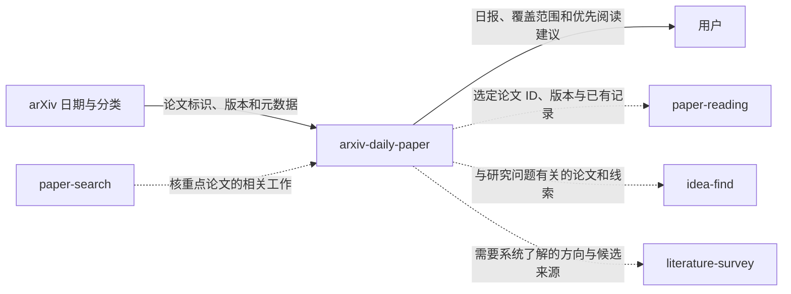
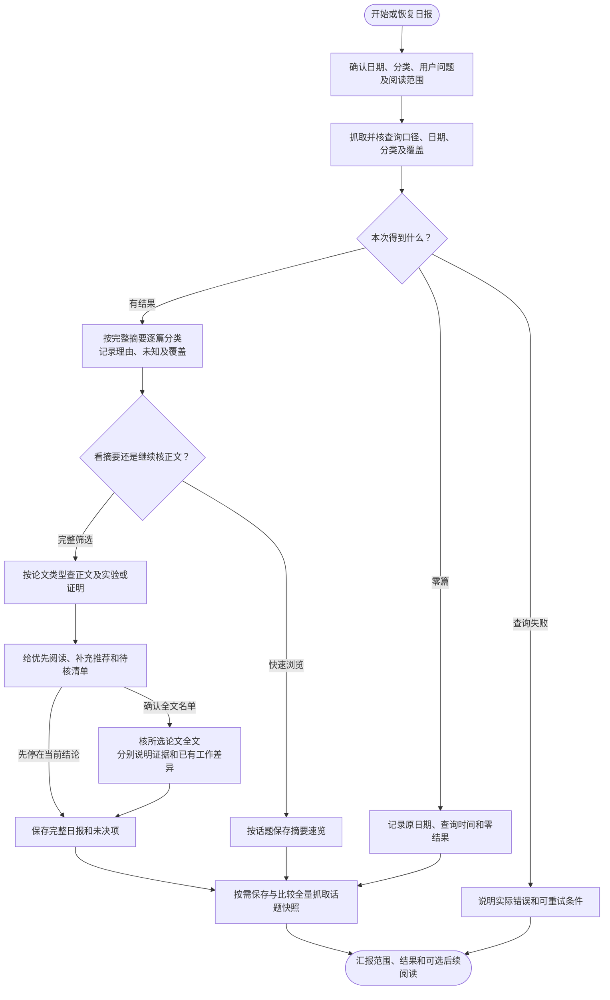

# 查看 arXiv 当日论文

帮助用户了解指定范围当天有哪些论文、哪些值得先读、推荐依据和剩余疑问。快速浏览以标题和完整摘要为依据，完整筛选再查具体正文、实验或证明，并对确认的重点论文做全文评价。

## SKILL 交接关系



全局关系见 [dl-assistant](../dl-assistant/SKILL.md)。需要逐段读懂单篇论文时用 paper-reading。社区热门论文使用 hf-trending-papers，常驻方向追踪使用 direction-tracking。

## 产出与保存

默认保存在 `docs/arxiv-daily/arxiv-daily-<UTC日期>-<分类组合>/`，用排序后的分类命名。续做先核 `raw.json` 的日期口径和实际论文版本。独立重跑可另存 `run-<时间>/`，保留原记录。

```text
arxiv-daily-<UTC日期>-<分类组合>/
├── raw.json                    # 原始结果、实际日期、获取时间与覆盖状态
├── round1/
│   └── part-<编号>.md          # 分批逐篇摘要、状态和理由
├── round1-screen.md             # 全部抓取论文的摘要核查汇总
├── pdfs/<安全版本ID>.pdf         # 按需保存可解析且版本已核的 PDF
├── round2/<安全版本ID>.md        # 正文和证据检查、来源与页节
├── round3/<安全版本ID>.md        # 重点论文全文评价、相关工作与未决项
├── digest.md 或 digest-lite.md  # 完整日报或摘要速览
└── trend-snapshot.json          # 按需保存全部抓取论文的话题统计
```

## 运行流程图



## 参考资料列表

| 资料 | 何时读 |
| --- | --- |
| [执行流程](references/workflow.md) | 定范围、抓取、分批核对、确认重点名单及续做 |
| [筛选原则](references/funnel-design.md) · [摘要检查](references/round1-screening.md) | 判断是否继续查正文并保存逐篇理由 |
| [正文与实验检查](references/round2-quantitative.md) · [重点全文评价](references/round3-deep-read.md) | 查原文、证据范围、对照及相关工作差异 |
| [简报、分类映射和讨论](references/digest-and-interaction.md) · [跨日快照](references/trend-snapshot.md) | 保存报告、比较覆盖并交接后续阅读 |

## 筛选原则

1. 日期按脚本的 UTC 提交时间口径。空结果、查询失败、达到上限和当日尚未结束分别记录。要查最近有结果的日期时，按用户实际意图另查。
2. 阅读预算决定优先顺序。值得保留的论文和证据待核的论文继续登记，按实际评估进度说明覆盖。录用、代码链接、引用和社区热度作为线索记录。
3. 作者报告、原文证据和自己的评价分别说明。用适合研究类型的依据判断证据充分性，再单独核与已有工作的实际差异。
4. 跨日话题快照覆盖本次抓到的全部论文。日期口径、分类和覆盖可比时才汇报变化。
