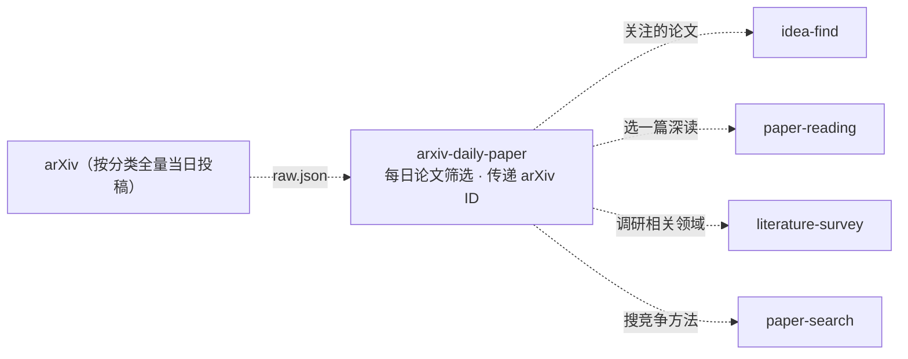
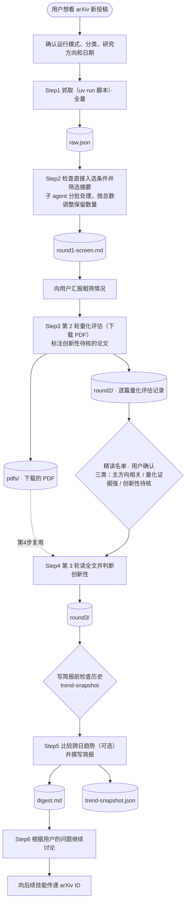

# arXiv 每日论文筛选与推荐

获取指定分类当天的全部 arXiv 新投稿，按可核查的信息分轮筛选，列出值得进一步阅读的论文，并根据用户的问题继续讨论。

新投稿缺少引用和社区投票，现有资料不足以客观判定论文质量。前几轮记录可核查的信息，创新性留到最后一轮阅读全文后与用户一起判断。后续的社区热度和引用情况由 `hf-trending-papers` 跟踪。

所有所选分类使用同一套筛选标准。用户研究方向只影响展示优先级，其他领域的论文同样参与筛选。前几轮优先记录可量化的信息，主观判断留到最后一轮。各轮设计见 `references/funnel-design.md`。

---

## 与其他技能的关系

本技能从 arXiv 获取所选分类的当日投稿，可以按用户接下来的任务交给图中的四个技能。虚线表示按需交接，用户选定论文后传递其 arXiv ID。



> 完整的技能关系图见 `dl-assistant` 的「全局 skill 流向图」；本 skill 只画与自己相关的 skill。

---

## 运行流程



> 今日速览模式只跑 Step1 + Step2 轻量分类、不下 PDF，产 `digest-lite.md`；之后可对选定篇只补跑 Step 3-4（见 `references/digest-and-interaction.md`）。

### 通用约定

- **依赖**：抓取脚本 `scripts/fetch_arxiv_daily.py`，PEP 723 内联依赖（`arxiv` 库），`uv run` 零配置即跑。`uv` 不存在就提示安装；脚本返回 `{"error": ...}` 时，向用户说明实际错误。
- **TaskList 跟踪流程**：确认模式和参数后建立任务。完整筛选有 6 项，依次为获取投稿、初筛、量化评估、精读、撰写简报和讨论。今日速览只跟踪前 2 项，每完成一项就标记完成。
- **子 agent 一律 `general-purpose`（禁 Explore）**：第 1、2 轮由子 agent 分批处理并保存初筛记录、逐篇量化评估记录和 PDF，Explore 没有写权限。
- **符号展示**：会话公式用 Unicode。见 `dl-assistant` SKILL.md「所有技能共用的规则」。
- **保存完整结果**（沿用 literature-survey 的做法）：各轮子 agent 将完整结果写入文件，只向主会话返回简要结论。后续需要细节时读取对应文件。
- **固定产出目录**：`<项目>/docs/arxiv-daily/`，在它下面建当天文件夹：

```
<项目>/docs/arxiv-daily/
└── arxiv-daily-<日期>-<类目>/
    ├── raw.json            脚本抓取的全量原始（带 comment/categories/pages）
    ├── round1-screen.md    第1轮：入选与未入选清单（每条附一句理由）
    ├── pdfs/<arxiv_id>.pdf   第 2 轮下载的 PDF，子 agent 共用，第 3 轮直接复用
    ├── round2/<arxiv_id>.md  第2轮：逐篇量化评估记录（baseline 年份/数量/SOTA/实验规模/算力）
    ├── round3/<arxiv_id>.md  第 3 轮：入选论文的全文评估
    ├── digest.md           最终：今日速览 + 跨日趋势 + 全部入选 + 主方向精选 + 其他领域亮点
    └── trend-snapshot.json 跨日趋势快照（话题关键词、代表论文 ID、机构），供下次运行做跨日对比
```

- **语言**：全程中文；论文标题、方法名、数据集、指标保留英文原文。
- **禁止编造**：标题、摘要、arXiv ID、baseline 列表必须来自真实数据（脚本或 PDF）；查不到标"未知"，不猜。

### 开场确认模式和参数

先确认模式。**完整筛选**执行所有步骤。**今日速览**只做直接入选检查与第 1 轮简要分类，跳过 PDF 下载。再确认四项：① 领域，可指定 arXiv 分类，也可用「多模态」等自然语言描述，由技能映射到分类组合。② 当前研究设想，用于突出相关论文和标注关联程度。③ 是否浏览其他领域的亮点，以及浏览范围。④ 日期。产出统一保存在 `docs/arxiv-daily/`。对话示例与分类映射见 `references/digest-and-interaction.md`。

### Step 1：抓取（脚本，确定性批处理）

```bash
uv run <skill目录绝对路径>/scripts/fetch_arxiv_daily.py --date <today|YYYY-MM-DD> --categories cs.CV cs.LG --max 500
```

用 `cat:A OR cat:B` 一次查询多个分类，避免重复记录交叉列出的论文。按 `submittedDate` 逐页获取全部结果，不设固定页数。将返回的 JSON 写入 `raw.json`。

> **脚本路径**：用 skill 目录的**绝对路径**——agent 通常在项目根启动，相对 `scripts/...` 找不到脚本。
>
> **日期语义**：脚本按 arXiv **submittedDate**（UTC）过滤，≠ 公告日。**返回空 `total_count: 0` 不是错误**——多半是周末/节假日/当天还没公告。空结果**自动往前回退**：每次回退一天重抓、最多回退 3 天，抓到后明确告知用户「{原定日期} 无新投稿，实际抓的是 {实际日期} 的」；回退 3 天仍为空才停下问用户（可能是长假期或 arXiv 侧问题）。
>
> **检查结果是否截断**。脚本返回 `truncated: true` 表示结果超过 `--max` 上限。告知用户本次获取不完整，建议提高上限后重试。当前结果不能作为全量投稿继续筛选。

### Step 2：直接入选条件与第 1 轮摘要初筛

子 agent 分批处理，主会话只汇总结果。会议录用、代码或项目页、`journal_ref` 任一符合时直接进入下一轮。其余论文根据摘要是否包含具体、可验证的技术内容筛选。总数 ≤45 篇时只分类，>45 篇时目标保留约 30-45 篇。保留条件、分批方式和汇报格式见 `references/round1-screening.md`，结果写入 `round1-screen.md`。

### Step 3：第 2 轮量化评估

由子 agent 并行评估所有通过初筛的论文。用 `curl` 从 `raw.json` 中的 `pdf_url` 下载 PDF，保存到 `pdfs/`。阅读 Experiment 与 Related Work，记录对比基线的年份、数量、是否包含当前 SOTA、实验规模、算力和可复现性风险。开源状态分三类，只有「完全不提」计入风险。此轮暂不判断创新性。作者提出新任务、新范式或新基准时，标为「创新性待核」，即使量化证据较弱也列入第 3 轮候选。逐篇量化评估记录保存在 `round2/`。评估标准与阅读方法见 `references/round2-quantitative.md`。

### Step 4：第 3 轮精读并判断创新性

精读候选分三类。A 类与用户主方向相关且通过量化评估。B 类的量化证据特别强。C 类作者提出新任务、新范式或新基准，量化结果不影响候选资格。**精读前必须请用户确认名单**，之后再阅读全文并判断创新性。结果写入 `round3/`，复用 `pdfs/` 中的文件。入选标准、确认对话和评估内容见 `references/round3-deep-read.md`。

### Step 5：跨日趋势（可选）和简报

撰写简报前，在固定目录 `docs/arxiv-daily/` 查找历史 `trend-snapshot.json`。对比同分类快照。少于 7 日时全部比较，至少 7 日时做周对比，至少 30 日时增加月对比。主会话汇总话题和机构的跨日情况，在简报中加入「跨日趋势」并告知用户用了几日历史。没有历史时标明「首次运行」，跳过跨日趋势。保存当天的 `trend-snapshot.json`。工作步骤见 `references/digest-and-interaction.md`，文件格式见 `references/trend-snapshot.md`。

主会话根据各轮保存的结果写 `digest.md`。依次呈现今日速览、跨日趋势（如有）、全部入选、主方向精选、与用户研究方案相关的论文（研究方案可能重合 / 强相关 / 弱相关）和其他领域亮点。模板见 `references/digest-and-interaction.md`。

### Step 6：根据用户的问题继续讨论

简报完成后，继续通过问答与用户讨论推荐论文。按需读取已保存的材料。问答方式见 `references/digest-and-interaction.md`。

---

## 向其他技能交接（附 arXiv ID）

| 用户意图 | 交给 |
| --- | --- |
| 深读某篇 / "帮我读第 X 篇" | `paper-reading`（传 arXiv ID，它能下 PDF） |
| 今日速览后，对选中的几篇补做评估和精读 | 回本 skill 只针对这几篇补跑 Step 3-4，不重跑全程 |
| 从某篇 gap 找 idea | `idea-find` |
| 调研某方向的文献 | `literature-survey` |
| 确认某方法的最新竞争情况 | `paper-search` |
| 换日期 / 换领域 | 回开场重设参数 |
| 保存今天的推荐 | 告知已保存的 digest.md 路径 |

---

## 各技能负责的任务

- **本技能**处理 arXiv 所选分类的全部当日投稿，适用于查看这些分类的新论文。
- **hf-trending-papers** 查看 Hugging Face 社区已投票或受到关注的论文，反映后续的社区热度。
- **任务分工**。本技能负责当日投稿筛选、分层推荐和讨论。专门精读单篇论文交给 `paper-reading`，判断某个研究问题是否值得做交给 `idea-find`，系统综述交给 `literature-survey`。

> 想看社区已经热起来的论文（不限 arXiv 分类），说「看看 HF 今天的热门论文」会切到 hf-trending-papers。
