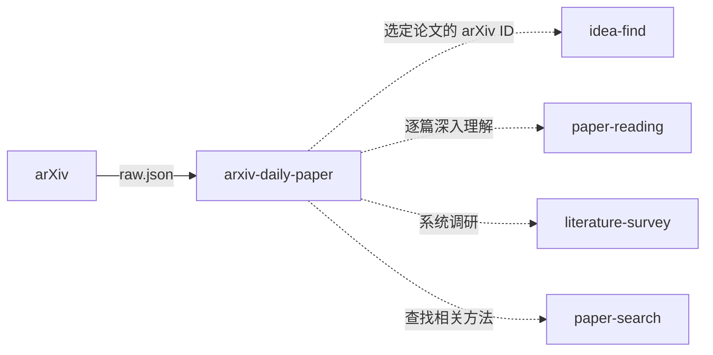

# arXiv 每日论文筛选

获取指定分类与日期的投稿，帮助用户决定优先阅读哪些论文。完整保存抓取结果和筛选理由。可核实的元数据、作者报告的结果、agent 的评价分别标明；录用、代码链接、引用或社区热度均不能单独证明研究质量。

## 在系统中的位置



全局流程见 `dl-assistant`。上述后续工作由用户选择，不自动启动。

## 工作原则

- 在用户选定的分类范围内检查论文，研究方向决定推荐顺序，不单凭不相关而排除其他方向。
- **阅读预算与保留数量分开**：优先阅读默认 5–8 篇，可由用户调整；值得保留的论文不限数量；尚未检查充分的论文单列为待核查，不当成质量差。
- 区分**用户阅读预算**与 **agent 评估预算**。推荐名额已满不构成停止检查的理由；剩余工作较多时汇报已完成数量、待核查数量和预计工作，请用户决定是否继续。
- 用证据充分性和与已有工作的差异分别评价论文。作者声称新颖不代表已确认创新性，实验支持也不自动代表创新性。
- 不推测作者动机，不把缺少信息写成已经证实的问题。元数据、数字与引用须注明来源；不确定的写“未知”或“待核实”。
- 会话符号与论文标识遵循 `dl-assistant` 的“横切规范”。

## 开始前确定参数

使用用户已提供的模式、日期、分类、研究问题与阅读预算；只询问尚缺且会影响工作的信息。模式分为：

- **完整筛选**：摘要检查、正文与实验检查、确认重点名单后全文评价、日报。
- **快速浏览**：只获取论文并按标题与完整摘要分类，生成 `digest-lite.md`；所有推荐注明“仅依据摘要，未经全文核查”。

领域到分类的常用映射、日报与交互说明见 [references/digest-and-interaction.md](references/digest-and-interaction.md)。

## 保存位置

默认在 `<项目>/docs/arxiv-daily/arxiv-daily-<UTC日期>-<分类组合>/` 保存。分类组合排序后命名，避免相同范围重复建目录。尊重用户指定的保存位置；重跑时复用相同论文版本的已有结果，不覆盖不同版本或不同运行的报告，可用 `run-<时间>/` 区分。

```text
raw.json                         原始抓取结果及查询信息
round1/part-<编号>.md             每个子 agent 独立写入的摘要检查结果
round1-screen.md                  主 agent 汇总的完整清单与理由
pdfs/<version_id>.pdf             经有效性检查的 PDF
round2/<arxiv_id>.md              正文与实验检查，记录实际阅读版本
round3/<arxiv_id>.md              全文评价，分别记录证据与创新性判断
digest.md / digest-lite.md        完整日报或快速浏览报告
trend-snapshot.json              全部抓取论文的话题统计，含覆盖范围
```

## 工作流程

### 1. 获取论文并核对范围

```bash
uv run <skill目录绝对路径>/scripts/fetch_arxiv_daily.py --date <YYYY-MM-DD> --categories cs.CV cs.LG --max 500
```

脚本按 **UTC submittedDate（提交日期）** 查询，不是公告日期。`today` / `yesterday` 也按 UTC 解释；执行前告知解析后的具体日期。用户给出本地日期或公告日含义时，先说明当前查询口径，不能将 UTC 自然日冒充其要求的时间范围。

结果保存为 `raw.json`，检查 `date`、`date_basis`、`timezone`、`fetched_at`、分类、数量和 `truncated`。`total_count` 是本次返回数量，不一定是源站总数。`truncated: true` 表示达到上限、完整性未确认；告知用户并提高上限重抓，或明确标为部分结果，不能称全量。

空结果如实报告，不自动换日期，不将空结果直接归因于周末或假期。当前 UTC 日可能尚未结束，API 数据也可能尚未可用；说明查询时间，不保证当天完整。用户希望改查最近有结果的日期时，再按其选择执行。API 错误与合法空结果分开处理。

`uv` 不存在时说明依赖缺失；脚本返回错误则报告真实错误，不编造结果。

### 2. 检查完整摘要

采用子 agent 分片，主 agent 汇总；执行环境不支持子 agent 时串行分批，保留同样记录。划分互不重叠的论文 ID，每个子 agent 只写自己的 `round1/part-<编号>.md`，不得同时写汇总文件。主 agent 核对所有输入 ID 恰好出现一次，再写 `round1-screen.md`。

规则见 [references/round1-screening.md](references/round1-screening.md)。保留、待核查、不推荐均写明理由；篇数不是排除条件。快速浏览模式到此生成简报，不自动下载 PDF。

### 3. 检查正文与实验

按论文分配互不重叠的任务，记录实际阅读范围、版本与来源。源码优先，无法取得时读 PDF；下载 PDF 时检查 HTTP 结果和文件能否解析，不能把错误页面当论文。具体要求见 [references/round2-quantitative.md](references/round2-quantitative.md)。

按研究类型检查对照、实验与论点是否匹配。代码状态、实验数量和算力分别记录，不直接加总成质量分。来源无法取得的列为待核查；工作量超预算时报告进度与剩余工作，由用户决定继续检查的范围。

### 4. 确认重点名单，再做全文评价

推荐依据可包括主方向相关性、证据值得关注、可能存在新的研究问题或方法。展示优先阅读名单及补充推荐，默认重点 5–8 篇；说明未列入重点的原因是阅读排序还是证据问题。**用户确认名单后**才开始这一轮全文评价。

分别判断证据支持程度与已有工作差异，说明后者的检索范围与不确定性；不把作者自称新颖写成确认结论。格式见 [references/round3-deep-read.md](references/round3-deep-read.md)。

### 5. 生成日报与可选跨日统计

汇总优先阅读、补充推荐、待核查的数量和名单；未推荐论文保留在完整筛选记录中。日报模板见 [references/digest-and-interaction.md](references/digest-and-interaction.md)。

话题统计使用 `raw.json` 中**全部抓取论文的标题与摘要**，不只用入选论文。历史不足、范围不同、数据不完整均说明限制；快照格式及比较规则见 [references/trend-snapshot.md](references/trend-snapshot.md)。旧版仅覆盖推荐论文的快照只作为历史推荐记录，不混入全部投稿统计。

### 6. 交付

告知报告位置、推荐数量、待核查项和可选下一步，完成当前任务。用户继续提问时按需回答；不强制开启问答或自动进入其他 skill。

## 阅读范围与后续工作

本 skill 阅读全文是为了形成筛选评价。用户需要逐节讲解、公式推导或系统理解单篇时使用 `paper-reading`；寻找研究课题用 `idea-find`；系统综述用 `literature-survey`；补充查找相关工作用 `paper-search`。交接稳定的 arXiv ID，并附已检查版本与报告路径；补查用 paper-search v2 的 paper_ref，保留其来源失败、预算和覆盖限制，不以有限结果替代每日全量。

社区热度与本 skill 的筛选互补，但不等于质量验证。核心筛选原则见 [references/funnel-design.md](references/funnel-design.md)。
