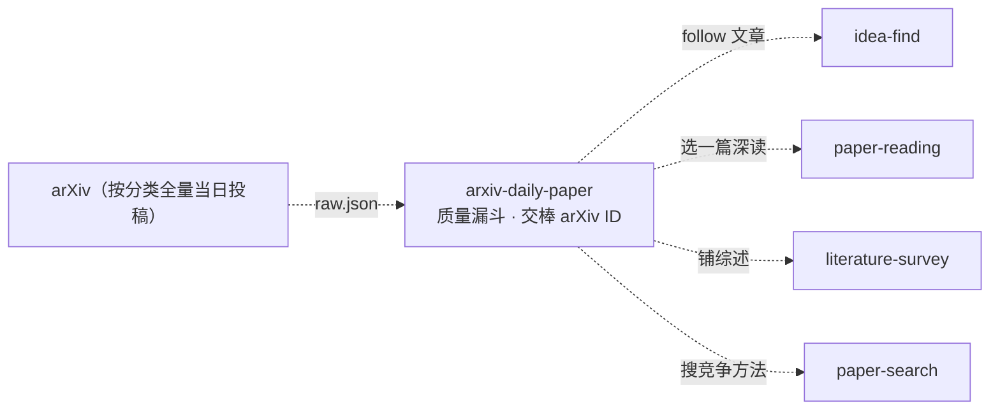
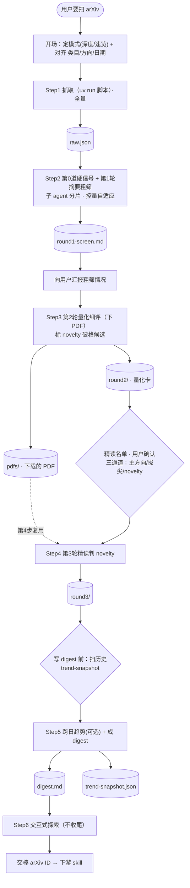

# arXiv 每日论文质量漏斗

每天从 arXiv 抓全量新论文，帮用户**不漏前沿、又不被噪音淹没**：用可量化的客观信号做多轮漏斗，把上百篇压成值得亲自读的短名单，再交互式陪用户探索。

**诚实定位**：day-1 新论文没有引用数/社区投票，"质量"无法客观判定。本 skill 用**可量化代理信号**做透明渐进初筛——摸得到的事实标出来，摸不到的判断（novelty）推到最后一轮且拉用户一起定。质量验证（引用/热度）是几天后 `hf-trending-papers` 的事。

**两条铁律**：① 质量筛全域，相关性只分层（方向只决定置顶、绝不丢弃其他领域）；② 可量化客观信号优先，模糊判断推到最后。设计哲学详见 `references/funnel-design.md`。

---

## 在系统里的位置（局部）

本 skill 是 `dl-assistant`（深度学习科研智能体）的配套 skill 之一，角色是**质量漏斗**——上游是外部数据源（arXiv 按分类全量当日投稿），不接别的 skill；自己是个发散出口，衔接到 4 个可能的下游。图里全虚线 = 用户选了某篇才跳转，不是固定主线；交棒物是**选定篇的 arXiv ID**。



> 整体架构、全局怎么连，看 `dl-assistant` 的「全局 skill 流向图」；本 skill 只画与自己相关的 skill。

---

## 运行流程



> 今日速览模式只跑 Step1 + Step2 轻量分类、不下 PDF，产 `digest-lite.md`；之后可对选定篇只补跑 Step 3-4（见 `references/digest-and-interaction.md`）。

### 横切约定

- **依赖**：抓取脚本 `scripts/fetch_arxiv_daily.py`，PEP 723 内联依赖（`arxiv` 库），`uv run` 零配置即跑。`uv` 不存在就提示安装；脚本返回 `{"error": ...}` 就如实转告，不硬编。
- **TaskList 跟踪流程**：开场对齐模式/参数后建流程任务（深度漏斗 6 项：抓取 / 粗筛 / 量化细评 / 精读 / digest / 交互探索；今日速览只前 2 项），每步完成即勾——长跑漏斗防跳步、防速览误跑全程。
- **子 agent 一律 `general-purpose`（禁 Explore）**：第 1/2 轮分片子 agent 都要落盘写文件（粗筛清单 / 量化卡 / PDF），Explore 没有写权限。
- **符号展示**：会话公式用 Unicode——横切规范见 `dl-assistant` SKILL.md「横切规范」。
- **零信息损失**（沿用 literature-survey 原则）：每轮子 agent 的**完整结果落盘，返回主会话只给精简结论**；后阶段要细节就去读盘。
- **产出目录**（写死，不问用户）：`<项目>/docs/arxiv-daily/`，在它下面建当天文件夹：

```
<项目>/docs/arxiv-daily/
└── arxiv-daily-<日期>-<类目>/
    ├── raw.json            脚本抓取的全量原始（带 comment/categories/pages）
    ├── round1-screen.md    第1轮：幸存清单 + 淘汰留痕（每条附一句理由）
    ├── pdfs/<arxiv_id>.pdf   第2轮下载的 PDF 统一落这——子 agent 共享、第3轮复用，不重复下
    ├── round2/<arxiv_id>.md  第2轮：每篇量化卡（baseline 年份/数量/SOTA/实验规模/算力）
    ├── round3/<arxiv_id>.md  第3轮：top 篇综合研判
    ├── digest.md           最终：今日速览 + 跨日趋势 + 全部入选 + 主方向精选 + 其他领域亮点
    └── trend-snapshot.json 跨日趋势快照（话题关键词/top id/机构）——下次运行做跨日对比的数据源
```

- **语言**：全程中文；论文标题、方法名、数据集、指标保留英文原文。
- **禁止编造**：标题、摘要、arXiv ID、baseline 列表必须来自真实数据（脚本或 PDF）；查不到标"未知"，不猜。

### 开场：定模式 + 对齐参数

开场先问模式（**深度漏斗** 全跑 / **今日速览** 只第0道+第1轮轻量、不下PDF），再对齐：① 领域（可说类目，也可说自然语言方向如"多模态"，skill 映射到分类组合）② 当前 idea（用来高亮 + 撞车分级）③ 其他领域亮点宽窄 ④ 日期。产出目录写死 `docs/arxiv-daily/`，不问用户。对话模板 + 方向→类目映射见 `references/digest-and-interaction.md`。

### Step 1：抓取（脚本，确定性批处理）

```bash
uv run <skill目录绝对路径>/scripts/fetch_arxiv_daily.py --date <today|YYYY-MM-DD> --categories cs.CV cs.LG --max 500
```

用 `cat:A OR cat:B` **单次查询多类目**（cross-list 天然去重）；按 `submittedDate` 翻页拉**全量**，不在固定页数截断。返回 JSON 写入 `raw.json`。

> **脚本路径**：用 skill 目录的**绝对路径**——agent 通常在项目根启动，相对 `scripts/...` 找不到脚本。
>
> **日期语义**：脚本按 arXiv **submittedDate**（UTC）过滤，≠ 公告日。**返回空 `total_count: 0` 不是错误**——多半是周末/节假日/当天还没公告。空结果**自动往前回退**：每次回退一天重抓、最多回退 3 天，抓到后明确告知用户「{原定日期} 无新投稿，实际抓的是 {实际日期} 的」；回退 3 天仍为空才停下问用户（可能是长假期或 arXiv 侧问题）。
>
> **truncated 要消费**：脚本返回 `truncated: true` 说明当天量超 `--max` 上限、**没抓全**——如实告知用户并建议加大 `--max` 重抓，别拿截断结果当全量往下筛。

### Step 2：第 0 道 + 第 1 轮粗筛

全程子 agent 分片做（主会话不读全量摘要）。第 0 道硬信号（中会/代码/journal_ref）直通；第 1 轮按"摘要有没有透出具体可验证技术内容"砍，**控量自适应**（全域 ≤45 只分类不淘汰、>45 砍到 ~30-45）。完整规则（反向保护、分片、自适应控量、汇报）见 `references/round1-screening.md`，结果落 `round1-screen.md`。

### Step 3：第 2 轮量化细评

幸存篇全交子 agent 并行，下 PDF（`curl` raw.json 里的 `pdf_url` 落 `pdfs/`，机制见 `references/round2-quantitative.md`）读 Experiment + Related Work，做**纯量化判断**（baseline 年份/数量/SOTA/实验规模/算力/可复现性风险——**开源分三态，只有"完全不提"才计风险**），不碰 novelty。**claim 了新任务/范式/新 benchmark 的标"novelty 破格候选"**（量化弱也带进第3轮）。PDF 统一落 `pdfs/`，量化卡落 `round2/`。判据表 + PDF 阅读技巧见 `references/round2-quantitative.md`。

### Step 4：第 3 轮精读判 novelty

**三通道入选**：A 主方向 / B 全域拔尖（量化特别强）/ **C novelty 破格**（claim 新任务·范式·新 benchmark，量化不论——补"质量前置筛"漏掉的早期 novel）。**精读前必须把名单摆给用户确认**（硬规则），确认后才精读全文碰主观判断。落 `round3/`，复用 `pdfs/`。三通道 + 确认对话 + 主观判据见 `references/round3-deep-read.md`。

### Step 5：跨日趋势（可选）+ 成 digest

写 digest **前先扫 `docs/arxiv-daily/` 下的历史 `trend-snapshot.json`**（固定根目录，直接扫、不用问用户；筛同分类、按天数分级：<7 全比 / ≥7 周 / ≥30 周+月）——有历史则主会话做话题级 + 机构级连续性归纳（不开子 agent），digest 加「跨日趋势」节，并跟用户说一声用了几日历史；没有则跳过、标"首次运行"。顺手落当天的 `trend-snapshot.json`。流程 + 分级见 `references/digest-and-interaction.md`，snapshot 格式见 `references/trend-snapshot.md`。

然后主会话综合各轮落盘结果写 `digest.md`：今日速览 →（跨日趋势）→ 全部入选 → 主方向精选 → 与 idea 相关（带**撞车分级**：撞车警报/强相关/弱相关）→ 其他领域亮点。模板见 `references/digest-and-interaction.md`。

### Step 6：交互式探索（不结束 skill）

digest 出完不收尾，转导师×学生问答陪用户探索（素材按需读盘）。纪律见 `references/digest-and-interaction.md`。

---

## 衔接下游（交棒带 arXiv ID）

| 用户意图 | 交给 |
| --- | --- |
| 深读某篇 / "帮我读第 X 篇" | `paper-reading`（传 arXiv ID，它能下 PDF） |
| 对选定几篇走深度漏斗后段（速览模式后） | 回本 skill 只针对这几篇补跑 Step 3-4，不重跑全程 |
| 从某篇 gap 找 idea | `idea-find` |
| 围绕某方向铺综述 | `literature-survey` |
| 确认某方法的最新竞争情况 | `paper-search` |
| 换日期 / 换领域 | 回开场重设参数 |
| 保存今天的推荐 | digest.md 已落盘，告知路径 |

---

## 边界 & 与 hf-trending-papers 的区别

- **本 skill**：arXiv 指定分类的**全量**当日投稿，做质量漏斗——适合"不想漏掉某领域新论文 + 想保持在前沿"。
- **hf-trending-papers**：HF 社区**已投票/已热**的精选，是几天后的"结果型"质量信号——两者互补。
- **不越界**：不深读（交 paper-reading）、不判某 gap 值不值得做（交 idea-find）、不做系统综述（交 literature-survey）。本 skill 只做"全域质量初筛 + 分层推荐 + 交互探索"。

> 想看社区已经热起来的论文（不限 arXiv 分类），说「看看 HF 今天的热门论文」会切到 hf-trending-papers。
