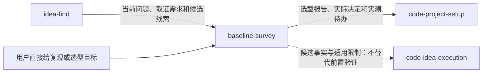

# 代码、模型与数据选型调查

目标是选择**能支持本轮取证且成本合理的实现组合**，说明选择依据、尚未验证的条件，以及后续准备和复现阶段应核查什么。研究适配性优先于安装便利、活跃度和代码整洁；这些工程属性不能替代“能否回答当前问题”。

本skill可以判断候选是否适合批准的研究需求，不能擅自改变问题、假设或科学比较。研究价值与首轮设计归idea-find，已有证据后的研究判断归iterate；execution按批准设计实施。单纯复现可以直接以目标论文/实现为输入，不要求先有新假设或走完整idea-find。

## 把必要研究条件用于选型

调查需求、候选适配性及推荐前自查时，接收并核对 [研究条件记录](../dl-assistant/references/research-conditions.md)：候选是否支持必须保留的模型/数据/输入/训练阶段与测量条件，实际资源能否承受。可静态核实的现在核实，需运行的列为具体实测任务；未知不能标已满足。没有合适候选时如实推荐进一步核查、资源调整或返回研究设计，不为低配置推荐牺牲关键条件，也不在选型中认证跨规模收益。

## 系统关系与边界

全局流程见dl-assistant。通常在本地调查，但不限制机器类型。只读论文、公开记录和远程源码/配置/文件元信息，也可读用户已提供的代码和结果；不clone、不安装依赖、不下载完整模型/数据、不启动实验。保存调查所需的文档与来源摘录不属于下载实验资产。远程读代码不替代用户的code-reading。

本skill调查“现在能查到什么”；setup负责实际环境、资产完整性/加载和入口检查；reproduction负责相应条件下的评测/训练复现可信度。正式研究所需的新测量或干预交研究设计与execution。不能因为某项要运行验证，就把现已能查的配置、指标定义或协议差异留给下游猜。

## 工作流程

### 1. 从当前任务提取需求

读取用户指定的研究说明/计划及来源；已有会话信息直接使用，不重复问。没有草案时说明复现或选型目标，只补影响调查的缺失条件：对象/任务、需要取得的观察、对照、模型与数据要求、资源及用途。会议或GPU规格不明确可保留未知，不为填表编造。

把需要的能力列成R编号：要取得的中间量、干预位置、数据/划分、指标、必要比较、版本和资源条件，区分必要条件与偏好。纯复现写要复现的具体配置、表格行或行为；纯测量不强求训练链或新模型。模型/数据/许可的硬约束同样列出。

用途可为比较方法、研究实现、测量分析、数据处理，一个仓库可承担多个角色，也可组合多个仓库/模型/数据。不要按“改进已有方法/组合研究发现”两类自动决定仓库角色。

**调查前适配性自查**：当前目标能否明确到所需观察与必要条件？这些条件来自实际研究设计还是agent猜测？候选需要支持什么才能回答问题？若核心科学比较仍未定义，先返回idea-find/iterate或与用户澄清；允许只调查准备条件，但不能称已找到合适研究实现。不因用户尚无新假设而拒绝明确的原样复现任务。

### 2. 检查候选与合理替代

上游线索不是已核实推荐；用户已经明确选择的仓库可直接调查风险，不强迫重新选型。需要选择时检查是否有合理替代，记录搜索时间、范围、纳入/排除理由和未覆盖来源。不规定2—4个，不按star排研究适配性，不为凑数调查无关仓库。

允许只有一个合适候选、多组件组合，或没有可推荐方案。比较官方实现、第三方实现、框架和工具时说明各自用途；复现原论文和搭建测量工具未必使用同一方案。源代码、版本、作者关系未核实则未知，不凭命名相似认定官方或代码继承关系。

### 3. 先核查研究适配性，再查工程条件

对每个值得继续调查的候选，逐项对应必要需求：
- 能否取得所需数据、模型状态、中间量或测量输出？
- 必要对照/干预是否可实现，数据/模型假设与目标条件是否匹配？
- 预处理、划分、指标、权重来源是否会改变科学比较？
- 必要修改是路径/接口适配，还是需要重建核心方法或改变设计？

写实际文件/函数/配置及依据。源码支持只表示静态证据，不能称已验证运行正确；缺访问权限或找不到入口先记未知，不凭README推断不存在能力。发现明确不匹配，不用工程优点抵消；必要时排除，或在用户批准的问题修订后重新评估。

随后按任务核查依赖与相关调用路径、权重和数据身份/获取条件、各自许可、社区记录及成本。只读所需训练/评测/数据/测量路径，不强制纯分析候选也给完整训练链。详细标准与证据记录见 [调查规则](references/due-diligence.md)。

文档声明、源码核查、社区报告、用户提供的运行记录分别标明；本次未运行就不能写“已复现”。社区失败报告核对版本/条件/处理状态，重复转述不算多份独立证据；没有记录是未知。代码、模型、数据许可分别引用实际条款和适用限制，缺失或不明确不推导为允许使用。

找不到完整实现时，只按明确来源记录代码关系，列核心差异、代价依据与未知。需要重建方法或改变比较时返回研究设计讨论，不作为普通setup修补。允许建议暂不采用，不能假定所有论文都有可小改的来源仓库。

### 4. 按用途推荐，并在推荐前自查

分别说明哪些方案适合原样复现、当前取证、测量/分析及后续修改，给必要取舍和不推荐理由，不强求综合排名。组合方案还要检查接口、数据身份、配置和许可条件是否兼容，不能默认各自可用就能组合。成本写依据与未知，不编造耗时/显存或胜率。

**推荐前自查必须影响推荐**：

| 检查 | 具体依据与行动 |
| --- | --- |
| 研究适配 | 每项必要R需求是否有支持、明确不匹配或未知？不匹配先排除或返回设计讨论，不用易安装或star抵消。 |
| 证据与版本 | 关键结论能否定位到源码/配置/原文及版本？是否把声明、链接存在或社区报告当作本次运行验证？先纠正混淆。 |
| 未知与实测 | 当前可查的内容是否已查？未查是访问受限还是需要运行？关键未知是否影响选择，还是只需预算明确的准备验证？ |
| 推荐与决定 | 是否按用途比较、核对组合，区分agent建议和用户决定？没有可靠候选能否如实暂不推荐？ |

每项在report记录“判断—来源/版本—未知—对当前行动的影响”，不要只勾选。状态用clear/limited/needs_revision：limited说明为何仍可作当前有限推荐；needs_revision先补调查/澄清，不能标研究适配已确认。可以推荐先做有范围的准备验证，不能将条件推荐登记成研究已可开跑。

这是选型自查，不是独立审阅，不增加研究自查JSON或脚本。主agent负责综合与核对；需要分工时说明数量、任务、输入输出与理由，按已有授权确认，不强制每候选每维派agent、不写死工具类型。分工者只写独立记录，主agent串行更新累计文件。

### 5. 保存调查、记录决定和交接

默认 `docs/baseline-survey/<实际日期>-<slug>/`，尊重用户指定项目与路径。新调查目录冲突加唯一标识；继续旧调查保留来源、修订和原决定，核对版本/链接是否已变化，不覆盖历史结论。

保存 `baseline-survey.json`、`report.md` 和必要的 `facts/` 来源笔记，按 [报告与交接模板](references/report-template.md)。未作决定也保存真实调查结果，decision保持pending；用户确认选型后写实际选择和理由，不把“继续调查”当成已选定。

**后续首批实测任务**逐项写：已经调查到什么、仍未知什么、为何必须运行、检查对象/条件、如何观察/判定、负责人、依赖/资源和不符合时返回哪里。survey现在能核查的不能推迟，细则见参考文档。没有运行过的命令仅为候选入口，不能当作已验证ready命令。

交setup的是准备和实测待办，交reproduction的是明确验证目标及协议依据，不是按仓库角色自动选一个参考分数。资料过期或实测与静态预判冲突，核对实际版本/条件，保留新证据与原报告；不能在不匹配条件下单凭一个读数覆盖全部判断。

## 新旧格式与相邻skill

新版schema_version=2，按实际roles和requirement映射记录；保留decision.repo、repo_role等旧入口用于定位，**不代表旧消费者已理解多仓库/多用途或已验证可信**。报告明确标版本与未验证项；setup与reproduction已按需求/组件/实测任务接收新版；其他旧消费者仍需核对语义，接收方不认识或映射有歧义时先核对，不静默忽略额外组件或回退旧二分类。用户代码阅读仍为主线必经。

来源工具依照实际可用接口和对应skill；工具/认证/限流失败与合法空结果分别记录。论文arXiv/DOI/URL、公式及跨机器交接遵循dl-assistant“横切规范”，不规定传输方式，也不因报告指向远端就声称文件已取得。
