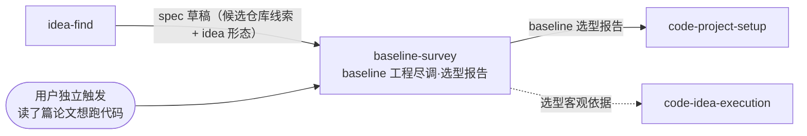
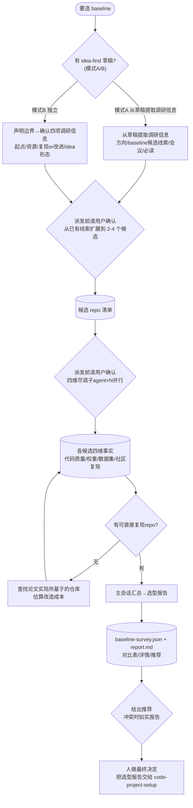

# Baseline Survey

## 这个 skill 解决什么问题

科研项目中期的入口假设是"用户已经有一个可信的 baseline repo"——`code-project-setup` 接手时 baseline 已选定，它只负责让这个**已选定**的 repo 跑起来；`code-paper-reproduction` 验的是这个**已选定**的 baseline 能否复现。

开始写代码前，需要选定仓库、权重和数据集版本。选型时要核查代码能否接入新方法、官方权重是否能下载、数据集版本是否和论文一致，以及社区是否报告过复现失败。

本 skill 在开始修改代码之前核查候选仓库的工程条件，为选型提供有出处的依据。

**根据研究构想确定仓库用途。** 改进某个具体方法时，选用该前驱实现作为比较基线和改造起点。结合多篇论文的发现、第一版先用分析实验检验核心假设时，没有直接前驱实现。这类构想需要一个适合开展分析实验的代码仓库，要求代码便于扩展、已有数据处理流程，并提供可信的参考结果。候选可以是任务最接近的论文仓库，也可以是框架类仓库。

两种用途都用「clone 卡」交接。卡片记录服务器上要 clone 的仓库、commit 或 tag、用途、权重、数据集版本、已知风险，以及后续要复现的参考结果，供 `code-project-setup` 准备环境。

> 本 skill 核查候选仓库是否存在、权重是否可获取、数据集版本、社区复现记录和代码接入成本。实验的基线对比矩阵由 `code-idea-execution` 在阅读代码、参考复现结果后确定。

## 边界：本 skill 做什么、不做什么

**做**：

- 先判 idea 形态（前驱改进型 / 结合多篇论文发现并先做分析的研究——读取 idea-find 草稿中的构想类型，或模式 B 现场问），据此定 repo 角色：**用于比较的基线代码** 还是**用于分析实验的代码仓库**
- 以"初始搜索线索"为起点，扩展搜索凑齐 2-4 个候选 repo（用于分析实验时，候选可以包含框架类仓库）
- 对每个候选做四维尽调：**代码质量 / 权重可得性 & license / 数据集版本一致性 / 社区复现报告**（选择分析实验代码仓库时的维度侧重见 `references/due-diligence.md`）
- 改进已有方法时，若目标论文没有可直接用于复现的实现，根据论文原文查找实现所基于的仓库，并估计改造成本。
- 产出 Baseline 选型报告（`baseline-survey.json` + `report.md`）：客观事实对比表 + 各候选详尽技术分析 + 助手推荐 + 由人做最终决定，**以「clone 卡」收尾**（clone 哪个 repo + commit/tag + 角色 + 权重 + 数据集版本 + 已知风险）
- 交接给中期 `code-project-setup`（知道要 setup 哪个 + 什么角色 + 已知风险）和 `code-idea-execution`（选对比 baseline 有客观依据）

**不做**（交给相邻 skill）：

| 场景                                              | 用                                         |
| ------------------------------------------------- | ------------------------------------------ |
| 判断这个方向值不值得做 / 是否 novel / 已有工作是否过于密集    | `idea-find`（前期）                        |
| 把选定的 repo 跑起来（环境/依赖/数据/checkpoint） | `code-project-setup`（中期）               |
| 验证选定 baseline 能否复现论文报的性能            | `code-paper-reproduction`（中期）          |
| 逐段精读源码 / 讲懂调用链给人听                   | `code-reading`（中期，clone 后的逐行精读） |
| 实现 idea / 设计实验矩阵                          | `code-idea-execution`（中期）              |
| 系统读懂某篇论文                                  | `paper-reading`                            |
| 系统调研某研究方向的文献                          | `literature-survey`                        |

> **本 skill 不 clone、不下载、不运行候选仓库。** 通过远程读取关键文件梳理主要调用关系，标注未经运行验证，供选型使用。选定仓库后，由中期的 `code-reading` 逐段阅读源码。

## 在系统里的位置（局部）

本 skill 是 `dl-assistant` 配套 skill 之一，角色是前期的 **基线代码与分析实验代码仓库工程尽调**——对候选 repo 做纯调研式核查，产出选型报告。从上游读取 idea-find 的 spec 草稿（候选仓库线索 + idea 形态）或用户独立触发；下游把 **baseline 选型报告（json + md，以 clone 卡收尾）**交给 code-project-setup（主线，跑选定 repo）+ execution（选型客观依据）。



> 整体架构、全局怎么连，看 `dl-assistant` 的「全局 skill 流向图」；本 skill 只画与自己相关的 skill。

## 运行架构

**① 在哪跑：只在本地机器（非服务器）。** 只做"基于可远程查阅的材料进行的核查"，不需要服务器算力，产出是一份进项目 `docs/` 的报告。产出是跨机器交接物（GPU 上 `code-project-setup` 要读 json），需要时请用户把文件传到目标机器（跨机器交接规则见 `dl-assistant`）。

**② 分工。** 主会话组织调研，子 agent 负责具体核查。整个流程不使用 workflow。



- **主会话负责与用户沟通**。说明范围、询问调研所需的信息、确定触发模式，以及在扩展候选时与用户沟通。
- **子 agent 负责并行核查**。每个候选的每个维度各派一个子 agent，按任务书阅读真实文件、查询 issue，并将带出处的事实写入相应文件。主会话汇总时按需读取结果。**需要写文件的子 agent 必须用 `general-purpose`，禁用只读的 `Explore`。**
- **不用 workflow**。调研时才确定候选数量，前半段也需要根据用户提供的信息决定下一步，因此由主会话按实际情况派发。
- **TaskList 跟踪流程**：为以下步骤建任务（确认调研所需的信息 / 扩展候选 / 尽调（每候选一项）/ 根据论文查找实现所基于的仓库（条件触发）/ 汇总报告 / 给出推荐并交接报告），每步完成即勾。
- **符号展示**：会话公式用 Unicode——共用规则见 `dl-assistant` SKILL.md「所有技能共用的规则」。

**③ 触发：主线上游是 idea-find（实线必经），也可独立触发（模式 B）**（详见下方「输入」）——有 idea-find 产出就读取其中的调研信息，没有也能独立跑。

---

## 输入：两种触发模式

两种模式仅在收集调研信息的方式上有区别，后续使用同一套核查流程。

### 模式 A：idea-find 之后跑（从草稿提取调研信息）

用户走完 idea-find、手上有准 spec 草稿（`specs/<方向slug>-idea-spec-draft.md`）。读草稿，提取这些当**调研所需的信息**：

- 选定方向（草稿 §0 总论点 + §1 问题定义）
- **idea 形态**（草稿「待补齐」节的形态标注：前驱改进型 / 结合多篇论文发现并先做分析的研究）——据此定 repo 角色（用于比较的基线代码 / 用于分析实验的代码仓库）与尽调侧重
- 基线代码或分析实验代码仓库的候选线索（草稿「待补齐」节的选型项——那里只列线索 URL，不下判断；分析先行型还要读取**分析实验对任务、数据和模型的要求**）
- 目标会议（草稿「目标会议」节）、必读论文（草稿 §2 文献基础）

调研所需的信息齐了，几乎不用再问，直接进仓库核查流程。

### 模式 B：独立触发（直接向用户获取调研信息）

使用场景：用户读了一篇论文 / 看到一个方向觉得不错，想直接跑它的代码，心里方向已经清楚，没走 idea-find。

**开场先声明边界**（一次性说清，避免用户误以为本 skill 会帮他把关方向）：

```text
说明一下我的职责边界：我会核查候选仓库的代码质量、权重可获取性、数据集版本和社区复现记录，给你一份对比报告、选型建议和服务器准备所需的「clone 卡」。卡上会写明仓库用途是用作比较基线还是开展分析实验。

我【不判断这个方向值不值得做、是不是 novel、已有工作是否过于密集】——那是 idea-find 的活。
如果你还没确定方向是否值得投入，建议先走 idea-find；如果你方向已经定了、就是想跑这篇/这个方向的代码，那我们继续。
```

用户确认继续后，**一次性询问下列四项调研信息**：

1. **起点是什么？** 一篇具体论文（给标题 / arXiv ID）？还是一个方向 / 任务？—— 决定去搜哪些 repo。
2. **资源约束？** 单卡 / 8 卡 / 更大？—— 直接影响"这个 baseline 你跑不跑得起"。
3. **意图：复现还是改进？** 想原样复现这篇论文，还是想在它基础上改？—— 影响尽调侧重：纯复现更看"权重 + 脚本齐不齐"，要改更看"代码好不好接、方法接入点清不清晰"。
4. **idea 形态：前驱改进还是结合多篇论文的发现？** 改进某个具体方法（存在直接前驱 repo）→ 选**用于比较的基线代码**；结合多篇论文的发现、v1 要先跑用于检验核心假设的分析实验（无直接前驱）→ 选**用于分析实验的代码仓库**——这时补问一句**分析实验对任务、数据和模型的要求**。

问完，模式 B 就拥有和模式 A 相同的调研信息，进入相同的核查流程。

### 从已有仓库线索扩展候选

无论已知的候选 repo 来自 idea-find 草稿（模式 A）还是用户口头（模式 B），它都只是**一个起点线索，不是已选定的 baseline**。

idea-find 的 Step 6「能启动吗」只检查是否有开源代码或数据可供起步。它提供可能可用的仓库 URL，权重是否可获取、代码是否容易接入等工程问题由本 skill 核查。只检查草稿列出的仓库，可能漏掉更符合要求的候选。

> idea-find 草稿中的仓库建议有待核实。中期阅读代码、检查复现结果后，对适合用作比较基线的仓库也可能有不同判断。

落地为三条硬动作：

1. **必须扩展候选**。以已有仓库为搜索起点，到 GitHub / HuggingFace 查找同任务的其他仓库，凑齐 **2-4 个**一起比较。
2. **尽调维度对所有候选一视同仁。** 不因为某个 repo 是 idea-find 推荐的就少查它。
3. **冲突时如实报告，不为"对齐上游"而硬保。** 如果尽调发现 idea-find 推荐的 repo 存在明确问题而另一个候选更好——直接说"草稿初步建议是 X，但尽调后我推荐 Y，因为…"。

---

## 仓库核查流程：四维核查（概览）

对每个候选 repo 做四维尽调。基于**本地可以远程查阅的信息**——远程读 repo 里的真实文件（文件树、requirements、入口脚本、核心 model 定义、README、issue），**不 clone、不下载、不跑，但要逐个读关键文件**。

1. **代码质量与可接入性**（用户最看重，详细核查）：环境依赖分析、主要调用关系（训练/eval/数据处理流程 + 改进意图的方法接入点）、接入成本；按需核查可读性 / 可扩展性 / 工程化 / 复现设施 / 资源需求 / 依赖维护情况 / 社区维护情况 / 加载链路。
2. **权重可得性 & license**：官方权重在不在、链接是否仍有效、下载方式（直链/HF/需申请/失效）、license 能不能用于你的场景、权重与代码版本对齐。
3. **数据集版本一致性**：哪个版本 / split、下载源、**预处理协议与 metric 定义是否对齐论文**（两者不一致可能导致结果无法直接比较）、已知 split 泄漏 / 标注问题。
4. **社区复现报告**（高价值、最易跳过）：issue / discussion / paperswithcode / 第三方复现仓库的复现成功/失败记录——**往往比 star 更说明 repo 可不可信**，即使 star 很多，也要记录 issue 中的复现失败。

> **选择分析实验代码仓库时（结合多篇论文的发现并先做分析的构想）**：候选可含框架型 repo（detectron2 / timm / HF 这类），维度侧重变为可扩展性 / 数据处理流程 / 仓库维护者报告的参考结果可信度——详见 `references/due-diligence.md`「特殊情形 2：选择用于分析实验的代码仓库」。

**尽调子 agent 任务书（派发时给齐）：**

- **输入**：候选 repo URL（标官方/三方）；负责哪一维；意图（复现/改进）+ 资源约束；方向一句话背景（模式 A 从草稿取）；`references/due-diligence.md` 对应维度的判据——连同文件路径一起放进 prompt。
- **返回 = 落盘**：事实直接写报告目录下 `facts/<候选slug>-<维度>.md`——每项发现带出处（repo 文件路径 / issue 链接 / 论文页码），查不到的标「未查证到」，不猜；维度1 额外给主要调用关系（`文件:函数` 级，标「远程读文件推断、未运行验证」）+ 接入成本结论（低/中/高 + 主要难点）。
- **汇总**：主会话读 `facts/` 合并进 `baseline-survey.json` + `report.md`——报告里每个判断都能回溯到 `facts/` 的原始出处。

**找不到可直接用于复现的仓库时**，读论文原文，搜索 "based on / built upon / our implementation follows" 等表述，找出实现所基于的仓库。对该仓库照常做四项核查，并估计改造成本（小改/中改/大改），注明情况后与其他候选一起比较。

> 四维的详细判据（必查核心、按需核查的参考项目、根据论文查找实现所基于的仓库完整步骤）见 **`references/due-diligence.md`**。

---

## 产出：Baseline 选型报告（概览）

两个文件，放 `docs/baseline-survey/<日期>-<slug>/`：

- **`baseline-survey.json`**：供下游技能读取的记录（candidates[] 四维事实 + 执行链 + recommendation），`code-project-setup` 直接读。
- **`report.md`**：供用户阅读的详细报告（调研所需的信息 + 对比表 + 各候选详情 + 关键风险 + 选型建议 + Handoff），引用 json。

报告先列有出处的事实对比表，再逐个分析候选并给出推荐，由用户最终决定。用户确认后，将选择写入 `decision`（含 `repo_role`），供 `code-project-setup` 读取。报告末尾附「clone 卡」，供服务器准备时查阅。

> 两个文件的完整模板见 **`references/report-template.md`**。

## references 文件列表

| reference                        | 讲什么                                                  | 什么时候读     |
| -------------------------------- | ------------------------------------------------------- | -------------- |
| `references/due-diligence.md`    | 四维尽调详述（必查核心 + 按需核查的参考项目）+ 根据论文查找实现所基于的仓库       | 做尽调时       |
| `references/report-template.md`  | `baseline-survey.json` + `report.md` 模板               | 写报告时       |

## 保存位置

baseline-survey 在本地机器跑，产出**固定落 `docs/baseline-survey/<日期>-<方向slug>/`**（`baseline-survey.json` + `report.md` + 尽调中间事实 `facts/`），不问用户、不接受另行指定——和 idea-find 的产出并排（都在 `docs/`）。产出是跨机器交接物（GPU 上 `code-project-setup` 要读 json），需要时请用户把文件传到目标机器（跨机器交接规则见 `dl-assistant`）。

---

## 工具使用规范

- **代码库搜索**：用 GitHub / HuggingFace MCP（或可用的搜索工具）搜真实存在的 repo。候选必须真实存在，不编造 repo 名 / star 数 / 链接。
- **读 repo 真实文件**（维度1 深度分析的关键）：用 GitHub MCP / WebFetch 拉单个文件内容（requirements、train/eval 入口、model 定义、README）。**不 clone，但要逐个读关键文件**——环境依赖 / 执行链 / 可读性分析必须基于读过的真实文件，不是 repo 描述。
- **论文事实 / 根据论文查找实现所基于的仓库**：arXiv 论文首选 `tex-mcp`——`tex_open` 打开固定版本 → `tex_read` 读原文核对数据集版本、metric 定义，以及（无可直接复现 repo 时）`tex_search` 查找论文对实现来源的说明（"based on / built upon ..."）。源码不可用 → 降级 `pdf-mcp`（`download_paper_asset` 取返回的路径，用 `pdf_open` 打开后 `pdf_search` / `pdf_read`）。
- **社区复现**：去 repo 的 issue / discussion、paperswithcode、第三方复现仓库找真实记录。
- **查不到就标"未知"**：尽调的诚实底线是宁缺毋滥。某个事实查不到，明确标"未查证到"，不拿猜测填表——错误的尽调比没有尽调更危险（会误导下游选错 baseline）。

---

## 核心原则

1. **尽调，不判断**：只核查 baseline 的客观工程事实，不碰方向值不值得做（那是 idea-find）。
2. **从已有线索扩展候选**。用上游给出的仓库作为搜索起点，对所有候选用同一套标准核查。结论与草稿不一致时说明原因。
3. **依据关键文件详细核查代码质量**。维度 1 的必查项（含主要调用关系）都要有实际读过的文件作为依据。
4. **形态先判、角色先定**：先判 idea 形态（前驱改进 / 结合多篇论文的发现），再定 repo 角色（用于比较的基线代码 / 用于分析实验的代码仓库）——选择分析实验代码仓库时的候选来源与尽调侧重随之切换。
5. **摆事实 + 给出推荐 + 人决定**：报告先客观对比，再给出推荐，最终选择留给用户；报告以「clone 卡」收尾。
6. **只做基于可远程查阅的材料进行的核查**：不 clone、不下载、不跑——那些留给服务器上的中期 skill。
7. **诚实告知边界**：查不到的标"未知"；执行链标"未验证"；推荐有不确定就说"不确定"。
