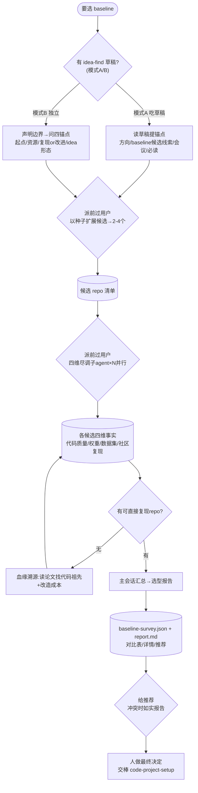

# Baseline Survey

## 这个 skill 解决什么问题

科研项目中期的入口假设是"用户已经有一个可信的 baseline repo"——`code-project-setup` 接手时 baseline 已选定，它只负责让这个**已选定**的 repo 跑起来；`code-paper-reproduction` 验的是这个**已选定**的 baseline 能否复现。

但**"在一堆候选里选出哪个 repo / 哪套权重 / 哪个数据集版本"这个决策是需要在科研项目中期之前就决定的**。选错 baseline 是科研项目的炸弹：代码质量差接不进方法、官方权重下不到只能自训、数据集版本和论文报的数字对不上、社区一片复现失败的 issue 没人提前看。

本 skill 专门填这一环：在实际开始动手写代码之前，对候选 baseline 做**纯调研式的工程尽调**，把"用哪个 baseline"从拍脑袋升级成有客观依据的选型。

**两种 idea 形态，两种 repo 角色。** 上游 idea 分两类：**前驱改进型**（改进某个具体方法——存在直接前驱 repo，clone 它就是要对打 + 改造的 baseline）和**组合 insight / 分析先行型**（多篇论文 insight 的组合，核心赌注是未验证的假设，v1 是假设裁决的分析实验——**不存在直接前驱 repo**）。后者需要的不是"对打的 baseline"，而是一个**实验基座**：工程扎实、数据链现成、自带可信参考数字的 repo（可以是离任务最近的论文 repo，也可以是框架型 repo），在它上面跑分析实验。本 skill 对两种形态都负责到底——**最终交付都是一张「clone 卡」**：去服务器 clone 哪个 repo、什么角色、带什么坑，用户拿着直接开 `code-project-setup`。

> **关键区分：尽调 ≠ 判断。** idea-find 正确地禁止"第一阶段凭空把 baseline 对比矩阵定死"（那是研究决策 + 要看代码，留给 execution 结合 reproduction 实情定）。本 skill 做的不是那个——是**对候选 baseline 的客观事实核查**（repo 真存在吗、权重下得到吗、数据集哪个版本、社区复现得出吗、代码接手疼不疼）。前者是判断，后者是尽调；本 skill 只做后者。

## 边界：本 skill 做什么、不做什么

**做**：

- 先判 idea 形态（前驱改进型 / 组合 insight 分析先行型——吃 idea-find 草稿的形态标注，或模式 B 现场问），据此定 repo 角色：**对打 baseline** 还是**实验基座**
- 以"种子线索"为起点，扩展搜索凑齐 2-4 个候选 repo（基座模式下候选可含框架型 repo）
- 对每个候选做四维尽调：**代码质量 / 权重可得性 & license / 数据集版本一致性 / 社区复现报告**（基座模式的维度侧重见 `references/due-diligence.md`）
- 前驱改进型论文无可直接复现实现时，血缘溯源找"近亲 repo"并标改造成本
- 产出 Baseline 选型报告（`baseline-survey.json` + `report.md`）：客观事实对比表 + 各候选详尽技术分析 + agent 推荐 + 由人做最终决定，**以「clone 卡」收尾**（clone 哪个 repo + commit/tag + 角色 + 权重 + 数据集版本 + 已知坑）
- 交接给中期 `code-project-setup`（知道要 setup 哪个 + 什么角色 + 已知坑）和 `code-idea-execution`（选对比 baseline 有客观依据）

**不做**（交给相邻 skill）：

| 场景                                              | 用                                         |
| ------------------------------------------------- | ------------------------------------------ |
| 判断这个方向值不值得做 / 是否 novel / 是否红海    | `idea-find`（前期）                        |
| 把选定的 repo 跑起来（环境/依赖/数据/checkpoint） | `code-project-setup`（中期）               |
| 验证选定 baseline 能否复现论文报的性能            | `code-paper-reproduction`（中期）          |
| 逐段精读源码 / 讲懂调用链给人听                   | `code-reading`（中期，clone 后的逐行精读） |
| 实现 idea / 设计实验矩阵                          | `code-idea-execution`（中期）              |
| 系统读懂某篇论文                                  | `paper-reading`                            |
| 系统调研某研究方向的文献                          | `literature-survey`                        |

> **本 skill 不 clone、不下载、不跑。** 只做本地能完成的"看得见的尽调"。它梳理的执行链是**远程读关键文件推断的粗粒度骨架**，不是 clone 后的逐行精读（那是中期 `code-reading` 的活）——两者是深度递进关系：尽调给骨架帮你选 repo，code-reading 选定后给精读。

## 在系统里的位置（局部）

本 skill 是 `dl-assistant` 配套 skill 之一，角色是前期的 **baseline / 实验基座工程尽调**——对候选 repo 做纯调研式核查，产出选型报告。上游吃 idea-find 的 spec 草稿（baseline/基座线索 + idea 形态）或用户独立触发；下游把 **baseline 选型报告（json + md，以 clone 卡收尾）**交给 code-project-setup（主线，跑选定 repo）+ execution（选型客观依据）。


> 整体架构、全局怎么连，看 `dl-assistant` 的「全局 skill 流向图」；本 skill 只画与自己相关的 skill。

## 运行架构

**① 在哪跑：只在本地机器（非服务器）。** 只做"看得见的尽调"，不需要服务器算力，产出是一份进项目 `docs/` 的报告。产出是跨机器交接物（GPU 上 `code-project-setup` 要读 json），需要时找用户弄过去（跨机器交接横切规范见 `dl-assistant`）。

**② 怎么编排：主会话编排 + 子 agent 做尽调脏活，不用 workflow。**



- **对话归主会话**：声明边界、问锚点、模式分叉、扩展候选时都要和用户互动——这些必须在主会话，确定性脚本干不了。
- **尽调归子 agent**：四维相互独立、可并行、产出结构化事实，正是子 agent 的甜区。每个候选的每一维派一个子 agent，在干净的隔离上下文里读真实文件、查 issue，事实直接落盘（任务书规格见「尽调主干」），不互相污染主上下文、也不撑爆主会话。**落盘的子 agent 必须 `general-purpose`，禁 `Explore`**——只读探索类 agent 不写文件。
- **不用 workflow**：候选数量是调研当场才浮现的（种子 + 扩展搜索），不是预先固定的 DAG；且前半段强对话。workflow 的确定性并行派发在这里是约束不是助力。
- **TaskList 跟踪流程**：主干建任务（锚点对齐 / 扩展候选 / 尽调（每候选一项）/ 血缘溯源（条件触发）/ 汇总报告 / 推荐+交棒），每步完成即勾。
- **符号展示**：会话公式用 Unicode——横切规范见 `dl-assistant` SKILL.md「横切规范」。

**③ 触发：主线上游是 idea-find（实线必经），也可独立触发（模式 B）**（详见下方「输入」）——有 idea-find 产出就吃进来当线索，没有也能独立跑。

---

## 输入：两种触发模式

两种模式只在最开头"获取调研锚点"这一步分叉，之后汇流进同一条尽调主干。

### 模式 A：idea-find 之后跑（吃草稿当线索）

用户走完 idea-find、手上有准 spec 草稿（`specs/<方向slug>-idea-spec-draft.md`）。读草稿，提取这些当**调研锚点**：

- 选定方向（草稿 §0 总论点 + §1 问题定义）
- **idea 形态**（草稿「待补齐」节的形态标注：前驱改进型 / 组合 insight 分析先行型）——据此定 repo 角色（对打 baseline / 实验基座）与尽调侧重
- baseline / 基座候选线索（草稿「待补齐」节的选型项——那里只列线索 URL，不下判断；分析先行型另带**载体需求**：分析实验要长在什么任务 / 数据 / 模型上）—— **当线索，不当结论，见下方纪律**
- 目标会议（草稿「目标会议」节）、必读论文（草稿 §2 文献基础）

锚点齐了，几乎不用再问，直接进尽调主干。

### 模式 B：独立触发（现场建锚点）

使用场景：用户读了一篇论文 / 看到一个方向觉得不错，想直接跑它的代码，心里方向已经清楚，没走 idea-find。

**开场先声明边界**（一次性说清，避免用户误以为本 skill 会帮他把关方向）：

```text
说明一下我的职责边界：我只做 baseline / 实验基座的工程尽调——核查候选 repo 的代码质量、
权重能不能下到、数据集版本对不对、社区复现得出不出来，最后给你一份选型对比 + 推荐 +
「clone 卡」（去服务器 clone 哪个 repo、什么角色——对打 baseline 还是实验基座）。

我【不判断这个方向值不值得做、是不是 novel、是不是红海】——那是 idea-find 的活。
如果你还没确定方向是否值得投入，建议先走 idea-find；如果你方向已经定了、就是想跑这篇/这个方向的代码，那我们继续。
```

用户确认继续后，**一次性合并问四个锚点**（这是事实输入，不是研究决策，别挤牙膏）：

1. **起点是什么？** 一篇具体论文（给标题 / arXiv ID）？还是一个方向 / 任务？—— 决定去搜哪些 repo。
2. **资源约束？** 单卡 / 8 卡 / 更大？—— 直接影响"这个 baseline 你跑不跑得起"。
3. **意图：复现还是改进？** 想原样复现这篇论文，还是想在它基础上改？—— 影响尽调侧重：纯复现更看"权重 + 脚本齐不齐"，要改更看"代码好不好接、方法接入点清不清晰"。
4. **idea 形态：前驱改进还是组合 insight？** 改进某个具体方法（存在直接前驱 repo）→ 选**对打 baseline**；多篇论文 insight 组合、v1 要先跑假设裁决的分析实验（无直接前驱）→ 选**实验基座**——这时补问一句**载体需求**：分析实验要长在什么任务 / 数据 / 模型上。

问完，模式 B 就拥有和模式 A 一样的锚点，汇流主干。

### 核心纪律：候选 repo 是「种子线索」，不是「结论」

**这是本 skill 最容易踩的坑，必须守住。**

无论锚点里的候选 repo 来自 idea-find 草稿（模式 A）还是用户口头（模式 B），它都只是**一个起点线索，不是已选定的 baseline**。

为什么不能直接信 idea-find 给的 repo：idea-find 列 repo 的目的不是"选最佳实现"，而是过它 Step 6 的过滤检查项「能启动吗」——只回答"有没有可起步的开源代码 / 数据集"，判据刻意放宽（有可改的 repo 就算），且它自己的边界写明**只列线索 URL、不核查质量**：权重下不下得到、代码接不接得进，正是它显式甩给本 skill 的尽调。它很可能只是搜索结果里 star 最多的那个。如果本 skill 把它当结论、只围着它尽调，就会**锚定在一个可能次优的 repo 上**，还**继承了未经核实的判断**。

> 这条纪律和 idea-find 自己的原则同源——它已警告过"第一阶段凭空设计的 baseline，可能和 execution 看了 reproduction 后的判断不一致"，预见了"上游 baseline 判断不可全信"，只是把核查甩给了下游。本 skill 正是接住这一棒：**专门把那个"一句话 repo"升级成"经过尽调的选型"。**

落地为三条硬动作：

1. **强制候选扩展，不许只盯种子那一个。** 第一步必须以种子 repo 为起点，再去 GitHub / HuggingFace 搜同任务的其他候选，凑齐 **2-4 个**一起进对比。种子只是省了"从零搜"的力气，不是终点。
2. **尽调维度对所有候选一视同仁。** 不因为某个 repo 是 idea-find 推荐的就少查它。
3. **冲突时如实报告，不为"对齐上游"而硬保。** 如果尽调发现 idea-find 推荐的 repo 有坑而另一个候选更好——直接说"草稿初步建议是 X，但尽调后我推荐 Y，因为…"。

---

## 尽调主干：四维核查（概览）

对每个候选 repo 做四维尽调。基于**本地看得见的信息**——远程读 repo 里的真实文件（文件树、requirements、入口脚本、核心 model 定义、README、issue），**不 clone、不下载、不跑，但要逐个读关键文件**。

1. **代码质量与可接入性**（用户最看重，做满做深）：环境依赖分析、执行链骨架（训练/eval/数据链 + 改进意图的方法接入点）、接入成本；按需深挖可读性 / 可扩展性 / 工程化 / 复现设施 / 资源足迹 / 依赖健康 / 社区健康 / 加载链路。
2. **权重可得性 & license**：官方权重在不在、链接活没活、下载方式（直链/HF/需申请/失效）、license 能不能用于你的场景、权重与代码版本对齐。
3. **数据集版本一致性**：哪个版本 / split、下载源、**预处理协议与 metric 定义是否对齐论文**（可比性炸弹源头）、已知 split 泄漏 / 标注问题。
4. **社区复现报告**（高价值、最易跳过）：issue / discussion / paperswithcode / 第三方复现仓库的复现成功/失败记录——**往往比 star 更说明 repo 可不可信**，star 多但 issue 全是"can't reproduce"的是陷阱。

> **基座模式（组合 insight / 分析先行型 idea）**：候选可含框架型 repo（detectron2 / timm / HF 这类），维度侧重变为可扩展性 / 数据链 / 基座自报参考数字可信度——详见 `references/due-diligence.md`「特殊情形 2：基座选型」。

**尽调子 agent 任务书（派发时给齐）：**

- **输入**：候选 repo URL（标官方/三方）；负责哪一维；意图（复现/改进）+ 资源约束；方向一句话背景（模式 A 从草稿取）；`references/due-diligence.md` 对应维度的判据——连同文件路径一起放进 prompt。
- **返回 = 落盘**：事实直接写报告目录下 `facts/<候选slug>-<维度>.md`——每项发现带出处（repo 文件路径 / issue 链接 / 论文页码），查不到的标「未查证到」，不猜；维度1 额外给执行链骨架（`文件:函数` 级，标「远程读文件推断、未运行验证」）+ 接入成本结论（低/中/高 + 卡点）。
- **汇总**：主会话读 `facts/` 合并进 `baseline-survey.json` + `report.md`——报告里每个判断都能回溯到 `facts/` 的原始出处。

**找不到可直接复现的 repo → 血缘溯源**：读论文原文找代码祖先（搜 "based on / built upon / our implementation follows"），对祖先 repo 照常四维尽调 + 估改造成本（小改/中改/大改），作为带标注的退路候选和现成 repo 一起对比。

> 四维的详细判据（必查核心、按需深挖菜单、血缘溯源完整步骤）见 **`references/due-diligence.md`**。

---

## 产出：Baseline 选型报告（概览）

两个文件，放 `docs/baseline-survey/<日期>-<slug>/`：

- **`baseline-survey.json`**：机读交接区（candidates[] 四维事实 + 执行链 + recommendation），`code-project-setup` 直接读。
- **`report.md`**：人读详解（调研锚点 + 对比表 + 各候选详情 + 关键风险 + Agent 推荐 + Handoff），引用 json。

结构：**先摆客观事实对比表，再逐候选给详尽技术分析，再给 agent 推荐，最终决定留给人。** 人拍板后把最终选定回填 json 的 `decision` 字段（含 `repo_role`）——选型决策落盘可回溯，下游 `code-project-setup` 直接读。报告以「**clone 卡**」收尾（clone 哪个 repo + commit/tag + 角色 + 权重 + 数据集版本 + 已知坑 + CPR 对齐目标）——拿它直接去服务器开 setup。

> 两个文件的完整模板见 **`references/report-template.md`**。

## references 文件列表

| reference                        | 讲什么                                                  | 什么时候读     |
| -------------------------------- | ------------------------------------------------------- | -------------- |
| `references/due-diligence.md`    | 四维尽调详述（必查核心 + 按需深挖菜单）+ 血缘溯源       | 做尽调时       |
| `references/report-template.md`  | `baseline-survey.json` + `report.md` 模板               | 写报告时       |

## 保存位置

baseline-survey 在本地机器跑，产出**固定落 `docs/baseline-survey/<日期>-<方向slug>/`**（`baseline-survey.json` + `report.md` + 尽调中间事实 `facts/`），不问用户、不接受另行指定——和 idea-find 的产出并排（都在 `docs/`）。产出是跨机器交接物（GPU 上 `code-project-setup` 要读 json），需要时找用户弄过去（跨机器交接横切规范见 `dl-assistant`）。

---

## 工具使用规范

- **代码库搜索**：用 GitHub / HuggingFace MCP（或可用的搜索工具）搜真实存在的 repo。候选必须真实存在，不编造 repo 名 / star 数 / 链接。
- **读 repo 真实文件**（维度1 深度分析的关键）：用 GitHub MCP / WebFetch 拉单个文件内容（requirements、train/eval 入口、model 定义、README）。**不 clone，但要逐个读关键文件**——环境依赖 / 执行链 / 可读性分析必须基于读过的真实文件，不是 repo 描述。
- **论文事实 / 血缘溯源**：arXiv 论文首选 `tex-mcp`——`tex_open` 打开固定版本 → `tex_read` 读原文核对数据集版本、metric 定义，以及（无可直接复现 repo 时）`tex_search` 搜论文声明的代码祖先（"based on / built upon ..."）。源码不可用 → 降级 `pdf-mcp`（`download_paper_asset` 取返回的路径，用 `pdf_open` 打开后 `pdf_search` / `pdf_read`）。
- **社区复现**：去 repo 的 issue / discussion、paperswithcode、第三方复现仓库找真实记录。
- **查不到就标"未知"**：尽调的诚实底线是宁缺毋滥。某个事实查不到，明确标"未查证到"，不拿猜测填表——错误的尽调比没有尽调更危险（会误导下游选错 baseline）。

---

## 核心原则

1. **尽调，不判断**：只核查 baseline 的客观工程事实，不碰方向值不值得做（那是 idea-find）。
2. **种子是线索不是结论**：上游给的 repo 当起点，强制扩展候选、统一尽调、冲突如实报告。
3. **代码质量做深 + 读真实文件**：维度1 是用户最看重的，必查核心（含执行链骨架）逐个落到读过的文件，禁止看 README 拍脑袋。
4. **形态先判、角色先定**：先判 idea 形态（前驱改进 / 组合 insight），再定 repo 角色（对打 baseline / 实验基座）——基座模式的候选来源与尽调侧重随之切换。
5. **摆事实 + 给推荐 + 人决定**：报告先客观对比，再给推荐，最终选择留给用户；报告以「clone 卡」收尾。
6. **只做看得见的尽调**：不 clone、不下载、不跑——那些留给服务器上的中期 skill。
7. **诚实告知边界**：查不到的标"未知"；执行链标"未验证"；推荐有不确定就说"不确定"。
