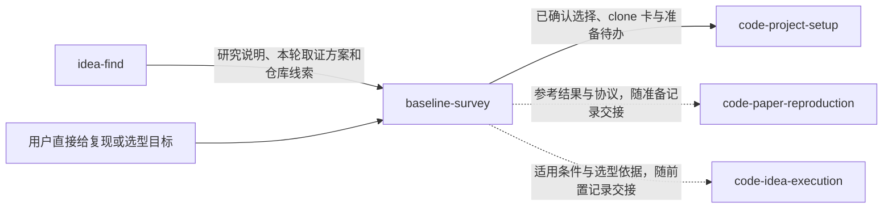
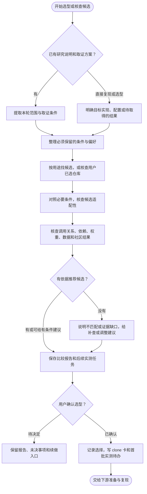

# 代码、模型与数据选型

根据本轮取证方案或复现目标，找出能保留必要条件、在资源范围内取得所需结果的实现组合。先判断候选能否满足研究或复现需求，再比较代码可接入性、权重、数据和社区复现记录。根据证据给出推荐，由用户决定采用哪个方案。

## SKILL 交接关系

直接复现可从目标论文、实现和设置开始。选型依据来自静态可读材料和用户提供的已有结果。环境与资产实测交给 `code-project-setup`，复现结论由 `code-paper-reproduction` 在实际条件下确认。全局链路见 [dl-assistant](../dl-assistant/SKILL.md#全局-skill-流向图skill-间顺序依赖)。

## 产出与保存

默认保存在 `docs/baseline-survey/<日期>-<slug>/`。用户指定其他位置时使用该位置。续做读取原报告及来源笔记，保留原决定与变更依据。

| 产物 | 用途 |
| --- | --- |
| `facts/` | 按需保存候选的源码位置、主要调用关系、资产版本、社区记录和限制 |
| `report.md` | 保存必要条件、候选比较、推荐理由、已知风险和实测待办。用户确认后附 clone 卡 |
| `baseline-survey.json` | 保存候选事实、推荐和用户确认的决定，供下游读取 |

用户尚未选定时保留调查结果，`decision` 留待确认。现有下游从 `decision.repo` 和 `decision.repo_role` 读取所选仓库及用途。组合或多个用途在报告中逐项交代，确保准备方知道完整范围。格式见[报告与交接模板](references/report-template.md)。

## 运行流程图

## 参考资料列表

| 参考资料 | 什么时候读 |
| --- | --- |
| [运行手册](references/workflow.md) | 开始或续做。提取需求、搜索候选、核查、推荐和交接 |
| [四项工程核查](references/due-diligence.md) | 查源码、依赖、模型权重、数据或社区复现时 |
| [事实记录模板](references/fact-record-template.md) | 按需保存候选证据、适用范围和实测待办 |
| [报告与交接模板](references/report-template.md) | 写选型对比、实测待办、结构化结果和 clone 卡时 |
| [论文检索](../paper-search/SKILL.md)、[TeX 原文](../tex-mcp/SKILL.md)、[PDF 原文](../pdf-mcp/SKILL.md) | 核目标论文、实现出处、数据划分和评测协议时 |

工程核查参考提供各维度的具体检查项，适配性、需要追查的调用关系和候选范围按运行手册确定。

## 选型原则

1. **必要条件优先。** 逐项匹配用户要取得的读数、对照与设置。为了容易安装而改变模型、数据、输入尺寸、训练阶段或测量口径时，先评估是否会改变研究问题或结果含义，交回研究设计讨论。
2. **按用途查实现。** 仓库可以用于复现、比较、实现或测量。候选数量取决于实际可用方案。多个组件组合时，核对接口、数据和许可是否兼容。
3. **说明证据层次。** 区分文档声明、静态源码、社区记录和已有运行结果。远程读到的入口应标记实际读取的版本和文件位置，待运行验证的条件单列。可读源码或配置、论文和资产元信息；完整仓库、模型和数据由准备阶段获取，实测在后续阶段进行。
4. **推荐和决定分开。** 主会话解释选择依据、限制和最关键待验证项。有证据不足或目前没有合适候选时可给有条件建议或暂不推荐。需要委派时先向用户说明任务、输入输出和分工理由，由主会话汇总独立事实记录。
