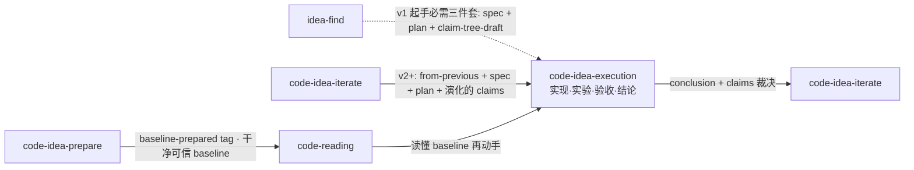
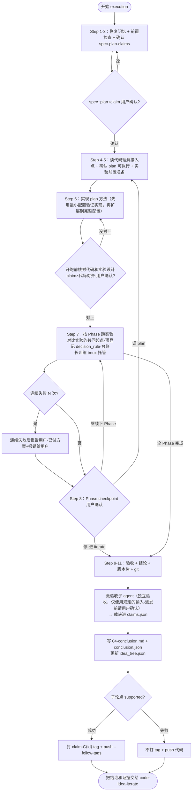

# Code Idea Execution

## 这个 skill 解决什么问题

从已确认的实验计划开始，编写代码、做短时测试，依据日志和指标修正实现，再按计划运行实验。

本 skill 读取 idea-find 或 code-idea-iterate 写好的研究说明、实验计划和论点记录。在已验证的基线上实现方法、运行实验并收集证据。验收子 agent 将各子论点的证据结论写回 `claims.json`。方法设计与下一版研究判断由用户和对应的研究技能负责，第一版用 idea-find，后续版本用 code-idea-iterate。

> **进来前你已经有**：一份 spec + plan（v1 来自 idea-find，v2+ 来自 iterate）+ claim 树（两层：总论点 + 子论点）+ 可信 baseline（过 code-project-setup / code-paper-reproduction / code-idea-prepare）。缺哪个先去补。

## 边界：本 skill 做什么、不做什么

**做**：读取研究说明、实验计划和论点记录，按计划实现最小可用的方法并运行实验。验收子 agent 把证据结论写入 claims.json，执行方据此写版本结论。按计划提交代码，只给子论点获支持的成功节点打 Git tag。

**三角色分工**（本 skill 含前两个，第三个交 iterate）：

- **execution**：执行（实现 + 实验）+ 记录实验事实
- **验收子 agent**（execution 派，只按验收规定读取输入材料）：**事实裁决**——数据支不支持子论点（supported / plausible / insufficient_evidence / contradicted，枚举以 `claims-template.json` 为准），基于客观证据
- **iterate + 用户**：**研究判断**——裁决意味什么、子论点失败是方法差还是方向错、总论点要不要演化、下版做什么

> execution（含验收）只到**事实裁决**（数据 vs 子论点），**不做研究判断**（方向 / 总论点 / 下一步归 iterate + 用户）；也不设计方法。

**不做**（交给相邻 skill）：

| 场景                                       | 用                        |
| ------------------------------------------ | ------------------------- |
| 找 idea / 研究空白                         | `idea-find`               |
| 设计方法 / 迭代下一版 / 研究方向判断       | `code-idea-iterate`       |
| repo 还不能跑（环境/依赖/数据/checkpoint） | `code-project-setup`      |
| baseline 是否可信还没验证                  | `code-paper-reproduction` |
| 清理 + 质量优化 baseline                   | `code-idea-prepare`       |
| 逐段精读源码                               | `code-reading`            |
| 写论文 section                             | `writing-*`               |

> **运行位置**：GPU 服务器（开发卡）。从 `baseline-prepared`（CIP 成功产）切分支；CIP 全退或被分诊跳过则从 `baseline-reproduced` 切。

## 在系统里的位置（局部）

本 skill 是 `dl-assistant` 配套 skill 之一，角色是中期 **执行引擎**——吃上游设计好的 spec+plan，产出实验结果 + claim 裁决交下游。



> **execution 不直连后期**：存活 claim、子论点与代码的对应记录、总论点不直接交 writing-paper / code-paper-release——全部经 iterate 收口（出口B 收口包）再到后期（见总览「全局 skill 流向图」）。
> 整体架构、全局怎么连，看 `dl-assistant` 的「全局 skill 流向图」；本 skill 只画与自己相关的。

## 产出与保存：版本目录

产出在 repo 的 `ideas/v<N>-<slug>/`（全局目录布局规定，不是 docs/）：

```
ideas/v<N>-<slug>/
├── 00-from-previous-version.md   # iterate 产（仅 v2+）
├── 01-idea-spec.md               # IF/iterate 产（版本内保持固定的说明，execution 只读）
├── 02-research-plan.md           # IF/iterate 产（方法设计，execution 只读）
├── 03-claim-code-map.md          # execution 产：子论点、代码位置与验证逻辑的对应记录（开跑前填写）
├── 04-conclusion.md              # execution 产（人读）
├── conclusion.json               # execution 产（机读交接：iterate / release / writing-paper 读）
├── claims.json                   # execution 建 v1 + 验收写裁决 / iterate 演化
├── scratch/                      # debug 脚本（版本级，不进 git）
└── experiments/                  # 不进 git
    ├── index.json                # 实验台账：每轮一行（execution 维护，验收/iterate 读）
    └── exp-XXX-<name>/           # 每个实验使用一个固定结构的目录
        ├── meta.json             # 实验元信息（开跑前预登记 decision_rule/anchor_run，完成后填结果）
        ├── 报告.md               # 供用户阅读的实验摘要：TL;DR 结论先行（半页，模板见 exp-report-template.md）
        ├── configs/              # 本实验实际用的 config 冻结副本（repo 原件会被改，不冻结不可回溯）
        ├── scripts/              # 可复现脚本（内嵌完整命令行，不得存放在 /tmp）
        ├── runs/                 # 训练/消融类实验的产物区
        │   └── seed-<n>/
        │       ├── train.log     # 训练全量日志（tmux 托管输出落这）
        │       ├── eval.log      # 评测日志
        │       ├── metrics.json  # 指标（机读）
        │       └── checkpoints/  # 权重（大文件，按 long-run-ops 清理）
        └── analysis/             # 诊断/分析类实验的产物区
            ├── report.md         # 分析详版（现象→数据→根因）
            ├── data/
            └── figures/
```

> 产物目录与文件要求由 `scripts/check-exp-artifacts.sh` 机器验收（每实验跑完自查 + Step 9 全量），结构不符 = 产物不接收。

> spec/plan/from-previous 归 idea-find/iterate 产（execution **只读消费**，一个字不改——子论点与代码的对应记录落 `03-claim-code-map.md`，实验状态落各 exp 的 `meta.json` + 台账，都不写 plan）；conclusion + claim-code-map + claims 裁决归 execution 产。**跨机器交接**：代码分支+tag 用 `git push --follow-tags`；实验数字/产出需要时找用户要（共用规则见 `dl-assistant` SKILL.md「所有技能共用的规则」）。

## 核心纪律

### 迭代纪律（服务 2-3h 一轮、上限 4h 的 method 快速迭代）

- **一次只加一个改动**：每个实验相对它的锚点只引入一个变量，结果归因才干净。改动粒度与 claim 粒度对齐——一个实验回答一个子论点的一个问题。
- **对比实验的共同起点**：参与同一组对比的变体从**相同起点**开始——`reproduced_baseline_checkpoint`（CPR 登记的可信权重，不从 official ckpt 切）或上一个 supported tag，**不得从尚无验收结论的变体 checkpoint 继续训练**，以免叠加未验证改动后无法区分各自的影响。迭代期对比固定 seed（减方差省钱），delta 接近 noise_floor 时才加 seed 确认。
- **先用最小配置验证实现，再扩展到完整配置**：可用单个批次、关闭数据增强或使用 reduced 配置，先确认实现能按预期运行。训练过程异常按 `training-dynamics-debug.md` 的顺序定位（先用单个批次检查模型能否拟合数据）；验证实现机制时用 `code-paper-reproduction/references/trust-traps.md` 的「组件级验证手册」（overfit one batch / loss @ init / input-independent baseline / 进网络前可视化 / 梯度依赖检查）。
- **实验前登记保留或放弃的判据。** 在 `meta.json` 预先写入 `decision_rule` 和用来比较的运行 `anchor_run`，完成后沿用这些规则。用 `decision_rule_rationale` 说明要检验的假设、阈值来源，以及达到判据后的解读和下一步。判据参考 `reproduction.json` 的 `noise_floor`。差异 < 2×std 时不可判断 keep 或 discard。实验级判据用于记录和决定是否继续投入该实验变体。验收子 agent 判断实验证据是否支持子论点并写入 verdict。子论点状态由 iterate 和用户分析原因后决定。
- **可以自行尝试的调整。** 不改变子论点含义的超参、seed 或工程实现调整，可自行尝试，记入实验索引并在 Phase checkpoint 汇报。若调整涉及方法机制，必须暂停并交由用户或 iterate 处理。自行尝试时，连续失败 N 次（默认 3）也须报告用户。
- **scale-risk 标记**：机制上可能和数据规模交互的变体（reduced 小数据规模上成立、full 规模上可能消失或反转），在 `meta.json` 和 `conclusion.json` 打 `scale_risk` + 一句话理由——CPE 跑 full-scale 时优先验这些。
- **简洁性判据**：提升要抵得过复杂度——keep 的不只是"指标涨了"，还要权衡引入的复杂度（新增行数 / 新依赖 / 新概念）；**删减代码后性能持平也可以保留**（同等指标下更简的变体优先 keep，在论文中可说明实现更简洁）。预登记 `decision_rule` 时把复杂度权衡写明白。
- **对照 baseline 曲线**：训练中对照 `reproduction.json` 的 `baseline_curves`（loss / metric / 固定批预测演变）形状，区分训练过程异常与方法改动未达预期。
- **单轮预算**：实验矩阵默认用 `reduced_setting`（单轮 ≤ 迭代预算：默认 2-3h、上限 4h）跑；全量只留关键验证。`scale_sweep.verdict: degraded` 时 reduced 只排方向、重大结论回 full。改模块前查 CIP 的 `hot-path.md`——若迭代命令执行不到改动位置，需补充验证。

### 需要暂停并由用户确认的情况

| 需要确认的事项 | 时机 | 用户确认什么 |
| -------------------- | ------------------------ | ---------------------------------- |
| spec+plan+claim 确认 | Step 3                   | 确认 plan 方法 + claim 树合理      |
| 开跑前核对代码和实验设计               | Step 6 实现后、开跑前    | 逐条核对子论点、代码和实验如何验证该论点 |
| 连续失败后报告用户             | Step 6/7 连续失败 N 次   | 决定继续试/回退/回 iterate         |
| 长训练启动           | Step 7 开 full run 前    | 由用户确认是否启动高消耗训练（eval 和 smoke 无须暂停确认）      |
| Phase checkpoint     | Step 8 每 Phase 完       | 继续下 Phase/停/调 plan            |
| 派验收子 agent       | Step 9                   | 确认派发验收任务           |

> 低消耗操作（eval/smoke/读代码/写文件）不必停；**语义改动、高消耗、需要作判断的任务派发**必停。允许自行尝试的工程调整不占确认点（Step 8 统一汇报）。

### 长任务托管

预计超过 5 分钟、耗时不确定，或会话断开后重跑代价高的命令，在 tmux 的分离会话中运行，首选 `dl-assistant/scripts/run-long.sh`。禁止用 `run_in_background` 或在前台等待。长训练输出写入 `experiments/<exp>/runs/train.log` 和 `EXIT_CODE`，重连后检查文件恢复进度。会话名前缀为 `ex-<slug>-<exp>`。详见 `dl-assistant/references/long-run-ops.md`。

### git 工作流：跟 plan 走、tag 只在成功节点打

改动 commit 到 `idea/v<N>-<slug>` 分支，跟 plan 走；**tag 只在子论点 supported 的成功节点打**（`claim-C<id>` 首次成立 / `claim-C<id>-v2` method 迭代新锚点），失败（refuted）节点不打。详见 `dl-assistant/references/version-tree.md`。push 用 `git push --follow-tags`（不是裸 push，否则 tag 不上传）。

## 输入文件和字段用法

**v1 起手**（idea-find 产草稿，execution 升级为版本文件）：

1. 把 IF 的 `<方向slug>-idea-spec-draft.md` 拷入升级为 `01-idea-spec.md`，`<方向slug>-idea-plan-draft.md` 升级为 `02-research-plan.md`（补版本号；内容不改——plan 只读从这开始）。
2. 将 idea-find 的 `<方向slug>-claim-tree-draft` 复制为本版的 `claims.json`。遵循 `dl-assistant/references/claims-template.json`，更新 `version: v1-<slug>`、`parent_version: null` 和 `snapshot_date`。
3. 从 baseline tag 切 `idea/v1-<slug>` 分支，建 `ideas/v1-<slug>/`。

**v2+ 起手**：iterate 已切好分支 + commit 种子文件，execution 接手读 `00-from-previous-version.md` + `01-idea-spec.md` + `02-research-plan.md` + `claims.json`（已演化）+ 上一版 `04-conclusion.md`。

**setup / reproduction / cleanup 目录**（路径按 `dl-assistant` 目录布局定位，找不到问用户；**CIP 被 CPR 分诊跳过则没有 cleanup 目录**，属正常路径，读 CPR 交接说明里记录的跳过理由）：

| 字段 | 用法 |
| --- | --- |
| reproduction.json `target`（冻结） | 对比的口径基准；execution 改 metric 口径 = 语义改动即停 |
| reproduction.json `noise_floor` | keep/discard 判据来源（delta < 2×std 不可判） |
| reproduction.json `reduced_setting` | 迭代载体：默认实验配置 + `baseline_result` 锚点数字 |
| reproduction.json `reproduced_baseline_checkpoint` | 微调/初始化从这切，不从 official ckpt 切 |
| reproduction.json `baseline_curves` | 训练中对照曲线形状，检查训练过程是否异常，或方法改动是否未达到预期 |
| reproduction.json `known_pitfalls` / `determinism` | 避坑清单（EMA ckpt / metric 有坑）；seed/cudnn 复刻 |
| reproduction.json `frozen_components` / `mutable_components` | 改动落在 mutable 里，可比性才有保障 |
| cleanup.json `handoff.execution_branch_from` | 从哪个 tag 切分支（无 cleanup 目录 → `baseline-reproduced`） |
| cleanup.json `handoff.iteration_command` / `iteration_verified` | 迭代命令 + 是否已验证；`false` 时第一轮 reduced run 兼做 baseline 复检（对 `reduced_setting.baseline_result`） |
| cleanup.json `handoff.hot_path` | 改模块前查在不在训练热路径上 |
| cleanup.json `uncovered_code` / `protected_iteration_infra` | 必看：未验过的代码（碰到谨慎）；迭代设施（别误删） |
| setup.json `conda_env` / `ready_commands.train_smoke` | 环境继承不重搭；实现后的 smoke 首选命令 |

## 运行流程总览



**TaskList 跟踪流程**：Step 3 确认后建任务（读代码 / 实现+开跑前核对代码和实验设计 / 按 plan 的 Phase 跑实验（每 Phase 一项）/ 验收+结论+tag），每步完成即勾——多 Phase + 长训练托管，防恢复后跳步。

## references 文件列表

| reference                           | 讲什么                                             | 位置                                | 什么时候读             |
| ----------------------------------- | -------------------------------------------------- | ----------------------------------- | ---------------------- |
| `version-tree.md`                   | 版本树规范（git 跟 plan、tag 只成功、两层 claim）  | **dl-assistant/references/**        | **现在就读**           |
| `claims-template.json`              | claims.json schema（总论点+子论点两层）            | **dl-assistant/references/**        | Step 2 / Step 9        |
| `spec-template.md`                  | spec 模板（版本内保持固定的说明）                                | **dl-assistant/references/**        | Step 2 读 spec 时      |
| `plan-template.md`                  | plan 模板（共享协议+方案设计+实验总览+原理+DoD）   | **dl-assistant/references/**        | Step 2/4 读 plan 时    |
| `plan-writing-principles.md`        | plan 编写原则（IF/iterate 用，execution 读着理解） | **dl-assistant/references/**        | Step 4 理解 plan 时    |
| `idea-tree-template.json`           | idea_tree.json 模板                                | **dl-assistant/references/**        | Step 11                |
| `long-run-ops.md`                   | 长训练托管（tmux/状态/重连）                       | **dl-assistant/references/**        | Step 7 长训练          |
| `trust-traps.md`                    | 组件级验证手册（实现机制的基础验证）                    | **code-paper-reproduction/references/** | Step 6 实现验机制   |
| `from-previous-version-template.md` | from-previous 模板（iterate 产）                   | **code-idea-iterate/references/**   | Step 2 读 v2+ 输入     |
| `conclusion-template.md`            | conclusion.md + conclusion.json 模板               | execution/references/               | Step 10                |
| `claim-code-map-template.md`        | 子论点与代码的对应记录模板（供用户核对和后续发布查阅）     | execution/references/               | Step 6 开跑前核对代码和实验设计          |
| `acceptance-contract.md`            | 验收子 agent 契约                                  | execution/references/               | Step 9                 |
| `experiment-meta-template.json`     | 实验 meta.json 模板（含 decision_rule / anchor_run / scale_risk） | execution/references/  | Step 7 建实验          |
| `experiment-index-template.json`    | 实验台账 index.json 模板（每轮一行）               | execution/references/               | Step 5 建台账 / Step 7 记行 |
| `exp-report-template.md`            | 实验 报告.md 模板（供用户阅读的实验摘要，半页）                | execution/references/               | Step 7 每实验跑完      |
| `check-exp-artifacts.sh`            | 实验产物验收脚本（产物目录与文件要求机器查）                 | execution/scripts/                  | Step 7 自查 / Step 9 全量 |
| `project-context-template.md`       | PROJECT_CONTEXT 模板                               | **dl-assistant/references/**        | Step 1                 |
| `session-recovery.md`               | session 恢复记忆（四节+三层记忆）                  | **dl-assistant/references/**        | Step 1 每次            |
| `training-dynamics-debug.md`        | 训练动态诊断顺序（overfit 单 batch 分两界）        | execution/references/               | Step 6/7 训练不 work 时 |

核心阅读原则：**SKILL 开始运行前**必读 `version-tree.md`；**每个阶段运行前**检查该阶段 reference。

## 常见错误

- 不要**自己设计方法** —— 方法在 plan 里（IF/iterate 设计），execution 只实现；要改方法回 iterate。
- 不要把完整训练当实现验证 —— 先用最小配置验证实现（单 batch / reduced）证明机制接入。
- 不要代码改动和子论点脱节 —— 每个核心改动都知道支撑哪个子论点（开跑前核对代码和实验设计就查这个）。
- 不要脱离 reproduction/cleanup 状态凭空选 baseline —— 比较应以已验证的基线为依据。
- 不要从上一个未裁决的变体 ckpt 接着训 —— 每个变体从相同的起始权重或已获支持的 tag 开始。
- 不要一次加多个改动 —— 一个实验一个变量，归因才干净。
- 不要跑完才想判据 —— 开跑前预登记 `decision_rule` + `anchor_run`，完成后仍用原先登记的规则判定。
- 不要光写判据不讲推导 —— `decision_rule` / 失败解读表条目必须带判据三问落盘（验什么假设 / 阈值来历或「无先验」标注 / 命中意味着什么+问题可能出现在哪一层以及下一步如何检查），确认点逐条讲给用户。
- 结果满足失败解读条件时，记录观察和对应解释。只有 iterate 与用户在分析原因后决定是否设为 status: refuted，execution 不修改 status。
- 不要把工程级微调也停下等确认 —— 在允许的范围内自行尝试，checkpoint 统一汇报；机制级改动才必停。
- 不要 reduced/smoke 失败后继续 full run。
- 不要混用不同 split/metric/checkpoint 直接比较 —— 验收时逐项核对比较条件。
- 不要只存最终数字，不存 command/commit/config/seed —— 后续无法审计。
- 不要绕过产物目录与文件要求自造保存位置 —— experiments/ 结构已写死（configs/scripts/runs/analysis 各归各位），跑完用 `check-exp-artifacts.sh` 自查。
- 不要把脚本/log 扔 `/tmp` —— 重启归零；进 `experiments/<exp>/scripts/` 或 `scratch/`。
- 不要用 `run_in_background` 跑长训练 —— 会话退出即杀；用 tmux detach。
- 不要在 execution 里做研究判断（"该放弃 Y"/"下版做 Z"） —— 归 iterate；你只记录事实。
- 验收子 agent 只读规定的验收材料，跳过执行对话和调试过程，以便独立核对证据。
- 不要跳过开跑前核对代码和实验设计 —— 开跑前确认代码实现与计划一致。
- 不要跳过 Phase checkpoint —— 每 Phase 完必须停下来问用户。
- 不要**给失败节点打 tag** —— tag 只在子论点 supported 的成功节点打（claim-C<id>）。
- 每次开启会话先读已有产物与代码，再提出实验方案。
- 连续失败 N 次时停止重复尝试，向用户说明已试方案和当前报错。
- 不要在会话里用 `$...$` LaTeX —— 会话符号用 Unicode（共用规则见 `dl-assistant` SKILL.md「所有技能共用的规则」）。

## 运行流程详情（Step 1 - Step 11）

### Step 1 恢复记忆（每次开 session 必做）

服务器每次开启新会话，先读取已有文件恢复进度，再按四节总结当前研究任务、所处阶段、代码现状和下一步。读完代码后才能提出实验方案。各节应读取的文件、PROJECT_CONTEXT 和三层背景信息见 `dl-assistant/references/session-recovery.md`。

### Step 2 前置检查 + 读输入

- 按「输入文件和字段用法」读 setup / reproduction / cleanup 目录 + IF（v1）/ iterate（v2+）的输入；v1 按三步走完成草稿升级（01/02/claims.json）。
- **CIP 被分诊跳过（无 cleanup 目录）**：属正常路径，从 `baseline-reproduced` 切；且第一轮 reduced run 兼做 baseline 复检（数字对 `reduced_setting.baseline_result`）。
- **cleanup.json 的 `iteration_verified: false`**：提醒用户迭代起点未验证，同样第一轮先复检。
- **uncovered 清单 + `protected_iteration_infra` + `known_pitfalls` 必读**。

### Step 3 确认 spec + plan + claim 树（确认点 1）

确认本版计划实现什么方法、接入哪里，以及 `claims.json` 中要验证哪些子论点、使用哪些 ID。

- **plan**：spec+plan 是 idea-find/iterate 产的，过一遍**确认理解**（execution 不改 plan，发现不可执行上报用户回 iterate）。
- **claim 树**：逐子论点讲——claim ID + 命题（白话）+ 可证伪/可测 + 优先级。每条用户点头「值得验、能验」。
- **失败解读表**。逐条向用户解释 spec §4 和计划中各实验的判据。说明要检验什么假设、阈值从哪来（或标注「无先验」）、结果达到判据时支持哪种解释、问题可能出在哪一层以及接下来怎么查。依据不清楚时先补推导，仍无法补充时暂停实验，报告用户并交回 iterate。满足失败解读条件时，执行阶段记录结果及对应解读。子论点状态由 iterate 和用户分析原因后决定。

确认后才进 Step 4。

### Step 4 读代码 + 确认 plan 可执行

- 读**当前版本的代码**（baseline + 前几版已落的实现），理解架构 / 数据流 / 训练流程，定位 plan 方案的接入点。
- **确认 plan 可执行**：plan 的代码指引 + 方案设计 → 接入点找得到、改动可行。
- **不生成 plan**（plan 已由 idea-find/iterate 设计）。若发现 plan 有不可执行处（接入点不存在/方案自相矛盾）→ 上报用户，回 iterate 调 plan，不自己改方法。

### Step 5 实验前置准备

环境检查（依赖、数据集、baseline checkpoint——微调从 `reproduced_baseline_checkpoint` 切）+ 代码 sanity（smoke 通过，首选 setup.json 的 `train_smoke`）+ 建 `experiments/` 目录 + 按 `experiment-index-template.json` 初始化台账 `experiments/index.json`。

### Step 6 实现代码 + 开跑前核对代码和实验设计（确认点 2）

按 plan 方案实现：最小语义正确实现，**先用最小配置验证实现，再扩展到完整配置**（单 batch / 关增强 / reduced config 先跑通机制），改动 commit 到 git。验证实现机制时用 `code-paper-reproduction/references/trust-traps.md` 的组件级验证手册；训练过程异常按 `training-dynamics-debug.md` 顺序定位。失败自己 debug（不是停顿点）。

**开跑前核对代码和实验设计。** 先看子论点，只讲本版新实现或改动涉及的子论点。逐项说明以下四点。

1. **子论点是啥意思** —— 白话讲要证明啥（带 claim ID，对齐 claims.json）。
2. **对应代码是哪块** —— `file:line` / 模块名。
3. **这块代码干啥** —— 机制。
4. **如何验证子论点**。说明代码和实验怎样检验子论点，并列出验证成立所依赖的假设。无法说明验证逻辑时，先核对实现。

逐条讲完后列出实验顺序和依赖关系。**用户确认后才开始运行实验。**

> 将这四项写入 **`03-claim-code-map.md`**，包括 claim ID、file:line 和验证逻辑。发布时也用这份记录定位对应代码。计划保持只读。

> **连续失败后报告用户**：实现/smoke 连续失败 N 次（默认 3）→ 停止重复尝试，**上报用户**（已试方案 + 当前报错），用户决定继续试 / 回退 / 回 iterate 调方法。

### Step 7 按 Phase 执行实验

每个实验：

1. 建实验目录 `experiments/exp-XXX-<name>/`，写 `meta.json`（按 `experiment-meta-template.json`：配置、git commit、seed、claim_cids + **预登记 `decision_rule` / `anchor_run`** + 需要时 `scale_risk`）。
2. **冻结 config**：本实验实际用的 config 文件拷进 `experiments/<exp>/configs/`——repo 原件会被后续实验改，不冻结副本，老实验的真实配置就不可考。
3. 可复现脚本进 `experiments/<exp>/scripts/`，**脚本内嵌完整命令行**（含全部参数，看脚本即知怎么跑的）；debug 脚本进版本级 `scratch/`；**禁写入 `/tmp`**（重启归零）。
4. 运行：训练/消融 → `runs/seed-X/{train.log, eval.log, metrics.json, checkpoints/}`；诊断/分析 → `analysis/{report.md, data/, figures/}`。默认用 `reduced_setting`（单轮 ≤ 迭代预算）；长训练 tmux 托管。
5. 完成后更新 `meta.json`（状态、结果、关键数据）+ 写 `报告.md`（按 `exp-report-template.md`，半页供用户阅读的实验摘要）+ **台账 `index.json` 记一行**（实验 ID / claim / 锚点 / 关键数字 / keep 还是 discard / 一句话原因）。
6. **产物自查**：跑 `scripts/check-exp-artifacts.sh --expdir experiments/exp-XXX-<name>`——用脚本核对产物目录、必需文件、预登记字段和实验索引。检查失败时先补齐，再运行下一个实验。
7. 汇报口径：记关键数据 + **描述性观察**（"数据显示 X"），不是判断性（"所以该放弃 Y"——归 iterate）。

**对比实验的共同起点**：变体从 `reproduced_baseline_checkpoint` 或上一个 supported tag 切；对比固定 seed，delta 接近 `noise_floor`（< 2×std）才加 seed。
**可以自行尝试的调整**：claim 语义不变的工程级变体自主试、记台账；机制级改动必停回用户。

### Step 8 Phase checkpoint（确认点 3）

每个 Phase 完成后停下来，展示核心观察（含自行尝试过的调整及结果摘要），问用户：继续下一个 Phase / 停下来 review（提前进 iterate）/ 调整 plan（改后续实验）。

### Step 9 整理产出 + 派验收子 agent（确认点 4）

先运行 `scripts/check-exp-artifacts.sh --all experiments/`，核对所有实验的目录和文件、预登记字段及索引是否与实验记录一致。检查失败时先补齐产物或重跑，全部通过后再派验收。然后按 `references/acceptance-contract.md`，用 Agent 工具派一个子 agent（**general-purpose，禁 Explore**；全新上下文，**不传 execution 对话历史**；派发前请用户确认）：

- **输入**：`01-idea-spec.md` + `claims.json`（本版新子论点全 pending）+ `experiments/`（含台账）+ git 状态。
- **禁止读**：execution 对话 / debug / 解释、`04-conclusion.md`（还没写）。
- **输出**：把每个 pending 子论点的裁决**直接写进 `claims.json`**，`verdict_source: acceptance-v<N>`。不出独立报告。

裁决写回后，主 agent 照 `claims-template.json` 校验 schema（必填字段 / 枚举值 / evidence 指针存在），失败修或重派——见 `acceptance-contract.md` 的「写回机制」。

### Step 10 写结论报告

验收写回 `claims.json` 后，写 `04-conclusion.md` + `conclusion.json`（按 `references/conclusion-template.md`）：实验产出总览 / 核心发现（现象→诊断→根因）/ claim 裁决表（从 claims.json 渲染，不重抄）/ 版本结论（成功/失败/部分 + trade-off 诚实）/ 可复现信息。**研究方向判断（下版做什么）不写这，交 iterate 的 from-previous**。

### Step 11 更新版本树 + git

- 更新 `ideas/idea_tree.json`（按 `dl-assistant/references/idea-tree-template.json`）：当前节点填 status、outcome、key_findings。
- **打 tag（只在成功节点）**：本版核心子论点 supported → 打 `claim-C<id>`（首次成立）或 `claim-C<id>-v2`（method 迭代新锚点）；失败节点**不打 tag**。详见 `dl-assistant/references/version-tree.md`。
- `git push --follow-tags`。
