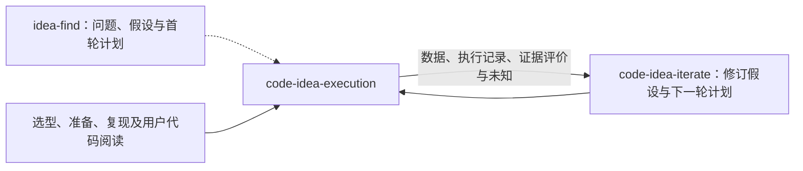

# 研究实验执行

将批准的研究问题与假设落实为可信实验，取得可解释、可追溯的证据，为下一轮研究判断提供依据。执行完成不等于数据有效，数据有效不等于假设成立，假设得到支持不等于有创新性或发表价值。

每轮回答：**原来相信什么、实际观察到什么、这些观察支持到哪一步、哪些仍未知**。可以主动做技术诊断、提出解释、指出设计问题与意外现象；未经确认不能改变研究问题、核心假设、科学比较或测量和统计规则，也不自行进入下一轮研究。

## W&B 记录与身份核对

新增代码实验按 [wandb skill](../wandb/SKILL.md) 和 [共同记录约定](../wandb/references/experiment-records.md) 使用用户内网实例。接收 setup/reproduction 的 tracking_ref 和精确基准 run，保留现有研究轮次、Git commit+diff、实验/重复/attempt 身份；每次启动前登记预分配 W&B run ID，SDK config 保存实际身份，meta 反向保存 run 和同步状态。默认独立 attempt 对应独立 run，恢复源和 checkpoint 明确，多卡 rank 不冒充独立重复。

pre_run 的 provenance 核实例、实际代码/设计/config 与 run 的对应，authorization 核上传范围；handoff 的 traceability/deviations 核全部尝试、查询快照、采样/缺失和同步状态。结束后独立读回所需字段才将对应范围记 synced；训练完成而上传失败仍保留实际结果，按批准策略离线/补同步，不重新训练、不自动切云端。原始关键结果本地保存，科学判断不由 W&B finished/best 标签决定。现有实验检查自动核声明 tracking 的 meta，仅核文件/身份，不能认证远端真实或科学有效。 独立安装时保留本skill完整目录；启用tracking还需相邻wandb配套skill。未启用时不加载该依赖，缺失已声明的依赖则报告未完成，不能忽略检查。

## 关键条件落实到每次启动和结果解释

核对设计与实现时，读取 [研究条件记录](../dl-assistant/references/research-conditions.md)，把必须保留项逐项对应实际代码、配置、数据和测量。pre_run 的 implementation/comparison/provenance 要引用具体核查依据；原问题关键条件被破坏则不开该研究实验。影响未知可按批准设计做有限探索，不能据其筛掉/确认目标假设。

每次 OOM 修复或运行条件变化后重查；关键条件/科学比较变化返回研究确认，不能仅作为工程调整。meta/design 保存 condition_review_ref 和实际核查，handoff 的 inference/deviations 说明现象是否存在、条件偏差及解释范围。按计划及时取得有代表性的目标条件证据，不把所有关键验证拖到论文阶段。

## 输入与前置条件

- 当前研究问题、假设（或明确的探索目标）、已有认识与来源、关键未知及本轮取证需求。
- 用户批准的本轮设计：观察/分析/干预/训练/理论检查、对照、读数、解释范围、预算与允许调整。
- 版本内的 `01-idea-spec.md`、`02-research-plan.md`、`claims.json`；首次接收 idea-find 的三份草案，后续接收 iterate 的版本与变更说明。
- 实际代码/数据/模型/测量入口及准备记录。基准可信度应匹配实验：官方权重经评测验证后可以用于对应评测，不强制先重训；需要训练对比时核对相应训练可信度。
- 保留 code-reading 必经要求：用户先读懂代码，后续仍审阅关键改动。清理步骤按实际需要，不因没有 cleanup 目录而阻塞。

缺少研究设计则回 idea-find/iterate 讨论；缺环境、数据或入口则先处理对应准备工作。不得用占位脚本、未测成本或假定资源冒称已就绪。纯分析也需要核查原数据、测量与统计代码，不要求先实现一个新方法。

## 系统关系



不直接把 supported 命题当论文贡献交后期。全局关系见 `dl-assistant`；中期旧记录按共享格式的迁移说明读取，不套用旧的阳性/阴性成功分类。

## 文件与来源

```text
ideas/v<N>-<slug>/
├── 00-from-previous-version.md    后续版本的研究变更说明
├── 01-idea-spec.md               当前问题、假设、依据与价值边界
├── 02-research-plan.md           批准的本轮取证设计；原批准版本保留
├── 03-claim-code-map.md          问题/假设—实验—代码/测量—读数映射及代码审阅
├── 04-conclusion.md             人读交接
├── conclusion.json              分开记录执行、数据有效性和假设证据
├── claims.json                  假设与证据记录，不是创新点自动清单
├── acceptance-review.md         独立核查记录
├── scratch/                     调试材料；有用证据另登记进实验
└── experiments/
    ├── index.json               全部计划与尝试，不只成功运行
    └── exp-XXX-<name>/
        ├── meta.json            设计类型、实际执行、数据状态、偏差及产物声明
        ├── design.json          运行前保存的设计与版本，或引用的不可变副本
        ├── 报告.md              单实验问题、观察与限制
        ├── configs/             实际配置副本
        ├── scripts/             可复现入口
        ├── runs/                运行日志、逐样本结果、指标与可选checkpoint
        └── analysis/            测量数据、统计与图表，按实际需要保存
```

各实验按实际设计声明所需产物，不要求纯评测有 train.log，也不要求失败实验伪造最终指标。原数据不必复制，但须记录可获得位置、版本/校验及缺失风险。命令、代码commit、未提交diff、配置、模型与数据版本共同定位实验；全部尝试与中止原因保留。配置和报告进版本控制，不能把整个 experiments/ 一概排除；权重、大数据和敏感内容按项目约定管理。

## 执行过程与用户参与

### 1. 恢复与接收本轮

核对当前分支、代码和实际任务，读取上轮结论、问题/假设、计划及未完成项。首次将三份草案复制为版本文件，保留来源并填写版本信息，不重写命题。用共享 [会话恢复说明](../dl-assistant/references/session-recovery.md)。

向用户说明本轮要减少什么未知、如何取得证据、已有授权和缺失条件。开始实施前，核对用户已明确批准当前 spec 和 plan 两份文件，记录批准对应的版本和范围。沿用覆盖当前内容的上游批准；如果记录缺失、只确认了其中一份，或研究问题、设计、关键条件、预算有实质变化，把待确认文件的路径和变更交用户审阅，等两份均获批后再进入实施。等待期间可只读核对现场与材料。复制草案、填写版本信息等整理可以沿用同一内容的批准。

### 2. 核对设计与实现

**长任务启动规则**。预计超过 5 分钟或中断后重跑代价高的命令，单机或 SSH 直连机器上用 `dl-assistant/scripts/run-long.sh` 在实际执行机器上通过 tmux detach 启动。通过集群调度器提交的任务走调度器。启动和恢复细节见 [共享长任务说明](../dl-assistant/references/long-run-ops.md)。

读当前代码、数据处理和统计入口，按 [映射模板](references/claim-code-map-template.md) 记录问题、假设、实验、实现位置与可识别范围。新方法、纯测量和理论检查均可，不强制一个变量或一个新组件；实际因果归因能力由批准设计决定。

可以按预算做最小接口、维度、数据、梯度或已知结果测试。通过某个单batch检查不证明代码无误；调试方法见 [训练诊断](references/training-dynamics-debug.md)。设计不可实现或比较不可解释时说明原因、给建议，未经确认不另改成更容易阳性的实验。

### 3. 代码审阅与开跑确认

关键改动实现后、研究实验开跑前，给用户**实际diff和代码位置**：

- 改了什么及为何服务当前问题/假设；数据预处理、划分、排除、指标和统计同样审。
- 输入输出、关键公式/逻辑、对照与测量怎样实现，哪些前提未验证。
- 运行过的测试、未覆盖部分及风险；不是只做口头解释。
- 实验顺序、成本依据、实际资源、允许调整与暂停条件。

当前 spec 和 plan 的批准有效，并且用户确认关键代码及本次开跑范围后，再启动研究实验。后续改动影响实现语义、数据、读数或统计时重新审阅；无关文件无需反复通读。已有明确授权内的日常检查继续进行。

### 4. 登记并执行

每个实验运行前保存设计类型（exploration/confirmation）、问题与假设映射、对照/读数/分析、预算和实际配置。保存设计副本与时间、代码commit或diff，不能仅靠运行后字段非空声称预登记。

- 探索允许未知的效应或结构，但要有问题、范围与预算；事后形成假设标明来源，不能伪装为预先检验。
- 确认实验按事先方案解释；阈值需有任务意义、测量误差或其他明确依据，无依据不补数字。
- 重复、seed、样本量和不确定性按设计安排，不统一采用2×std，也不只在差值接近时临时加seed直到显著。序贯设计需明确停止规则。
- 同seed不保证比较公平；官方/复现权重、初始化、缩规模与全规模都按问题选，记录理由。缩规模不自动继承全规模趋势。
- 超参、训练长度、batch、精度和筛样本都可能改变解释。仅在批准的范围/预算内自主调整，保存全部尝试；改变科学设计先记录并返回确认，不覆盖原计划。

登记完成、正式启动前执行以下自查。

**开跑前自查（pre_run）**：implementation核对实际diff/测试与批准设计，comparison核对数据/划分/对照/统计，provenance核对设计副本和实际代码/配置/模型/数据，authorization核对用户实际代码审阅与本次运行范围。写具体依据、未验证前提和行动影响；科学设计变化未经批准或关键比较不可解释时先修正，不开跑。效应尚未知可带限制探索，不能假装已确认。

结合任务进程、日志和退出码核实长任务状态。退出码0仍需核对数据完整性；缺退出码不代表仍在运行。避免覆盖输出，重启任务使用独立attempt记录和明确resume来源。

### 5. 持续检查与偏差记录

实验登记后即进台账，执行失败、阻塞、取消和部分数据都保留。按 [meta模板](references/experiment-meta-template.json)、[台账模板](references/experiment-index-template.json) 和 [单实验报告](references/exp-report-template.md) 更新：实际操作、失败原因、与计划差异、意外观察、可解释范围。

按批准的阶段汇报观察、预算使用和剩余任务；用户选择继续、暂停或进入iterate。没有新证据的重复尝试、预算超限、关键对照缺失或数据不可信时及时报告，不固定三次失败才停，也不无限排查。

### 6. 检查记录并独立核查

```bash
bash <skill目录>/scripts/check-exp-artifacts.sh --expdir <实验目录>
bash <skill目录>/scripts/check-exp-artifacts.sh --all <版本>/experiments/
```

脚本只核查格式、声明文件和台账一致性，不证明实验成功、预登记真实、数据有效或科学结论成立。FAIL非零退出；WARN表示有限或未完成，不能当全实验成功。失败/阻塞记录完整也可通过文件检查，必须继续如实显示其执行状态；不能为了通过而补造成功文件。

独立核查前说明任务与输入，按既有要求等用户确认后派agent；不传主agent的预期结论，但应提供批准计划、代码、原始数据、偏差与错误记录，不能为了隔离预期结论而排除必要证据。核查者写独立报告和建议，主agent验证后串行更新证据字段，见 [核查契约](references/acceptance-contract.md)。

### 7. 交接而非预设成功

**解释结果及交接前自查（handoff）**：分别核对执行状态与缺失（execution_state）、数据有效范围（data_validity）、支持是否超过证据及最强替代解释（inference）、全部偏差/尝试（deviations）、实际来源和原review（traceability）。关键误差先纠正；失败或数据不足可以如实交接，不能转写为假设反证。已发现设计改变需记录并返回研究讨论，不把自查未解决项藏在附件。

按 [结论模板](references/conclusion-template.md) 交付执行状态、数据有效性、每个假设的支持程度及限制、全部偏差和意外观察。独立核查未完成就标未核查，不能自称独立验收通过。

报告“原来相信什么／观察到什么／这些观察支持到哪一步／未知与建议”。可以提出下一步解释或实验建议，标为待研究判断；iterate结合价值与资源决定是否实施，不在这里默开下一轮。

## 自查记录与脚本

上述两个时点按 [共享自查规则](../dl-assistant/references/research-self-check.md) 保存 `self-checks/<阶段>-<唯一标识>.json`，输入覆盖批准设计、实际代码/config或diff及已有结果，记录引用进映射/结论。判断、依据、未知、行动影响均需具体；自查不替代用户代码审阅或独立证据核查。

```bash
python3 <skills目录>/dl-assistant/scripts/check_research_self_check.py --record <自查.json> --root <项目根> --skill code-idea-execution --stage pre_run
# 交接前用 --stage handoff，并执行上面的实验产物检查
```

needs_revision先处理或讨论，不执行受阻的目标行动；limited说明为何可继续当前行动。输入变化后重新检查，不复用过期通过记录。脚本非零时不声称已就绪，仍可如实报告阻塞、部分数据和待解决问题；退出0只证明结构/引用/版本一致，不证明授权、数据有效或科学解释正确。不为通过而改标签、伪造依据；不能将同一agent的自查称为独立审阅。

## 版本、权限与共享格式

每轮设计、实现、分析和结果以明确commit/路径追踪，反证、未决和部分完成同样保存。中性的版本tag按需要且遵循用户授权，不以阳性决定是否记录。旧claim tag只作定位，不保证创新性，见 [版本记录](../dl-assistant/references/version-tree.md)。远端push按用户授权执行，不默认推送。

claims证据记录用 [共享模板](../dl-assistant/references/claims-template.json)；结果支持、创新性与研究价值分开，验收不改研究状态或创新字段。共同研究流程见 [研究循环](../idea-find/references/research-cycle.md)，研究说明与计划用 [spec模板](../dl-assistant/references/spec-template.md) 和 [plan模板](../dl-assistant/references/plan-template.md)。

iterate已同步；后期旧消费者尚需同步新版字段；交接注明schema_version=2和解释，消费者不认识时先核对，不能把partial转成refuted或把valid阴性结果丢弃。本skill不迁移历史项目、不擅自重写已有结果。

## 与论文补充实验共享记录

CPE复用meta和基础记录检查，完整run核声明产物，包模式按manifest另核副本/引用。纯人工理论核查明确execution_basis=manual及实际记录，不补假commit；代码任务仍保留实际版本。
