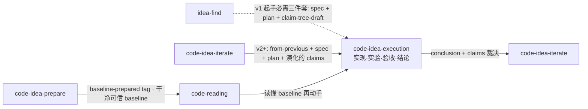
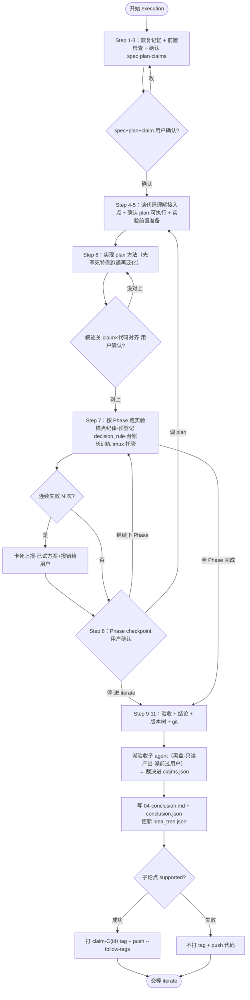

# Code Idea Execution

## 这个 skill 解决什么问题

从确定的 plan 落地为跑通的实验是一段高度交织的循环：写代码 → 跑 smoke → 发现不对 → 改实现 → 再跑 → 看指标 → 调实验。实现与实验持续交织、证据驱动。

本 skill 是**纯执行引擎**：吃 idea-find/iterate 写好的 spec + plan（方法已设计好），在可信 baseline 上完成 [实现 ⇄ 实验 → 验收裁决 → 结论]。**不设计方法**——方法设计是研究决策（要文献 + 设计 + 和用户打磨），归 idea-find（v1）/ iterate（v2+）。**claim 树是脊柱**：本 skill 落地子论点、用实验验它、验收子 agent 下裁决写回它；一版跑完，iterate 基于裁决演化下一版。**用户做研究决策，agent 做执行与证据收集。**

> **进来前你已经有**：一份 spec + plan（v1 来自 idea-find，v2+ 来自 iterate）+ claim 树（两层：总论点 + 子论点）+ 可信 baseline（过 code-project-setup / code-paper-reproduction / code-idea-prepare）。缺哪个先去补。

## 边界：本 skill 做什么、不做什么

**做**：吃 spec+plan+claim 树；实现 plan 的方法（最小语义正确）；跑 plan 的实验矩阵；派验收子 agent 把裁决写进 claims.json；基于裁决写 conclusion；git 跟 plan 走、tag 只在成功节点打。

**三角色分工**（本 skill 含前两个，第三个交 iterate）：

- **execution**：执行（实现 + 实验）+ 记录实验事实
- **验收子 agent**（execution 派，黑盒只读实验产出）：**事实裁决**——数据支不支持子论点（supported / plausible / insufficient_evidence / contradicted，枚举以 `claims-template.json` 为准），基于客观证据
- **iterate + 用户**：**研究判断**——裁决意味什么、子论点失败是方法差还是方向错、总论点要不要演化、下版做什么

> execution（含验收）只到**事实裁决**（数据 vs 子论点），**不做研究判断**（方向 / 总论点 / 下一步归 iterate + 用户）；也不设计方法。

**不做**（交给相邻 skill）：

| 场景                                       | 用                        |
| ------------------------------------------ | ------------------------- |
| 找 idea / 研究空白                         | `idea-find`               |
| 设计方法 / 迭代下一版 / 研究方向判断       | `code-idea-iterate`       |
| repo 还不能跑（环境/依赖/数据/checkpoint） | `code-project-setup`      |
| baseline 是否可信还没验证                  | `code-paper-reproduction` |
| 清理 + 质量优化 baseline                   | `code-idea-prepare`       |
| 逐段精读源码                               | `code-reading`            |
| 写论文 section                             | `writing-*`               |

> **运行位置**：GPU 服务器（开发卡）。从 `baseline-prepared`（CIP 成功产）切分支；CIP 全退或被分诊跳过则从 `baseline-reproduced` 切。

## 在系统里的位置（局部）

本 skill 是 `dl-assistant` 配套 skill 之一，角色是中期 **执行引擎**——吃上游设计好的 spec+plan，产出实验结果 + claim 裁决交下游。



> **execution 不直连后期**：存活 claim、claim×代码地图、总论点不直接交 writing-paper / code-paper-release——全部经 iterate 收口（出口B 收口包）再到后期（见总览「全局 skill 流向图」）。
> 整体架构、全局怎么连，看 `dl-assistant` 的「全局 skill 流向图」；本 skill 只画与自己相关的。

## 产出与保存：版本目录

产出在 repo 的 `ideas/v<N>-<slug>/`（全局目录布局规定，不是 docs/）：

```
ideas/v<N>-<slug>/
├── 00-from-previous-version.md   # iterate 产（仅 v2+）
├── 01-idea-spec.md               # IF/iterate 产（稳定层，execution 只读）
├── 02-research-plan.md           # IF/iterate 产（方法设计，execution 只读）
├── 03-claim-code-map.md          # execution 产：claim×代码×验证逻辑地图（叙述关填）
├── 04-conclusion.md              # execution 产（人读）
├── conclusion.json               # execution 产（机读交接：iterate / release / writing-paper 读）
├── claims.json                   # execution 建 v1 + 验收写裁决 / iterate 演化
├── scratch/                      # debug 脚本（版本级，不进 git）
└── experiments/                  # 不进 git
    ├── index.json                # 实验台账：每轮一行（execution 维护，验收/iterate 读）
    └── exp-XXX-<name>/           # 一个实验一个目录，结构写死如下
        ├── meta.json             # 实验元信息（开跑前预登记 decision_rule/anchor_run，完成后填结果）
        ├── 报告.md               # 人读封面：TL;DR 结论先行（半页，模板见 exp-report-template.md）
        ├── configs/              # 本实验实际用的 config 冻结副本（repo 原件会被改，不冻结不可回溯）
        ├── scripts/              # 可复现脚本（内嵌完整命令行，禁扔 /tmp）
        ├── runs/                 # 训练/消融类实验的产物区
        │   └── seed-<n>/
        │       ├── train.log     # 训练全量日志（tmux 托管输出落这）
        │       ├── eval.log      # 评测日志
        │       ├── metrics.json  # 指标（机读）
        │       └── checkpoints/  # 权重（大文件，按 long-run-ops 清理）
        └── analysis/             # 诊断/分析类实验的产物区
            ├── report.md         # 分析详版（现象→数据→根因）
            ├── data/
            └── figures/
```

> 目录契约由 `scripts/check-exp-artifacts.sh` 机器验收（每实验跑完自查 + Step 9 全量），结构不符 = 产物不接收。

> spec/plan/from-previous 归 idea-find/iterate 产（execution **只读消费**，一个字不改——claim×代码地图落 `03-claim-code-map.md`，实验状态落各 exp 的 `meta.json` + 台账，都不写 plan）；conclusion + claim-code-map + claims 裁决归 execution 产。**跨机器交接**：代码分支+tag 用 `git push --follow-tags`；实验数字/产出需要时找用户要（横切规范见 `dl-assistant` SKILL.md「横切规范」）。

## 核心纪律

### 迭代纪律（服务 2-3h 一轮、上限 4h 的 method 快速迭代）

- **一次只加一个改动**：每个实验相对它的锚点只引入一个变量，结果归因才干净。改动粒度与 claim 粒度对齐——一个实验回答一个子论点的一个问题。
- **锚点纪律**：每个变体从**同一个锚点**切——`reproduced_baseline_checkpoint`（CPR 登记的可信权重，不从 official ckpt 切）或上一个 supported tag，**绝不从上一个还没裁决的变体 ckpt 接着训**（未验证的改动复利式叠加，归因全乱）。迭代期对比固定 seed（减方差省钱），delta 接近 noise_floor 时才加 seed 确认。
- **先写死特例跑通再泛化**：实现新方法时，先在最小配置（单 batch / 关增强 / reduced config）跑通机制，再放大到完整配置——don't be a hero，不一次写全再整体调。训练动态病态按 `training-dynamics-debug.md` 的顺序定位（先 overfit 单 batch 分两界）；机制级 sanity 用 `code-paper-reproduction/references/trust-traps.md` 的「组件级验证手册」（overfit one batch / loss @ init / input-independent baseline / 进网络前可视化 / 梯度依赖检查）。
- **keep/discard 预登记**：每个实验开跑前在 `meta.json` 写死 `decision_rule`（什么结果算 keep）和 `anchor_run`（对比锚点是哪个 run）；跑完按预登记规则判，不移动球门。**`decision_rule` 必须带判据三问落盘**（`decision_rule_rationale`：验什么假设 / 阈值来历 / 命中意味着什么+后路——光写不讲用户没法审）。判据来源：`reproduction.json` 的 `noise_floor`（delta < 2×std 不可判 keep/discard）。注意 decision_rule 只管**实验级** keep/discard（资源 + 记录纪律），不裁 claim——claim 级事实裁决归验收子 agent（verdict），claim 生死（status）归 iterate+用户验尸后拍板。
- **微观迭代自治带**：**不改变 claim 语义的变体**（超参、seed、工程实现细节）execution 自主试，记台账、Phase checkpoint 时汇报；**改变机制的变体**（动方法本身）必停，回用户 / 回 iterate。自治带内不死磕：连续失败 N 次（默认 3）照样卡死上报。
- **scale-risk 标记**：机制上可能和数据规模交互的变体（reduced 小数据规模上成立、full 规模上可能消失或反转），在 `meta.json` 和 `conclusion.json` 打 `scale_risk` + 一句话理由——CPE 跑 full-scale 时优先验这些。
- **简洁性判据**：提升要抵得过复杂度——keep 的不只是"指标涨了"，还要权衡引入的复杂度（新增行数 / 新依赖 / 新概念）；**删代码能持平也是赢**（同等指标下更简的变体优先 keep，那是最终论文 method 的卖点）。预登记 `decision_rule` 时把复杂度权衡写明白。
- **对照 baseline 曲线**：训练中对照 `reproduction.json` 的 `baseline_curves`（loss / metric / 固定批预测演变）形状，判「训崩了还是方法不行」。
- **单轮预算**：实验矩阵默认用 `reduced_setting`（单轮 ≤ 迭代预算：默认 2-3h、上限 4h）跑；全量只留关键验证。`scale_sweep.verdict: degraded` 时 reduced 只排方向、重大结论回 full。改模块前查 CIP 的 `hot-path.md`——改动不在训练热路径上 = 迭代循环执行不到，要自己补验证。

### 五个确认点（必停，等用户）

| 确认点               | 何时                     | 用户做什么                         |
| -------------------- | ------------------------ | ---------------------------------- |
| spec+plan+claim 确认 | Step 3                   | 确认 plan 方法 + claim 树合理      |
| 叙述关               | Step 6 实现后、开跑前    | 逐子论点审 claim×代码×验证逻辑对齐 |
| 卡死上报             | Step 6/7 连续失败 N 次   | 决定继续试/回退/回 iterate         |
| 长训练启动           | Step 7 开 full run 前    | 高消耗拍板（eval/smoke 不用）      |
| Phase checkpoint     | Step 8 每 Phase 完       | 继续下 Phase/停/调 plan            |
| 派验收子 agent       | Step 9                   | 派前过用户（含判断派发）           |

> 低消耗操作（eval/smoke/读代码/写文件）不必停；**语义改动、高消耗、含判断的派发**必停。微观迭代自治带内的工程级变体不占确认点（Step 8 统一汇报）。

### 长任务托管

**亮线规则**：预计 >5 分钟 / 会话断开重跑代价高的命令 → 一律 tmux detach（拿不准时长就当长任务），首选封装脚本 `dl-assistant/scripts/run-long.sh`；禁止 `run_in_background`、禁止前台干等。长训练用 tmux detach 托管，输出落 `experiments/<exp>/runs/train.log` + `EXIT_CODE`，agent 可离场、重连读文件恢复。详见 `dl-assistant/references/long-run-ops.md`。session 前缀 `ex-<slug>-<exp>`。

### git 工作流：跟 plan 走、tag 只在成功节点打

改动 commit 到 `idea/v<N>-<slug>` 分支，跟 plan 走；**tag 只在子论点 supported 的成功节点打**（`claim-C<id>` 首次成立 / `claim-C<id>-v2` method 迭代新锚点），失败（refuted）节点不打。详见 `dl-assistant/references/version-tree.md`。push 用 `git push --follow-tags`（不是裸 push，否则 tag 不上传）。

## 上游接缝：输入清单 + 字段用法

**v1 起手**（idea-find 产草稿，execution 升级为版本文件）：

1. 把 IF 的 `<方向slug>-idea-spec-draft.md` 拷入升级为 `01-idea-spec.md`，`<方向slug>-idea-plan-draft.md` 升级为 `02-research-plan.md`（补版本号；内容不改——plan 只读从这开始）。
2. 把 IF 的 `<方向slug>-claim-tree-draft` 拷入并转成 `claims.json`（schema 以 `dl-assistant/references/claims-template.json` 为准；更新 `version: v1-<slug>` / `parent_version: null` / `snapshot_date`）——**脊柱诞生**。
3. 从 baseline tag 切 `idea/v1-<slug>` 分支，建 `ideas/v1-<slug>/`。

**v2+ 起手**：iterate 已切好分支 + commit 种子文件，execution 接手读 `00-from-previous-version.md` + `01-idea-spec.md` + `02-research-plan.md` + `claims.json`（已演化）+ 上一版 `04-conclusion.md`。

**setup / reproduction / cleanup 目录**（路径按 `dl-assistant` 目录布局定位，找不到问用户；**CIP 被 CPR 分诊跳过则没有 cleanup 目录**，属正常路径，读 CPR 交接说明里记录的跳过理由）：

| 字段 | 用法 |
| --- | --- |
| reproduction.json `target`（冻结） | 对比的口径基准；execution 改 metric 口径 = 语义改动即停 |
| reproduction.json `noise_floor` | keep/discard 判据来源（delta < 2×std 不可判） |
| reproduction.json `reduced_setting` | 迭代载体：默认实验配置 + `baseline_result` 锚点数字 |
| reproduction.json `reproduced_baseline_checkpoint` | 微调/初始化从这切，不从 official ckpt 切 |
| reproduction.json `baseline_curves` | 训练中对照曲线形状，判训崩 vs 方法不行 |
| reproduction.json `known_pitfalls` / `determinism` | 避坑清单（EMA ckpt / metric 有坑）；seed/cudnn 复刻 |
| reproduction.json `frozen_components` / `mutable_components` | 改动落在 mutable 里，可比性才有保障 |
| cleanup.json `handoff.execution_branch_from` | 从哪个 tag 切分支（无 cleanup 目录 → `baseline-reproduced`） |
| cleanup.json `handoff.iteration_command` / `iteration_verified` | 迭代命令 + 是否已验证；`false` 时第一轮 reduced run 兼做 baseline 复检（对 `reduced_setting.baseline_result`） |
| cleanup.json `handoff.hot_path` | 改模块前查在不在训练热路径上 |
| cleanup.json `uncovered_code` / `protected_iteration_infra` | 必看：未验过的代码（碰到谨慎）；迭代设施（别误删） |
| setup.json `conda_env` / `ready_commands.train_smoke` | 环境继承不重搭；实现后的 smoke 首选命令 |

## 运行流程总览



**TaskList 跟踪流程**：Step 3 确认后建任务（读代码 / 实现+叙述关 / 按 plan 的 Phase 跑实验（每 Phase 一项）/ 验收+结论+tag），每步完成即勾——多 Phase + 长训练托管，防恢复后跳步。

## references 文件列表

| reference                           | 讲什么                                             | 位置                                | 什么时候读             |
| ----------------------------------- | -------------------------------------------------- | ----------------------------------- | ---------------------- |
| `version-tree.md`                   | 版本树规范（git 跟 plan、tag 只成功、两层 claim）  | **dl-assistant/references/**        | **现在就读**           |
| `claims-template.json`              | claims.json schema（总论点+子论点两层）            | **dl-assistant/references/**        | Step 2 / Step 9        |
| `spec-template.md`                  | spec 骨架（稳定层）                                | **dl-assistant/references/**        | Step 2 读 spec 时      |
| `plan-template.md`                  | plan 骨架（共享协议+方案设计+实验总览+原理+DoD）   | **dl-assistant/references/**        | Step 2/4 读 plan 时    |
| `plan-writing-principles.md`        | plan 编写原则（IF/iterate 用，execution 读着理解） | **dl-assistant/references/**        | Step 4 理解 plan 时    |
| `idea-tree-template.json`           | idea_tree.json 骨架                                | **dl-assistant/references/**        | Step 11                |
| `long-run-ops.md`                   | 长训练托管（tmux/状态/重连）                       | **dl-assistant/references/**        | Step 7 长训练          |
| `trust-traps.md`                    | 组件级验证手册（机制级 sanity）                    | **code-paper-reproduction/references/** | Step 6 实现验机制   |
| `from-previous-version-template.md` | from-previous 骨架（iterate 产）                   | **code-idea-iterate/references/**   | Step 2 读 v2+ 输入     |
| `conclusion-template.md`            | conclusion.md + conclusion.json 骨架               | execution/references/               | Step 10                |
| `claim-code-map-template.md`        | claim×代码地图骨架（叙述关底稿，release 消费）     | execution/references/               | Step 6 叙述关          |
| `acceptance-contract.md`            | 验收子 agent 契约                                  | execution/references/               | Step 9                 |
| `experiment-meta-template.json`     | 实验 meta.json 骨架（含 decision_rule / anchor_run / scale_risk） | execution/references/  | Step 7 建实验          |
| `experiment-index-template.json`    | 实验台账 index.json 骨架（每轮一行）               | execution/references/               | Step 5 建台账 / Step 7 记行 |
| `exp-report-template.md`            | 实验 报告.md 骨架（人读封面，半页）                | execution/references/               | Step 7 每实验跑完      |
| `check-exp-artifacts.sh`            | 实验产物验收脚本（目录契约机器查）                 | execution/scripts/                  | Step 7 自查 / Step 9 全量 |
| `project-context-template.md`       | PROJECT_CONTEXT 模板                               | **dl-assistant/references/**        | Step 1                 |
| `session-recovery.md`               | session 恢复记忆（四节+三层记忆）                  | **dl-assistant/references/**        | Step 1 每次            |
| `training-dynamics-debug.md`        | 训练动态诊断顺序（overfit 单 batch 分两界）        | execution/references/               | Step 6/7 训练不 work 时 |

核心阅读原则：**SKILL 开始运行前**必读 `version-tree.md`；**每个阶段运行前**检查该阶段 reference。

## 常见错误

- 不要**自己设计方法** —— 方法在 plan 里（IF/iterate 设计），execution 只实现；要改方法回 iterate。
- 不要把完整训练当实现验证 —— 先写死特例（单 batch / reduced）证明机制接入。
- 不要代码改动和子论点脱节 —— 每个核心改动都知道支撑哪个子论点（叙述关就查这个）。
- 不要脱离 reproduction/cleanup 状态凭空选 baseline —— 不可信的 baseline 是论文炸弹。
- 不要从上一个未裁决的变体 ckpt 接着训 —— 每个变体从同一锚点切（锚点纪律）。
- 不要一次加多个改动 —— 一个实验一个变量，归因才干净。
- 不要跑完才想判据 —— 开跑前预登记 `decision_rule` + `anchor_run`，不移动球门。
- 不要光写判据不讲推导 —— `decision_rule` / 失败解读表条目必须带判据三问落盘（验什么假设 / 阈值来历或「无先验」标注 / 命中意味着什么+嫌疑层+后路），确认点逐条讲给用户。
- 不要把失败解读表命中当 claim 死刑 —— 命中只触发对应解读 + 如实记录；claim 生死（status: refuted）归 iterate + 用户验尸后拍板，execution 永不动 status。
- 不要把工程级微调也停下等确认 —— 微观迭代自治带内自主试，checkpoint 统一汇报；机制级改动才必停。
- 不要 reduced/smoke 失败后继续 full run。
- 不要混用不同 split/metric/checkpoint 直接比较 —— 可比性炸弹（验收会揪出来）。
- 不要只存最终数字，不存 command/commit/config/seed —— 后续无法审计。
- 不要绕过目录契约自造保存位置 —— experiments/ 结构已写死（configs/scripts/runs/analysis 各归各位），跑完用 `check-exp-artifacts.sh` 自查。
- 不要把脚本/log 扔 `/tmp` —— 重启归零；进 `experiments/<exp>/scripts/` 或 `scratch/`。
- 不要用 `run_in_background` 跑长训练 —— 会话退出即杀；用 tmux detach。
- 不要在 execution 里做研究判断（"该放弃 Y"/"下版做 Z"） —— 归 iterate；你只记录事实。
- 不要让验收子 agent 读 execution 对话/debug —— 破黑盒。
- 不要跳过叙述关 —— 代码误解 plan 会被 GPU 放大。
- 不要跳过 Phase checkpoint —— 每 Phase 完必须停下来问用户。
- 不要**给失败节点打 tag** —— tag 只在子论点 supported 的成功节点打（claim-C<id>）。
- 不要跳过 session 开头恢复记忆 —— 服务器新 session 失忆，不读代码就瞎提方案。
- 不要卡死死磕 —— 连续失败 N 次上报用户，不死磕。
- 不要在会话里用 `$...$` LaTeX —— 会话符号用 Unicode（横切规范见 `dl-assistant` SKILL.md「横切规范」）。

## 运行流程详情（Step 1 - Step 11）

### Step 1 恢复记忆（每次开 session 必做）

服务器每开一个新 session，**先从盘上把上下文灌回来**再干任何活——吐四节小结（我们在干啥 / 我们在哪 / 代码长这样 / 准备干啥），**读完代码才准提实验方案**。四节各读什么、PROJECT_CONTEXT、三层记忆见 `dl-assistant/references/session-recovery.md`。

### Step 2 前置检查 + 读输入

- 按「上游接缝」读 setup / reproduction / cleanup 目录 + IF（v1）/ iterate（v2+）的输入；v1 按三步走完成草稿升级（01/02/claims.json）。
- **CIP 被分诊跳过（无 cleanup 目录）**：属正常路径，从 `baseline-reproduced` 切；且第一轮 reduced run 兼做 baseline 复检（数字对 `reduced_setting.baseline_result`）。
- **cleanup.json 的 `iteration_verified: false`**：提醒用户迭代起点未验证，同样第一轮先复检。
- **uncovered 清单 + `protected_iteration_infra` + `known_pitfalls` 必读**。

### Step 3 确认 spec + plan + claim 树（确认点 1）

确认两样：**plan 的方法**（这版做什么、怎么接入）和 **claim 树**（要验哪些子论点、ID 合不合理——脊柱，错了后面全跑偏）。

- **plan**：spec+plan 是 idea-find/iterate 产的，过一遍**确认理解**（execution 不改 plan，发现不可执行上报用户回 iterate）。
- **claim 树**：逐子论点讲——claim ID + 命题（白话）+ 可证伪/可测 + 优先级。每条用户点头「值得验、能验」。
- **失败解读表**：spec §4 + plan 各实验的解读条目逐条过**判据三问**（验什么假设 / 阈值来历或「无先验」标注 / 命中支持哪种解读+嫌疑层+后路）——白话讲到用户能审；讲不出三问的条目当场补推导，补不出上报回 iterate，不带病进实验。**执行期没有 claim 死刑**：解读条目命中只触发对应解读 + 如实记录，claim 生死归 iterate + 用户验尸后拍板。

确认后才进 Step 4。

### Step 4 读代码 + 确认 plan 可执行

- 读**当前版本的代码**（baseline + 前几版已落的实现），理解架构 / 数据流 / 训练流程，定位 plan 方案的接入点。
- **确认 plan 可执行**：plan 的代码指引 + 方案设计 → 接入点找得到、改动可行。
- **不生成 plan**（plan 已由 idea-find/iterate 设计）。若发现 plan 有不可执行处（接入点不存在/方案自相矛盾）→ 上报用户，回 iterate 调 plan，不自己改方法。

### Step 5 实验前置准备

环境检查（依赖、数据集、baseline checkpoint——微调从 `reproduced_baseline_checkpoint` 切）+ 代码 sanity（smoke 通过，首选 setup.json 的 `train_smoke`）+ 建 `experiments/` 目录 + 按 `experiment-index-template.json` 初始化台账 `experiments/index.json`。

### Step 6 实现代码 + 叙述关（确认点 2）

按 plan 方案实现：最小语义正确实现，**先写死特例跑通再泛化**（单 batch / 关增强 / reduced config 先跑通机制），改动 commit 到 git。机制级 sanity 用 `code-paper-reproduction/references/trust-traps.md` 的组件级验证手册；训练动态病态按 `training-dynamics-debug.md` 顺序定位。失败自己 debug（不是停顿点）。

**代码写完、开跑前，叙述关**（claim 优先，只讲这版新实现/改动的子论点，继承的不重讲）。每个子论点四步：

1. **子论点是啥意思** —— 白话讲要证明啥（带 claim ID，对齐 claims.json）。
2. **对应代码是哪块** —— `file:line` / 模块名。
3. **这块代码干啥** —— 机制。
4. **为啥能验证** —— 代码→claim 的验证逻辑；**诚实说前提假设**（"在假设 X 下成立，X 不成立就没真测到"）。讲不出清晰逻辑 = 没对上。

全部走完 → 给**跑的顺序**（依赖关系）。**用户确认才开跑**——误解当场抓，不浪费 GPU。

> 叙述关的四步内容落盘成 **`03-claim-code-map.md`**（claim ID → file:line → 验证逻辑）。这是 release 抽发行版时要的 claim×代码地图——写在这个独立文件里，**不写进 plan**（plan 只读）。

> **卡死上报**：实现/smoke 连续失败 N 次（默认 3）→ 不死磕，**上报用户**（已试方案 + 当前报错），用户决定继续试 / 回退 / 回 iterate 调方法。

### Step 7 按 Phase 执行实验

每个实验：

1. 建实验目录 `experiments/exp-XXX-<name>/`，写 `meta.json`（按 `experiment-meta-template.json`：配置、git commit、seed、claim_cids + **预登记 `decision_rule` / `anchor_run`** + 需要时 `scale_risk`）。
2. **冻结 config**：本实验实际用的 config 文件拷进 `experiments/<exp>/configs/`——repo 原件会被后续实验改，不冻结副本，老实验的真实配置就不可考。
3. 可复现脚本进 `experiments/<exp>/scripts/`，**脚本内嵌完整命令行**（含全部参数，看脚本即知怎么跑的）；debug 脚本进版本级 `scratch/`；**禁写入 `/tmp`**（重启归零）。
4. 运行：训练/消融 → `runs/seed-X/{train.log, eval.log, metrics.json, checkpoints/}`；诊断/分析 → `analysis/{report.md, data/, figures/}`。默认用 `reduced_setting`（单轮 ≤ 迭代预算）；长训练 tmux 托管。
5. 完成后更新 `meta.json`（状态、结果、关键数据）+ 写 `报告.md`（按 `exp-report-template.md`，半页人读封面）+ **台账 `index.json` 记一行**（实验 ID / claim / 锚点 / 关键数字 / keep 还是 discard / 一句话原因）。
6. **产物自查**：跑 `scripts/check-exp-artifacts.sh --expdir experiments/exp-XXX-<name>`——目录契约、预登记字段、台账对账机器查，查不过先补齐再进下一个实验。
7. 汇报口径：记关键数据 + **描述性观察**（"数据显示 X"），不是判断性（"所以该放弃 Y"——归 iterate）。

**锚点纪律**：变体从 `reproduced_baseline_checkpoint` 或上一个 supported tag 切；对比固定 seed，delta 接近 `noise_floor`（< 2×std）才加 seed。
**微观迭代自治带**：claim 语义不变的工程级变体自主试、记台账；机制级改动必停回用户。

### Step 8 Phase checkpoint（确认点 3）

每个 Phase 完成后停下来，展示核心观察（含自治带内试过的变体台账摘要），问用户：继续下一个 Phase / 停下来 review（提前进 iterate）/ 调整 plan（改后续实验）。

### Step 9 整理产出 + 派验收子 agent（确认点 4）

先全量验收产物：跑 `scripts/check-exp-artifacts.sh --all experiments/`——所有实验的目录契约 + 预登记字段 + 台账对账机器查，**查不过先补齐/重跑，不齐不派验收**。然后按 `references/acceptance-contract.md`，用 Agent 工具派一个子 agent（**general-purpose，禁 Explore**；全新上下文，**不传 execution 对话历史**；派前过用户）：

- **输入**：`01-idea-spec.md` + `claims.json`（本版新子论点全 pending）+ `experiments/`（含台账）+ git 状态。
- **禁止读**：execution 对话 / debug / 解释、`04-conclusion.md`（还没写）。
- **输出**：把每个 pending 子论点的裁决**直接写进 `claims.json`**，`verdict_source: acceptance-v<N>`。不出独立报告。

裁决写回后，主 agent 照 `claims-template.json` 校验 schema（必填字段 / 枚举值 / evidence 指针存在），失败修或重派——见 `acceptance-contract.md` 的「写回机制」。

### Step 10 写结论报告

验收写回 `claims.json` 后，写 `04-conclusion.md` + `conclusion.json`（按 `references/conclusion-template.md`）：实验产出总览 / 核心发现（现象→诊断→根因）/ claim 裁决表（从 claims.json 渲染，不重抄）/ 版本结论（成功/失败/部分 + trade-off 诚实）/ 可复现信息。**研究方向判断（下版做什么）不写这，交 iterate 的 from-previous**。

### Step 11 更新版本树 + git

- 更新 `ideas/idea_tree.json`（按 `dl-assistant/references/idea-tree-template.json`）：当前节点填 status、outcome、key_findings。
- **打 tag（只在成功节点）**：本版核心子论点 supported → 打 `claim-C<id>`（首次成立）或 `claim-C<id>-v2`（method 迭代新锚点）；失败节点**不打 tag**。详见 `dl-assistant/references/version-tree.md`。
- `git push --follow-tags`。
