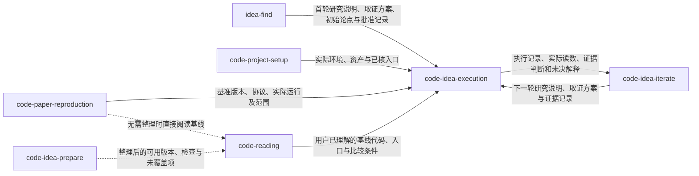
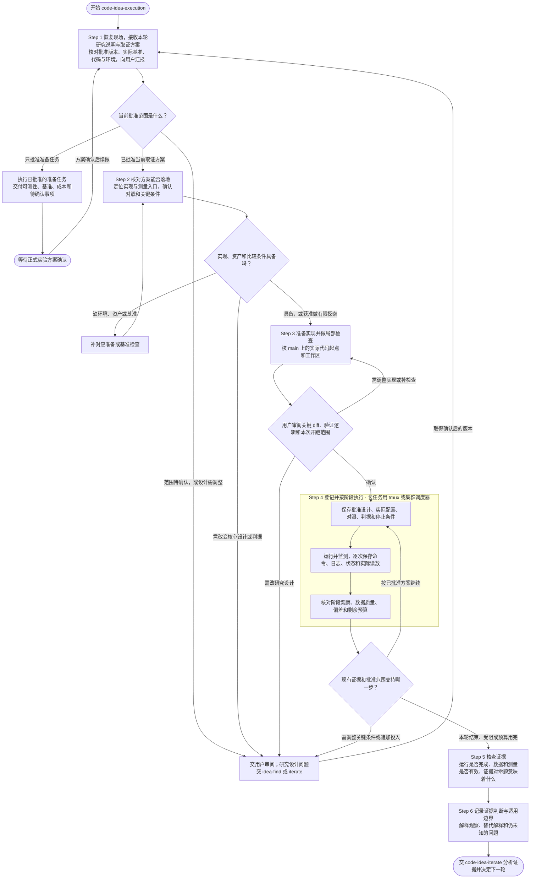

# 执行研究实验并交付证据

在「提出假设 → 设计实验 → 收集数据 → 分析并修订假设 → 提出下一步假设」的科研循环中，本 skill 负责把已确认的假设和取证方案落实到代码与测量，取得可复查的证据，并说明这些证据能支持到哪里、还有哪些解释尚未区分。

实验结束后逐项回答 **运行是否完成、数据和测量是否有效、证据对命题意味着什么**。给用户说明原来要检验什么、实际观察到什么、结论适用于哪些条件，以及下一轮需要解决什么。共同研究流程见 [dl-assistant](../dl-assistant/SKILL.md#共同研究流程)。

## SKILL 交接关系



优先使用用户指定的上游记录。实际任务可以是训练、评测、数据分析、组件测量或理论检查。实验需要训练证据时核对应的训练基准，使用固定发布权重时核适用的评测基准。清理按需要进行，用户基线代码阅读和本轮关键改动审阅各有对应的确认内容。

## 产出与保存

在 `docs/research/v<N>-<slug>/` 保存本轮产物，与 iterate 共用目录。一个研究轮次可接收多批获批任务。用目的命名任务、实验和批次，例如 `verify-fixed-dispatch`、`exp-verify-fixed-dispatch`。在 plan 和台账里写简短标题，已有记录使用原标识。

| 产物 | 何时创建与记录内容 |
| --- | --- |
| `docs/research/research-rounds.json` | 首轮获批开立时登记，整轮交接时补实际收尾 commit 或轮次 tag |
| `docs/research/PROJECT_CONTEXT.md` | 首轮缺少 prepare 的初始化时，按已核事实补建 |
| `research-spec.md`、`research-plan.md` | 接收本轮研究说明和取证方案时保存版本快照，保留来源和批准记录 |
| [论点与代码映射](references/claim-code-map-template.md) `claim-code-map.md` | 实现和审阅时更新。关联命题、取证任务、实际代码、数据及测量位置、已试检查和开放前提 |
| [论点记录](../dl-assistant/references/claims-template.json) `claims.json` | 接收上游快照。证据核查后更新被检验子论点的证据判断和边界 |
| `executions/<批次-slug>/execution-result-review.md` | 开展独立核查时，由审阅子 agent 写该批覆盖的实验、run、证据和判断边界 |
| [结论与机读交接](references/execution-conclusion-template.md) `execution-conclusion.md`、`execution-conclusion.json` | 本轮结束、受阻或达到停止条件时整理。分开写执行、测量质量、证据判断和未决事项 |
| `experiments/index.json` | 登记首项实验时建立，持续记录实验及全部尝试的状态和引用 |
| `experiments/exp-<实验-slug>/` | 每项实验实际登记时建立，保存设计、执行及结果。一批可包含多个实验 |
| `scratch/` | 按需存临时调试材料。支撑结论的材料引用到相应实验记录 |

```text
experiments/exp-<实验-slug>/
├── design.json        # 开跑前保存获批设计与版本，或保存指向固定副本的引用
├── meta.json          # 登记实验身份、命题与对照，随执行补状态、偏差和产物
├── report.md           # 开跑前写目的和获批设计，运行后补实际条件、读数和判断
├── configs/           # 按需保存实际配置、覆盖项和所用清单
├── scripts/           # 按需保存可复跑命令和实际入口
├── runs/<run-id>/     # 每次实际运行、重复或恢复尝试独立记录
└── analysis/          # 按需保存分析报告、中间数据和图表
```

```text
runs/<run-id>/
├── meta.json          # 运行身份、命令引用、代码与环境、资产与重复条件，随后回填实际状态
├── run.log            # 实际 stdout/stderr，或引用 tmux / 调度器生成的日志
├── EXIT_CODE          # 已落盘的退出状态，或引用工具生成的状态证据
├── metrics.json       # 有数值结果时，保存指标、单位和实际统计范围
└── outputs/           # 按需保存逐样本结果、轨迹、曲线或 checkpoint 指针
```

保存失败和中止尝试。跨机器交接时写明资产的实际位置、版本或校验值及取得方式；结论所需数字须能回查原始证据。

## 运行流程图



## 参考资料列表

| 参考资料 | 什么时候读 |
| --- | --- |
| [运行手册](references/workflow.md) | 开始或续做时，按已批准范围执行六步 |
| [研究交接](../idea-find/references/research-handoff.md)、[会话恢复](../dl-assistant/references/session-recovery.md) | 接收首轮研究文件和批准记录，或恢复已有运行时 |
| [论点、代码与测量映射指引](references/claim-code-map-guide.md) | 实现前追实际入口、对照和读数，准备代码审阅 |
| [论点与代码映射模板](references/claim-code-map-template.md) | 填写映射，记录检查和用户审阅时 |
| [组件与差距排查](../code-paper-reproduction/references/trust-traps.md)、[训练与测量诊断](references/training-dynamics-debug.md) | 局部检查或阶段运行出现偏差，需要从日志、诊断脚本或可选的 mcp-debugger 定位运行时状态时 |
| [实验元记录](references/experiment-meta-template.json)、[实验台账](references/experiment-index-template.json)、[单实验报告](references/exp-report-template.md) | 登记和回填实际运行时 |
| [实验设计记录](references/experiment-design-template.json)、[单次运行记录](references/run-meta-template.json) | 锁定获批设计和每次尝试实际使用的代码、配置与产物时 |
| [长任务托管](../dl-assistant/references/long-run-ops.md)、[W&B 共同记录](../wandb/references/experiment-records.md) | 启动、恢复和追溯运行时。实验使用 W&B 时核其运行身份及同步证据 |
| [独立证据核查](references/acceptance-contract.md)、[共享论点记录](../dl-assistant/references/claims-template.json) | 整理执行、测量和子论点证据判断时 |
| [结论与机读模板](references/execution-conclusion-template.md) | 汇总各批观察、核查实际证据并交回 iterate 时 |

## 执行原则与确认点

1. **按实际批准的内容行动。** 核研究说明、本轮取证方案和明确批准的任务及预算。已批准的实现和局部检查按范围推进。核心假设、关键对照、统计规则或投入需要变化时，带上问题与建议重新确认。
2. **代码审阅让用户能跟上。** 按「要区分什么 → 实际代码怎样实现对照 → 会看什么读数 → 各种结果如何解释」呈现，引用实际 diff、文件位置、已跑检查和未验证前提。研究实验在关键代码、实际测量和本次开跑范围确认后启动。
3. **比较规则来自本轮设计和证据。** 运行前登记对照、观察量、解释、重复方式和停止条件。测量或重复的安排服务于具体未知。Reduced 的实测证据绑定当前改动、基线和规模，影响后续决策时按需要升到适合的条件。重大差异、阴性观察和失败都保存。
4. **独立核查和研究判断各留依据。** 核查者提供记录和建议，主会话核证据后串行更新相关子论点的 `evidence_assessment`、来源、质量和适用范围。论点的研究状态、总论点和贡献判断由 iterate 与用户处理。按 [共享论点记录](../dl-assistant/references/claims-template.json) 填写。
5. **代码版本、运行身份和授权可查。** 默认沿研究仓库的 `main` 推进。开轮和续做时核实际代码、轮次及获批任务。各次尝试关联实际代码与 diff、配置、数据、权重及环境。提交、合并、标签和远端同步按项目约定及已有授权执行。
