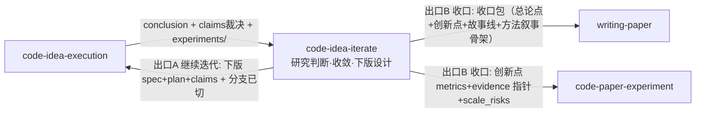
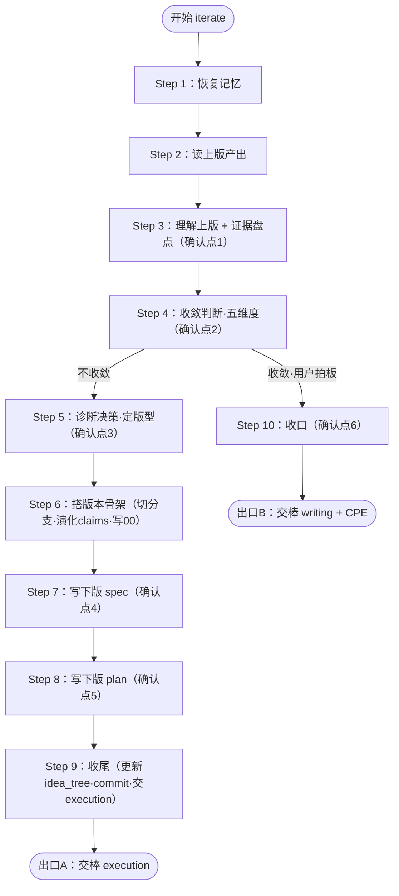

# Code Idea Iterate

## 这个 skill 解决什么问题

execution 只执行 + 记录、验收只裁决——都不做研究判断。但真实科研里，拿到一版结果后最关键的两类动作都是**研究判断**：

1. **怎么演化**：这个子论点证伪了 / 效果不好，下一步往哪走——这是**诊断**驱动的（先搞清楚问题出在哪，再判方法差 / 方向错 / 总论点演化），不是凭空拍脑袋。真实节奏是「改模型 ⇄ 诊断」交替：改模型后往往要先做几轮诊断（验尸 / probe），累积够证据才能判。**诊断是 iterate 的本职，在当前会话就地做（Step 5），不外包给 execution**——execution 只吃检验模式的实验（验 claim 的方法版）。
2. **该不该收口**：创新点够不够支撑一篇 paper、deadline 到没到——story 讲圆了就收口写论文，没圆就继续迭代。

本 skill 就是这个**研究判断枢纽**：读上一版产出，与用户对话做诊断 + 收敛判断，**演化两层 claim 树**，产下一版 spec+plan 交回 execution，**或**产收口包交 writing + CPE。**三角色里的研究判断角色——人和 agent 一起拍板方向与收口时机，不替用户决定，也不让用户独自摸索。**

> **进来前项目中已经有**：上一版 execution 跑完（`claims.json` 带裁决 + `04-conclusion.md` + `conclusion.json` + `idea_tree.json` + `experiments/`）+ 带有上一版实现的 repo。上一版没跑完别进来（先回去跑 execution）。

## 边界：本 skill 做什么、不做什么

**做**：研究判断（分层诊断）+ 收敛判断；演化两层 `claims.json`；产下版 `01-idea-spec.md` + `02-research-plan.md` + `00-from-previous-version.md/.json`（出口 A）；产收口包 `ideas/paper-package.md`（出口 B）；切新版本分支 + commit 种子；更新 `idea_tree.json`。

**三角色分工**（本 skill 是第三个，前两个在 execution）：

- **execution**：执行（实现 + 实验）+ 记录实验事实
- **验收子 agent**（execution 派）：**事实裁决**——数据支不支持子论点
- **iterate + 用户**：**研究判断**——裁决意味什么、子论点失败是方法差还是方向错（诊断驱动）、总论点要不要演化、什么时候收口、下版做什么

> **方法设计归本 skill**（v2+）/ idea-find（v1）——execution 是纯执行引擎，不设计方法。本 skill 的 Step 7/8 产 spec + plan（方案生成 + 方法设计 + 实验矩阵），execution 据此实现。

**不做**（交给相邻 skill）：

| 场景 | 用 |
| --- | --- |
| 写代码（实现方法）、跑 plan 实验、下裁决 | `code-idea-execution`（+ 验收子 agent） |
| 第一阶段从零 / 从一篇论文找方向 | `idea-find` |
| idea 彻底走不通，要找全新起点 | `idea-find` |
| 打 tag、填上一版 outcome | `code-idea-execution`（它跑完自己那版时干） |
| 系统读懂某篇文献 | `paper-reading` |
| 写论文 section | `writing-*` |

> iterate 只切**新版本**的分支 + commit 自己的种子文件；**不打 tag、不填 outcome**（execution 干）。也不改上一版的任何文件。
>
> **例外——诊断归 iterate**：方法版判死后的验尸 / 诊断 probe（探索模式：不改 method、不验 claim、不进 claims.json）由 iterate 在会话内就地做（Step 5），不交 execution。边界按**实验性质**划：验 claim 的实验（检验模式，要预登记 + 验收裁决）走 execution；诊断 probe（探索模式，只回观察）走 iterate。

## 在系统里的位置（局部）



> 整体架构、全局怎么连，看 `dl-assistant` 的「全局 skill 流向图」；本 skill 只画与自己相关的。

## 产出与保存

**运行位置**：GPU 服务器（和 execution 同——读 repo 里的上版产出、写新版本目录到 repo）。收口包产在 GPU 机器的 `ideas/`，writing 在本地——交接时找用户弄收口包到本地，不绑传输方式（见 `dl-assistant` 跨机器协作）。

**出口 A（继续迭代）**——`ideas/v<N>-<slug>/`：

| 文件 | 内容 | 读者 |
| --- | --- | --- |
| `00-from-previous-version.md` | 版本间因果叙事链（为什么从上版走到这版）+ 机制直觉沉淀 | 人 |
| `00-from-previous-version.json` | 机读变更摘要（版型 / claim 变更 / 下版攻谁 / git） | 机器 |
| `autopsy.md` | 验尸 / 诊断台账（探索链：Q→probe→观察→含义→next Q）——仅本版做了诊断时有 | 人+机器 |
| `01-idea-spec.md` | 下版 spec（稳定层：总论点 / Roadmap / 当前子论点 / novelty / 失败解读表） | 人 |
| `02-research-plan.md` | 下版 plan（方法设计 + 实验矩阵 + 代码指引） | 人+execution |
| `claims.json` | 演化后的两层 claim 树快照 | 机器 |

**出口 B（收口）**——`ideas/paper-package.md`：收口包（总论点终态 + 创新点清单 + claim 树终态 + 故事线骨架 + 方法叙事骨架 + scale_risks 清单 + 收敛理由 + 复盘材料）。

**更新**：`ideas/idea_tree.json`（只加新节点；收口时顶层标 converged）；换方向 / 目标会议时同步 `ideas/PROJECT_CONTEXT.md` 的「研究框架」字段。

## 核心纪律

- **诊断由证据驱动**：不做诊断、不累积证据就拍方法差 / 方向错 = 凭空判。判方向错必须同时满足两个必要条件（试过多种 method 变体都不行 + 诊断证据显示机制前提不成立）。
- **方法版判死先验尸**：上版方法版核心方案死了，先把死因归层（执行 / 设计选择 / 机制前提）再定版型——验尸在 **iterate 会话内就地做**（Step 5：L0 读盘 → L1 eval-only probe → L2 诊断训练，按需升级），不外包 execution；判死结论本身不算定位（Step 5 验尸门禁）。
- **验尸结论 = 设计依据，不是 claim 证据**：验尸是事后探索（无预登记），结论指导下版设计随便用；但要写进论文当机制结论，必须用预登记的检验模式实验重验（塞进某个方法版的 plan）。
- **纪律跟实验性质走，不跟 skill 走**：iterate 跑诊断实验（L1/L2）时照样遵守实验目录契约、config 冻结、可复现脚本、tmux 长任务托管（`dl-assistant/references/long-run-ops.md`）——探索模式免的是**预登记判据**，不是**留痕**。
- **六个确认点必经**：用户没理解 / 没拍板就往下走，方向错了 execution 接手就是 GPU 成本。用户沉默 /「嗯」/ 只回答问题 ≠ 推进信号；也不要比用户更热爱流程（用户喊「直接下一步」就顺着跳）。
- **单变量纪律**：每版只攻一个子论点、只改一个主轴变量——一版改多个，裁决无法归因，下版判断失据。写进 spec/plan 的单变量声明。多方案赛马不违反这条：变量是机制选择本身，各方案是取值，每个实验内部仍单变量同设置。
- **预期承诺**：plan 每实验的预期信号 / 失败信号**跑实验前写死**，之后不改（要调只能在下一版 plan 调，留变更记录）。预登记的是**解读结构**（spec §4 失败解读表），不是死刑触发器——没有预先登记的解读，任何结果都能被事后解释成「符合预期」；但解读表命中永远不直接判死 claim（见 Step 5 验尸门禁）。**每条解读条目必须带「判据三问」并落盘**（①验什么假设+机制链 / ②阈值来历（没有先验可写方向性预期，但须显式标注「无先验」）/ ③命中支持哪种解读+嫌疑落在哪层+后路——见 spec-template §4）——光写结论不讲推导，用户在确认点只能点头不能审。
- **复杂度权衡**：提升要抵得过复杂度——改进 method 版若复杂度大增只换微小提升，判不值得继续磨；删代码能持平也是赢。收口时每个创新点的方法复杂度要能讲成干净故事（一堆 trick 叠出来的 supported claim 写不进论文 method 节）。
- **机制直觉沉淀**：每版必须在 00-from-previous 沉淀机制层面的 why（为什么会 / 不会 work），不只记现象——这是下版方案生成的弹药、论文 method 节「设计动机」的素材。
- **方法设计不凭空**：spec/plan 共同打磨（讲懂 + 用户讨论 + paper-search 文献验证，禁止编造论文，引用给 URL）。
- **不改上一版任何文件；不打 tag、不填上一版 outcome**（execution 的活）。
- **改判验收留血脉**：必须 `verdict_source: iterate-v<N>` + note 理由，不覆盖抹掉验收原判。
- **session 开头先恢复记忆**（Step 1），读完代码和 claims 才准提下版方案。
- 会话符号用 Unicode（α、β、θ），不用 `$...$` LaTeX；写「用户」不写「你」。

## 上游接缝：输入清单 + 字段用法

来自 execution 的上版产出（`ideas/v<N-1>-<slug>/`）：

| 输入 | 用法 |
| --- | --- |
| `conclusion.json` | **机读先读它**：status / outcome / node_type / key_insights / evidence_quality_issues / **scale_risks**（下版设计参考 + 收口时交 CPE）/ handoff |
| `04-conclusion.md` | 人读核心发现（现象→诊断→根因，按实验 / 问题维度） |
| `claims.json`（带裁决） | 两层：总论点 verdict + 子论点 status/verdict + evidence 指针 + is_innovation + method_tag |
| `experiments/index.json` | **实验台账**：看全景尝试地形（每轮 keep/discard + 一句话原因）——比逐版回读 conclusion 高效 |
| `experiments/<exp>/meta.json` | 逐实验细节（verdict_local / scale_risk / 关键数字），按需 |
| 训练曲线 / 训练日志（`experiments/<exp>/` 内） | **验尸材料**：loss 形态 / 梯度量级 / 关键中间量——方法版判死时零成本验尸（Step 5 L0）用 |
| `03-claim-code-map.md` | claim×代码地图——下版改进 method 时定位改动落点；验尸时对照「实现和方案对不对得上」 |
| `idea_tree.json` | 版本链全貌、各版 outcome / node_type |
| 前几版 `00-from-previous-version.md` | **累积机制直觉**（「裁决意味着什么」逐条提取）——方案生成的弹药 |
| `docs/` 前期产物 | 经 PROJECT_CONTEXT 索引导航，按需派子 agent（**general-purpose，禁 Explore**）精读返回摘要 |
| 代码 diff（按需） | `git diff idea/v<N-2>-<slug>..idea/v<N-1>-<slug>` 看上版实际改了什么；成功节点有 claim tag 时可 `git diff claim-C⟨id⟩..HEAD` 对比某子论点 method 锚点 |

## 运行流程总览

**TaskList 跟踪流程**：Step 1 后建任务（理解上版 / 收敛判断 / 诊断决策 / 版本骨架 / spec / plan / 收尾交棒；收敛拍板则改走 收口包），每 Step 完成即勾——多 Step + 6 个确认点，防跳步。



### 六个确认点（必停，等用户）

| 确认点 | 位置 | 用户做什么 |
| --- | --- | --- |
| 1 | Step 3 理解上版 | 提问直到没疑问；明确「懂了 / 继续」 |
| 2 | Step 4 收敛判断 | 拍板收口 or 继续迭代 |
| 3 | Step 5 诊断决策 | 听验尸结论（方法版判死 / 有 claim 被验收写 contradicted 时）+ 理解诊断推理链 + 拍板版型 + 拍板 claim 生死（refuted 只在这里发生，必先验尸归层） |
| 4 | Step 7 spec | 审阅拍板下版 spec（总论点 / Roadmap / 当前子论点 / 失败解读表——逐条过判据三问） |
| 5 | Step 8 plan | 审阅拍板方法 + 实验设计 |
| 6 | Step 10 收口包 | 确认收口包 |

> 不通过（有疑问 / 没拍板）就回当前 Step 继续答 / 改，轮数无上限；只有用户明确推进才往下。**绝不闷头往前冲。**

## references 文件列表

| 文件 | 讲什么 | 何时读 |
| --- | --- | --- |
| `dl-assistant/references/version-tree.md` | 版本树规范（命名 / git 跟 plan / tag / 目录 / 三种版型对应节点） | **现在就读** |
| `dl-assistant/references/claims-template.json` | claims.json schema（两层 claim / ID / 血缘 / is_innovation / method_tag） | Step 6 演化 claim 树时 |
| `dl-assistant/references/spec-template.md` | spec 骨架（§0 总论点+Roadmap+当前子论点 / §1-3 / §4 失败解读表） | Step 7 写 spec 时 |
| `dl-assistant/references/plan-template.md` | plan 骨架（共享对照协议 + 方案设计 + 实验总览 + 每实验原理） | Step 8 写 plan 时 |
| `dl-assistant/references/plan-writing-principles.md` | plan 编写原则（方法设计六视角 + 实验设计原则） | Step 8 写 plan 时 |
| `dl-assistant/references/idea-tree-template.json` | idea_tree.json 骨架 | Step 9 更新版本树时 |
| `dl-assistant/references/session-recovery.md` | session 开头恢复记忆（四节 + 三层记忆） | Step 1 每次开 session 时 |
| `dl-assistant/references/long-run-ops.md` | 长任务托管（tmux / 状态 / 重连） | Step 5 L2 诊断训练时 |
| `references/autopsy-template.md` | autopsy.md 模板（验尸探索链台账：Q→probe→观察→含义→next Q） | Step 5 验尸时 |
| `references/spec-design.md` | **下版方案生成操作手册**（起点盘点→缺口陈述→候选生成→选定深挖→落盘） | Step 7 写 spec 时 |
| `references/from-previous-version-template.md` / `.json` | 00-from-previous 模板（叙事链 + 分层诊断）+ 机读变更摘要骨架 | Step 6 写 00 时 |
| `references/research-dialogue.md` | 研究判断对话方法（边查边讲 / 压缩全景 / 讲懂纪律 / 共同编辑） | Step 3/5/7/8 对话时 |

> claims/spec/plan/version-tree/idea-tree/session-recovery/plan-writing-principles 由 `dl-assistant/references` 维护（execution/iterate 共享，单一真相源）；spec-design / from-previous / research-dialogue 是本 skill 专用。

核心阅读原则：

- **SKILL 开始运行前**，必读 `dl-assistant/references/version-tree.md`，理解版本树心智模型（尤其「分支怎么切」「三种版型对应什么节点」——本 skill 要切新版本分支、决定版型）。
- **每个 Step 运行前**，检查是否读了该 Step 的 references 文件。

## 常见错误

- 不要**分层诊断凭空判** —— 不做诊断、不累积证据，读完 conclusion 就拍方法差 / 方向错。诊断由验尸 + probe 证据驱动。
- 不要**把判死当定位** —— contradicted / 解读条目命中只说"出事了"，没说死在哪层（执行 / 设计选择 / 机制前提）。方法版不明不白死掉时，在会话内按 L0 → L1 → L2 就地验尸是默认动作，不是可选项；未经归层直接演化下版方法 = 抽奖（Step 5 验尸门禁）。
- 不要**把 contradicted 当 claim 死** —— 验收写的 contradicted 是「证据与预测相反」的事实描述，只触发验尸；status: refuted 必须由 iterate-v<N> / human 在验尸归层为「机制前提」后写入，验收子 agent 无权动 status。
- 不要**把验尸结论当 claim 证据** —— 验尸是事后探索（无预登记），结论只指导下版设计；进论文的机制结论必须用预登记实验重验（Step 5 / Step 8）。
- 不要**在验尸时改 method** —— L1/L2 probe 的改动只为观测（hook / 探针），不为改进；想试改法就回诊断推理定版型（Step 5 三条护栏）。
- 不要**总论点单个子论点失败就判死刑** —— 单个 / 少数子论点失败不演化总论点；多个核心子论点都方向错才考虑。
- 不要**不判收敛一直迭代** —— 出口断了，永远在 execution⇄iterate 循环里。每次 Step 4 要认真评估五维度。
- 不要**只改 spec、不产 plan** —— 方法设计归本 skill（Step 8），execution 不设计方法。漏 plan = execution 没方法可执行。
- 不要**跳过缺口陈述直接给方案** —— 「性能差 → 试试加注意力」是碰运气；先翻译成机制级缺口（spec-design Step B）。
- 不要**无视累积机制直觉** —— 每版从零想方案，前几版花钱买来的机制理解全浪费（spec-design Step A）。
- 不要**plan 方法凭空想象** —— Step 8 要共同打磨（讲懂 + 用户讨论 + 文献验证），不 agent 闭门造车。
- 不要**一版改多个变量** —— 裁决出来无法归因，下版判断失据（单变量纪律）。
- 不要**跑完才写预期** —— 预期信号 / 证伪线跑前写死，不移动球门（预期承诺纪律）。
- 不要**跳确认点** —— 6 个确认点是必经关卡，用户没拍板 / 没理解就往下，方向错了 execution 接手是 GPU 成本。
- 不要**改判验收不留血脉** —— 改判必须 `verdict_source: iterate-v<N>` + note 理由，不能覆盖抹掉验收原判。
- 不要**改上一版的任何文件** —— iterate 只创建新版本。
- 不要**打 tag / 填上一版 outcome** —— 那是 execution 的活。
- 不要**跳过 session 开头恢复记忆** —— 服务器新 session 失忆，不读代码 / claims 就瞎提下版方案。
- 不要**写"你"不写"用户"** —— skill 是 agent 手册，"你"指代不清，一律写"用户"。
- 不要**在会话里用 `$...$` LaTeX** —— 会话符号用 Unicode（横切规范见 `dl-assistant` SKILL.md「横切规范」）。

## 运行流程详情（Step 1 - Step 10）

### Step 1 恢复记忆（每次开 session 必做）

和 execution 一样：服务器每开新 session，**先从盘上灌回上下文**再干任何活——吐四节小结（我们在干啥 / 我们在哪 / 代码长这样 / 准备干啥），**读完代码才准提下版方案**。四节各读什么、PROJECT_CONTEXT、三层记忆见 `dl-assistant/references/session-recovery.md`。

### Step 2 读上版产出

按「上游接缝」清单读：先 `conclusion.json`（机读）+ `04-conclusion.md`（人读发现）+ `claims.json`（带裁决）+ 台账 `experiments/index.json`（全景尝试地形）+ `idea_tree.json`；再沿版本链回读前几版的 `00-from-previous-version.md` + `autopsy.md`（如有——累积机制直觉和历次诊断的发现，诊断"问题出在哪"靠这些累积证据）；`docs/` 前期产物与代码 diff 按需。

### Step 3 理解上版 + 证据盘点（确认点 1）

给用户白话讲上一版：赌了什么（攻哪个子论点、什么版型）、实验结果、验收裁决。讲两层：**总论点稳度**（paper_claim 目前被创新点支撑得怎么样）+ **子论点裁决分布**（verdict / status 各几个、已升格创新点几个）。**不假设用户记得细节。**

然后证据盘点：已有证据（含**历次诊断 / 验尸结论**）够不够定位「问题出在哪」？上一版结果暴露的、上版框架内回答不了的更深问题是什么？

对话手法（边查边讲 / 压缩全景→用户点播 / 讲懂纪律）见 `references/research-dialogue.md`。**确认点 1**：用户明确「懂了 / 没疑问 / 继续」才进 Step 4。

### Step 4 收敛判断（确认点 2）

白话评估**五个维度**：

| 维度 | 看什么 |
| --- | --- |
| 创新点成立数 | supported 子论点 vs 目标（1=short paper / 2-3=full paper）。够的信号：数量达标 **且** 每个有 method_tag + golden metric + strong/medium evidence；有未解释的 contradicts 证据的 supported 不算稳 |
| 总论点稳度 | paper_claim 被现有创新点支撑的程度。够的信号：`supported_by` 覆盖总论点的每个核心承诺（总论点说 A+B+C 但只有 A 的证据 = 不稳）；paper_claim verdict ≥ plausible |
| Roadmap 收敛度 | 剩余「待定」子论点的价值：成立能否显著加故事（新贡献维度 vs 边角增益）。收敛信号：剩余点全是边角 nice-to-have，或同一子论点连续 2-3 版攻不动且诊断显示前提可疑 |
| deadline 迫近度 | 读 `PROJECT_CONTEXT.md` 的目标会议 / 截稿。迫近量级：剩余时间 < 1 个迭代周期（实现+实验+验收，通常数周）+ 写作周期（1-2 个月起）→ 现在不收就来不及 |
| 投入产出 | 再迭一版的期望收益 vs 成本：剩余子论点胜率 × 故事增量 vs 一版 GPU 周 + deadline 风险。**台账视角**：`experiments/index.json` 的 keep/discard 率是客观信号——连续多版 discard 率高 = 迭代效率低，收口权重上调。胜率低且故事已圆 → 收口；胜率低但故事有洞 → 权衡补洞还是收缩总论点 |

顺手对核心创新点做一次 **paper-search 增量查新**（领域在动，创新点可能被 preempt——越早知道越好；查新结果也喂 Step 7 的 §3）。

**确认点 2**：达标 → 提议收口，**用户拍板**走 Step 10；否则走 Step 5 继续迭代。收敛是研究判断（够不够写 paper 高度主观），iterate 提议 + 用户拍板，不替用户定。

### Step 5 诊断决策（确认点 3）

**验尸门禁（claim 死刑的唯一入口）**：上版方法版（改进 method / 新创新点 / 演化）核心方案被判死 / 效果不达标、或验收给任何 claim 写下 contradicted → **先验尸归层，再定版型、再谈 claim 生死**；赛马版有输家方案时，每个输家同样过此门禁（输法留痕升级为死因归层）。**任何 claim 标 refuted 之前必须验尸归层，没有例外**——只有归到「机制前提」层才可判死；归「执行层」→ 修执行重验（claim 不动），归「设计选择错」→ 改进 method 版重试。验尸目标：把死因归到三层之一——

| 死因层 | 含义 | 归层后下版动作 |
| --- | --- | --- |
| **执行层** | 实现 bug / 训练配置不对，方案没被真正验到 | 修执行，同方案重验（claim 不动） |
| **设计选择错** | 机制 idea 成立，但某个设计自由度定错了（接入位置 / 层位 / 维度 / 初值）——典型形态：**机制对、落点错** | 同方案换落点重设计（claim 不动，改进 method 版） |
| **机制前提** | 机制核心假设不成立 | 进诊断推理链，判方向错 / 总论点演化 |

**判死 ≠ 定位死因**：contradicted / 解读条目命中只说明"出事了"，不说明问题在哪层。死因归不了层就直接设计下一版方法方案 = 抽奖（典型冤案：机制对、落点错，被判成"方法差"后在错误落点上连烧几版无效迭代）。**验尸是 iterate 的本职，在会话内就地做**——它是探索模式（假设生成），不走 spec/plan/预登记那套检验仪式（预登记的"死法假设"命中率天然低，验尸恰恰是要找出没想到的死因）。三级阶梯，**按需升级，能停在低级就不升级**：

0. **L0 零成本验尸**（读盘上材料，不花 GPU）：iterate 派**只读验尸子 agent**（可并行分工：一个啃代码、一个啃训练动态）归层——代码 diff + `03-claim-code-map.md`（实现和方案对不对得上）、训练曲线 / 日志（loss 形态 / 梯度量级 / 关键中间量——plan「验尸备战」节备好的材料在这兑现）、`experiments/` meta。**嫌疑清单不用现想**：上版 plan「设计选择显式化」节里缺乏证据支持的设计选择（拍的 / 按惯例定的）+ spec 候选方案的「怎么算死」嫌疑清单就是头号嫌疑——逐条问"这条选择有证据支持吗"。归层成功 → 带验尸结论进诊断推理。
1. **L1 会话内 probe**（L0 归不了层时）：iterate 当前会话直接对已有 checkpoint 跑 **eval-only probe**——load 权重前向、dump 中间激活、固定 batch 探针、梯度 / 统计量分析。**亮线：不改模型代码、不发起训练、不动 claims.json**。probe 脚本进版本级 `scratch/`；产物落 `ideas/v<N>-<slug>/experiments/exp-XXX-probe-<name>/analysis/`，meta 记 **question + observation**（不写 `decision_rule`——探索模式不预登记判据），台账 `index.json` 记一行（type: probe）。一批 probe 列出来跟用户确认一次即开跑（低开销，不每个都停）。
2. **L2 诊断训练**（诊断问题必须训练才能回答时，如层位扫描要 fine-tune 几版）：**iterate 自己跑，不外包 execution**——但机械纪律照 execution 同款：tmux 托管（`dl-assistant/references/long-run-ops.md`，session 前缀 `it-<slug>-<exp>`）、目录契约、config 冻结、可复现脚本；守**最小成本原则**（reduced setting，诊断也要快，不花全量训练的钱）；**开跑前过用户**（高消耗确认，与 execution 长训练确认点同款）。

**三条护栏（防探索模式漂成地下 execution）**：

- **改动只为观测，不为改进**：L1/L2 对模型的任何改动只能是观测性的（插 hook、加探针头）；一旦冒出"这个改法可能有效"——那是方法设计，立刻停，回诊断推理定版型走正轨（影子 execution 是本 skill 最大的漂移风险）。
- **每个 probe 必须挂在一个具体问题上**：问题清单来自 L0 嫌疑清单（如"probe 信号是否到达 X 层 / 各层位效果对比"），用户选 / 补充；没有问题驱动不许跑 probe。
- **claims 不动、不派验收**：诊断全程 claims.json 一个字不改，结论只进 autopsy.md → 00-from-previous。

**autopsy.md 台账（探索模式的记忆载体，非可选）**：验尸全程按 `references/autopsy-template.md` 记探索链（Q → probe → 观察 → 含义 → next Q），落 `ideas/v<N>-<slug>/autopsy.md`——**Step 5 开始验尸时先把新版本目录建好**（分支 + commit 仍在 Step 6），probe 产物和台账都落进去。它是跨 session 恢复的依据，也是 00-from-previous 和论文 method 节「设计动机」的素材源。

死因已显然时（如 loss NaN 明确是实现问题）L0 一步归层即可；用户可在确认点 3 显式豁免验尸。

**先判证据够不够定位**（验尸后）：iterate 能讲出"**死因落在哪一层、凭什么**"→ 够，进诊断推理；讲不出、或只能讲出"它死了" → 不够，按上面阶梯升级（L0 → L1 → L2），**不存在"派分析版"这个出口**。

**诊断推理链（够时）**——基于验尸结论 + 历次诊断累积证据，按分层诊断判（不凭空，按顺序怀疑、不轻易升级）：

- **方法差**（第一怀疑）：机制前提**成立**（诊断证据支持），只是实现 / 设计不够 → 改进 method，**子论点 claim 不动**（同子论点继续磨）。归层为"设计选择错"的方法版判死属于此类——method 重设计的主轴是**修正落点**，不是推翻机制。
- **方向错**（反复试多种 method 都不行才判）：机制前提**不成立**——多次 method 变体都不 work **且**诊断证据显示机制核心假设站不住 → 子论点 refuted，换下一个创新点。
- **总论点演化**（多个核心子论点都方向错才考虑）：原总论点撑不住 → 演化总论点（缩小范围 / 转向新发现），**不轻易判死刑**。

把验尸结论 + 诊断推理链给用户**讲明白**（死因归层的证据 / 为什么这么判 / 基于哪些诊断证据），讲清版型意味着下版做什么。**确认点 3**：用户理解验尸 + 诊断、拍板版型，才进 Step 6。

**三种版型**（Step 6-8 据此产出；诊断已在 Step 5 就地完成，不再有独立"分析版"——验尸结论若要进论文当机制结论，把预登记重验实验塞进下版 plan）：

| 版型 | 何时 | 改模型? | claim 变更 | 节点结局（execution 跑完） |
| --- | --- | --- | --- | --- |
| **改进 method 版** | 方法差 | 是（同子论点磨 method） | 子论点不变 | 成功打 `claim-C<id>-v2` |
| **新创新点版** | 方向错 | 是（换子论点） | 旧 refuted + 新增 | 成功打 `claim-C<new>` |
| **演化版** | 总论点演化 | 是（新方向） | 改 paper_claim | 成功打 `claim-C<new>`（新方向的新子论点首次成立）；继续磨某已 supported 子论点的 method 则套用 method 迭代规则打 `claim-C<id>-v<k>` |

### Step 6 搭版本骨架

**切分支 + 建目录**：

```bash
git checkout -b idea/v<N>-<slug>      # v2+ 从 HEAD（最新 commit）切
mkdir -p ideas/v<N>-<slug>/
```

分支名 / 目录名 / 未来 tag 都从 `v<N>-<slug>` 派生，三者同源（见 `dl-assistant/references/version-tree.md`）。

**演化两层 claims.json（核心，按版型）**：从上一版 `claims.json` 拷一份作起点，先更新三个快照字段（`version` = 本版、`snapshot_date` = 今天、`parent_version` = 上一版），再按版型演化（每条都讲「证据 → 判断 → 为啥这么改」，用户在 Step 5 已拍版型，这里落盘）：

- **改进 method 版**：子论点 claim 本身不动，只动 method（method_tag 待 execution 成功后打 `claim-C<id>-v2`）。**重攻的子论点 verdict 重置 `pending`**——上版被裁 `contradicted` / `insufficient_evidence` 的这版要重验，`notes` 记上版裁决与理由；验收只裁 `pending`，不重置它永远拿不到新裁决。已 `supported` 的保持原样。
- **新创新点版**：旧子论点 `status: refuted`（留 ID 不删）；新增子论点（下一可用号 + `emerged_from` + `verdict: pending`）。
- **演化版**：改 `paper_claim`（缩小 / 转向）+ `verdict_source: iterate-v<N>` + note 演化逻辑 + `lineage.derived_from` 旧总论点（留血缘）。
- **继承的**（还活着、下版继续验）：原样保留，改动若可能动摇某条，note 标"待验收重验"。

全部走完 → 写进 `ideas/v<N>-<slug>/claims.json`。schema / ID / 血缘见 `dl-assistant/references/claims-template.json`。

**写 00-from-previous-version.md + .json**：按 `references/from-previous-version-template.md`：上版目标 → 结果 + 裁决意义（**机制层面**，直觉沉淀）→ 浮出的更深问题 → 研究判断（分层诊断 + claim 变更）→ 定位声明 + 这版做什么 → 教训 → 版本树更新。机读变更摘要（版型 / claim 变更 / 下版攻谁 / git）按 `references/from-previous-version-template.json` 写进 `00-from-previous-version.json`。

### Step 7 写下版 spec（确认点 4）

**这是创新发生的核心步**——严格按 `references/spec-design.md` 手册走。**跳跃归用户**：agent 的活是把问题削尖（诊断 + 缺口陈述）、先收用户的原始想法，再细化实现——不是替用户跳。

1. **起点盘点**：诊断结论 + 存活 claim + 累积机制直觉（前几版 00 的「裁决意味着什么」逐条提取）。
2. **缺口陈述**：诊断结论翻译成机制级缺口（指向可动手改的机制位置；写不出 → 回 Step 5 就地诊断，别硬写）。
3. **空场征集（spec-design Step B.5）**：把削尖的缺口摆给用户，先收用户的原始机制想法（半句话也行）；用户说没有，才轮到 agent 生成。
4. **候选生成**：用户活直觉第一来源；推导链（缺口分解→干预点→机制类）+ 累积直觉库 + 四手法（迁移 / 组合 / 反转 / 简化）补位，agent 自产标「补丁候选」；每缺口 2-3 个**本质不同**的候选 × 五要素（来源逻辑 / 关键思路 / 预期工作原理 / 机制先例三问 / 死法+最早发现）。
5. **用户排除 + 逐个深挖（不是四选一）**：候选骨架摆给用户（格式见 research-dialogue），用户划掉明显不行的，**剩下的全进 spec**（值得试的交给实验裁决，实践出真知）；每个存活候选机制细化 + 正经验证 + baseline 兼容性。存活一般 2-4 个。
6. **落盘**：按 `dl-assistant/references/spec-template.md`——§0 当前子论点「为何攻它」回扣诊断 + **候选方案节**（每方案三要素：赌什么 / 为什么值得赌 / 怎么算死）；§3 novelty 一句话区别 + 增量查新结果；§4 失败解读表**按方案组织**（解读条目从「死法+最早发现」长出来，跑前写死，**每条带判据三问**：验什么假设 / 阈值来历（无先验须标注）/ 命中支持哪种解读+嫌疑层+后路——落盘，确认点 4 逐条讲）。

**确认点 4**：把下版 spec（总论点 / Roadmap / 当前子论点 / 候选方案 / 失败解读表）摆给用户审阅拍板。**确认后才写 plan**——spec 是稳定层，错了 plan 全跑偏。

### Step 8 写下版 plan（确认点 5）

按 `dl-assistant/references/plan-template.md` + `plan-writing-principles.md`（写前必读，两半：方法设计六视角 + 实验设计原则）。**版型决定 plan 内容**：改进 method 版 = 改进 method（对比 `claim-C<id>` 上一版 method）；新创新点版 = 验新子论点；演化版 = 新方向。Step 5 验尸结论若要进论文当机制结论，把它的预登记重验实验编进本版实验矩阵（检验模式，写全判据三问）。

**多方案赛马**（spec 留了 2-4 个方案时）：plan = 共享对照协议（同 baseline / 同 reduced / 同 seed，可比性地基）+ 每方案方法设计 + 赛马矩阵；判死实验前移（明显不行的早停）、资源随淘汰聚焦（赢家才配消融）、赢家判定跑前预登记（平局简洁性决胜）、输家输法留痕（rebuttal 素材）。单方案版本结构不变、只写一个方案。

**方法设计六视角**（每个方案设计节必填）：设计选择显式化（选项+取舍+为什么，否决备选留痕）/ 单变量声明（赛马时变量=机制选择）/ 最小侵入 baseline / 复杂度预算 / 实现风险+fallback / 实现自由度边界；外加**预期工作原理**（补上缺口后哪个中间量怎么变——长成诊断实验）。

**共同打磨循环**（plan 是方法设计，不能凭空）：

1. iterate 出方法 + 实验初稿（方案设计 + 实验总览 + 每实验**原理**四要素）。
2. **给用户讲懂**：每个实验讲原理（变量是什么 / 为什么能隔离 / 预期成功信号 / 失败信号）——**失败解读表条目逐条讲判据三问**（验什么假设 / 阈值来历或「无先验」标注 / 命中支持哪种解读+嫌疑层+后路），讲到用户能审，不是列出来就算。
3. 用户质疑 / 调整 → 查文献（paper-search）+ 证据补充 → 更新初稿。
4. 循环到用户认可。**每次改动都说清「改了什么、为什么」。**

**确认点 5**：方法 + 实验（讲懂 + 用户拍板）确认后才进 Step 9。**这版方法 / 实验错了，execution 接手就是 GPU 成本。**

### Step 9 收尾交接（出口 A）

**更新 idea_tree.json**：按 `dl-assistant/references/idea-tree-template.json`，**只加新节点**：`versions` 末尾加 v<N>（version / slug / from_previous / status=active / outcome=pending / hypothesis / node_type / git_branch=idea/v<N>-<slug> / git_tag=空 / next=null），上一版节点的 `next` 指向 v<N>。**不填上一版的 outcome / key_findings**（execution 跑完它那版时已填）。若本版换了方向 / 目标会议，同时更新 `ideas/PROJECT_CONTEXT.md` 的「研究框架」字段（该字段的更新职责归本 skill，见 `session-recovery.md`）。

**commit 种子 + 交接**：

```bash
git add ideas/v<N>-<slug>/ ideas/idea_tree.json
git commit -m "iterate: start v<N>-<slug> (<版型>)"
```

告诉用户：下一版目录已建好（00(.md/.json) + 01 + 02 + claims.json）、分支 `idea/v<N>-<slug>` 已切 + 种子已 commit，可以调 `code-idea-execution` 开始实施这版。

### Step 10 收口（确认点 6，仅 Step 4 拍板收敛后走）

**产收口包** `ideas/paper-package.md`：

- **总论点 paper_claim**（终态，已稳）。
- **创新点清单**（= supported 子论点）：每个 = claim ID + 白话 + **method_tag**（代码锚点 `claim-C<id>`）+ golden metrics（关键数字）+ evidence 指针（conclusion / exp）。
- **方法叙事骨架**（writing-paper 的 method 节拿来就能展开）：每个创新点 = 动机（哪条诊断 / 教训驱动，从各版 00-from-previous 的机制直觉提取）→ 机制 → 关键设计选择 + 否决过的备选。
- **claim 树终态**：含 refuted / abandoned 的子论点（写 Related Work「我们试过 X 不 work」、rebuttal 回看用）。
- **Roadmap 终态**：哪些升格创新点、哪些放弃。
- **故事线一句话骨架**：创新点怎么支撑总论点（iterate 给骨架，详细叙事归 writing-paper）。
- **scale_risks 清单**：从各版 conclusion.json / meta.json 汇总 scale_risk 标记 + 一句话理由——CPE 跑 full-scale 时优先验这些。
- **收敛理由**：为什么这时收口（创新点够 / Roadmap 收敛 / deadline）。
- **复盘材料**：idea-find `spec.json` 的「选题理由快照」指针 + 本链实际走向摘要（几版、成/败、哪些子论点 refuted）。**选题复盘的写与归并在本地做**（writing-paper step 1，落本地统一目录）——本 skill 在 GPU 服务器，不写本地文件。**用户宣告放弃 idea 链时**：复盘材料写进 idea 目录，提示用户带回本地归并。

**标记 idea 链收口**：`idea_tree.json` 顶层标 `status: converged`，commit 收口包。

**确认点 6**：收口包摆给用户确认。**交接时找用户弄收口包到本地**（writing 在本地机器）——不绑传输方式。

告诉用户：收口包已产、idea 链标 converged，可以调 `writing-paper`（写作线）开始写论文；写作中缺 ablation / figure 数字走 `code-paper-experiment`（实验线）补，故事讲不通 / 缺核心创新点回来找本 skill（原链加新版本，状态改回 active）。

## 常见场景

### 场景 1：证伪后调假设（方法差）

上版 C1 效果不好，但诊断证据显示机制前提成立（如 abs_hf 显示高频有用、只是被淹没）→ 判方法差，C1 不动，下版**改进 method 版**改进实现（claim 不动，但 verdict 重置 `pending` 重裁，见 Step 6）。

### 场景 2：方法版判死，验尸发现落点错（设计选择错）

上版方法版被判死，但方案经过充分打磨、机制 idea 仍可信 → 走验尸门禁（Step 5）：L0 零成本验尸翻上版 plan「设计选择显式化」节，发现"接中间层"这个设计选择从没被实验验过（头号嫌疑）→ 会话内升级 L2 诊断训练做层位扫描 probe（reduced setting，iterate 自己 tmux 托管跑，最小成本）→ 实锤"晚期层更好"（全程记 autopsy.md）→ 下版 **claim 不动、机制不动、只改落点**（改进 method 版），性能即起。不验尸的反面教材：直接判"方法差"，在错误落点上连烧几版改融合 / 改门控，全是无效迭代。

### 场景 3：证据不够，就地诊断

上版结果不理想但不确定为啥 → Step 5 在会话内做诊断（L0 读盘 → L1 eval-only probe → 必须训练才 L2），累积够证据再判方法差 / 方向错、定版型。验尸（场景 2）是就地诊断的特例：诊断问题来自判死后的嫌疑清单。**不再有"派分析版"这个出口**——诊断是 iterate 的本职，不外包。

### 场景 4：方向错，换创新点

多次改进 method（不同变体）都不行 + 诊断证据显示机制前提不成立 → 判方向错，C1 refuted 留 ID，下版**新创新点版**验新子论点。

### 场景 5：部分成功，深化

上版 C2 部分支持 → C2 拆成 C2a（已稳）/ C2b（待解），下版针对 C2b。

### 场景 6：总论点演化

多个核心子论点都方向错、原总论点撑不住 → 演化 paper_claim（缩小范围 / 转向，`lineage.derived_from` 留血缘），下版**演化版**。单个子论点失败不演化总论点。

### 场景 7：method 迭代（supported 后改进）

C1 已 supported（升格创新点），还想优化它的 method → C1 不变（仍 supported），下版改进 method，execution 成功打 `claim-C<id>-v2`，conclusion 对比基线 = `claim-C<id>`（上一版 method）。

### 场景 8：改判验收

验收把 C3 判 refuted，但实验设置不公平 → 改判 + `verdict_source: iterate-v<N>` + note 理由，验收原判留血脉。

### 场景 9：收口

创新点够支撑总论点 / deadline 到 → **出口 B**，产收口包交 writing + CPE。
