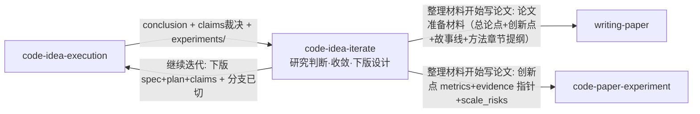
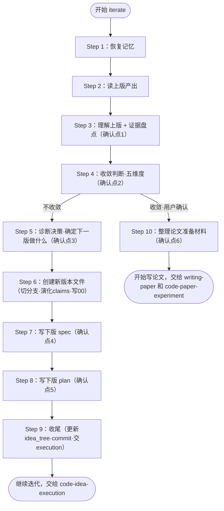

# Code Idea Iterate

## 这个 skill 解决什么问题

execution 只执行 + 记录、验收只裁决——都不做研究判断。但真实科研里，拿到一版结果后最关键的两类动作都是**研究判断**：

1. **下一版做什么。** 子论点未获支持或方法结果不达标时，先在 Step 5 诊断原因。根据证据判断应改进方法、更换子论点，还是调整总论点。诊断可能需要经历多轮检查，由本会话完成。检验子论点的正式实验交给 execution。
2. **是否开始写论文。** 判断现有创新点和证据能否支撑总论点，并结合剩余研究问题、投稿期限和再迭代一版的成本，与用户决定是否继续。

本 skill 阅读上一版产物，与用户讨论证据和诊断结论，更新总论点与子论点记录。继续迭代时写下一版 spec 和 plan，交给 execution。决定开始写论文时整理准备材料，交给 writing-paper 和 code-paper-experiment。

> **进来前项目中已经有**：上一版 execution 跑完（`claims.json` 带裁决 + `04-conclusion.md` + `conclusion.json` + `idea_tree.json` + `experiments/`）+ 带有上一版实现的 repo。上一版没跑完别进来（先回去跑 execution）。

## 边界：本 skill 做什么、不做什么

**做**：诊断结果并与用户判断下一步。继续迭代时更新两层 `claims.json`，准备 `01-idea-spec.md`、`02-research-plan.md` 和 `00-from-previous-version.md/.json`，创建并提交新版本分支，更新 `idea_tree.json`。开始写论文时整理 `ideas/paper-package.md`。

**三角色分工**（本 skill 是第三个，前两个在 execution）：

- **execution**：执行（实现 + 实验）+ 记录实验事实
- **验收子 agent**（execution 派）：**事实裁决**——数据支不支持子论点
- **iterate + 用户**：**研究判断**——裁决意味什么、子论点失败是方法需要改进还是机制前提不成立（诊断驱动）、总论点要不要演化、什么时候开始写论文、下版做什么

> **方法设计归本 skill**（v2+）/ idea-find（v1）——execution 是纯执行引擎，不设计方法。本 skill 的 Step 7/8 产 spec + plan（方案生成 + 方法设计 + 实验矩阵），execution 据此实现。

**不做**（交给相邻 skill）：

| 场景 | 用 |
| --- | --- |
| 写代码（实现方法）、跑 plan 实验、下裁决 | `code-idea-execution`（+ 验收子 agent） |
| 第一阶段从零 / 从一篇论文找方向 | `idea-find` |
| idea 彻底走不通，要找全新起点 | `idea-find` |
| 打 tag、填上一版 outcome | `code-idea-execution`（它跑完自己那版时干） |
| 系统读懂某篇文献 | `paper-reading` |
| 写论文 section | `writing-*` |

> iterate 只切**新版本**的分支 + commit 自己的种子文件；**不打 tag、不填 outcome**（execution 干）。也不改上一版的任何文件。
>
> **例外——诊断归 iterate**：方法版本未达预期后的诊断 / 诊断 probe（探索模式：不改 method、不验 claim、不进 claims.json）由 iterate 在会话内就地做（Step 5），不交 execution。边界按**实验性质**划：验 claim 的实验（检验模式，要预登记 + 验收裁决）走 execution；诊断 probe（探索模式，只回观察）走 iterate。

## 在系统里的位置（局部）



> 整体架构、全局怎么连，看 `dl-assistant` 的「全局 skill 流向图」；本 skill 只画与自己相关的。

## 产出与保存

**运行位置**：GPU 服务器（和 execution 同——读 repo 里的上版产出、写新版本目录到 repo）。论文准备材料产在 GPU 机器的 `ideas/`，writing 在本地——交接时找用户弄论文准备材料到本地，不绑传输方式（见 `dl-assistant` 跨机器协作）。

**继续迭代**——`ideas/v<N>-<slug>/`：

| 文件 | 内容 | 读者 |
| --- | --- | --- |
| `00-from-previous-version.md` | 版本间因果叙事链（为什么从上版走到这版）+ 机制直觉沉淀 | 人 |
| `00-from-previous-version.json` | 机读变更摘要（版型 / claim 变更 / 下一版要验证哪些子论点 / git） | 机器 |
| `autopsy.md` | 诊断记录（探索链：问题→检查→观察→解释→下一个问题）——仅本版做了诊断时有 | 人+机器 |
| `01-idea-spec.md` | 下版 spec（稳定层：总论点 / Roadmap / 当前子论点 / novelty / 失败解读表） | 人 |
| `02-research-plan.md` | 下版 plan（方法设计 + 实验矩阵 + 代码指引） | 人+execution |
| `claims.json` | 演化后的两层 claim 树快照 | 机器 |

**整理材料开始写论文**——`ideas/paper-package.md`：论文准备材料（总论点终态 + 创新点清单 + claim 树终态 + 论文论证提纲 + 方法章节提纲 + scale_risks 清单 + 收敛理由 + 复盘材料）。

**更新**：`ideas/idea_tree.json`（只加新节点；开始写论文时将顶层标为 converged）；换方向 / 目标会议时同步 `ideas/PROJECT_CONTEXT.md` 的「研究框架」字段。

## 核心纪律

- **诊断由证据驱动**：不做诊断、不累积证据就拍方法需要改进 / 机制前提不成立 = 凭空判。判机制前提不成立必须同时满足两个必要条件（试过多种 method 变体都不行 + 诊断证据显示机制前提不成立）。
- **方法结果未达预期时先诊断原因。** Step 5 检查问题属于执行、设计选择还是机制前提，再决定下一版做什么。先做 L0，不能定位时做 L1，必须训练才能回答时才做 L2。由 iterate 在当前会话处理。
- **诊断结论 = 设计依据，不是 claim 证据**：诊断是事后探索（无预登记），结论指导下版设计随便用；但要写进论文当机制结论，必须用预登记的检验模式实验重验（塞进某个验证方法的版本的 plan）。
- **纪律跟实验性质走，不跟 skill 走**：iterate 跑诊断实验（L1/L2）时照样遵守实验目录契约、config 冻结、可复现脚本、tmux 长任务托管（`dl-assistant/references/long-run-ops.md`）——探索模式免的是**预登记判据**，不是**留痕**。
- **六个确认点必经**：用户没理解 / 没确认就往下走，机制前提不成立了 execution 接手就是 GPU 成本。用户沉默 /「嗯」/ 只回答问题 ≠ 推进信号；也不要比用户更热爱流程（用户喊「直接下一步」就顺着跳）。
- **单变量纪律**：每版只检验一个子论点、只改一个主轴变量——一版改多个，裁决无法归因，下版判断失据。写进 spec/plan 的单变量声明。在相同条件下比较多个候选方案不违反这条：变量是机制选择本身，各方案是取值，每个实验内部仍单变量同设置。
- **实验前登记预期和失败信号。** 写入 plan 后保持固定，变更只能写入下一版 plan 并留记录。spec §4 逐条说明检验的假设及其机制、阈值来源，以及观察到信号时支持哪种解释、原因可能属于哪一类、接下来怎么查。缺少先验时可写方向性预期，并注明「无先验」。观察到信号时按表分析，子论点状态按 Step 5 的诊断条件决定。
- **复杂度权衡**：提升要抵得过复杂度——保留子论点并改进方法若复杂度大增只换微小提升，判不值得继续磨；删减代码且性能持平也可以保留。整理写作材料时，要能清楚解释每项创新的机制与关键设计选择。
- **机制直觉沉淀**：每版必须在 00-from-previous 沉淀机制层面的 why（为什么会 / 不会 work），不只记现象——这是下版方案生成的弹药、论文 method 节「设计动机」的素材。
- **方法设计不凭空**：spec/plan 共同打磨（讲懂 + 用户讨论 + paper-search 文献验证，禁止编造论文，引用给 URL）。
- **不改上一版任何文件；不打 tag、不填上一版 outcome**（execution 的活）。
- **改判验收留血脉**：必须 `verdict_source: iterate-v<N>` + note 理由，不覆盖抹掉验收原判。
- **session 开头先恢复记忆**（Step 1），读完代码和 claims 才准提下版方案。
- 会话符号用 Unicode（α、β、θ），不用 `$...$` LaTeX；写「用户」不写「你」。

## 输入文件及字段用法

来自 execution 的上版产出（`ideas/v<N-1>-<slug>/`）：

| 输入 | 用法 |
| --- | --- |
| `conclusion.json` | **机读先读它**：status / outcome / node_type / key_insights / evidence_quality_issues / **scale_risks**（下版设计参考 + 开始写论文时交给 code-paper-experiment）/ handoff |
| `04-conclusion.md` | 人读核心发现（现象→诊断→根因，按实验 / 问题维度） |
| `claims.json`（带裁决） | 两层：总论点 verdict + 子论点 status/verdict + evidence 指针 + is_innovation + method_tag |
| `experiments/index.json` | **实验台账**：看全景尝试地形（每轮 keep/discard + 一句话原因）——比逐版回读 conclusion 高效 |
| `experiments/<exp>/meta.json` | 逐实验细节（verdict_local / scale_risk / 关键数字），按需 |
| 训练曲线 / 训练日志（`experiments/<exp>/` 内） | **用于诊断的记录**：loss 形态 / 梯度量级 / 关键中间量——方法版本未达预期时只查已有记录（Step 5 L0）用 |
| `03-claim-code-map.md` | claim×代码地图——下版改进方法 时定位改动落点；诊断时对照「实现和方案对不对得上」 |
| `idea_tree.json` | 版本链全貌、各版 outcome / node_type |
| 前几版 `00-from-previous-version.md` | **历次验证对机制的认识**（「裁决意味着什么」逐条提取）——方案生成的弹药 |
| `docs/` 前期产物 | 经 PROJECT_CONTEXT 索引导航，按需派子 agent（**general-purpose，禁 Explore**）精读返回摘要 |
| 代码 diff（按需） | `git diff idea/v<N-2>-<slug>..idea/v<N-1>-<slug>` 看上版实际改了什么；成功节点有 claim tag 时可 `git diff claim-C⟨id⟩..HEAD` 对比某子论点 method 锚点 |

## 运行流程总览

**TaskList 跟踪流程**：Step 1 后建任务（理解上版 / 收敛判断 / 诊断决策 / 新版本文件 / spec / plan / 收尾交接；收敛确认则改走 论文准备材料），每 Step 完成即勾——多 Step + 6 个确认点，防跳步。



### 六个确认点（必停，等用户）

| 确认点 | 位置 | 用户做什么 |
| --- | --- | --- |
| 1 | Step 3 理解上版 | 提问直到没疑问；明确「懂了 / 继续」 |
| 2 | Step 4 收敛判断 | 确认开始写论文还是继续迭代 |
| 3 | Step 5 诊断决策 | 了解诊断结论和依据（方法未达预期或验收为 contradicted 时） + 确认下一版方案及是否变更子论点状态（标记 refuted 前须查明原因类别，只在此处决定） |
| 4 | Step 7 spec | 审阅确认下版 spec（总论点 / Roadmap / 当前子论点 / 失败解读表——逐条过判据三问） |
| 5 | Step 8 plan | 审阅确认方法 + 实验设计 |
| 6 | Step 10 论文准备材料 | 确认论文准备材料 |

> 不通过（有疑问 / 没确认）就回当前 Step 继续答 / 改，轮数无上限；只有用户明确推进才往下。**绝不闷头往前冲。**

## references 文件列表

| 文件 | 讲什么 | 何时读 |
| --- | --- | --- |
| `dl-assistant/references/version-tree.md` | 版本树规范（命名 / git 跟 plan / tag / 目录 / 三种版型对应节点） | **现在就读** |
| `dl-assistant/references/claims-template.json` | claims.json schema（两层 claim / ID / 血缘 / is_innovation / method_tag） | Step 6 演化 claim 树时 |
| `dl-assistant/references/spec-template.md` | spec 骨架（§0 总论点+Roadmap+当前子论点 / §1-3 / §4 失败解读表） | Step 7 写 spec 时 |
| `dl-assistant/references/plan-template.md` | plan 骨架（共享对照协议 + 方案设计 + 实验总览 + 每实验原理） | Step 8 写 plan 时 |
| `dl-assistant/references/plan-writing-principles.md` | plan 编写原则（方法设计六视角 + 实验设计原则） | Step 8 写 plan 时 |
| `dl-assistant/references/idea-tree-template.json` | idea_tree.json 骨架 | Step 9 更新版本树时 |
| `dl-assistant/references/session-recovery.md` | session 开头恢复记忆（四节 + 三层记忆） | Step 1 每次开 session 时 |
| `dl-assistant/references/long-run-ops.md` | 长任务托管（tmux / 状态 / 重连） | Step 5 L2 诊断训练时 |
| `references/autopsy-template.md` | autopsy.md 模板（按问题记录的诊断过程：问题→检查→观察→解释→下一个问题） | Step 5 诊断时 |
| `references/spec-design.md` | **下版方案生成操作手册**（起点盘点→缺口陈述→候选生成→选定深挖→写入文件） | Step 7 写 spec 时 |
| `references/from-previous-version-template.md` / `.json` | 00-from-previous 模板（叙事链 + 分层诊断）+ 机读变更摘要骨架 | Step 6 写 00 时 |
| `references/research-dialogue.md` | 研究判断对话方法（边查边讲 / 压缩全景 / 讲懂纪律 / 共同编辑） | Step 3/5/7/8 对话时 |

> claims/spec/plan/version-tree/idea-tree/session-recovery/plan-writing-principles 由 `dl-assistant/references` 维护（execution/iterate 共享，单一真相源）；spec-design / from-previous / research-dialogue 是本 skill 专用。

核心阅读原则：

- **SKILL 开始运行前**，必读 `dl-assistant/references/version-tree.md`，理解版本树心智模型（尤其「分支怎么切」「三种版型对应什么节点」——本 skill 要切新版本分支、决确定下一版做什么）。
- **每个 Step 运行前**，检查是否读了该 Step 的 references 文件。

## 常见错误

- 不要**分层诊断凭空判** —— 不做诊断、不累积证据，读完 conclusion 就拍方法需要改进 / 机制前提不成立。诊断由诊断 + probe 证据驱动。
- 上一版核心方案未达预期，或证据与预测相反时，先按 Step 5 的 L0 → L1 → L2 条件定位原因，再设计下一版。
- 验收写入 contradicted 时启动诊断。原因确认属于机制前提后，由 iterate-v<N> 或 human 写入 status: refuted。验收子 agent 无权改写 status。
- 不要**把诊断结论当 claim 证据** —— 诊断是事后探索（无预登记），结论只指导下版设计；进论文的机制结论必须用预登记实验重验（Step 5 / Step 8）。
- 不要**在诊断时改 method** —— L1/L2 probe 的改动只为观测（hook / 探针），不为改进；想试改法就回诊断推理确定下一版做什么（Step 5 三条护栏）。
- 只有多个核心子论点的机制前提均不成立时，才考虑调整总论点。单个或少数子论点失败时沿用原总论点。
- 每轮在 Step 4 按五项标准判断是否可以开始写论文。
- 不要**只改 spec、不产 plan** —— 方法设计归本 skill（Step 8），execution 不设计方法。漏 plan = execution 没方法可执行。
- 不要**跳过缺口陈述直接给方案** —— 「性能差 → 试试加注意力」是碰运气；先翻译成机制级缺口（spec-design Step B）。
- 不要**无视历次验证对机制的认识** —— 每版从零想方案，前几版花钱买来的机制理解全浪费（spec-design Step A）。
- 不要**plan 方法凭空想象** —— Step 8 要共同打磨（讲懂 + 用户讨论 + 文献验证），不 agent 闭门造车。
- 不要**一版改多个变量** —— 裁决出来无法归因，下版判断失据（单变量纪律）。
- 不要**跑完才写预期** —— 预期信号 / 证伪线跑前写死，不移动球门（预期承诺纪律）。
- 不要**跳确认点** —— 6 个确认点是必经关卡，用户没确认 / 没理解就往下，机制前提不成立了 execution 接手是 GPU 成本。
- 不要**改判验收不留血脉** —— 改判必须 `verdict_source: iterate-v<N>` + note 理由，不能覆盖抹掉验收原判。
- 不要**改上一版的任何文件** —— iterate 只创建新版本。
- 不要**打 tag / 填上一版 outcome** —— 那是 execution 的活。
- 不要**跳过 session 开头恢复记忆** —— 服务器新 session 失忆，不读代码 / claims 就瞎提下版方案。
- 不要**写"你"不写"用户"** —— skill 是 agent 手册，"你"指代不清，一律写"用户"。
- 不要**在会话里用 `$...$` LaTeX** —— 会话符号用 Unicode（共用规则见 `dl-assistant` SKILL.md「所有技能共用的规则」）。

## 运行流程详情（Step 1 - Step 10）

### Step 1 恢复记忆（每次开 session 必做）

和 execution 一样：服务器每开新 session，**先从盘上灌回上下文**再干任何活——吐四节小结（我们在干啥 / 我们在哪 / 代码长这样 / 准备干啥），**读完代码才准提下版方案**。四节各读什么、PROJECT_CONTEXT、三层记忆见 `dl-assistant/references/session-recovery.md`。

### Step 2 读上版产出

按「输入文件」清单读：先 `conclusion.json`（机读）+ `04-conclusion.md`（人读发现）+ `claims.json`（带裁决）+ 台账 `experiments/index.json`（全景尝试地形）+ `idea_tree.json`；再沿版本链回读前几版的 `00-from-previous-version.md` + `autopsy.md`（如有——历次验证对机制的认识和历次诊断的发现，诊断"问题出在哪"靠这些累积证据）；`docs/` 前期产物与代码 diff 按需。

### Step 3 理解上版 + 证据盘点（确认点 1）

给用户白话讲上一版：赌了什么（要验证哪个子论点、什么版型）、实验结果、验收裁决。讲两层：**总论点稳度**（paper_claim 目前被创新点支撑得怎么样）+ **子论点裁决分布**（verdict / status 各几个、已升格创新点几个）。**不假设用户记得细节。**

然后证据盘点：已有证据（含**历次诊断 / 诊断结论**）够不够定位「问题出在哪」？上一版结果暴露的、上版框架内回答不了的更深问题是什么？

对话手法（边查边讲 / 压缩全景→用户点播 / 讲懂纪律）见 `references/research-dialogue.md`。**确认点 1**：用户明确「懂了 / 没疑问 / 继续」才进 Step 4。

### Step 4 收敛判断（确认点 2）

白话评估**五个维度**：

| 维度 | 看什么 |
| --- | --- |
| 创新点成立数 | supported 子论点 vs 目标（1=short paper / 2-3=full paper）。够的信号：数量达标 **且** 每个有 method_tag + golden metric + strong/medium evidence；有未解释的 contradicts 证据的 supported 不算稳 |
| 总论点稳度 | paper_claim 被现有创新点支撑的程度。够的信号：`supported_by` 覆盖总论点的每个核心承诺（总论点说 A+B+C 但只有 A 的证据 = 不稳）；paper_claim verdict ≥ plausible |
| Roadmap 收敛度 | 剩余「待定」子论点的价值：成立后能否为论文增加实质贡献。收敛信号：剩余点全是边角 nice-to-have，或同一子论点连续 2-3 版未获支持，且诊断显示机制前提可能有问题 |
| deadline 迫近度 | 读 `PROJECT_CONTEXT.md` 的目标会议 / 截稿。迫近量级：剩余时间 < 1 个迭代周期（实现+实验+验收，通常数周）+ 写作周期（1-2 个月起）→ 应考虑现在开始写作 |
| 投入产出 | 比较剩余子论点成立的可能性及对论文论证的贡献，与再迭代一版所需的 GPU 时间和投稿延期风险。参考 `experiments/index.json` 中的 keep/discard 比例。若连续多版 discard 比例高，应更多考虑开始写作。成功可能性低且已有证据能支撑主要论证时，建议开始写作。主要论证仍缺证据时，权衡继续补证据或缩小总论点。 |

用 **paper-search** 检索核心创新点相关的新工作，检查是否已有类似贡献。结果也写入 Step 7 的 §3。

**确认点 2**：达到写作条件时，提议开始写论文。用户确认后进入 Step 10，否则进入 Step 5 继续迭代。

### Step 5 诊断决策（确认点 3）

**更改子论点状态前的诊断条件**。上一版用于改进方法、更换子论点或调整总论点的核心方案未通过验证或效果未达标时，以及验收将任何子论点写为 contradicted 时，先诊断再决定下一版和子论点状态。同一版本比较多个方案后，对表现未达要求而淘汰的方案也逐个诊断并记录原因。任何子论点标为 refuted 之前都必须查明问题类别。只有证据指向机制前提时，才可与用户确认是否设为 refuted。若属于执行问题，修正执行后重新验证，保留原子论点。若属于设计选择问题，保留子论点并重新设计方法。

| 原因类别 | 含义 | 确定原因后的处理 |
| --- | --- | --- |
| **执行层** | 实现 bug / 训练配置不对，方案没被真正验到 | 修执行，同方案重验（claim 不动） |
| **设计选择错** | 机制 idea 成立，但某个设计自由度定错了（接入位置 / 层位 / 维度 / 初值）——典型形态：**机制对、落点错** | 同方案更换实现位置重设计（claim 不动，保留子论点并改进方法） |
| **机制前提** | 机制核心假设不成立 | 进诊断推理链，判机制前提不成立 / 调整总论点 |

contradicted 或达到失败解读表的判据时，先判断具体原因。比如证据支持机制、但接入位置不合适时，应核查设计选择。由 iterate 在当前会话做探索性诊断，记录观察和新问题，无需事先登记实验判据。按 L0、L1、L2 逐级检查，有足够证据时即可停止增加检查。

0. **L0 查阅已有记录。** 派只读子 agent 查代码 diff、`03-claim-code-map.md`、训练曲线和日志（损失、梯度量级、关键中间量）及 `experiments/` 的 meta。可并行检查代码和训练过程，无需使用 GPU。先核对上版 plan「设计选择」里缺乏证据的选择，以及为分析失败原因预留的记录，再查 spec 候选方案的「可能的失败原因及最早可观测的信号」。逐条核对依据。能定位问题类别时，进入后续诊断判断。
1. **L1 使用现有权重做只评测的诊断。** L0 无法定位时，由 iterate 在当前会话用已有 checkpoint 做前向计算，记录中间激活、固定批次的观察、梯度和统计量。保持模型代码与 claims.json 原样，不启动训练。脚本放版本级 `scratch/`，产物放 `ideas/v<N>-<slug>/experiments/exp-XXX-probe-<name>/analysis/`。meta 写 **question 和 observation**，探索性诊断不预登记 `decision_rule`。在索引 `index.json` 记一行（type: probe）。运行前向用户一次性确认这一批检查，无需逐项停下来确认。
2. **L2 诊断训练。** 只有诊断问题必须训练才能回答时才运行，例如比较不同接入层。由 iterate 在当前会话运行，采用与 execution 一致的 tmux、目录结构、配置留存和复现脚本要求。使用 reduced setting 控制成本。开跑前请用户确认，按 execution 的高消耗确认规则执行。tmux 见 `dl-assistant/references/long-run-ops.md`，会话名前缀为 `it-<slug>-<exp>`。

**诊断中的三项限制**：

- **诊断中的改动仅用于观察。** 例如注册 hook 或添加用于观测的探针头，同时遵守各级诊断的限制。发现值得尝试的方法改动时暂停诊断，先根据证据确定下一版方案。
- **每项诊断要回答一个具体问题。** 从 L0 的待核查原因出发，例如信号有没有到达某层、不同层位结果是否有差异。由用户选择或补充问题，再运行检查。
- **claims 不动、不派验收**：诊断全程 claims.json 一个字不改，结论只进 autopsy.md → 00-from-previous。

在 Step 5 开始诊断时先建新版本目录，将诊断产物及 `ideas/v<N>-<slug>/autopsy.md` 保存在其中。按 `references/autopsy-template.md` 逐项记录问题、检查、观察、解释和下一个问题。分支和提交仍在 Step 6 完成。诊断记录用于恢复进度，也可作为 00-from-previous 和论文方法章节设计动机的来源。

已有记录能明确说明原因时，例如 loss NaN 已确认来自实现问题，L0 即可完成分类。用户可在确认点 3 明确豁免诊断。

**检查现有证据能否定位问题。** 能说明问题所属层次及其依据时，再判断下一版方案。证据仍不足时按 L0 → L1 → L2 的条件继续检查，由 iterate 在本会话完成。

**诊断推理链（够时）**——基于诊断结论 + 历次诊断累积证据，按分层诊断判（不凭空，按顺序怀疑、不轻易升级）：

- **方法需要改进**（第一怀疑）：机制前提**成立**（诊断证据支持），只是实现 / 设计不够 → 改进方法，**子论点 claim 不动**（同子论点继续磨）。归层为"设计选择错"的方法版本未达预期属于此类——method 重设计的主轴是**修正实现位置**，不是推翻机制。
- **机制前提不成立**（反复试多种 method 都不行才判）：机制前提**不成立**——多次 method 变体都不 work **且**诊断证据显示机制核心假设站不住 → 子论点 refuted，换下一个创新点。
- **调整总论点。** 只有多个核心子论点的机制前提都不成立时才考虑，例如缩小总论点范围或改为解释已发现的现象。

向用户解释原因所属层次、支持判断的证据和下一版的具体做法。**确认点 3**。用户理解诊断结论并确认下一版方案和子论点状态后，再进入 Step 6。

**下一版的三种做法**。下表用于 Step 6-8。诊断在 Step 5 完成。要将探索性诊断结论作为论文中的机制结论，须在下一版 plan 安排有预登记判据的复验。

| 版型 | 何时 | 改模型? | claim 变更 | 节点结局（execution 跑完） |
| --- | --- | --- | --- | --- |
| **保留子论点并改进方法** | 方法需要改进 | 是（同子论点磨 method） | 子论点不变 | 成功打 `claim-C<id>-v2` |
| **更换要验证的子论点** | 机制前提不成立 | 是（换子论点） | 旧 refuted + 新增 | 成功打 `claim-C<new>` |
| **调整总论点的版本** | 调整总论点 | 是（新方向） | 改 paper_claim | 成功打 `claim-C<new>`（新方向的新子论点首次成立）；继续磨某已 supported 子论点的 method 则套用 method 迭代规则打 `claim-C<id>-v<k>` |

### Step 6 创建新版本文件

**切分支 + 建目录**：

```bash
git checkout -b idea/v<N>-<slug>      # v2+ 从 HEAD（最新 commit）切
mkdir -p ideas/v<N>-<slug>/
```

分支名 / 目录名 / 未来 tag 都从 `v<N>-<slug>` 派生，三者同源（见 `dl-assistant/references/version-tree.md`）。

**演化两层 claims.json（核心，按版型）**：从上一版 `claims.json` 拷一份作起点，先更新三个快照字段（`version` = 本版、`snapshot_date` = 今天、`parent_version` = 上一版），再按版型演化（每条都讲「证据 → 判断 → 为啥这么改」，用户在 Step 5 已拍版型，这里写入文件）：

- **保留子论点并改进方法**：子论点 claim 本身不动，只动 method（method_tag 待 execution 成功后打 `claim-C<id>-v2`）。**要重新验证的子论点 verdict 重置 `pending`**——上版被裁 `contradicted` / `insufficient_evidence` 的这版要重验，`notes` 记上版裁决与理由；验收只裁 `pending`，不重置它永远拿不到新裁决。已 `supported` 的保持原样。
- **更换要验证的子论点**：旧子论点 `status: refuted`（留 ID 不删）；新增子论点（下一可用号 + `emerged_from` + `verdict: pending`）。
- **调整总论点的版本**：改 `paper_claim`（缩小 / 转向）+ `verdict_source: iterate-v<N>` + note 演化逻辑 + `lineage.derived_from` 旧总论点（留血缘）。
- **继承的**（还活着、下版继续验）：原样保留，改动若可能动摇某条，note 标"待验收重验"。

全部走完 → 写进 `ideas/v<N>-<slug>/claims.json`。schema / ID / 血缘见 `dl-assistant/references/claims-template.json`。

**写 00-from-previous-version.md + .json**：按 `references/from-previous-version-template.md`：上版目标 → 结果 + 裁决意义（**机制层面**，直觉沉淀）→ 浮出的更深问题 → 研究判断（分层诊断 + claim 变更）→ 定位声明 + 这版做什么 → 教训 → 版本树更新。机读变更摘要（版型 / claim 变更 / 下一版要验证哪些子论点 / git）按 `references/from-previous-version-template.json` 写进 `00-from-previous-version.json`。

### Step 7 写下版 spec（确认点 4）

按 `references/spec-design.md` 准备下一版研究说明。先向用户说明诊断结果和待解决的问题，听取用户的初步想法，再进一步细化候选方案。

1. **起点盘点**：诊断结论 + 仍待验证或已获支持的子论点 + 历次验证对机制的认识（前几版 00 的「裁决意味着什么」逐条提取）。
2. **缺口陈述**：诊断结论翻译成机制级缺口（指向可动手改的机制位置；写不出 → 回 Step 5 就地诊断，别硬写）。
3. **先征集用户的想法（spec-design Step B.5）**：把具体待解决的问题摆给用户，先收用户的原始机制想法（半句话也行）；用户说没有，才轮到 agent 生成。
4. **候选生成**：用户当场提出的想法第一来源；推导链（缺口分解→干预点→机制类）+ 历次验证积累的机制认识 + 四手法（迁移 / 组合 / 反转 / 简化）补位，agent 自产标「补丁候选」；每缺口 2-3 个**本质不同**的候选 × 五要素（来源逻辑 / 关键思路 / 预期工作原理 / 机制先例三问 / 可能的失败原因和最早可观测的信号）。
5. **用户排除 + 逐个深挖（不是四选一）**：候选方案概要摆给用户（格式见 research-dialogue），用户划掉明显不行的，**剩下的全进 spec**（值得试的交给实验裁决，实践出真知）；每个保留的候选机制细化 + 正经验证 + baseline 兼容性。存活一般 2-4 个。
6. **写入文件**：按 `dl-assistant/references/spec-template.md`——§0 当前子论点「为什么检验这个子论点」回扣诊断 + **候选方案节**（每方案三要素：方案依赖什么假设 / 为什么值得试 / 哪些信号说明方案可能未达到预期）；§3 novelty 一句话区别 + 增量查新结果；§4 失败解读表**按方案组织**（解读条目从「可能的失败原因和最早可观测的信号」长出来，跑前写死，**每条带判据三问**：验什么假设 / 阈值来历（无先验须标注）/ 命中支持哪种解读+可能的原因类别和下一步检查——写入文件，确认点 4 逐条讲）。

**确认点 4**：把下版 spec（总论点 / Roadmap / 当前子论点 / 候选方案 / 失败解读表）摆给用户审阅确认。**确认后才写 plan**——spec 是稳定层，错了 plan 全跑偏。

### Step 8 写下版 plan（确认点 5）

按 `dl-assistant/references/plan-template.md` + `plan-writing-principles.md`（写前必读，两半：方法设计六视角 + 实验设计原则）。**版型决定 plan 内容**：保留子论点并改进方法 = 改进方法（对比 `claim-C<id>` 上一版 method）；更换要验证的子论点 = 验新子论点；调整总论点的版本 = 新方向。Step 5 诊断结论若要进论文当机制结论，把它的预登记重验实验编进本版实验矩阵（检验模式，写全判据三问）。

**比较多个候选方案**。spec 保留 2-4 个方案时，plan 写明共享对照协议（同一基线、同一 reduced 配置和同一 seed）、各方案的设计和对比实验矩阵。最先安排能及早发现失败的低成本实验，明显不合适的方案暂停，只有继续评估的方案进入消融。开跑前登记选择判据，结果相同时优先较简洁的方案。记录所有未选方案的结果和理由，供后续答复审稿意见参考。单方案时沿用同一结构，只填一个方案。

**方法设计六视角**（每个方案设计节必填）：设计选择显式化（选项+取舍+为什么，否决备选留痕）/ 单变量声明（比较多个候选方案时变量=机制选择）/ 最小侵入 baseline / 复杂度预算 / 实现风险+fallback / 实现自由度边界；外加**预期工作原理**（补上缺口后哪个中间量怎么变——长成诊断实验）。

**共同打磨循环**（plan 是方法设计，不能凭空）：

1. iterate 出方法 + 实验初稿（方案设计 + 实验总览 + 每实验**原理**四要素）。
2. **给用户讲懂**：每个实验讲原理（变量是什么 / 为什么能隔离 / 预期成功信号 / 失败信号）——**失败解读表条目逐条讲判据三问**（验什么假设 / 阈值来历或「无先验」标注 / 命中支持哪种解读+可能的原因类别和下一步检查），讲到用户能审，不是列出来就算。
3. 用户质疑 / 调整 → 查文献（paper-search）+ 证据补充 → 更新初稿。
4. 循环到用户认可。**每次改动都说清「改了什么、为什么」。**

**确认点 5**：方法 + 实验（讲懂 + 用户确认）确认后才进 Step 9。**这版方法 / 实验错了，execution 接手就是 GPU 成本。**

### Step 9 继续迭代时交接新版本

**更新 idea_tree.json**：按 `dl-assistant/references/idea-tree-template.json`，**只加新节点**：`versions` 末尾加 v<N>（version / slug / from_previous / status=active / outcome=pending / hypothesis / node_type / git_branch=idea/v<N>-<slug> / git_tag=空 / next=null），上一版节点的 `next` 指向 v<N>。**不填上一版的 outcome / key_findings**（execution 跑完它那版时已填）。若本版换了方向 / 目标会议，同时更新 `ideas/PROJECT_CONTEXT.md` 的「研究框架」字段（该字段的更新职责归本 skill，见 `session-recovery.md`）。

**commit 种子 + 交接**：

```bash
git add ideas/v<N>-<slug>/ ideas/idea_tree.json
git commit -m "iterate: start v<N>-<slug> (<版型>)"
```

告诉用户：下一版目录已建好（00(.md/.json) + 01 + 02 + claims.json）、分支 `idea/v<N>-<slug>` 已切 + 种子已 commit，可以调 `code-idea-execution` 开始实施这版。

### Step 10 整理论文准备材料（确认点 6，仅 Step 4 确认开始写论文后执行）

**产论文准备材料** `ideas/paper-package.md`：

- **总论点 paper_claim**（终态，已稳）。
- **创新点清单**（= supported 子论点）：每个 = claim ID + 白话 + **method_tag**（代码锚点 `claim-C<id>`）+ golden metrics（关键数字）+ evidence 指针（conclusion / exp）。
- **方法章节提纲**（writing-paper 的 method 节拿来就能展开）：每个创新点 = 动机（哪条诊断 / 教训驱动，从各版 00-from-previous 的机制直觉提取）→ 机制 → 关键设计选择 + 否决过的备选。
- **claim 树终态**：含 refuted / abandoned 的子论点（写 Related Work「我们试过 X 不 work」、rebuttal 回看用）。
- **Roadmap 终态**：哪些升格创新点、哪些放弃。
- **用一句话说明各创新点如何支撑总论点**：iterate 提供一句话提纲，详细论证由 writing-paper 展开。
- **scale_risks 清单**：从各版 conclusion.json / meta.json 汇总 scale_risk 标记 + 一句话理由——CPE 跑 full-scale 时优先验这些。
- **收敛理由**：说明为什么现在开始写论文，例如证据已足够、剩余子论点贡献有限或临近截稿。
- **复盘材料**：idea-find `spec.json` 的「选题理由快照」指针 + 本链实际走向摘要（几版、成/败、哪些子论点 refuted）。**选题复盘的写与归并在本地做**（writing-paper step 1，落本地统一目录）——本 skill 在 GPU 服务器，不写本地文件。**用户宣告放弃 idea 链时**：复盘材料写进 idea 目录，提示用户带回本地归并。

**记录已决定开始写论文。** 将 `idea_tree.json` 顶层标为 `status: converged`，提交论文准备材料。

**确认点 6**。请用户确认论文准备材料。交接时请用户将文件从 GPU 服务器传到写作所用的本地机器，传输方式由用户决定。

告诉用户论文准备材料已写好、状态为 converged，可用 `writing-paper` 开始写论文。缺少消融实验或图表数字时，由 `code-paper-experiment` 补实验。论文论证仍缺关键证据或核心创新点时，可回到本 skill 在原版本树上新增一版，并把状态改回 active。

## 常见场景

### 场景 1：证伪后调假设（方法需要改进）

上版 C1 效果不好，但诊断证据显示机制前提成立（如 abs_hf 显示高频有用、只是被淹没）→ 判方法需要改进，C1 不动，下版**保留子论点并改进方法**改进实现（claim 不动，但 verdict 重置 `pending` 重裁，见 Step 6）。

### 场景 2：方法未达预期，诊断发现接入位置不合适

上版验证方法的版本未通过验证，但方案经过充分打磨、机制 idea 仍可信 → 走更改子论点状态前的诊断条件（Step 5）：L0 只查已有记录翻上版 plan「设计选择」节，发现"接中间层"这个设计选择从没被实验验过（优先核查项）→ 会话内升级 L2 诊断训练做层位扫描 probe（reduced setting，iterate 自己 tmux 托管跑，最小成本）→ 验证确认"晚期层更好"（全程记 autopsy.md）→ 下版 **claim 不动、机制不动、只改落点**（保留子论点并改进方法），性能即起。不诊断的反面教材：直接判"方法需要改进"，在错误落点上连烧几版改融合 / 改门控，全是无效迭代。

### 场景 3：证据不够，就地诊断

上版结果不理想但不确定为啥 → Step 5 在会话内做诊断（L0 读取已有文件 → L1 eval-only probe → 必须训练才 L2），累积够证据再判方法需要改进 / 机制前提不成立、确定下一版做什么。诊断（场景 2）是就地诊断的特例：在场景 2 中，诊断问题来自结果未达预期时列出的待核查原因。诊断由 iterate 在当前会话完成。

### 场景 4：机制前提不成立，换创新点

多次改进方法（不同变体）都不行 + 诊断证据显示机制前提不成立 → 判机制前提不成立，C1 refuted 留 ID，下版**更换要验证的子论点**验新子论点。

### 场景 5：部分成功，深化

上版 C2 部分支持 → C2 拆成 C2a（已稳）/ C2b（待解），下版针对 C2b。

### 场景 6：调整总论点

多个核心子论点都机制前提不成立、原总论点撑不住 → 演化 paper_claim（缩小范围 / 转向，`lineage.derived_from` 留血缘），下版**调整总论点的版本**。单个子论点失败不演化总论点。

### 场景 7：method 迭代（supported 后改进）

C1 已 supported（升格创新点），还想优化它的 method → C1 不变（仍 supported），下版改进方法，execution 成功打 `claim-C<id>-v2`，conclusion 对比基线 = `claim-C<id>`（上一版 method）。

### 场景 8：改判验收

验收把 C3 判 refuted，但实验设置不公平 → 改判 + `verdict_source: iterate-v<N>` + note 理由，验收原判留血脉。

### 场景 9：开始写论文

已有创新点能支撑总论点或已到投稿期限时，整理论文准备材料交给 writing-paper 和 code-paper-experiment。
