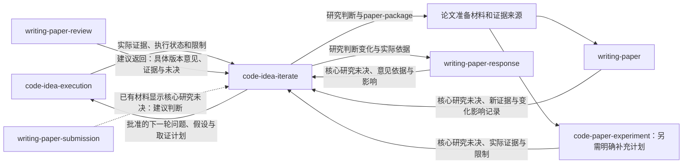

# 根据证据更新研究判断

从已有的定义清楚、值得回答的研究问题、假设和数据出发，明确：**原来相信什么、实际观察到什么、因此改变了什么判断**。下一步由重要未知决定，不默认改模型、保留原假设或必须形成论文。

agent 主动检查证据、比较解释、发现问题、提出假设与研究构想，并给出推荐和反对理由。用户不需要先提供创意；用户与agent的想法采用相同标准。发现问题仍未定义清楚时，先帮助澄清；需要全新领域调研或重新找题时交 idea-find，不用旧题的局部修改冒充新问题。

## 通过 W&B 查询实际证据

使用 [wandb skill](../wandb/SKILL.md) 的内网 MCP 和 [共同记录](../wandb/references/experiment-records.md)，先由台账确定应检查的实验、重复和全部尝试，再查询配置、summary、指定范围指标和产物，不能只取表现最佳的 run。核 baseline 与新方法的实际数据、协议、预算、来源和选择差异；未同步、失败、抽样、分页截断和未取得资产均记录影响。没有 MCP 可用时可读取本地或经核对 API 的数据并说明来源，不假装已完成远端查询。

保存查询时间、实例/run 全身份、字段/step 范围、覆盖限制、实际返回快照及校验值。next_step 的 evidence_history/competing_explanations 与 transition 的 evidence 核这些依据；W&B 的诊断文本不直接当机制解释，正式新增分析交 execution。研究判断仍写回原 spec/claims/研究决定，不让 W&B 标签覆盖历史；一次 run、一次恢复、一个 rank 不自动算独立重复。

## 解释证据和安排下一轮时重查条件

第 2 步分析结果时，按 [研究条件与低成本实验](../dl-assistant/references/research-conditions.md) 核对实际条件、关键现象及偏差；reduced 阳性/阴性不能直接确认/否定目标条件下假设。趋势不一致时比较实现/测量问题、条件差异和真实规模依赖等解释，不预设 bug。

第 3 步 next_step 自查中，competing_explanations/current_value/next_evidence 必须说明条件证据、当前范围价值和目标验证触发点。新假设/方法重新判定哪些条件必须保留，不沿用永久认证的低成本配置。大量继续局部迭代前或作更大投入前，落实计划中的代表性目标验证；无可承受配置时比较资源、减少实验、改问题或暂停，不默许破坏关键条件。transition 的 evidence/remaining_work 核查目标证据；核心贡献依赖尚未取得的目标规模结果时继续研究，不交后期普通补实验。

## 在系统中的位置



暂停、停止和继续阅读也可完成一次研究讨论，不强制交实验或写作。writing-paper已接收五项判断并在核心证据或贡献受动摇时返回本skill；writing-paper-review也已按具体论文版本和证据分级提出研究未决建议，不把评审意见自动当事实。writing-paper-response也已按实际意见和证据分流，收窄后重评研究价值并核实际回复。writing-paper-submission已改为官方指南与人工提交准备，不认证科学内容；code-paper-experiment已按具体设计、共享状态和真实批次证据分流；code-paper-release已按实际来源、分项复现能力和版本重验改造，发布中发现核心研究问题时返回本skill。

## 输入与职责

- 当前问题、假设、批准的spec/plan、已讨论的研究价值与投入。
- execution 的conclusion、claims、全部尝试台账、原始结果/日志、实现与统计代码commit/diff、独立核查及未完成项。按问题读取，不只数supported。
- 后期返回时：原判断、新证据或论证缺口、受影响主张/段落、实际数据来源、剩余资源与正在运行的任务。

**不要求上一轮全部完成。** 部分数据、执行失败、阻塞或意外观察都可进入讨论；先限定哪些数据可解释。不因退出码0、文件齐全或review存在就视为数据可信。

iterate 阅读材料、分析已有观察、提出解释并设计下一步。已有数据的简单核算可在讨论内进行，保留计算依据；需新增测量、修改实验代码、训练或形成正式可复现分析结果时，交execution，包括探索和诊断。不在这里另开一套不受执行记录约束的实验。

用户先前code-reading和后续关键代码审阅要求保留；准备新实验仍由execution展示实际diff。资料工具按实际接口和对应skill使用，文献来源、版本、已读范围与限制必须可核查，不凭模型记忆宣称已查新。

## 工作流程

### 1. 恢复问题、证据与任务状态

按 [共享恢复说明](../dl-assistant/references/session-recovery.md) 核对当前代码、文件版本和实际任务。阅读本轮及相关历史材料，分清文献先验、项目数据、推理、事后解释和未执行项。继承历史笔记前核对其依据，不把重复出现的猜测当已知事实。

向用户简短解释问题为什么重要、已有工作解决了什么、本轮原本想知道什么及实际做到了哪里。用户不熟悉时补必要背景，不以反复要求“懂了”替代解释。

### 2. 明确证据改变了什么认识

逐项对应原假设、观察和原批准的解释规则，检查数据有效性、比较条件、缺失数据、多次尝试和外推范围。指出最不支持当前判断的证据；阳性结果也检查替代解释，涨分不证明机制。

分别记录执行状态、数据有效性、假设证据、与已有工作差异和研究意义。证据不足、无法区分解释和原因未知均为允许结论。不强制定位唯一原因，不要求尝试多种方法后才允许接受反证；决定不再投入也不等于科学证伪。

分析记录用 [研究判断模板](references/autopsy-template.md)；该文件保留旧文件名供发现，新记录不采用旧的失败原因强制分类。

### 3. 主动发展解释、问题和下一步假设

从观察、异常、反证、跨条件差异及相关工作中提出候选解释或研究问题。每个解释写推理、依据、未知和可区分预测；尚未证实的解释只能作为待检验前提，不能当作设计依据中已确立的事实。详见 [假设与取证设计](references/spec-design.md)。

下一步可以是检查实现、重复测量、区分解释、建立理论、研究适用边界、提出方法或改变问题。没有必要凑候选数、一次全试或先要求用户排除。优先比较结果能改变哪些重要判断、可识别性与实际成本，低成本本身不保证科学有效。

**提出下一轮方案前自查**（stage=next_step）：

- belief_update：原来相信什么、观察到什么、改变了什么；没有改变也解释原因。
- competing_explanations：最强反对证据、替代解释、推理缺口和可区分预测；原因未知可保留。
- current_value：当前问题回答后新增什么；收窄后保留/失去什么意义。
- next_evidence：推荐行动减少哪个未知、不同结果如何影响决定、是否值得投入。
- evidence_history：命题ID与条件、历次证据、原核查意见及新判断是否保留。

按 [共享自查规则](../dl-assistant/references/research-self-check.md) 留依据和行动影响；需要修正的项先处理，不能一边记录“问题不清楚”一边交实验。

### 4. 选择下一步，或判断能否进入写作

agent 提出具体推荐，用户决定研究价值、方向变化和实际投入。已有授权继续有效；“继续”只授权上下文明确的行动，不证明假设、创新性或用户已理解全部技术。沉默不是授权。科学讨论不设固定六次确认、固定失败轮数或无限诊断。

可选择：继续取证、修订假设、重新定义问题、暂停、停止，或准备写作。前三项仍需比较投入；预算不足/价值不足可暂停或停止，不必先证明方向错误。

**决定进入写作或停止前自查**（stage=transition）：

- knowledge：已回答或提出什么明确重要的问题，新增了什么知识。
- evidence：核心发现的可信证据、限制、反证及替代解释。
- novelty_value：最接近工作、核查范围、实际差异及其意义。
- remaining_work：剩余任务是否明确；核心贡献是否仍靠未来实验成立。
- recommendation：agent建议、风险、资源需求、用户决定或尚待确认项。

逐项依据见 [共享研究与写作判断](../dl-assistant/references/research-transition.md)。不打总分、不以创新点数量、keep率、故事完整度或deadline替代。允许发现并明确重要问题，但须有证据表明它存在、已有认识不足和研究意义；空泛提问不自动成为贡献。

决定停止但不写论文时，仍如实填写上述认识与未知，不要求五项都已充分；说明停止原因。自查的行动是“保存并停止”还是“交写作”必须明确，前者不冒充后者已具备条件。

### 5. 根据决定保存与交接

先保存 `ideas/decisions/<唯一标识>/research-assessment.md` 和对应自查记录；如项目已约定位置则沿用。每次决定引用当前问题、数据和版本。只读讨论也保存结果，不为凑目录而生成新实验轮次。

**继续实验**。拟议下一轮实验时，先起草以下材料供审阅：

- `00-from-previous-version.md/.json`：认识更新、研究意义变化、版本及命题关系，见 [人读模板](references/from-previous-version-template.md) 和 [JSON模板](references/from-previous-version-template.json)。
- `01-idea-spec.md`、`02-research-plan.md`、`claims.json`：采用共享 [spec](../dl-assistant/references/spec-template.md)、[plan](../dl-assistant/references/plan-template.md)、[编写原则](../dl-assistant/references/plan-writing-principles.md) 和 [命题格式](../dl-assistant/references/claims-template.json)。附当前判断与自查引用。

仅探索时允许没有方向性命题，问题与目标留spec；不伪造总假设。沿用同一命题须检查条件，保留历次证据，不为重试清空反证，也不让supported永久免检。命题含义或范围改变分配新ID（包括P编号），旧项保留并写关系；改判保留原意见、来源、日期和理由。资源上停止追踪写notes和决定，不强填refuted。

把写好的 spec 和 plan 的文件路径一起发给用户，说明相对上一轮的变化、取证设计、预算和待决事项，请用户明确确认两份当前版本。一次回复可以确认两份。记录获批版本和范围，两份均获批后才将材料纳入下一轮 `ideas/v<N>-<slug>/` 并交接 execution。

建分支前检查工作区和用户改动；实现起点可以是已验证历史commit，区别研究上一轮与实现父commit。按 [版本记录](../dl-assistant/references/version-tree.md) 更新idea_tree，只追加本轮并更新next/当前进度，不改写历史结果；无新实验不虚建节点。只提交本次授权内容，不默认push或覆盖tag。

**进入写作**：用户确认后产 `ideas/paper-package.md`，内容和五项判断按 [共享说明](../dl-assistant/references/research-transition.md)。顶层converged兼容旧字段，只表示当前决定准备写作，不代表结论永远稳定或全部实验已结束。

**暂停/停止**：保存已知、未知、具体原因、任务与数据状态、用户决定和可恢复条件；顶层按决定记paused/stopped。没有创新不强行整理成论文贡献。

## 自查记录与核验

每个自查阶段在上述位置执行；详情不能只放参考文档。每项写当前判断、依据/来源、未知和对下一步的影响，主动检查反证与沉没成本。记录用独立文件，原文件或输入改变后重新检查，不能只改结果为通过。

```bash
python3 <skills目录>/dl-assistant/scripts/check_research_self_check.py --record <自查.json> --root <项目根> --skill code-idea-iterate --stage next_step
# 决定写作或停止时改为 --stage transition
```

脚本非零则不把目标行动标成可继续；保存缺失和修正/讨论建议，仍可交接“待解决问题”。退出0仅为格式、引用与声明一致，不是科学质量认证。自查不是独立核查，不强制派子agent；需要独立协作时先说明任务、输入输出与理由，按既有授权确认，不并发写累计文件。

## 与后期协作

写作可以暴露研究缺口，也可以与明确的补充实验并行。后期发现核心结论/数据/贡献有实质问题时，返回本skill分析，而非只换叙述或降低主张。保留原稿及已运行任务，标注受影响内容，未受影响写作可继续；返回格式见共享说明。

writing-paper、writing-paper-review、writing-paper-response及writing-paper-submission已配套；code-paper-experiment已配套；code-paper-release已配套分项复现验证与研究问题返回。交后期时明确指出新版格式与旧规则冲突，不默认已全系统兼容。旧记录不批量迁移，缺失仍为未知。
