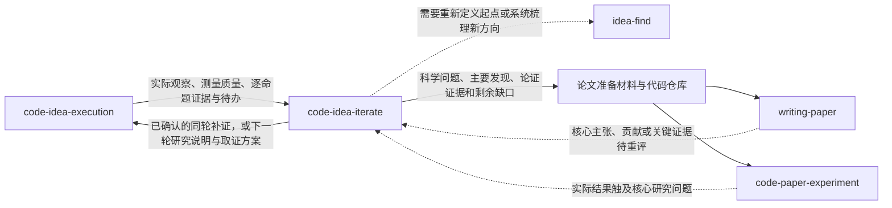
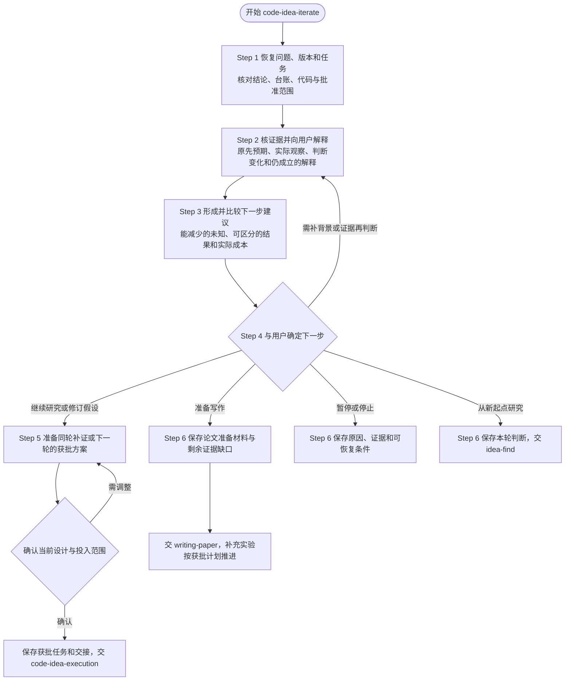

# 根据证据决定下一步研究

在「提出假设 → 设计实验 → 收集数据 → 分析并修订假设 → 提出下一步假设」的科研循环中，本 skill 负责根据实际证据回答：原来相信什么、实际观察到什么、因此改变了什么判断，以及下一轮最值得弄清什么。

据此比较继续取证、修订假设或问题、准备写作、暂停或停止。主会话主动找证据、比较解释和提出有理由的推荐。根据用户对方向的熟悉程度补充背景，先讲到能判断，再确认会改变研究方向、范围、投入或主张的决定。共同流程见 [dl-assistant](../dl-assistant/SKILL.md#共同研究流程)。

## SKILL 交接关系



首次接收部分结果、执行失败或受阻记录时，也可讨论已有证据和限制。后期返回时，核原主张、受影响段落或实验、实际新证据和剩余任务。论文实验按获批实验计划执行。

## 产出与保存

本次分析哪一轮，就在该轮的 `decisions/<决定-slug>/` 集中保存本次 iterate 的产物，例如 `v1-edge-vision/decisions/check-existing-traces/`。一轮可有多次执行和研究决定。每次新的决定用能说明目的且在本轮唯一的 slug。续做同一决定时补原记录。

| 产物 | 何时创建与记录内容 |
| --- | --- |
| `decisions/<决定-slug>/next-step-decision.md` | 写证据怎样改变判断、下一步建议、用户实际决定、批准范围和正式交付路径 |
| [诊断记录](references/autopsy-template.md) `decisions/<决定-slug>/autopsy.md` | 按需记录已核材料、复算、实际观察及剩余解释 |
| `decisions/<决定-slug>/drafts/` | 按需暂存本轮补证或下一轮的待审研究说明、取证方案 |
| 本轮 `research-plan.md` | 同轮补证获批后保存新修订，保留原批准版本，注明对应决定及任务 |
| `docs/research/v<N>-<slug>/` | 下一轮实验版本获确认后创建。各文件用途见下 |
| `docs/research/paper-package.md` | 用户决定准备写作时保存。写科学问题、主要发现和证据、替代解释、适用边界、相对已有工作的新增与剩余缺口 |
| `docs/research/research-rounds.json` | 建立下一轮后按顺序追加轮次、上一轮、实际代码起点、分支和决定引用 |
| `docs/research/PROJECT_CONTEXT.md` | 研究方向、长期目标或所采用基准确实变化时，按实际决定更新稳定背景和资料指针 |

```text
docs/research/v<N>-<slug>/
├── research-spec.md               # 获确认的研究说明，写问题、假设、研究价值及预期主张
├── research-plan.md              # 获确认的本轮取证方案，引用来源轮次的决定
└── claims.json                    # 本轮命题快照，保留稳定 ID、历史证据及演化关系
```

准备写作、暂停或停止时按实际分支保存决定。大型证据、代码和跨机器交接按 [共用规则](../dl-assistant/SKILL.md#所有技能共用的规则)记录可取得的位置及版本。

## 运行流程图



## 参考资料列表

| 参考资料 | 什么时候读 |
| --- | --- |
| [运行手册](references/workflow.md) | 开始或续做时，按六步复核证据、比较下一步并交接 |
| [会话恢复说明](../dl-assistant/references/session-recovery.md) | 核当前版本、实际任务和运行状态时 |
| [上轮结论结构](../code-idea-execution/references/conclusion-template.md) | 回查实际观察、测量质量、证据判断和未完成事项时 |
| [研究讨论](references/research-dialogue.md) | 给用户讲实际结果和下一步建议时 |
| [证据复核与原因调查指引](references/autopsy-guide.md)、[调查记录模板](references/autopsy-template.md) | 选择调查动作并保存各次检查时 |
| [研究说明](../dl-assistant/references/spec-template.md)、[取证方案](../dl-assistant/references/plan-template.md) | 在运行手册 Step 5 写下一轮交接材料时 |
| [研究决定记录模板](references/next-step-decision-template.md) | 起草下一步建议并记录用户决定、批准范围和停止点时 |
| [论点记录](../dl-assistant/references/claims-template.json) | 修订论点和保留证据历史时 |
| [W&B 共同记录](../wandb/references/experiment-records.md) | 使用 W&B 查证运行、同步与实际数据范围时 |

## 研究判断与确认点

1. **让证据改变判断。** 分开核实际执行、数据和测量、命题证据。阳性、反向和不确定的结果都保留实际条件。将已证实的现象、技术诊断和仍需检验的解释写清楚。
2. **用实际数据重答实验前的问题。** 结果回答了什么科学问题，论文能据此提出什么新结论？说明最强替代解释、适用边界和相对最接近工作的新增。研究贡献与写作时机各有依据。用户确认准备写作后，再组织论文准备材料。
3. **比较下一步能学到什么。** 对候选行动给出证据、可区分的结果、成本和推荐理由。可复查已取得的源码、日志和数据，也可复算已有读数。需要新测量、运行或正式诊断实验时，由 execution 按明确设计取得证据。规模变化影响关键条件时，写清可用范围及代表性验证安排。
4. **保留命题和证据的历史。** 同义命题保留 ID，含义变化另给 ID 并记录关系。复核已有证据的条件和适用范围，记录改判的出处和理由。因预算或价值暂缓时写实际决定。新增实验版本绑定批准文件、实际实现起点和用户决定。
