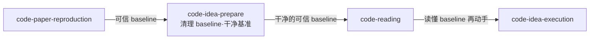
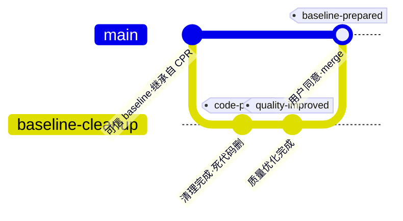
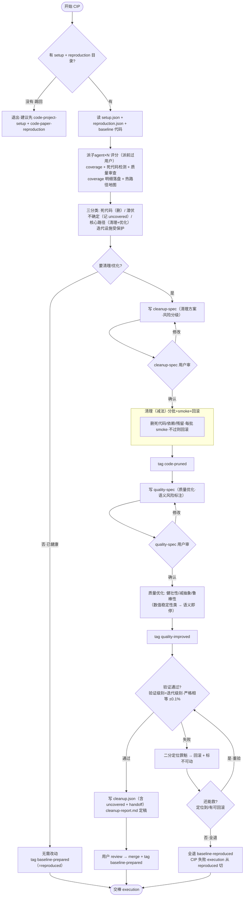

# Code Idea Prepare

## 这个 skill 解决什么问题

DL 研究代码的两个典型痛点：**写得乱**（死代码、冗余依赖、调试残留、过度抽象堆积），**有隐藏坑**（按官方命令跑没问题——reproduction 验过，但 repo 里大量逻辑没被 reproduction 覆盖，分不清是真没用还是潜伏 bug）。

直接在这样的 baseline 上改 idea：阅读负担重、容易碰潜伏代码、改完不知道 delta 是真提升还是被脏 baseline 拖累。本 skill 在动 idea 前把 baseline **清理 + 质量优化**成干净健康的开发基准，**全程保证性能与 reproduction 严格相等（±0.1%）**。

两个核心认知：

**「清理 + 优化」≠「改行为」。** 本 skill 只做行为等价的改动：删确定无用的（减法）、加校验/简化结构/防崩溃（改法不改逻辑）。**不改算法/实验语义**——那是 `code-idea-execution` 的事。

**「性能严格相等」是铁律。** 任何清理/优化引入的性能偏差，要么定位回滚，要么整轮全退。CIP 是锦上添花，不能破坏 CPR 验过的可信 baseline。

## 边界：本 skill 做什么、不做什么

**做**：吃 reproduction 目录；探索评分（coverage + 死代码 + 质量审查）；清理死代码/冗余依赖/残留；质量优化（健壮性/减抽象/鲁棒性）；coverage 热路径落盘；全程 smoke + 性能验证保严格相等；产出 cleanup 目录交 execution。

**不做**（交给相邻 skill）：

| 场景 | 用 |
| ---- | -- |
| repo 还跑不起来 | `code-project-setup` |
| 验证 baseline 能否复现论文性能 | `code-paper-reproduction` |
| 逐段精读源码 | `code-reading` |
| 实现 idea、改算法逻辑 | `code-idea-execution` |
| 修潜伏 bug（改行为的） | `code-idea-execution`（碰到确认了再修） |

> **运行位置**：GPU 服务器（开发卡）。从 CPR 的 `baseline-reproduced` tag 切分支工作。

## 在系统里的位置（局部）

本 skill 是 `dl-assistant` 配套 skill 之一，角色是中期的 **baseline 准备关卡**——清理 + 质量优化可信 baseline，产出干净健康的开发基准。上游吃 `code-paper-reproduction` 的可信 baseline；下游把干净的可信 baseline 先交 `code-reading`（主线必经，人对人带读 baseline，无机读产物）再到 `code-idea-execution`。

> **主线默认，但非必经**：CPR 交棒时会先分诊（repo 规模 / 死代码·ablation 残留密度 / idea 改动范围 / 预期迭代版本数）——干净小 repo + 局部改动可记录理由后跳过本 skill，execution 直接从 `baseline-reproduced` 切（分诊标准见 `code-paper-reproduction` SKILL.md「下游交接」）。用户主动触发（"代码太乱先清理"）不受分诊限制。



> 整体架构、全局怎么连，看 `dl-assistant` 的「全局 skill 流向图」；本 skill 只画与自己相关的 skill。

## 产出与保存：cleanup 目录

保存位置写死 `docs/code-idea-prepare/<repo>-<日期>/`：

```
docs/code-idea-prepare/<repo>-<日期>/
├── cleanup-spec.md       # 清理方案（确认点 1）
├── quality-spec.md       # 质量优化方案（确认点 2，做了才产）
├── cleanup.json          # 机读：评分 + 三分类 + 清理/优化清单 + uncovered + 性能对比 + tag 链 + handoff
├── cleanup-report.md     # 人读报告（活文档，执行中回填）
└── coverage/             # coverage 明细 + hot-path.md（训练链热路径地图，交 execution）
```

- **机读区单一真相源**：`cleanup.json` 是 execution 入口（评分/分类/清理/优化/uncovered/performance/tags/handoff），人读材料分散在目录其他文件。两者描述同一事实，别打架。
- **跨机器交接**：产出是跨机器交接物——横切规范见 `dl-assistant` SKILL.md「横切规范」。

模板：`cleanup-spec-template.md` / `quality-spec-template.md` / `cleanup-report-template.md`（含 cleanup.json 字段）。

## 核心纪律

### 三分类 + 只动确定的

DL 研究代码的"隐藏坑"——reproduction 没覆盖的逻辑，分不清死代码还是潜伏 bug。本 skill 用 **coverage 收集 + 静态分析**把代码分三类，按确定性处理：

| 分类 | 识别 | 处理 |
| --- | --- | --- |
| **核心路径**（reproduction 覆盖） | coverage 跑到 | 可清理 + 优化（动完重验性能） |
| **确定的死代码** | 未覆盖 + 静态确认无引用（grep/import 图/动态 import/registry 排查都无，或整条引用链都是死的） | **删** |
| **潜伏不确定** | 未覆盖 + 有引用，但不确定是死是潜伏 | **不删不修，记 `uncovered` 交 execution** |

> **为什么潜伏不确定不删不修**：删——可能是 execution 改 idea 时要用的接口，误删就崩；修——CIP 契约是性能严格相等，预判修 bug 可能改行为破坏契约。execution 碰到这些代码、确认是 bug 了再修（有明确目标），比 CIP 盲修安全。**确定的动，不确定的记录。**
>
> 质量优化的"健壮性"维度（加校验防崩溃）会顺手覆盖一部分潜伏 bug——但只加防护不改逻辑，且只在核心路径上。

### 迭代设施保护（scaling-law 迭代的命根子）

CPR 的 reduced setting 用「数据集等比采样」（模型容量不动——动容量 = 改 baseline 语义），而 reproduction 跑的是全量数据——repo 里的数据集子集开关、采样脚本、reduced config，coverage 多半没覆盖到，静态分析眼里像「疑似死代码」。但它们是 execution 每轮 2-3h 迭代的载体，误删/误改 = 迭代断腿。

纪律：`reproduction.json` 的 `ready_commands` 三条命令链 + `reduced_setting` 的 config/command 触及的一切文件、配置、缩放开关（模型大小档位 / 数据子集采样），**一律按核心路径对待**——不删、不"优化"；真看着像死代码，记 uncovered 交 execution，不自行处理。

### 两个确认点（cleanup-spec 审 + quality-spec 审，必停）

- **cleanup-spec 审**：三分类结果 + 死代码清单风险分级 + uncovered + 迭代设施保护清单 + 分批计划，用户确认才动手。spec 落盘是"当初决定删什么、为什么"的证据。
- **quality-spec 审**：健壮性/减抽象项用户过目即可；鲁棒性/数值稳定性项（epsilon/clamp）**逐个拍板**——这类改动可能微改数值破坏严格相等，必须用户知情决策。

### 验证级别 = 迭代级别

execution 将在哪个配置上迭代，本 skill 就在哪个配置上验严格相等（±0.1%）——不是"reduced 验趋势 + full 抽验"，否则 execution 拿到的迭代起点本身没验过：

- 有 `reduced_setting`（要重训且 full 超预算）：同 reduced 配置、同 seed，对齐 `reduced_setting.baseline_result`；噪声判断用 `reduced_setting.noise_floor`。
- training-free：eval 链对齐冻结 `target` 块的 `eval_reproduced`。
- 无 reduced（full 在迭代预算内）：full 对齐 `target.training_reproduced`。

验证级别显式记进 `cleanup.json` 的 `performance.verification_level`；迭代命令 post-cleanup 可用且数字对齐 → `handoff.iteration_verified: true`。详见 `verification-strategy.md`。

### 报告动态更新（活文档）

`cleanup-report.md` 在 cleanup-spec 确认后即建立，**随执行逐节回填**——每批清理/优化当场写「目的 / 做了什么 / 预期结果 / 实际结果 / 是否成功」，性能验证节当场记实测值（不是"通过了"），不留到最后一次性补写。「结论先行」节在交付时定稿。

### 失败回退底线

性能不符 → **循环**：排随机（多 seed，对照 noise_floor）→ 二分定位罪魁 → 回滚 + spec 标不可动 → 重验；底线（定位不到 / 回滚到 `baseline-reproduced` 仍失败）→ **全退 `baseline-reproduced`**。CIP 失败的代价是"没清理没优化"，不是"baseline 变差"。详见 `verification-strategy.md`。

### 长任务托管

**亮线规则**：预计 >5 分钟 / 会话断开重跑代价高的命令 → 一律 tmux detach（拿不准时长就当长任务），首选封装脚本 `dl-assistant/scripts/run-long.sh`；禁止 `run_in_background`、禁止前台干等。完整性能验证（full 或 reduced 多 seed）是小时级长任务，机制见 **`dl-assistant/references/long-run-ops.md`**（tmux detach + sentinel + 只读三连 + 扫产物恢复）。本 skill 的 session 前缀 `cip-<repo>-`。

### git 工作流：baseline-cleanup 分支 + 里程碑 tag

从 `baseline-reproduced` 切 `code/baseline-cleanup` 分支，里程碑打 tag：



- `code-pruned`：清理（减法）完成
- `quality-improved`：质量优化完成（做了才打）
- `baseline-prepared`：最终性能验证通过 + merge（execution 从这切）
- 全退时：不打任何 tag、不 merge，execution 从 `baseline-reproduced` 切

> 探索评分"无需改动"（已健康）→ 直接打 `baseline-prepared`（= baseline-reproduced 状态）。图里分支名简称 `baseline-cleanup`（实际 `code/baseline-cleanup`）。

## 上游接缝：reproduction.json + setup.json 字段用法

启动先读 reproduction 目录的 `reproduction.json` + setup 目录的 `setup.json`（缺任一退出，见 Step 1）。继承不重查：

| 字段 | 用法 |
| --- | --- |
| `ready_commands`（eval / train / train_scaled） | 核心入口；coverage 收集与性能验证的命令来源 |
| `reduced_setting` | 有则：coverage 首选命令 + 严格相等基准（`baseline_result` + `noise_floor`）；其 config/command 链接受保护（见「迭代设施保护」） |
| `target`（冻结块） | 严格相等的最终基准（metric 精确定义 + band + eval/training_reproduced）；`frozen: true`，清理不得改 metric 口径 |
| `noise_floor` | full 级噪声 vs 真差判断（跨 seed std） |
| `determinism` | 性能验证复刻同 seed / cudnn / worker seed 设置 |
| `frozen_components` / `mutable_components` | 清理碰到 frozen 组件（metric 实现 / 评测协议）格外谨慎——行为等价改动也先想三遍 |
| `known_pitfalls` | CPR 标过的坑（EMA ckpt / metric 有坑），清理时别踩 |
| setup.json `ready_commands.train_smoke` | 每批清理/优化后的 smoke 首选命令 |
| setup.json `conda_env` / reproducibility | 环境不重搭，直接继承 |

## 运行流程总览



**TaskList 跟踪流程**：Step 1 通过后建任务（探索评分 / cleanup-spec / 分批清理 / quality-spec / 质量优化 / 性能验证 / 交付+merge），每步完成即勾——两个确认点 + 验证回退循环，防跳步。

## references 文件列表

| reference | 讲什么 | 什么时候读 |
| --- | --- | --- |
| `cleanup-spec-template.md` | 清理方案模板（三分类 + 死代码分级 + 迭代设施保护 + uncovered） | 写 cleanup-spec 时 |
| `quality-spec-template.md` | 质量优化方案模板（健壮性/减抽象/鲁棒性 + 语义风险标注） | 写 quality-spec 时 |
| `verification-strategy.md` | coverage 收集 + smoke 分级 + 性能验证（验证级别=迭代级别）+ 失败回退循环 | 验证 / 失败回退时 |
| `cleanup-report-template.md` | cleanup-report.md + cleanup.json 模板 | 建报告 / 写交付时 |

## 常见错误

- 不要不评分就清理 —— 先探索三分类，确定的才动，不确定的记录。
- 不要删"有引用但未覆盖"的代码 —— 可能是 execution 要用的接口，记 uncovered 不删。
- **不要把迭代设施当死代码** —— reduced config / 模型大小档位 / 数据子集开关是 execution 的迭代载体，受保护（见「迭代设施保护」）。
- 不要修潜伏 bug（改行为的） —— 归 execution；CIP 只做行为等价 refactor。
- 不要把质量优化当生产级重构 —— 研究代码不必追完美，减抽象优先训练热路径，边缘脚本不追完美。
- **鲁棒性/数值稳定性优化要即停** —— epsilon/clamp 可能微改数值破坏严格相等，停下问用户。
- 不要跳过 smoke —— 每批清理/优化后必 smoke（首选 setup.json 的 `train_smoke`），不过回滚该批。
- **不要只在 full 验相等就把 reduced 起点交给 execution** —— 验证级别 = 迭代级别，execution 用哪个配置迭代就在哪个配置上验。
- 不要把 coverage 明细用完就扔 —— 落盘 `coverage/` + 整理 `hot-path.md`，execution 要靠它判断改动在不在迭代循环内。
- 不要把性能偏差当噪声放过 —— 按失败回退循环（排随机→二分→回滚），找不到根因就全退。
- **不要破坏可信 baseline** —— CIP 失败的代价是"没清理没优化"（全退 baseline-reproduced），不是"baseline 变差"。
- 不要自动 merge —— 用户 review 才 merge。
- 不要在会话里用 `$...$` LaTeX——会话符号用 Unicode（横切规范见 `dl-assistant` SKILL.md「横切规范」）。

## 运行流程详情（Step 1 - Step 7）

### Step 1 前置检查（硬依赖 reproduction + setup）

- **关键动作**：按 `dl-assistant` 目录布局定位 setup 目录（`setup.json`）+ reproduction 目录（`reproduction.json`）——找不到问用户。都有 → 读，继承 reproduction 的性能基准（冻结 `target` 块）/ 可信度 / determinism / reduced_setting + setup 的 env/数据/命令。缺任一 → **退出**，建议先 `code-project-setup`（没 setup）+ `code-paper-reproduction`（没 reproduction）。CIP 严格依赖 reproduction 验过的可信 baseline，没有就不开始。

### Step 2 探索 + 评分（派子 agent，派前过用户）

- **关键动作**：从 `reproduction.json` 的 `ready_commands` / `reduced_setting` 拿核心入口；**派子 agent ×N 并行评分**（一律 general-purpose，禁 Explore；派前过用户：说明几个、各查什么、读哪些代码）——coverage 收集（命令按 `verification-strategy.md` 三种情形选）、死代码检测（vulture/pyflakes + import 图 + 动态 import/registry 排查）、质量审查（健壮性/鲁棒性/抽象/可维护）。coverage 明细落盘 `coverage/` + 整理 `hot-path.md`（模块/文件级热路径地图）。汇总 → 三分类 + 清理必要度 + 质量优化空间。
- **产出**：评分结论 + `coverage/`（含 hot-path.md）。

### Step 3 写 cleanup-spec（确认点 1）

- **关键动作**：写 `cleanup-spec.md`（三分类结果 + 死代码清单风险分级 + uncovered + 迭代设施保护清单 + 分批计划），模板见 `cleanup-spec-template.md`。
- **确认点**：用户审 → 确认才动手。

### Step 4 分批清理 → tag code-pruned

- **关键动作**：按 spec 分批清理（每批后 smoke——首选 `setup.json` 的 `train_smoke`，粒度见 `verification-strategy.md`；不过回滚该批 + spec 标不可删），每批结果当场回填 report。完成打 `code-pruned`。

### Step 5 写 quality-spec（确认点 2）→ 质量优化 → tag quality-improved

- **关键动作**：写 `quality-spec.md`（健壮性/减抽象/鲁棒性，模板见 `quality-spec-template.md`）——减抽象优先训练热路径（训练主循环 + 模型 forward，execution 每版都要读的路径），边缘脚本不追完美；鲁棒性/数值稳定性标语义即停。
- **确认点**：用户审（鲁棒性项逐个拍板）→ 优化（健壮性/减抽象自主做，鲁棒性确认才做）→ 打 `quality-improved`。
- 不优化就不打这个 tag，直接进 Step 6。

### Step 6 性能验证 + 失败回退（循环）

- **关键动作**：按「验证级别 = 迭代级别」验严格相等 ±0.1%（基准与噪声判据见 `verification-strategy.md` 的对照表；复刻 `determinism`）。失败 → **循环**：排随机（多 seed）→ 二分定位罪魁 → 回滚 + spec 标不可动 → 重验；底线（定位不到 / 回滚光仍失败）→ 全退 `baseline-reproduced`，不打 `baseline-prepared`。

### Step 7 交付 + 下游交接

- **关键动作**：`cleanup.json` 定稿（含 `handoff`：`execution_branch_from` / `iteration_command` / `iteration_verified` / `hot_path` / uncovered 指针）+ `cleanup-report.md` 结论先行节定稿 → **用户 review → merge + tag `baseline-prepared`**。
- **交接**：向用户总结评分结论、清理了什么、优化了什么、性能是否严格相等、uncovered 有哪些、execution 从哪个 tag 切。主线先交棒 `code-reading`（主线必经，带人读懂 baseline 再动 idea）；之后 `code-idea-execution` 从 `baseline-prepared`（或全退的 `baseline-reproduced`）切分支。明确提醒：**uncovered 清单 + `hot-path.md` execution 必看**——前者是 reproduction 没验过的代码（碰到谨慎），后者是判断改动在不在迭代循环内的地图。
