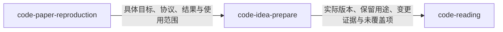

# 按保留用途整理研究代码

目标是减少影响当前阅读和开发的具体代码负担，明确什么保留、什么经批准移除，以及改动验证到了哪里。**指标接近不等于行为等价，未覆盖不等于不用，执行覆盖不等于性能热点。** 没有必要改动也可交调查结果，不以删除行数、评分或完成一次重构证明价值。

通常在实际项目机器工作；检查按任务选择设备，不强制GPU或训练。用户明确要求较大范围整理时按实际范围制定方案，不自行扩大为全仓库审计。科学方法/对照的设计归idea-find/iterate，批准实验归execution；确认的问题可提出修复建议，但不混入行为保持的整理中。

## 保留实验记录行为

已接入 W&B 时，将 [共同记录约定](../wandb/references/experiment-records.md) 的初始化/结束、实际配置、指标定义/step、尝试身份、分布式主进程和断连保留纳入保留用途。清理前后以最小实际运行核对这些行为；不能因 reduced/本地测试没用到 logger 就删掉，不能让一次训练生成多个重复 run。历史 run 不覆盖，代码整理后的检查另建尝试并关联前后版本。交接自查说明记录行为检查范围；未用 W&B 的历史项目不强行补造运行。

## 整理时保留目标条件入口

制定保留范围、修改和前后核查时，接收 [研究条件记录](../dl-assistant/references/research-conditions.md)，保留必须条件对应的数据处理、模型能力、训练阶段、评测入口及配置。不能因 reduced 没用到就删目标规模所需路径；局部回归通过不证明目标条件行为保持。交接前自查列明保护了什么、检查到哪一步和未覆盖项，不把“整理”变成未经批准的研究缩减。

## 系统关系与前置

全局关系见dl-assistant。清理不是强制步骤，code-reading仍为主线必经；本skill内部代码核查不能替用户读懂代码。

先读用户指定的setup/reproduction与当前研究说明，接收components/environments、操作/目标/协议、runs/checks/use_scope和未决。缺固定文件不直接退出：先核是否能明确当前代码、保留需求及必要对照；缺实际环境/资产回setup，缺参考行为/结果则补明确检查或交reproduction。没有相关证据就不声称整理后保持原性能。

旧ready_commands、tag和可信度字段只供定位；不恢复旧noise_floor、统一±0.1%、缩规模外推或frozen/mutable清单。可选低成本配置仅按当前实际用途保护，不默认存在、不由它认证研究结论。

## 工作流程

### 1. 保存改动前现场，明确保留范围

核实际组件/代码commit、未提交diff、环境/config/数据/模型及现有检查的范围。保护用户改动和已有任务，按项目约定使用当前授权或隔离分支，不要求固定tag/分支、merge或push。保留能准确定位本次前后状态的记录，不能把重置整个工作区当恢复。

**建立保留范围清单**：本轮研究/复现、用户指定及已约定的操作、配置、命令入口、公开接口、模型保存/加载、数据/资产兼容、相关历史实验与可重复检查分别列明，说明依据和必要程度。外部使用者/配置或用途不明就记录未知，不推断当前没跑等于可以删。范围本身需改变时按实际授权讨论。

用户只要局部整理时只查相关依赖与接口；用户要求更大范围时明确相应保留范围，不强制每次全仓库评分。若结构已足够清楚、收益小或验证成本不相称，建议不改或缩小范围并保留理由。

### 2. 调查候选，区分证据与移除决定

按实际入口/配置/注册与动态加载、命令行/安装入口、文档/外部调用线索、导入副作用、资产/保存兼容及必要静态检查调查候选。执行覆盖和静态工具只是线索，不是删除许可，不假设检索无结果就是无引用。

候选分别标：保留（有约定用途）、可提议移除（有当前范围与影响证据）、不确定（保留并说明未知）。本轮经批准不再支持的功能可移除，但必须称为有意缩减支持范围，不伪称全局死代码或行为完全不变。

需要运行覆盖/调用观察时先明确命令、配置、输入和成本/授权，只采与候选有关的证据。记录观察到的路径和遗漏；不能把命中一次称为每轮必经，也不以覆盖率推断耗时或验证便宜。按需保存coverage/operation-paths.md；真正性能热点需另外测量。细则见 [变更验证策略](references/verification-strategy.md)。

### 3. 逐项形成方案，执行前自查

按 [清理方案模板](references/cleanup-spec-template.md) 建立“变更—受影响用途/行为—验证”对应表。可选整理/修复建议用 [质量方案模板](references/quality-spec-template.md)，没有相关工作不建空文档。简单任务可同次审阅，已有具体授权直接沿用，不固定两次确认或强制分工。

每项明确类型、实际代码/配置、理由/来源、保留与有意移除什么、影响及未知、必要检查/依据、成本/授权和局部撤销办法。

- preserve_behavior：旨在保持已约定行为的整理；需要相应证据，不以名称叫refactor认定等价。
- remove_out_of_scope：批准移除的用途/接口，明确支持范围变化、调用迁移和相关记录。
- behavior_fix：有意改变错误处理、数值、数据或其他行为，单独描述前后差异、依据/授权及验证；不夹在等价整理里。

加校验、收窄异常、扁平化模块、epsilon/clamp等可能改变异常、参数命名/保存格式或计算，不能凭“代码量小/指标没变”消除影响。有意修复若超出本次任务先提建议，获批后作为独立变更验证；影响原参考条件则交setup/reproduction复核，研究设计变动交idea-find/iterate，不默认所有bug留给以后execution，也不自行设计新方法。

**执行前自查**写在方案中：
- 保留用途/接口/历史资产与未知是否明确？删除依据是否只是未覆盖/未搜到？
- 类型与影响是否诚实，是否把新增错误行为或数值变化叫等价重构？
- 检查能发现对应退化吗，依据/输入/范围与成本是否明确，而不是只比较一个指标？
- 本次改动和撤销范围能否与用户已有改动分开，授权是否足够？

每项写clear/limited/needs_revision、证据/版本、未知与行动影响；needs_revision先补调查/缩范围/讨论，不边写未知边删。自查不新增独立JSON/脚本或逐项审批；已明确不受影响的工作可继续。

### 4. 小批变更，按影响检查

按可分离改动与依赖安排小批，保存实际diff和前后状态；每批执行相应检查并即时记录，不预设必须重训。采用已核适用的setup/reproduction行为检查及 [验证策略](references/verification-strategy.md)，必要时先取得改前对照。

按改动检查输出/损失/参数依赖与更新、数据身份/标签/预处理/顺序、配置/命令行/公开接口、模型保存加载和相关任务结果。哪些相关就检查哪些，纯文档可审阅链接/引用，无需训练；导入/--help成功不替代实际用途和兼容检查。

预期保持内容需要有依据的对应检查；数值容差/随机性解释按具体计算和目标，不套±0.1%或2×std。相同seed不保证前后完全同条件；同一指标不变也不证明逐样本输出或梯度一致。有限检查只支持已覆盖范围，不把“没发现差异”写成整体等价证明。

故意移除功能需检查约定保留用途仍受支持及文档/入口处理；故意修复需检查原问题和相关退化风险，指标接近不能替代正确性依据。修改环境/依赖时用隔离或可恢复的方式比较，不直接破坏用户现用环境。

### 5. 调查差异并只撤销本次确定改动

观察差异先区分实际代码变化、测试/输入差异、环境/资产漂移、随机性或旧证据不适用，不能直接归为本次某行改动或噪声。按预算选择有信息的局部检查，允许原因未知/验证不足。

需要撤销时只撤销可识别的本次改动，保护用户原改动、数据、环境与已运行任务；不可分离时停止操作并讨论，不自动reset到旧tag、不整轮覆盖工作区。局部撤销后核实际状态与受影响检查。

改前状态也出现异常时返回核前置/原证据，不宣称旧代码必然恢复可信。重复无新信息、验证超预算或需要改变设计时报告差异、已知/未知与可选行动，不循环到指标接近才结束。失败/未采用的改动同样保留记录。

### 6. 交接前自查与保存

按 [报告与JSON模板](references/cleanup-report-template.md) 保存保留范围、逐项变更/验证、实际前后版本、未覆盖项和下一步。默认docs/code-idea-prepare/<实际日期>-<slug>/，尊重指定位置，目录冲突区分新任务；继续旧任务核版本，不覆盖原证据。无改动也可交报告，不为打tag而提交空改动。

**交接前自查**：
- 每项删改是否有真实diff、依据、保留/移除范围与相应检查？
- 是否把覆盖率、--help或指标接近升级为整体等价/性能热点/未来必经？
- 有意行为变化是否单列，旧复现结论哪些仍适用、哪些需重新核？
- 选择的实际实现与用户改动是否保留，未完成/撤销/未知是否如实，后续责任是否明确？

逐项给依据和影响；needs_revision不交宽泛“已准备好”结论，但可交真实部分结果。报告支持的是约定用途在所查条件下的具体行为，不自动认证模型正确、科研贡献或跨规模能力。

## 下游与版本

交code-reading的是保留用途、实际源码/config、变更理由、操作路径观察及未覆盖项；执行仍按批准研究设计和关键代码审阅。execution接收实际commit+diff及具体检查范围，不依赖baseline-prepared或iteration_verified认证。git提交/merge/push遵循实际项目规则与已有授权，不将其作为行为已验证的条件。

长任务按 [共享说明](../dl-assistant/references/long-run-ops.md) 和实际调度环境运行，核进程/日志/退出状态/输出再恢复，不重跑仍在运行的任务。分工按需要和实际授权说明任务/输入输出，不强制派子agent或固定工具类型；累计文件串行更新。

新版cleanup.json为schema_version=2。code-reading已按实际用途/变更/观察范围接收；后期旧消费者将在各自审查时同步；旧performance.in_band、iteration_verified、hot-path或tag只作历史定位，不自动映射新证据。历史项目原文件保留，不批量改写，不恢复旧scaling-law设施和统一性能判据。
