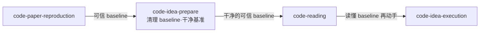
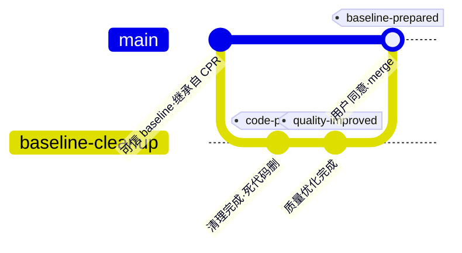
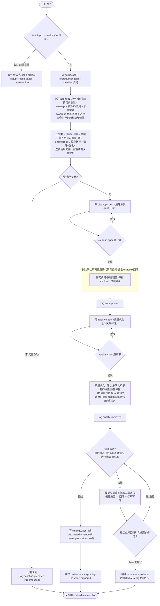

# Code Idea Prepare

## 这个 skill 解决什么问题

研究仓库可能保留未使用的代码、冗余依赖、调试配置和多余的包装层。复现只验证了实际运行的部分。清理前要查明未执行的代码是否仍有用途。

本 skill 在实现研究构想前整理基线代码。清理和优化后，用原有复现结果核对性能，要求严格相等（±0.1%）。

清理和优化以行为等价为原则。可以删除确认不用的代码、增加输入校验、改进错误处理和简化结构。算法和实验含义的改动由 `code-idea-execution` 负责。

发现清理或优化引入性能偏差时，定位并回滚相关改动。无法定位或恢复时，回退整轮改动，保留已经复现验证的基线。

## 边界：本 skill 做什么、不做什么

**做**：读取复现目录，收集覆盖率、检查死代码并审查代码质量。删除确认不用的代码、依赖和调试残留，改善校验、错误处理和结构。记录迭代命令执行到的模块，对每批改动做 smoke 测试，最后比较性能并交付 cleanup 目录。

**不做**（交给相邻 skill）：

| 场景 | 用 |
| ---- | -- |
| repo 还跑不起来 | `code-project-setup` |
| 验证 baseline 能否复现论文性能 | `code-paper-reproduction` |
| 逐段精读源码 | `code-reading` |
| 实现 idea、改算法逻辑 | `code-idea-execution` |
| 修复会改变行为的问题 | `code-idea-execution`（碰到确认了再修） |

> **运行位置**：GPU 服务器（开发卡）。从 CPR 的 `baseline-reproduced` tag 切分支工作。

## 在系统里的位置（局部）

本 skill 以 `code-paper-reproduction` 验证通过的基线为起点。清理并验证后，先交给 `code-reading`，由它带用户阅读基线代码。这一步在主线上必经，不生成机读产物。随后由 `code-idea-execution` 实现研究构想。

> 默认先做清理与质量优化。`code-paper-reproduction` 在交接前根据仓库规模、死代码和消融实验残留、改动范围及预期迭代次数判断是否需要这一步。代码整洁的小仓库且只需局部改动时，可记录理由后跳过，`code-idea-execution` 从 `baseline-reproduced` 创建分支。具体见 `code-paper-reproduction` SKILL.md「下游交接」。用户也可主动启动本 skill。



> 整体架构、全局怎么连，看 `dl-assistant` 的「全局 skill 流向图」；本 skill 只画与自己相关的 skill。

## 产出与保存：cleanup 目录

保存位置写死 `docs/code-idea-prepare/<repo>-<日期>/`：

```
docs/code-idea-prepare/<repo>-<日期>/
├── cleanup-spec.md       # 清理方案（确认点 1）
├── quality-spec.md       # 质量优化方案（确认点 2，做了才产）
├── cleanup.json          # 机读：评分 + 三分类 + 清理/优化清单 + uncovered + 性能对比 + tag 链 + handoff
├── cleanup-report.md     # 供用户阅读的报告，每批执行后更新
└── coverage/             # coverage 明细 + hot-path.md（迭代命令执行到的训练模块和位置，交 execution）
```

- **供下游技能读取的记录**：`cleanup.json` 是 execution 入口（评分/分类/清理/优化/uncovered/performance/tags/handoff），人读材料分散在目录其他文件。两份记录里的结果应保持一致。
- **跨机器交接**：产出是跨机器交接物——共用规则见 `dl-assistant` SKILL.md「所有技能共用的规则」。

模板：`cleanup-spec-template.md` / `quality-spec-template.md` / `cleanup-report-template.md`（含 cleanup.json 字段）。

## 核心纪律

### 按覆盖和引用情况决定如何处理代码

根据复现实验的覆盖率和静态引用检查，把代码分为三类。

| 分类 | 识别 | 处理 |
| --- | --- | --- |
| **核心路径**（reproduction 覆盖） | 复现执行到的代码 | 可按方案清理和优化，改完重新验证性能 |
| **确定的死代码** | 未覆盖 + 静态确认无引用（grep/import 图/动态 import/registry 排查都无，或确认整条引用链都不再使用） | **删** |
| **未覆盖且用途未确认** | 未覆盖 + 有引用，但尚不能确认是否仍会使用 | 原样保留，记入 `uncovered` 并交给 `code-idea-execution` |

> 对未覆盖且用途未确认的代码，保留原样并记录到 `uncovered`。它可能是后续实现要用的接口。若 `code-idea-execution` 实际遇到并确认存在问题，再按当时的目标修复行为。
>
> 只在复现覆盖的核心路径加校验和错误处理，保留原有逻辑。

### 保护迭代所用的文件、配置和开关

复现阶段的 reduced setting 按同一比例采样各数据集，保持模型容量。全量运行的覆盖率可能没有记录子集开关、采样脚本或 reduced 配置，但日常 2-3h 的迭代仍会用到这些文件和开关。

保护 `reproduction.json` 中 `ready_commands` 的三条命令和 `reduced_setting` 的 config、command 所用的一切文件、配置和缩放开关（模型大小档位、数据子集采样）。这些内容即使未被覆盖，也不得删除或优化。疑似死代码记入 uncovered，交给 `code-idea-execution`。

### 两个确认点（cleanup-spec 审 + quality-spec 审，必停）

- **cleanup-spec 审**：三分类结果 + 死代码清单风险分级 + uncovered + 迭代所用文件、配置和开关的保护清单 + 分批计划，用户确认才动手。spec 落盘是"当初决定删什么、为什么"的证据。
- **quality-spec 审**：用户审阅输入校验、错误处理和结构简化的清单；鲁棒性/数值稳定性项（epsilon/clamp）**逐项确认**——这类改动可能微改数值破坏严格相等，必须用户知情决策。

### 用后续迭代的实际配置做性能验证

按后续迭代实际使用的配置验证清理前后的性能是否严格相等（±0.1%）。从以下三种情况中选择对应的配置和比较基准。

- 有 `reduced_setting`（要重训且 full 超预算）：同 reduced 配置、同 seed，对齐 `reduced_setting.baseline_result`；噪声判断用 `reduced_setting.noise_floor`。
- training-free：eval 链对齐冻结 `target` 块的 `eval_reproduced`。
- 无 reduced（full 在迭代预算内）：full 对齐 `target.training_reproduced`。

验证级别显式记进 `cleanup.json` 的 `performance.verification_level`；迭代命令 post-cleanup 可用且数字对齐 → `handoff.iteration_verified: true`。详见 `verification-strategy.md`。

### 每批完成后更新报告

`cleanup-report.md` 在 cleanup-spec 确认后即建立，**随执行逐节回填**——每批清理/优化当场写「目的 / 做了什么 / 预期结果 / 实际结果 / 是否成功」，性能验证节当场记实测值（不是"通过了"），不留到最后一次性补写。「结论先行」节在交付时定稿。

### 失败回退底线

性能不符时，先用多个随机种子的结果和 noise_floor 检查是否超出随机波动，确认超出随机波动后，再按提交或批次二分定位引入偏差的改动。回滚该改动，在方案中记录相应代码不可删改，然后重新验证。无法定位偏差，或回滚到 `baseline-reproduced` 后仍失败时，整轮退回 `baseline-reproduced`。详见 `verification-strategy.md`。

### 长任务托管

预计超过 5 分钟、耗时不确定，或会话断开后重跑代价高的命令，在 tmux 的分离会话中运行，首选 `dl-assistant/scripts/run-long.sh`。禁止用 `run_in_background` 或在前台等待长任务。全量或 reduced 的多随机种子验证可能持续数小时，会话名前缀为 `cip-<repo>-`。查看会话、日志和退出码，中断后核对已有文件再继续。详见 `dl-assistant/references/long-run-ops.md`。

### git 工作流：baseline-cleanup 分支 + 里程碑 tag

从 `baseline-reproduced` 切 `code/baseline-cleanup` 分支，里程碑打 tag：



- `code-pruned`：删除确认不再使用的代码和依赖完成
- `quality-improved`：质量优化完成（做了才打）
- `baseline-prepared`：最终性能验证通过 + merge（execution 从这切）
- 整轮回退时：不打任何 tag、不 merge，execution 从 `baseline-reproduced` 切

> 探索评分"无需改动"（已健康）→ 直接打 `baseline-prepared`（= baseline-reproduced 状态）。图里分支名简称 `baseline-cleanup`（实际 `code/baseline-cleanup`）。

## 从已有复现与环境报告读取信息：reproduction.json + setup.json 字段用法

启动先读 reproduction 目录的 `reproduction.json` + setup 目录的 `setup.json`（缺任一退出，见 Step 1）。继承不重查：

| 字段 | 用法 |
| --- | --- |
| `ready_commands`（eval / train / train_scaled） | 核心入口；coverage 收集与性能验证的命令来源 |
| `reduced_setting` | 有则：coverage 首选命令 + 严格相等基准（`baseline_result` + `noise_floor`）；其 config/command 链接受保护（见「保护迭代所用的文件、配置和开关」） |
| `target`（冻结块） | 用于验证性能相等的基准（指标定义、容差范围及 eval/training_reproduced）；`frozen: true`，清理时沿用指标的原有计算方式 |
| `noise_floor` | full 级判断差异是否超出随机波动（跨 seed std） |
| `determinism` | 性能验证复刻同 seed / cudnn / worker seed 设置 |
| `frozen_components` / `mutable_components` | 清理碰到 frozen 组件（metric 实现 / 评测协议）格外谨慎——即使改动预计保持行为等价，也要仔细核对影响 |
| `known_pitfalls` | 复现阶段记录的已知问题，例如 checkpoint 使用了 EMA 权重或指标实现有差异，清理时据此核对。 |
| setup.json `ready_commands.train_smoke` | 每批清理/优化后的 smoke 首选命令 |
| setup.json `conda_env` / reproducibility | 环境不重搭，直接继承 |

## 运行流程总览



**TaskList 跟踪流程**：Step 1 通过后建任务（探索评分 / cleanup-spec / 分批清理 / quality-spec / 质量优化 / 性能验证 / 交付+merge），每步完成即勾——两个确认点 + 验证回退循环，防跳步。

## references 文件列表

| reference | 讲什么 | 什么时候读 |
| --- | --- | --- |
| `cleanup-spec-template.md` | 清理方案模板（三分类 + 死代码分级 + 迭代设施保护 + uncovered） | 写 cleanup-spec 时 |
| `quality-spec-template.md` | 质量优化方案模板（健壮性/简化不必要的抽象层/鲁棒性 + 语义风险标注） | 写 quality-spec 时 |
| `verification-strategy.md` | coverage 收集 + smoke 分级 + 性能验证（用后续迭代的实际配置验证）+ 失败回退循环 | 验证 / 失败回退时 |
| `cleanup-report-template.md` | cleanup-report.md + cleanup.json 模板 | 建报告 / 写交付时 |

## 常见错误

- 不要不评分就清理 —— 先探索三分类，确定的才动，不确定的记录。
- 不要删"有引用但未覆盖"的代码 —— 可能是 execution 要用的接口，记 uncovered 不删。
- **不要把迭代设施当死代码** —— reduced config / 模型大小档位 / 数据子集开关是 execution 的迭代载体，受保护（见「保护迭代所用的文件、配置和开关」）。
- 不要修复会改变行为的问题 —— 归 execution；CIP 只做行为等价 refactor。
- 不要把质量优化当生产级重构 —— 研究代码不必追完美，简化不必要的抽象层优先训练时反复执行的代码，边缘脚本不追完美。
- **鲁棒性/数值稳定性优化要即停** —— epsilon/clamp 可能微改数值破坏严格相等，停下问用户。
- 不要跳过 smoke —— 每批清理/优化后必 smoke（首选 setup.json 的 `train_smoke`），不过回滚该批。
- **不要只在 full 验相等就把 reduced 起点交给 execution** —— 用后续迭代的实际配置做性能验证，execution 用哪个配置迭代就在哪个配置上验。
- 不要把 coverage 明细用完就扔 —— 落盘 `coverage/` + 整理 `hot-path.md`，execution 要靠它判断改动在不在迭代循环内。
- 发现性能偏差时，按回退流程检查随机波动、二分定位、回滚并重验。无法定位时退回原基线。
- 整轮回退时，后续从 baseline-reproduced 开始。
- 不要自动 merge —— 用户 review 才 merge。
- 不要在会话里用 `$...$` LaTeX——会话符号用 Unicode（共用规则见 `dl-assistant` SKILL.md「所有技能共用的规则」）。

## 运行流程详情（Step 1 - Step 7）

### Step 1 前置检查（硬依赖 reproduction + setup）

- **关键动作**：按 `dl-assistant` 目录布局定位 setup 目录（`setup.json`）+ reproduction 目录（`reproduction.json`）——找不到问用户。都有 → 读，继承 reproduction 的性能基准（冻结 `target` 块）/ 可信度 / determinism / reduced_setting + setup 的 env/数据/命令。缺任一 → **退出**，建议先 `code-project-setup`（没 setup）+ `code-paper-reproduction`（没 reproduction）。CIP 严格依赖 reproduction 验过的可信 baseline，没有就不开始。

### Step 2 探索 + 评分（派子 agent，派发前请用户确认）

- **关键动作**：从 `reproduction.json` 的 `ready_commands` / `reduced_setting` 拿核心入口；**派子 agent ×N 并行评分**（一律 general-purpose，禁 Explore；派发前请用户确认：说明几个、各查什么、读哪些代码）——coverage 收集（命令按 `verification-strategy.md` 三种情形选）、死代码检测（vulture/pyflakes + import 图 + 动态 import/registry 排查）、质量审查（健壮性/鲁棒性/抽象/可维护）。coverage 明细落盘 `coverage/` + 整理 `hot-path.md`（迭代命令执行到的模块和文件）。汇总 → 三分类 + 清理必要度 + 质量优化空间。
- **产出**：评分结论 + `coverage/`（含 hot-path.md）。

### Step 3 写 cleanup-spec（确认点 1）

- **关键动作**：写 `cleanup-spec.md`（三分类结果 + 死代码清单风险分级 + uncovered + 迭代所用文件、配置和开关的保护清单 + 分批计划），模板见 `cleanup-spec-template.md`。
- **确认点**：用户审 → 确认才动手。

### Step 4 分批清理 → tag code-pruned

- **关键动作**：按 spec 分批清理（每批后 smoke——首选 `setup.json` 的 `train_smoke`，粒度见 `verification-strategy.md`；不过回滚该批 + spec 标不可删），每批结果当场回填 report。完成打 `code-pruned`。

### Step 5 写 quality-spec（确认点 2）→ 质量优化 → tag quality-improved

- **关键动作**：写 `quality-spec.md`（健壮性/简化不必要的抽象层/鲁棒性，模板见 `quality-spec-template.md`）——简化不必要的抽象层优先训练时反复执行的代码（训练主循环 + 模型 forward，execution 每版都要读的路径），边缘脚本不追完美；鲁棒性/数值稳定性标暂停并请用户确认可能影响实验含义的改动。
- **确认点**：用户审（鲁棒性项逐项确认）→ 优化（健壮性/简化不必要的抽象层自主做，鲁棒性确认才做）→ 打 `quality-improved`。
- 不优化就不打这个 tag，直接进 Step 6。

### Step 6 性能验证 + 失败回退（循环）

- **关键动作**：用后续迭代的实际配置验证性能严格相等（±0.1%）。按 `verification-strategy.md` 选择基准并判断随机波动，沿用 `determinism` 记录的设置。失败时先检查随机波动，再二分定位相关提交或批次。回滚该改动、在方案中标为不可删改后重新验证。无法定位，或回退到 `baseline-reproduced` 后仍失败时，保留 `baseline-reproduced`，不打 `baseline-prepared`。

### Step 7 交付 + 下游交接

- **关键动作**：`cleanup.json` 定稿（含 `handoff`：`execution_branch_from` / `iteration_command` / `iteration_verified` / `hot_path` / uncovered 指针）+ `cleanup-report.md` 结论先行节定稿 → **用户 review → merge + tag `baseline-prepared`**。
- **交接**：向用户总结评分结论、清理了什么、优化了什么、性能是否严格相等、uncovered 有哪些、execution 从哪个 tag 切。主线先交接给 `code-reading`（主线必经，带人读懂 baseline 再动 idea）；之后 `code-idea-execution` 从 `baseline-prepared` 创建分支，整轮回退时从 `baseline-reproduced` 创建分支。明确提醒：**uncovered 清单 + `hot-path.md` execution 必看**——前者是 reproduction 没验过的代码（碰到谨慎），后者记录迭代命令执行到的模块，供判断是否需要补充验证。
