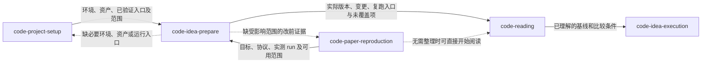
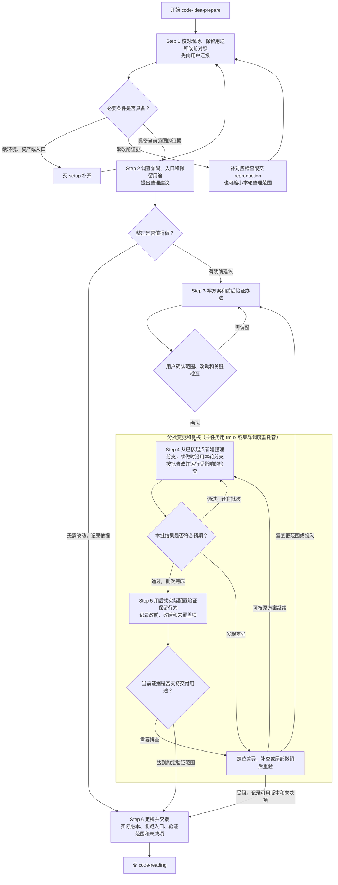

# 整理研究代码并验证保留的行为

在实现研究构想之前，整理会妨碍阅读和迭代的研究代码，明确哪些入口和行为需要保留，并用可复跑的改前、改后证据说明整理后的代码可以支持哪些后续工作。先调查再建议改动。仓库已适合后续工作时，交付调查结论和可沿用的基准。

## SKILL 交接关系



先用用户指定的 setup、reproduction 及研究记录核对现有证据。缺固定文件时，按当前仓库、数据、环境和保留用途判断还能回答什么。整体科研流程见 [dl-assistant](../dl-assistant/SKILL.md#共同研究流程)。

## 产出与保存

默认保存到 `docs/code-idea-prepare/<repo>-<日期>/`。使用用户指定目录时，续做先核起点版本、已审方案和实际已完成的批次。新任务使用独立目录。

| 产物 | 何时创建与记录内容 |
| --- | --- |
| [清理方案](references/cleanup-spec-template.md) `cleanup-spec.md` | 有清理建议时在改代码前建立。写保留用途、删除依据、受影响入口、分批安排和对应检查 |
| [质量方案](references/quality-spec-template.md) `quality-spec.md` | 有结构、校验或错误处理等质量改动时在改代码前建立。逐项说明预期行为、改动类型和验证依据 |
| [清理报告与机读记录](references/cleanup-report-template.md) `cleanup-report.md`、`cleanup.json` | 开工时记现场，调查后补基准与建议，逐批回填，交付时核对两份记录。保存实际变更、改前和改后版本、证据、未覆盖项和后续入口。无需改动时也可交调查结论 |
| `coverage/` | 调查时按需保存执行路径和原始覆盖证据。记录具体执行条件和观测范围 |
| `runs/<run-slug>/` | 本轮新增的改前检查、逐批检查和最终复核各用独立目录。可复用的复现 run 在报告中引用 |
| `docs/research/PROJECT_CONTEXT.md`、`docs/research/research-rounds.json` | 首次准备研究仓库并交接时初始化缺少的文件，已有记录沿用。轮次由获批后的 execution 或 iterate 登记 |

```text
coverage/
├── operation-paths.md  # 按需记录命令执行到的入口、模块、条件、证据和未观察到的范围
└── <实际生成的覆盖记录>  # 按需保留工具生成的文件，写明工具、版本和采集方式

runs/<run-slug>/
├── command.sh         # 执行前保存实际工作目录、环境入口和命令
├── meta.json          # 执行前关联批次、改前或改后版本、配置、资产和比较对象，运行后回填
├── run.log            # 实际 stdout/stderr，tmux 使用 <会话名>.log
├── EXIT_CODE          # 运行结束时记录，tmux 使用 <会话名>.EXIT_CODE
├── config/            # 按需保存生效配置、覆盖参数或样本清单
├── metrics.json       # 有指标时保存读数、单位和统计范围
└── outputs/           # 按需保存样本 ID、行为对照、逐样本输出或大产物的位置
```

日志和退出状态按实际执行工具生成的位置登记。大文件记录身份、原路径和取得方式。

## 运行流程图



## 参考资料列表

| 参考资料 | 什么时候读 |
| --- | --- |
| [运行手册](references/workflow.md) | 开始或续做时，按步骤核查、调查、改动、复核并交接 |
| [研究代码清理指引](references/cleanup-guide.md) | 调查代码、配置和依赖的用途，判断清理候选并选验证办法时 |
| [清理方案模板](references/cleanup-spec-template.md) | 写删除候选、影响、分批方案和保护范围时 |
| [结构整理与行为修复指引](references/quality-guide.md) | 调查质量问题、判断行为和兼容影响并选检查时 |
| [质量方案模板](references/quality-spec-template.md) | 计划结构整理、错误处理或其他质量改动时 |
| [验证策略](references/verification-strategy.md) | 需要收集执行路径、选逐批检查或定位差异时 |
| [清理报告与机读模板](references/cleanup-report-template.md) | 起稿、回填每批证据和交接时 |
| [复现报告与机读交接](../code-paper-reproduction/references/reproduction-report-template.md) | 找可用改前 run、比较协议和适用范围时 |
| [长任务托管与恢复](../dl-assistant/references/long-run-ops.md) | 执行或恢复较长的训练、评测及回归检查时 |

## 改动原则与确认点

1. **保持行为的整理。** 清楚写出要保持的接口、实际输出或训练行为，并用改前、改后证据核对。最终指标与样本覆盖、参数更新、保存加载等证据按受影响路径选取。
2. **经确认移除的功能。** 调查真实用途、调用方和支持范围，写明移除后受影响的配置、入口与兼容性。用户确认后实施并核保留用途。执行覆盖只说明给定运行观察到了哪些路径。静态检索或覆盖证据不足的候选记录为用途待核。
3. **有意改变行为的修复。** 明确重现输入、原行为、新预期和影响，获准后单独分批验证。改变评测或训练协议时，请 setup 或 reproduction 核受影响的证据。改变研究问题或实验设计时，交研究设计阶段讨论。

保护已经约定的正式入口、将要使用的 reduced 配置、数据与 checkpoint 兼容性。项目已使用 W&B 时，把相关记录行为纳入保留范围，按[共同实验记录](../wandb/references/experiment-records.md)核对。用户审阅清理和质量改动时可一起讨论，分开记录改动类型与验证依据。已有明确授权按原范围推进。

首次开始整理时，在修改项目代码前，从已确认的改前版本新建本地 `code/baseline-cleanup` 分支。续做时核对并沿用本轮分支。只做调查或无需改代码时，按现场记录交接。只撤销可识别的本轮改动，保留用户的工作和各次运行证据。交付绑定实际 commit 及相关 diff，合并由用户决定。
