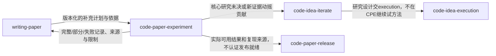

# 执行论文补充实验并交付真实证据

接收已经明确的问题和补充需求，核实际实现、资源与批准范围，取得可解释且可追查的记录。执行完成、数据有效、假设得到支持和研究有价值分别判断；文件检查不能认证科学结论。

## 位置与分工



全局关系见dl-assistant。核心事实、方法有效性、关键解释、重要性或目标条件收益仍未知，按 [研究与写作分工](../dl-assistant/references/research-transition.md) 返回iterate设计、execution取证；不因规模、seed、主表/消融名称或机器位置划分。已有完整设计可接收内容等价的用户计划，不强制先去另一个skill补模板。

沿用execution的meta、执行状态、数据有效性、推断和声明产物语义，见 [共同记录与批次契约](references/execution-contract.md)。本skill增加论文计划、重复身份、汇总复核和交接；不维护另一套success/failure科学判据，不直接改claims或新建研究命题，但必须读相关研究背景以正确执行。

## W&B 与论文实验来源

沿用 [W&B 共同记录](../wandb/references/experiment-records.md)，SDK 向用户内网实例记录实际运行。batch_id 对应 scope_id，exp_id/replicate_id/attempt_id 双向关联 run；失败/中断/恢复和离线同步同样登记，不把重试计为新独立重复。启动自查核身份、实际来源与上传范围，交接自查核运行/同步/有效性分开及全部尝试；共享 meta 检查会核 tracking 字段，不保证远端持久化。

论文数据包带实际结果、必要查询快照和校验值、run 全身份及 Artifact 精确版本/digest；仅网页 URL 不算已取得的证据。W&B 抽样曲线不作为完整统计输入，正式汇总沿用本skill的原始读数/重复/选择核对。同步失败优先保存和补同步，不重跑实验、不切云端。

## 1. 接收计划，核是否能回答问题

定位用户指定计划/批次，记录实际文件与校验值，不默认按版本号先后串行执行。读取目的、研究问题/主张、设计类型、对照/分析与解释规则、必要条件、依赖、预算/停止规则、产物和现有批准。

支持训练、纯评测、诊断、测量、分析、可视化/探针或理论检查；paper_role另记论文用途。按任务选择CPU/GPU/其他设备，不要求方法全局冻结或所有配置先扫描。计划缺科学比较/资源决定时先指出并补讨论，不悄悄改成更容易阳性的方案。

**接收自查**：目标、设计、关键未知、条件、解释范围、已有证据复用和授权是否足够？在现有记录保存判断—依据—未知—行动影响。核心未决先回研究；有限的准备/诊断可按批准范围继续，不把未知一律当否定。

## 2. 绑定实际代码、条件与执行方式

**长任务启动规则**。预计超过 5 分钟或中断后重跑代价高的命令，单机或 SSH 直连机器上用 `dl-assistant/scripts/run-long.sh` 在实际执行机器上通过 tmux detach 启动。通过集群调度器提交的任务走调度器。启动和恢复细节见 [共享长任务说明](../dl-assistant/references/long-run-ops.md)。

读真实入口、数据处理、测量/统计及现有准备记录。保存实际commit、未提交diff、解析后配置、脚本/命令、数据/模型版本和所需环境。配置副本存在不证明实际加载了它；代码与数据也不能只填“中期收口版本”。

按 [研究条件规则](../dl-assistant/references/research-conditions.md) 核本轮必须保留项、目标与实际差异、关键现象与未知。低成本配置无永久筛选资格，短训练不替代后期现象。只有小规模才是本研究目标时不强制放大。

新实现、测量/统计改动给用户实际diff及语义说明，继承code-reading的人类阅读和关键改动审阅要求。已经明确授权的工程检查直接继续，不因进入论文阶段跳过语义审阅。

比较协议按问题逐项制定：相同与不同条件、参数选择、权重/checkpoint来源、公平性和混杂。不能把相同seed、统一checkpoint规则、所有参数相同或固定消融配置当充分证明。探索与确认分开，无依据不填预计增益、2×std或通用重复数。

## 3. 按已批准范围启动与恢复

保存不可变plan副本、批次run-spec、设计与实际配置，使用唯一batch_id、exp_id和attempt_id；结构见execution-contract。与现有任务/结果对照，按条件、来源、有效性和用途决定能否复用，不因文件在或曾通过就直接复用。

只在计划明确需要时搜索参数或选配置，写范围、选择数据、成本、解释/停止规则；不默认pilot或扫描。测试数据不得被用于未批准的选择与反复调参；实际协议变化保留版本，不覆盖原设计。

**启动自查**：实际代码/配置/条件与批准设计一致吗，必要对照和原始读数是否可取得，允许调整与资源边界是否明确？在预算内按资源和真正依赖排程；GPU、显存、CPU/RAM、存储/I/O和共享资源按实际需要核，不强制多卡、并行或must先于所有依赖。

启动前做与操作相适配的最小检查；纯分析不要求前向/反向/存checkpoint，已有等价检查可引用。低成本检查仅证明所查范围，不能替代研究条件或完整结果。

中断先核进程/调度器、退出状态、日志与产物，再决定重连、恢复、另起尝试或不继续；不默认重跑，不覆盖失败现场。无退出码不自动视为仍运行。

## 4. 保存全部尝试与变更

所有启动、失败、取消、阻塞、未执行、选择/排除和恢复都入记录；种子身份与尝试身份分开，重试不算新独立重复。重复不足时核原因、选择影响及仍能解释什么，不仅改“置信度”。

已批准范围内且不改变科学含义的日常调整可自主并留依据；新预算、关键条件、科学比较或测量/分析变化返回确认。**条件变化自查**写明原/新条件、原因、关键影响及批准；OOM不自动授权缩输入、batch、精度或训练阶段，改变受保护条件不能继续原假设检验。

相对原计划的增加/变更/不再执行都保留来源和实际决定；新增科学实验先取得新批准计划，不以“执行时可加改”替代设计。互相冲突的批次配置隔离，不能并发覆盖同一活文件。

## 5. 复核结果并分批交接

每个实验按实际状态声明所需产物，不要求分析有train.log、失败有最终指标。由原始读数与选择记录复核统计量；均值/标准差/比例、分母、单位、重复和不确定性类型明确。复杂分析保留输入、脚本/版本与真实输出，不能因文件可解析就认证计算或科学有效。

```bash
bash <skill目录>/scripts/check-run-artifacts.sh --expdir <批次>/experiments/<exp_id> --spec <批次>/run-spec.json --exp-id <exp_id>
bash <skill目录>/scripts/check-run-artifacts.sh --pkgdir <数据包目录>
```

脚本复用execution的记录检查并核本skill的身份、尝试、引用、集合和声明汇总。退出0为所声明记录核对完成，不是实验全成功；1为错误，2为用法错误，3为记录/来源/复算未完成。失败记录完整可以通过，仍明确显示失败和可用范围。

**交接自查**：计划—实际—结果是否逐项对应；数据有效性、统计/选择、条件、偏差和失败是否诚实；原来相信什么、观察什么、支持到哪一步；是否需要返回研究？保存具体依据与行动影响，不靠目录齐全替代。

数据包可交部分、失败或未决；must缺失说明对主张影响和下一步决定，不默认重跑到成功，也不凭任务标签决定论文能否定稿。小型关键读数/统计输出/源码配置优先提供；大文件按用途、成本和授权复制或外部引用，记录校验值、实际可访问性、缺失及影响，不一律禁止权重或日志。

包与批次不覆盖历史，每次交接明确plan/run-spec快照、batch_id、全部计划项及状态。writing-paper按实际数据和条件接收，release只取可用且对应其用途的具体结果；两者不能把旧done/success/全规模标签当可信认证。

## 资料与限制

[执行/复算/包契约](references/execution-contract.md)、[机读模板](references/templates/data-pkg-schema.json)、[单实验报告](references/templates/exp-report-template.md)。文件检查只核声明、身份和有限复算，不证明实际授权、预登记时间、语义一致、跨规模迁移或科学判断正确。
