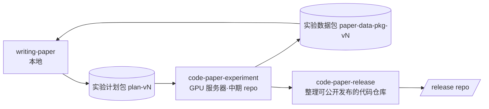
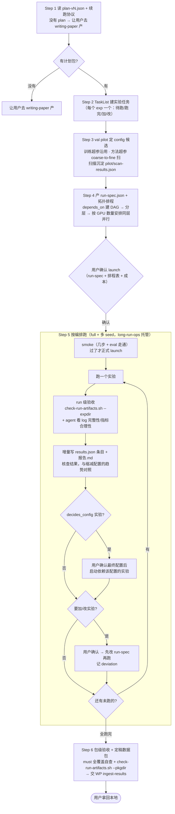

# Code Paper Experiment

## 用途

中期的 `code-idea-execution` 和 `code-idea-iterate` 用缩减配置和单个随机种子快速迭代方法，观察结果趋势。论文主表和消融分析需要用全量配置和多个随机种子获得结果。

本 skill 在 GPU 服务器上，基于 `code-idea-iterate` 确认的最终方法和代码版本执行全量实验。实验完成后，将数据包交给 `writing-paper` 的 `ingest-results` 导入。

### 实验计划、执行规格和数据包

- **实验计划**（`plan-vN.json`）由 `writing-paper` 生成，记录要做的实验及其目的。可在计划基础上增改实验，每项增改均须经用户确认。
- **执行规格**（`experiments/run-spec.json`）在收到计划后、启动实验前编写。逐项记录脚本、实际使用的配置副本、完整命令、随机种子、评估协议和按依赖关系安排的运行顺序。用户确认已保存的执行规格后才启动实验。严格按规格执行，经用户确认的增改要先写入规格，再运行。
- **实验数据包**（`paper-data-pkg-vN/`）汇总实际结果。按规定的目录结构保存每项实验的配置、脚本、各次运行的产物和完整日志。每项实验通过验收后才接收结果，整个数据包通过验收后再交给 `writing-paper`。

全量实验可能持续数天，消耗数十到上百 GPU 小时。执行规格记录使用的配置和命令，固定目录结构便于查找日志和结果。逐项验收和数据包验收确保包里的每个数字都能追溯到 `experiments/<exp_id>/` 中的记录。这是「产物即真相」在实验环节的落实。

**必须有实验计划包**。缺少计划包时，请用户先用 `writing-paper` 生成。实验的增改以已有计划为基础，并由用户确认。

**长任务按 `long-run-ops.md` 托管**。预计耗时超过 5 分钟或中断后重跑代价高的命令，必须用 `tmux detach` 托管。拿不准时按长任务处理。优先使用 `dl-assistant/scripts/run-long.sh`，禁止使用 `run_in_background` 或在前台等待任务结束。

**只执行实验并生成数据**。不读取或修改 `code-idea-iterate` 生成的 `claims.json`。

## 在系统里的位置



> `[( )]` 节点 = skill 间内部流转（计划包 / 数据包，不对外暴露）；`[/ /]` 节点 = 外部成品（release repo，用户拿走开源）。完整全局图见 `dl-assistant`。

## 边界

**做**：读取实验计划包 → 编写 run-spec（执行规格）→ 用户确认 launch → 跑 full-scale 实验（full config + 多 seed，按拓扑排程）→ run 级验收 + 增量写结果 → 可加/改实验（先改 spec、用户确认）→ 包级验收 → 将数据包交给 writing-paper 的 ingest-results 导入。

**不做**（交给相邻 skill）：

| 场景 | 用 |
|---|---|
| 产实验计划包（定要跑什么 + 为什么 + 谁先谁后）| `writing-paper`（缺少计划包时请用户先生成）|
| 中期迭代方法（实现 / 验 / 演化下一版）| `code-idea-execution` / `code-idea-iterate` |
| 导入数据包后撰写或修改论文| `writing-paper` ingest-results |
| 整理可公开发布的代码仓库| `code-paper-release` |

## 输入

- **实验计划包**（必需）：`writing-paper` 产（`_draft/experiments/plan-vN.json`，版本化递增——v1 只装长周期必做项，写作中新增需求攒成后续批次；文件格式见 `writing-paper/references/templates/paper-experiment-plan-template.json`)。用户拿到 GPU 服务器（不管怎么传）。关键字段：
  - **`priority`**:must 必跑（WP 数据验收第一条就是"must 都跑了？"）；排队 must 先跑，预算紧砍 should/appendix（用户确认）。
  - **`expected_signal`**：预先设定的成功判据——`results.json` 逐实验对照它给判定。
  - **`fairness`**（main/comparison 必填）：baseline 公平条件照跑，结果条目里声明怎么落实的。
  - **`depends_on` / `decides_config`**：拓扑依赖与配置决策标记——Step 4 排程的输入。
- **代码仓库**（GPU 服务器本地）。使用 code-idea-iterate 确认的最终方法和代码版本运行全量实验。
- **论文材料与代码版本**由 code-idea-iterate 提供，用于确认最终方法和对应的仓库版本。

> 实验计划包和数据包由用户在机器之间转交，传输方式由用户决定。实验直接使用 GPU 服务器上的代码仓库。

## 共用的长任务运行规则

| 引用 | 讲什么 | 何时读 |
|---|---|---|
| `dl-assistant/references/long-run-ops.md` | 长训练托管（tmux detach / 三个状态文件 / 重连 / resume / 避免磁盘写满）| 跑 full-scale 训练（贵、长）时 |

> 本 skill 的 tmux session 前缀：`cpe-<exp_id>-`（各 skill 前缀的场景速查见该文件末尾）。

## 产出与保存

实验目录和数据包均以 `references/templates/data-pkg-schema.json` 定义的格式为准。writing-paper 据此验收。

### GPU 服务器上必须使用的目录结构

```
experiments/
├── run-spec.json              # 第 4 步生成的执行规格，用户确认后才启动实验
├── pilot/
│   └── scan-results.json      # val pilot 扫描数据（WP 敏感性分析素材）
└── <exp_id>/                  # 每个实验一个目录，按此结构验收
    ├── configs/               # 实际用的 config 冻结副本（repo 原件会被改，不冻结不可回溯）
    ├── scripts/               # 启动脚本（train.sh / eval.sh，含完整命令行）
    ├── runs/
    │   └── seed-<n>/
    │       ├── train.log      # 完整训练日志，用于排查故障
    │       ├── eval.log
    │       └── metrics.json   # 该 seed 原始指标
    ├── figures/               # qualitative 实验的可视化产物（其他类型可空）
    ├── results.json           # 该实验 mean±std + 各 seed 原始数 + signal 判定
    ├── meta.json              # experiment meta（git/type/claim_cids/状态/gpu_hours）
    └── 报告.md                # 人读：TL;DR 结论先行（模板见 exp-report-template.md）
```

### 数据包（每批一份，由 writing-paper 的 ingest-results 导入）

```
paper-data-pkg-v<N>/           # N 对齐 plan 版本
├── experiments-actual.json    # 实际跑了哪些 + 相对 plan 的加/改/删（删带原因）
├── results.json               # 逐实验结果汇总（mean±std/n seeds/signal 判定/fairness）——增量写
├── pkg-meta.json              # 验收清单 + 权重/log 指针 + GPU 小时记录
├── pilot/
│   └── scan-results.json      # 超参扫描（WP 敏感性分析素材）
└── experiments/<exp_id>/      # 副本：configs/ scripts/ results.json meta.json 报告.md figures/
                               # runs/ 的权重与全量 log 不进包（太大）——pkg-meta.json 给 GPU 路径指针
```

**各文件的用途**

- **experiments-actual.json** = 实际跑了哪些 + 相对 plan 的 deviation(WP 据此**对齐 experiment section**)。
- **results.json** 逐项记录均值 ± 标准差、随机种子数，以及对照预先设定判据的判断。`writing-paper` 据此填写论文数据，并核对论文表述。
- **报告.md**（每实验）= 供用户阅读的实验摘要。数字直接引用 results.json，无需新增供程序读取的字段。

## 核心纪律

- **用户确认 launch 和每个加/改**——full-scale 烧 GPU,launch 确认 run-spec + 排程 + 成本；加/改先改 run-spec 再跑，都用户点头，别自作主张。
- **两道验收**——run 级验收不过不接收结果（先补/重跑）；包级验收不过不交 WP。
- **config/脚本冻结副本进实验目录**——repo 原件会被后续改动，不冻结永远不可回溯。
- **保存完整日志**。发生故障时，使用完整的 train.log 排查。
- **逐项保存结果**。每项实验完成并通过验收后，立即更新 `results.json` 并写好 `报告.md`，以便中断后仍能查到已完成的结果。
- **val 上选，不看 test**——超参与 config 决策只用 validation split；主表数字出来后 config 不再动（test peeking 红线）。
- **eval 协议全实验统一**——checkpoint 选择规则 launch 前定死写进 run-spec,eval split 统一；seed/baseline 间选法不一，mean±std 就是假的。
- **消融不是调参**——消融复用主表同一冻结配置（减组件），否则对比被污染；调参是 pilot / decides_config 实验的事。
- **趋势反转先当 bug 查**——full vs reduced 方向/量级对不上，先查 config/数据/评估，确认原因前，暂缓将趋势反转作为研究发现交给 writing-paper。
- **部分 seed 如实报 n**——n=3 不当 n=4 报，signal 判定降置信。
- **must 全覆盖才定稿**——`priority=must` 没跑完不能定稿；跑不了的进 deviation 的 drop 带原因，别悄悄缺。
- **多 seed**——论文级要 mean ± std,reduced 单 seed 不够。
- **权重/全量 log 不进数据包**——保留在 GPU 服务器上，由 `pkg-meta.json` 记录路径。
- **不读取或修改 claims.json**。本 skill 执行实验并提供数据，论点判断由其他 skill 负责。
- **保存方法超参扫描结果**至 `pilot/scan-results.json`，这份结果也用于论文的敏感性分析。
- **别在会话里用 `$...$` LaTeX**——会话符号用 Unicode（见 `dl-assistant` 的 `SKILL.md`「所有技能共用的规则」）。

---

## 工作流



### Step 1：读实验计划包 + 续跑协议

读 `plan-vN.json` 的 `experiments[]`。缺少计划包时，请用户先用 `writing-paper` 生成。多批并存时按版本顺序处理，一批一个数据包。

**续跑协议**（中断后重进）:① 读 `experiments/` 各 `meta.json` 状态 + 包级 `results.json` 已增量写到哪 → 定位断点（哪个 exp、哪个 seed、跑到哪一步）;② 已完成的不重跑；③ 中断的按 `long-run-ops.md` 重连规则恢复（tmux / 三个状态文件）;④ 恢复不了的重跑该 seed，并在 deviation 里记录。

### Step 2：TaskList 建实验任务

plan 的每个 exp 一个任务 + 状态（待跑 / 跑完 / 加 / 改），进度可见不可跳。

### Step 3：val pilot 定 full config 候选

训练超参与方法超参的选择依据不同。

- **训练超参**（lr / batch / schedule）：主要沿用前作设置，并参考缩减配置推定取值，通常无需扫描。
- **方法超参**（loss 权重 / 阈值 / 数量 / 维度——方法的一部分，直接决定性能上限）:**先验可能为零**（中期方法一直在变，没扫过是正常的）。**在验证集上从粗到细搜索**。取值与规模无关的超参先用缩减配置粗略搜索（**优先用 reproduction 交付的 `reduced_setting`**——已验有效、scale_method 在案，没有再自造）；耦合 scale 的（token 数 / cluster 数之类）full 短程确认。
- **保存扫描结果**：扫描结果按 analysis 实验标准记录（扫描范围 / 取值 / 指标 / 选定值 + 理由），落 **`pilot/scan-results.json`**——论文敏感性分析直接使用这份结果。
- **验证集试跑用于提出候选配置**：候选配置由 plan 里 `decides_config=true` 的实验（全量设置下的组件消融 / 超参选定）确认后才冻结（Step 5 的确认点）。pilot 计划（扫哪几个 / 范围 / 预算）用户确认。

### Step 4：产 run-spec.json + 拓扑排程，用户确认 launch

1. **逐实验落条目**:`entry_script` / `config_file`（指向 `configs/` 冻结副本——把实际要用的 config 拷进实验目录）/ `command`（完整启动命令，封装进 `scripts/train.sh`)/ `seeds` / `gpu` / `expected_cost` / `expected_artifacts`。
2. **eval 协议定死**:`checkpoint_rule`(val 选 best，禁 test 挑）+ `eval_split`，写进 run-spec 的 `eval_protocol`——全实验统一。
3. **拓扑排程**：读各实验 `depends_on` 建 DAG → 拓扑分层 → **层内无依赖的并行**（按可用 GPU 数量安排并行实验，长实验先排）→ 层次写进 `run-spec.scheduling.layers`。漏标 `depends_on` 可能让可并行的实验串行等待。发现漏标时，指出缺项，经用户确认后补入执行规格。
4. **先确认主表实验的配置**。把包含 `decides_config=true` 实验的层排在最前。该层完成并由用户确认最终配置后，才启动依赖该配置的实验（主表批次）。提前运行可能需要重跑主表实验，并影响对比、消融和数据回填。
5. **用户确认 launch**：把 run-spec + 排程表（哪层并行 / 哪层等待 / 预估总时长）+ 成本（`expected_cost` 汇总，`priority` 标清，**must 先跑**）摆给用户，确认才开跑。

### Step 5：按编排跑 + run 级验收 + 增量写（循环）

- **每项实验正式启动前必须通过短程试跑（smoke）**。使用保存的配置副本和 `scripts/` 内的启动脚本，运行数步训练和评估，检查能否加载数据、完成前向和反向计算、保存检查点、执行评估并写出指标，同时核对产物是否写入规定位置。通过后才进入正式运行队列。失败时修正配置、命令或路径，再次试跑。
- **跑一个实验**:full config + 多 seed 训练（`long-run-ops.md` 托管）+ eval，产 mean ± std。填 `meta.json`(git 填确认用于论文实验的仓库版本，type/claim_cids 填 plan 的）。
- **run 级验收（结果进 results.json 之前，必过）**:
  - 机器项：`bash <本skill目录>/scripts/check-run-artifacts.sh --expdir experiments/<exp_id> --spec experiments/run-spec.json --exp-id <exp_id>`——必需目录及文件是否存在、json 可解析、必需字段、seed 数对账；
  - agent 项：`train.log` 完整性（有正常结尾和 eval 段，不是中途截断）、指标合理性（量级离谱不离谱）;
  - **查不过不接收**——先补（找回 log / 修产物）或重跑，仅将产物齐全并通过检查的结果纳入数据包。
- **核查结果是否合理**。与中期缩减配置的结果对照，比较趋势方向和量级。趋势反转时先排查配置、数据和评估。
- **增量写**：验收过了 → 写 `experiments/<exp_id>/results.json` + `报告.md`（供用户阅读的实验摘要，模板见 `references/templates/exp-report-template.md`)→ **同时追加包级 `results.json` 条目**（以便中断后仍能查到已完成的结果）。
- **qualitative 实验**：用主 run 的 checkpoint 产可视化样本（预测图 / 对比 / 失败案例）→ 落 `figures/`;results 条目记 checkpoint 来源、样本选择、对应 `output_to_paper` 图位。
- **run 级失败处理**:crash(OOM / 抢占 / 掉线）→ 按 `long-run-ops.md` resume;resume 不成 → **用户决策**（重跑 / 降配置 / 标记失败）；部分 seed 成功 → 如实写 n,signal 判定降置信。
- **要加/改实验**（补消融 / 换 baseline / 调 config)→ **用户确认** → **先改 run-spec.json 再跑** → 记 deviation(plan 没有的=add、plan 有但 config 变=change)。

### Step 6：包级验收 + 定稿数据包

1. **must 全覆盖自查**:plan 里 `priority=must` 的都跑了？没跑的进 deviation 的 drop 并带原因。
2. **包级验收**:`bash <本skill目录>/scripts/check-run-artifacts.sh --pkgdir paper-data-pkg-v<N>`——检查 experiments-actual.json、results.json 和 pkg-meta.json 是否可解析、内容是否相互一致、results 条目必需字段、权重 log 没混进包。
3. **定稿**：组装数据包（各 exp 目录副本：configs / scripts / results.json / meta.json / 报告.md / figures;runs/ 保留在 GPU 服务器上，并记录所在路径）+ 填 `pkg-meta.json`（含 GPU 小时记录：实际消耗 vs `expected_cost`)。
4. **交接**：用户拿回本地 → `writing-paper` ingest-results（按批，不等全部跑完）。

## 常见错误

- **没实验计划包别硬跑**——让用户去 `writing-paper` 产。CPE 不从零决定跑什么（但 plan 基础上可加/改）。
- **别跳过 run-spec 直接跑**——plan 接过来先落 run-spec.json（脚本 / config 冻结副本 / 命令 / seeds / eval 协议 / 排程）,launch 确认点确认的就是它；跑中改了没回写 spec，审计链就断了。
- **别跳过 smoke 直接全量 launch**——每个实验先用冻结 config + 脚本跑几步 + eval 走通，过了才进编排队列；试跑可尽早发现配置、命令或路径错误。
- **验收不过别接收**——run 级查不过先补/重跑；缺 configs/scripts/log 的实验进包，WP 拿到的数字就不可回溯。
- **config/脚本必须冻结副本**——直接引用 repo 里的活文件，实验跑完文件一变，永远查不回当时用的什么配置。
- **保留完整的 train.log**。日志末尾的片段可能缺少排查故障所需的信息。
- **加/改实验要用户确认 + 先改 spec**——和 launch 一样高消耗，每项增改都须经用户确认，并在运行前更新执行规格。
- **逐项保存结果**。每项实验完成后，将结果追加到数据包的 `results.json`，并编写 `报告.md`。
- **deviation 记全**——加了/改了/删了哪些相对 plan,WP ingest-results 靠这个对齐 experiment section，漏了 WP 不知道实际跑了啥。
- **报告逐实验带 signal 判定**——success / failure / partial 按预先设定的判据填写。如实记录未达到预期的结果，供 writing-paper 核对论文表述。
- **配置未冻结主表不开跑**——`decides_config` 实验跑完、用户确认最终配置后，才启动主表实验。
- **按 `depends_on` 安排运行顺序**。按依赖关系决定哪些实验必须顺序执行。同层实验可按可用 GPU 数安排并行，预计耗时较长的先排。
- **eval 协议全实验统一**——checkpoint 规则 launch 前定死进 run-spec；选法不一 mean±std 就是假的。
- **趋势反转先当 bug 查**——full vs reduced 对不上先查 config/数据/评估。
- **部分 seed 如实报 n**——n=3 不当 n=4 报，判定降置信。
- **定稿前 must 全覆盖 + 包级验收**——缺 must 不能定稿；包级机械核对过了才交 WP。
- **不读取或修改 claims.json**。本 skill 执行实验并提供数据，论点判断由其他 skill 负责。
- **权重/全量 log 不进数据包**——保留在 GPU 服务器上，由 `pkg-meta.json` 记录路径。
- **别在会话里用 `$...$` LaTeX**——会话符号用 Unicode（见 `dl-assistant` 的 `SKILL.md`「所有技能共用的规则」）。

## references / scripts

| 路径 | 讲什么 | 什么时候用 |
|---|---|---|
| `references/templates/data-pkg-schema.json` | 全部机读产物（run-spec / results / experiments-actual / pkg-meta / scan-results / meta / metrics）的格式均以此文件为准 | Step 4 产 spec、Step 5 写结果、Step 6 验收时 |
| `references/templates/exp-report-template.md` | 每实验人读 `报告.md` 模板（TL;DR 结论先行 + 各节指引） | Step 5 增量写时 |
| `scripts/check-run-artifacts.sh` | 产物验收（run 级 `--expdir` / 包级 `--pkgdir`，输出 Status 表） | Step 5 每实验跑完、Step 6 交包前 |
| `dl-assistant/references/long-run-ops.md` | 长训练托管（tmux / 状态文件 / 重连 / resume / 避免磁盘写满） | Step 5 跑长训练时 |
