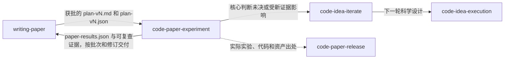
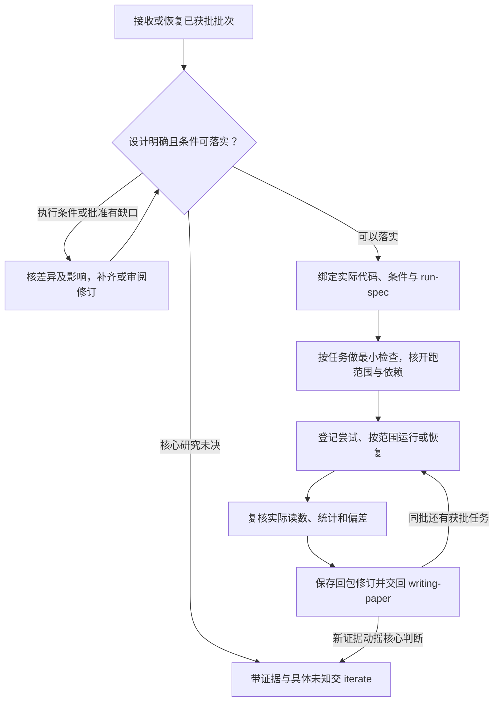

# 执行论文补充实验

根据获批计划取得可复查的证据，记录实际执行、测量有效性和证据能回答的问题。训练、评测、测量、分析和定性展示按实际设计实施。规模、重复次数和评估条件由研究问题决定。

## SKILL 交接关系



从获批计划核论文主张和研究依据，必要时查 `docs/research/` 下对应轮次的记录。核心判断需要新的研究设计时交 iterate。环境、模型或数据缺失时指明受影响的任务和所需材料。跨机器交接见 [dl-assistant](../dl-assistant/SKILL.md#所有技能共用的规则)。

## 产出与保存

```text
docs/paper-experiments/<batch-id>/
├── plan-vN.md、plan-vN.json     # 接收时保存获批副本
├── run-spec.json               # 启动前绑定实际执行，回包携带实际使用的快照
├── experiments/
│   └── <exp-id>/
│       ├── report.md           # 开跑前写计划，结束或受阻后回填
│       ├── configs/、scripts/   # 实际采用的配置和可复跑入口
│       └── runs/<attempt-id>/  # 每次实际尝试独立保存
│           ├── command.sh     # 长任务的实际启动入口
│           ├── meta.json       # 确切执行身份、代码、输入、命令和状态
│           ├── metrics.json    # 有读数时保存带单位的观测
│           └── <日志及产物>     # 实际文件或可取得的位置
└── handoffs/rev-<N>/
    ├── paper-results.json      # 写作端读取入口，列出本批全部计划项
    ├── plan-vN.json            # 本次回包引用的获批计划
    ├── run-spec.json           # 本次回包引用的实际执行规格
    └── <可携带证据>             # 原始读数、报告、分析或来源引用
```

## 运行流程图



## 参考资料列表

| 资料 | 什么时候读 |
| --- | --- |
| [执行手册](references/workflow.md) | 从接收、绑定到运行、核查和回包 |
| [计划模板](../writing-paper/references/templates/paper-experiment-plan-template.json) | 核数据、比较、重复和批准范围 |
| [执行规格模板](references/templates/run-spec-template.json)、[回包模板](references/templates/paper-results-template.json) | 绑定实际执行和交回结果 |
| [记录字段说明](references/records.md)、[尝试元记录](references/templates/paper-attempt-template.json) | 登记尝试、统计、产物及回包修订时 |
| [单实验报告](references/templates/exp-report-template.md) | 开跑前登记和回填结果 |
| [长任务托管](../dl-assistant/references/long-run-ops.md)、[W&B 记录](../wandb/references/experiment-records.md) | 在实际机器开跑、续做和复核来源 |

## 执行与交接原则

- 每项尝试使用独立 ID，重试或恢复沿用原重复 ID。失败、受阻、未执行和实际偏差如实保存。
- 每批回包保存独立修订。逐项给出执行状态、测量有效性和证据判断。可交部分结果，改善或反证都按实际记录。
- 影响科学比较、解释或投入的变更按实际决定确认后执行。核查结果和未决主张随包交回。
