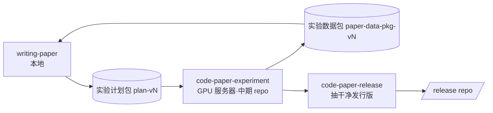

# Code Paper Experiment

## 这个 skill 干啥

中期 `code-idea-execution` / `code-idea-iterate` 在 reduced 配置上快速迭代方法，数据是 reduced 级（单 seed、缩减配置，趋势信号）。论文要**论文级数据**（full config + 多 seed，能写进论文主表 / 消融的数字）。

本 skill 在 **GPU 服务器的中期 repo**（iterate 收口、方法锁定的 repo）上补这个 gap：吃 `writing-paper` 的**实验计划包**，跑 full-scale 实验，产**实验数据包**交回 writing-paper ingest-results。

**三段契约，各管一段**:

- **plan 定「跑什么 + 为什么」**——writing-paper 产（`plan-vN.json`)。是起点不是契约：CPE 跑时可加/改，每个加/改用户确认。
- **run-spec 定「怎么跑」**——CPE 产（`experiments/run-spec.json`)。接受 plan 后、launch 前，把每个实验落成可执行条目（脚本 / config 冻结副本 / 完整命令 / seeds / eval 协议 / 拓扑排程）。**launch 确认点用户确认的就是这份落盘的 spec**；跑中严格按它执行，要加/改实验先改 spec（用户确认）再跑。
- **数据包是「跑出了什么」**——CPE 产（`paper-data-pkg-vN/`)。每个实验按**目录契约**落盘（configs / scripts / runs / log 全量）,**run 级验收过了才接收结果**，交 WP 前再过**包级验收**。

**为什么要有 run-spec 和两道验收**:full-scale 实验一跑几天、几十上百 GPU-hours,agent 跑长了存储必乱——config 用的是哪份、命令是什么、log 在哪，全靠记忆就是不可回溯。run-spec 把「怎么跑」冻成落盘契约；目录契约写死产物在哪；验收机制保证进数据包的每个数字都能被审计（谁拿着 `experiments/<exp_id>/` 都能复述这个实验）。这是「产物即真相」在实验环节的落实。

**必须有实验计划包**——没有就让用户去 `writing-paper` 产。CPE 不从零决定跑什么，但在 plan 基础上可加/改（用户确认）。

**复用 execution 的实验机制**（引用、不复制，守单一真相源）：长训练托管（`long-run-ops.md`——亮线规则：预计 >5 分钟 / 断了重跑代价高的命令一律 tmux detach，拿不准就当长任务，首选 `dl-assistant/scripts/run-long.sh`，禁 `run_in_background` / 前台干等）。

**不碰 claims.json**：中期 repo 有 claims.json（iterate 产的），但 CPE 只跑实验产数据，不读不写脊柱。

## 在系统里的位置



> `[( )]` 节点 = skill 间内部流转（计划包 / 数据包，不对外暴露）；`[/ /]` 节点 = 外部成品（release repo，用户拿走开源）。完整全局图见 `dl-assistant`。

## 边界

**做**：吃实验计划包 → 产 run-spec（执行契约）→ 用户确认 launch → 跑 full-scale 实验（full config + 多 seed，按拓扑排程）→ run 级验收 + 增量写结果 → 可加/改实验（先改 spec、用户确认）→ 包级验收 → 产数据包交回 WP ingest-results。

**不做**（交给相邻 skill）：

| 场景 | 用 |
|---|---|
| 产实验计划包（定要跑什么 + 为什么 + 谁先谁后）| `writing-paper`（没有计划包让用户去产）|
| 中期迭代方法（实现 / 验 / 演化下一版）| `code-idea-execution` / `code-idea-iterate` |
| 写 / 改论文（消费数据包）| `writing-paper` ingest-results |
| 抽干净发行版（开源）| `code-paper-release` |

## 输入

- **实验计划包**（必需）：`writing-paper` 产（`_draft/experiments/plan-vN.json`，版本化递增——v1 只装长周期必做项，写作中新增需求攒成后续批次；schema 单一真相源见 `writing-paper/references/templates/paper-experiment-plan-template.json`)。用户拿到 GPU 服务器（不管怎么传）。关键字段：
  - **`priority`**:must 必跑（WP 数据验收第一条就是"must 都跑了？"）；排队 must 先跑，预算紧砍 should/appendix（用户确认）。
  - **`expected_signal`**：预注册 success bar——`results.json` 逐实验对照它给判定。
  - **`fairness`**（main/comparison 必填）：baseline 公平条件照跑，结果条目里声明怎么落实的。
  - **`depends_on` / `decides_config`**：拓扑依赖与配置决策标记——Step 4 排程的输入。
- **中期 repo**（GPU 服务器本地）:iterate 收口、方法锁定的 repo。CPE 在锁定的方法上跑 full-scale。
- **收口包**（方法锁定确认）:iterate 产的，确认方法已锁定 + repo 收口版本。

> 解耦：计划包 / 数据包跨机器交接都找用户（不绑 scp/ssh，不管怎么传）。中期 repo 在 GPU 服务器本地，CPE 直接跑。

## 复用的 execution 机制（引用、不复制）

| 引用 | 讲什么 | 何时读 |
|---|---|---|
| `dl-assistant/references/long-run-ops.md` | 长训练托管（tmux detach / 状态文件三连 / 重连 / resume / 防爆盘）| 跑 full-scale 训练（贵、长）时 |

> 本 skill 的 tmux session 前缀：`cpe-<exp_id>-`（各 skill 前缀的场景速查见该文件末尾）。

## 产出与保存

两处产物，schema 单一真相源都是 `references/templates/data-pkg-schema.json`(WP 验收照它机械核对）。

### 中期 repo 侧（GPU 服务器，跑的地方）——目录契约，写死

```
experiments/
├── run-spec.json              # 本批执行契约（Step 4 产——launch 确认点确认的就是它）
├── pilot/
│   └── scan-results.json      # val pilot 扫描数据（WP 敏感性分析素材）
└── <exp_id>/                  # 每个实验一个目录，结构写死、验收照它查
    ├── configs/               # 实际用的 config 冻结副本（repo 原件会被改，不冻结不可回溯）
    ├── scripts/               # 启动脚本（train.sh / eval.sh，含完整命令行）
    ├── runs/
    │   └── seed-<n>/
    │       ├── train.log      # 完整训练日志（全量，不是 tail——出错时唯一的事故现场）
    │       ├── eval.log
    │       └── metrics.json   # 该 seed 原始指标
    ├── figures/               # qualitative 实验的可视化产物（其他类型可空）
    ├── results.json           # 该实验 mean±std + 各 seed 原始数 + signal 判定
    ├── meta.json              # experiment meta（git/type/claim_cids/状态/gpu_hours）
    └── 报告.md                # 人读：TL;DR 结论先行（模板见 exp-report-template.md）
```

### 数据包（CPE 产 → WP ingest-results 消费，一批一包）

```
paper-data-pkg-v<N>/           # N 对齐 plan 版本
├── experiments-actual.json    # 实际跑了哪些 + 相对 plan 的加/改/删（删带原因）
├── results.json               # 逐实验结果汇总（mean±std/n seeds/signal 判定/fairness）——增量写
├── pkg-meta.json              # 验收清单 + 权重/log 指针 + GPU-hours 台账
├── pilot/
│   └── scan-results.json      # 超参扫描（WP 敏感性分析素材）
└── experiments/<exp_id>/      # 副本：configs/ scripts/ results.json meta.json 报告.md figures/
                               # runs/ 的权重与全量 log 不进包（太大）——pkg-meta.json 给 GPU 路径指针
```

**产物分工**:

- **experiments-actual.json** = 实际跑了哪些 + 相对 plan 的 deviation(WP 据此**对齐 experiment section**)。
- **results.json** = 结果（mean±std + n seeds + signal 判定，增量写；WP 据此**填数字** + 诚实性自审对照预注册 bar)。
- **报告.md**（每实验）= 人读封面——你随时打开就能看明白这个实验；数字照抄 results.json，不另造机读字段。

## 核心纪律

- **用户确认 launch 和每个加/改**——full-scale 烧 GPU,launch 确认 run-spec + 排程 + 成本；加/改先改 run-spec 再跑，都用户点头，别自作主张。
- **两道验收**——run 级验收不过不接收结果（先补/重跑）；包级验收不过不交 WP。
- **config/脚本冻结副本进实验目录**——repo 原件会被后续改动，不冻结永远不可回溯。
- **log 全量保存**——train.log 是出错时唯一的事故现场。
- **增量写**——每跑完一个实验就写 results.json 条目 + 报告.md，别攒到最后（中途崩了已完成的还在）。
- **val 上选，不看 test**——超参与 config 决策只用 validation split；主表数字出来后 config 不再动（test peeking 红线）。
- **eval 协议全实验统一**——checkpoint 选择规则 launch 前定死写进 run-spec,eval split 统一；seed/baseline 间选法不一，mean±std 就是假的。
- **消融不是调参**——消融复用主表同一冻结配置（减组件），否则对比被污染；调参是 pilot / decides_config 实验的事。
- **趋势反转先当 bug 查**——full vs reduced 方向/量级对不上，先查 config/数据/评估，别当科学发现流向 WP。
- **部分 seed 如实报 n**——n=3 不当 n=4 报，signal 判定降置信。
- **must 全覆盖才定稿**——`priority=must` 没跑完不能定稿；跑不了的进 deviation 的 drop 带原因，别悄悄缺。
- **多 seed**——论文级要 mean ± std,reduced 单 seed 不够。
- **权重/全量 log 不进数据包**——留 GPU,`pkg-meta.json` 给指针。
- **不碰 claims.json**——CPE 只跑实验产数据，不裁决脊柱。
- **方法超参扫描数据别扔**——落 `pilot/scan-results.json`，是 WP 敏感性分析的素材，一份 GPU 两份用。
- **别在会话里用 `$...$` LaTeX**——会话符号用 Unicode（横切规范见 `dl-assistant` SKILL.md「横切规范」)。

---

## 工作流


### Step 1：读实验计划包 + 续跑协议

读 `plan-vN.json` 的 `experiments[]`。没有计划包 → 让用户去 `writing-paper` 产（CPE 不从零决定跑什么）。多批并存时按版本顺序消费，一批一个数据包。

**续跑协议**（中断后重进）:① 读 `experiments/` 各 `meta.json` 状态 + 包级 `results.json` 已增量写到哪 → 定位断点（哪个 exp、哪个 seed、跑到哪一步）;② 已完成的不重跑；③ 中断的按 `long-run-ops.md` 重连规则恢复（tmux / 状态文件三连）;④ 恢复不了的重跑该 seed，并在 deviation 里记录。

### Step 2：TaskList 建实验任务

plan 的每个 exp 一个任务 + 状态（待跑 / 跑完 / 加 / 改），进度可见不可跳。

### Step 3：val pilot 定 full config 候选

超参分两类，先验不同、打法不同：

- **训练超参**（lr / batch / schedule）：先验强——沿用前作 + 从 reduced 反推，基本不用扫。
- **方法超参**（loss 权重 / 阈值 / 数量 / 维度——方法的一部分，直接决定性能上限）:**先验可能为零**（中期方法一直在变，没扫过是正常的）。在 **val 上 coarse-to-fine 扫**：不耦合 scale 的先 reduced 粗扫（**优先用 reproduction 交付的 `reduced_setting`**——已验有效、scale_method 在案，没有再自造）；耦合 scale 的（token 数 / cluster 数之类）full 短程确认。
- **扫描数据沉淀**：扫描结果按 analysis 实验标准记录（扫描范围 / 取值 / 指标 / 选定值 + 理由），落 **`pilot/scan-results.json`**——WP 的敏感性分析直接消费，一份 GPU 两份用。
- **pilot 出的是候选，不是定案**：候选配置由 plan 里 `decides_config=true` 的实验（全量设置下的组件消融 / 超参选定）确认后才冻结（Step 5 的确认点）。pilot 计划（扫哪几个 / 范围 / 预算）用户确认（烧 GPU）。

### Step 4：产 run-spec.json + 拓扑排程，用户确认 launch

1. **逐实验落条目**:`entry_script` / `config_file`（指向 `configs/` 冻结副本——把实际要用的 config 拷进实验目录）/ `command`（完整启动命令，封装进 `scripts/train.sh`)/ `seeds` / `gpu` / `expected_cost` / `expected_artifacts`。
2. **eval 协议定死**:`checkpoint_rule`(val 选 best，禁 test 挑）+ `eval_split`，写进 run-spec 的 `eval_protocol`——全实验统一。
3. **拓扑排程**：读各实验 `depends_on` 建 DAG → 拓扑分层 → **层内无依赖的并行**（按 GPU 数装箱，长实验先排）→ 层次写进 `run-spec.scheduling.layers`。**漏标 depends_on = 该并行的串行等，GPU-hours 白烧**——发现 plan 里依赖标漏了，标出来跟用户确认后补进 spec。
4. **decides_config 闸门**：含 `decides_config=true` 实验的层排在最前；该层跑完 → **配置冻结确认点（用户拍板）** → 依赖它的层（主表批）才开跑。配置未冻结主表不开跑——主表用拍脑袋配置跑，headline 数字非最优，发现时主表重跑、对比/消融/数字回填全牵连。
5. **用户确认 launch**：把 run-spec + 排程表（哪层并行 / 哪层等待 / 预估总时长）+ 成本（`expected_cost` 汇总，`priority` 标清，**must 先跑**）摆给用户，确认才开跑。

### Step 5：按编排跑 + run 级验收 + 增量写（循环）

- **smoke 先行（每个实验正式 launch 前必过）**：用该实验的冻结 config + `scripts/` 启动脚本跑一个 **smoke**——几步 iteration + eval 流程走通（数据加载 → 前向反向 → 落 checkpoint → eval → 指标写出），几分钟的事。**验证的是链路不是性能**：端到端能跑通、产物落在目录契约的位置。smoke 过了才进编排队列正式 launch；不过 → 修 config/命令/路径再复 smoke。config 写错/命令拼错/数据路径不对这类问题，full-scale 跑两三小时才炸是最贵的浪费——smoke 就是防这个。
- **跑一个实验**:full config + 多 seed 训练（`long-run-ops.md` 托管）+ eval，产 mean ± std。填 `meta.json`(git 填中期 repo 收口版本，type/claim_cids 填 plan 的）。
- **run 级验收（结果进 results.json 之前，必过）**:
  - 机器项：`bash <本skill目录>/scripts/check-run-artifacts.sh --expdir experiments/<exp_id> --spec experiments/run-spec.json --exp-id <exp_id>`——目录契约存在性、json 可解析、必需字段、seed 数对账；
  - agent 项：`train.log` 完整性（有正常结尾和 eval 段，不是中途截断）、指标合理性（量级离谱不离谱）;
  - **查不过不接收**——先补（找回 log / 修产物）或重跑，别拿缺项结果进包。
- **结果 sanity**：跟 reduced（中期迭代）趋势对照——方向一致？量级合理？趋势反转先当 bug 查（config / 数据 / 评估）。
- **增量写**：验收过了 → 写 `experiments/<exp_id>/results.json` + `报告.md`（人读封面，模板见 `references/templates/exp-report-template.md`)→ **同时追加包级 `results.json` 条目**（防中途崩丢已完成）。
- **qualitative 实验**：用主 run 的 checkpoint 产可视化样本（预测图 / 对比 / 失败案例）→ 落 `figures/`;results 条目记 checkpoint 来源、样本选择、对应 `output_to_paper` 图位。
- **run 级失败处理**:crash(OOM / 抢占 / 掉线）→ 按 `long-run-ops.md` resume;resume 不成 → **用户决策**（重跑 / 降配置 / 标记失败）；部分 seed 成功 → 如实写 n,signal 判定降置信。
- **要加/改实验**（补消融 / 换 baseline / 调 config)→ **用户确认** → **先改 run-spec.json 再跑** → 记 deviation(plan 没有的=add、plan 有但 config 变=change)。

### Step 6：包级验收 + 定稿数据包

1. **must 全覆盖自查**:plan 里 `priority=must` 的都跑了？没跑的进 deviation 的 drop 并带原因。
2. **包级验收**:`bash <本skill目录>/scripts/check-run-artifacts.sh --pkgdir paper-data-pkg-v<N>`——三件套可解析、交叉对账（actual / results / pkg-meta 三边一致）、results 条目必需字段、权重 log 没混进包。
3. **定稿**：组装数据包（各 exp 目录副本：configs / scripts / results.json / meta.json / 报告.md / figures;runs/ 留 GPU 给指针）+ 填 `pkg-meta.json`（含 GPU-hours 台账：实际消耗 vs `expected_cost`)。
4. **交接**：用户拿回本地 → `writing-paper` ingest-results（按批，不等全部跑完）。

## 常见错误

- **没实验计划包别硬跑**——让用户去 `writing-paper` 产。CPE 不从零决定跑什么（但 plan 基础上可加/改）。
- **别跳过 run-spec 直接跑**——plan 接过来先落 run-spec.json（脚本 / config 冻结副本 / 命令 / seeds / eval 协议 / 排程）,launch 确认点确认的就是它；跑中改了没回写 spec，审计链就断了。
- **别跳过 smoke 直接全量 launch**——每个实验先用冻结 config + 脚本跑几步 + eval 走通，过了才进编排队列；config/命令/路径错跑几小时才炸是最贵的浪费。
- **验收不过别接收**——run 级查不过先补/重跑；缺 configs/scripts/log 的实验进包，WP 拿到的数字就不可回溯。
- **config/脚本必须冻结副本**——直接引用 repo 里的活文件，实验跑完文件一变，永远查不回当时用的什么配置。
- **log 全量留**——train.log 截 tail 省事，出错时就没有事故现场了。
- **加/改实验要用户确认 + 先改 spec**——和 launch 一样高消耗，每个加/改用户点头，spec 先改再跑。
- **增量写结果**——每跑完一个就追加包级 results.json 条目 + 写 报告.md，别攒到最后。
- **deviation 记全**——加了/改了/删了哪些相对 plan,WP ingest-results 靠这个对齐 experiment section，漏了 WP 不知道实际跑了啥。
- **报告逐实验带 signal 判定**——success / failure / partial 纯客观对照预注册 bar，不做 storytelling；否定信号如实写，WP 靠它做诚实性自审。
- **配置未冻结主表不开跑**——`decides_config` 实验跑完、用户拍板冻结后，主表批才 launch。
- **排程靠 depends_on 拓扑**——别拍脑袋串行跑；层内并行按 GPU 数装箱，长实验先排。
- **eval 协议全实验统一**——checkpoint 规则 launch 前定死进 run-spec；选法不一 mean±std 就是假的。
- **趋势反转先当 bug 查**——full vs reduced 对不上先查 config/数据/评估。
- **部分 seed 如实报 n**——n=3 不当 n=4 报，判定降置信。
- **定稿前 must 全覆盖 + 包级验收**——缺 must 不能定稿；包级机械核对过了才交 WP。
- **不碰 claims.json**——CPE 只跑实验产数据，不裁决脊柱。
- **权重/全量 log 不进数据包**——留 GPU,`pkg-meta.json` 给指针。
- **别在会话里用 `$...$` LaTeX**——会话符号用 Unicode（横切规范见 `dl-assistant` SKILL.md「横切规范」)。

## references / scripts

| 路径 | 讲什么 | 什么时候用 |
|---|---|---|
| `references/templates/data-pkg-schema.json` | 全部机读产物（run-spec / results / experiments-actual / pkg-meta / scan-results / meta / metrics）的 schema 单一真相源 | Step 4 产 spec、Step 5 写结果、Step 6 验收时 |
| `references/templates/exp-report-template.md` | 每实验人读 `报告.md` 模板（TL;DR 结论先行 + 各节指引） | Step 5 增量写时 |
| `scripts/check-run-artifacts.sh` | 产物验收（run 级 `--expdir` / 包级 `--pkgdir`，输出 Status 表） | Step 5 每实验跑完、Step 6 交包前 |
| `dl-assistant/references/long-run-ops.md` | 长训练托管（tmux / 状态文件 / 重连 / resume / 防爆盘） | Step 5 跑长训练时 |
