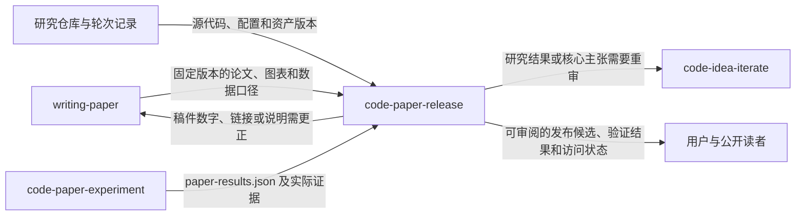
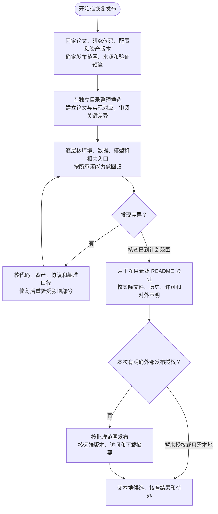

# 整理、验证并发布论文代码

确定这次要提供哪些代码和资产，说明它们对应论文的哪些步骤，验证读者实际能执行的操作。安装、权重评测、训练短跑、完整训练和分析复算分别记录。先完成可审阅的本地候选版本，再按授权发布。

## SKILL 交接关系



全局关系见 [dl-assistant](../dl-assistant/SKILL.md)。

## 产出与保存

在独立于研究仓库的位置准备发布候选。更新已有发布仓库时保留已发布版本和适合公开的历史。公开文件采用项目可用结构，内部记录从开始就放在发布目录之外。

```text
<发布候选目录>/
├── README.md                   # 安装、资产获取、实测操作和验证边界
├── AGENTS.md                   # 按需提供，同 README 使用相同入口
├── LICENSE、NOTICE             # 按实际许可证和署名要求提供
├── <代码、配置和运行入口>        # 按范围提供评测、训练或分析
├── <环境说明或环境文件>          # 按对外支持的安装方式提供
└── docs/
    ├── perf-baseline.json      # 按需公开，可用于数值回归的公开依据
    └── <数据准备或项目页>        # 按需求和发布范围提供

<内部记录目录>/<release-id>/
├── RELEASE_REPORT.md           # 版本、发布范围、实际验证和外部状态
├── checks/<check-id>/          # 实际命令、输入指纹、日志、退出状态和输出
└── perf-baseline.json          # 按需保存内部基准及完整来源
```

## 运行流程图



## 参考资料列表

| 资料 | 何时读 |
| --- | --- |
| [发布执行手册](references/release-flow.md) | 定范围、整理实现、运行验证、定位差异及发布 |
| [性能或数值基准](references/perf-baseline-template.json) | 需要按可比条件做数值回归时 |
| [README 模板](references/readme-template.md) · [AGENTS 模板](references/agents-template.md) | 写对外获取步骤、实测入口和验证范围 |
| [内部发布报告](references/release-report-template.md) | 记录来源、验收、自查和实际外部状态 |

## 发布与验证原则

1. 保留论文所需的实现、协议、资产来源和署名。整理关键逻辑时核对应代码差异，说明实际配置和数学含义有无改变。
2. 先定验收再跑验证。论文报告值、可比的参考值与候选版本实测值分别保存。发布权重的评测范围和多次训练统计分别说明。
3. 整理前、验证后、发布前在内部报告记录判断、实际依据、未知及下一步影响。代码、环境或资产变化时重核受影响的检查。
4. 本地准备、代码上传、权重上传、仓库公开和项目页分别记录。按既有授权执行，未获授权的部分可以作为已准备的本地交付。
