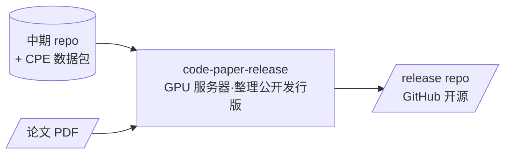
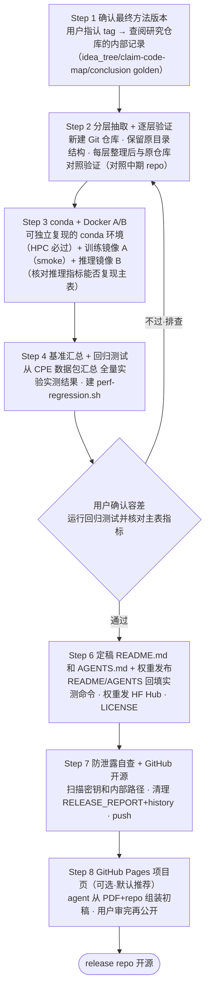

# Code Paper Release

## 用途

研究仓库可能包含实验分支、已放弃的方案、未使用的代码和 `runs/` 等运行产物。直接发布会暴露未发表的研究方向，读者也难以找到论文对应的实现和运行方式。

论文写完或接收后，使用 GPU 服务器上已经由 `code-paper-experiment` 跑过实验的研究仓库，将最终方法和复现所需的基线代码整理到新 Git 仓库。新仓库独立建立提交历史，读者应能理解实现并在允许的误差内复现论文主表。

整个发布流程在 GPU 服务器上完成。依次确认最终方法版本、整理代码、准备 conda 和 Docker 环境、从实验数据包汇总基准、验证论文主表、定稿公开文档并发布权重、检查内部信息并发布到 GitHub。基准使用 `code-paper-experiment` 数据包中 `results.json` 的全量实验实测结果。论文实验直接在研究仓库运行，无需先建发行版。

## 整理时可查阅的记录与公开内容

- **公开内容**。假设读者只有论文 PDF，据此组织代码、README、AGENTS.md、文档和镜像。公开仓库不包含研究阶段的探索记录、未发表方案或提交历史。
- **整理时可查阅的内部记录**。用 `idea_tree.json` 确定候选发布版本，用 `03-claim-code-map.md` 定位与论文论点对应的实现。参考 `04-conclusion.md` 的 `golden_metrics` 核对基准信息，并查阅 `code-project-setup` 和 `code-paper-reproduction` 的产物，确认环境和基线的验证范围。

整理发行版时，可以查阅用户自己的研究记录。模拟审稿的 `writing-paper-review` 只使用模拟审稿人可见的材料，不能查阅内部论点记录。

## 在系统里的位置



**图例**：圆柱体 = skill 间内部流转（中期 repo，不对外暴露）；平行四边形 = 外部成品（论文 PDF / release repo，用户拿走开源）。完整全局图见 `dl-assistant`。

## 边界

**做**：确认最终方法版本（用户指认）+ 从中期 repo 抽取重写独立的新仓库 + conda + Docker A/B + 基准从 CPE 数据包汇总 + 建性能回归测试 + 验论文主表在确认的容差内复现论文主表 + README.md 和 AGENTS.md + 权重发布 + 防泄露自查 + GitHub 开源。

**不做**（交给相邻 skill）：

| 场景 | 用 |
|---|---|
| 搭环境 / 装依赖 / 准备数据 checkpoint | `code-project-setup` |
| 复现**别人**论文的 baseline | `code-paper-reproduction` |
| 实现 idea / 跑实验 | `code-idea-execution` |
| 跑论文级实验（坐实主表、产论文数据）| `code-paper-experiment` |
| 写 / 改论文 | `writing-*` |

> `code-paper-reproduction` 验证其他论文的公开代码能否复现基线。本 skill 整理能供其他研究者复现本论文的公开代码。

## 输入

- **完整中期 repo**（GPU 服务器）：iterate 收口、CPE 跑过实验的 repo。release 从它抽。
- **确认最终方法版本**（用户，必需）：哪个分支/tag 是锁定的最终方法。agent 查阅研究仓库的内部记录推荐，**由用户确认**（发布前核对该版本与论文方法一致）。
- **CPE 实验数据包**（基准来源）：`results.json` + `experiments-actual.json` + `pkg-meta.json`（主表 mean±std + 权重路径 + GPU 小时用量记录），release 汇总成基准记录。
- **论文 PDF**。公开内容以论文为依据，验收时将复现结果与论文主表逐项核对。

> 解耦：跨机器交接（中期 repo → GitHub）由用户做，不绑 scp/ssh。

## 产出与保存

release repo = 全新 git 仓库（GPU 服务器，位置用户定），第一个 commit 就是干净发行版。

**保留所需代码的原目录结构**。去除中后期内部产物（`ideas/`、`experiments/`、`docs/` 中的内部研究文件、`runs/` 残留）后，保留其余代码的原有位置。统一搬入 `src/` 等目录需要修改导入路径，可能影响复现。若有必要局部重组，例如用论文概念为模块改名，由助手提议、用户确认。删除未使用的代码，并在 README.md 和 AGENTS.md 中说明目录及模块与论文组件的对应关系。

在原有目录结构上增加以下文件。

```
<release-repo>/                # 保留所需的配置、模型、数据和训练代码的原有位置
├── README.md                # 新增·供外部读者使用的说明（readme-template）：主表 + quickstart 运行命令
├── AGENTS.md                # 新增·供编程助手使用的说明（agents-template）：命令 + 产物保存位置 + 成功判据 + 已知问题与解决方法
├── LICENSE                  # 新增·由用户确认
├── environment.yml          # 新增·conda 环境（必过关用的环境源）
├── requirements.txt         # 新增
├── scripts/                 # 新增·入口脚本
│   ├── train.sh / eval.sh
│   └── perf-regression.sh   # 性能回归测试（一键复现主表 + 比对基准 → pass/fail）
├── docker/
│   ├── Dockerfile.train     # 新增·镜像 A（检查短程训练能否正常运行）
│   └── Dockerfile.infer     # 新增·镜像 B（挂权重核对推理指标能否复现主表）
├── docs/
│   ├── data_preparation.md  # 新增·大数据集详细准备说明（挂载用）
│   ├── perf-baseline.json   # 新增·机读基准（CPE 全量实验实测结果），perf-regression.sh 读它
│   └── index.html + 媒体     # （可选）GitHub Pages 项目页（Step 8）
└── RELEASE_REPORT.md        # 新增·内部验证记录报告（含内部信息，开源前删，Step 7）
```

> 删除未使用的代码，使用与论文概念对应的模块名，并在 README.md 和 AGENTS.md 中写清目录及模块与论文组件的对应关系。

- **权重不进 repo**——发布到 Hugging Face Hub（或用户指定存储），README/AGENTS.md/`perf-baseline.json` 记下载链接。
- **`RELEASE_REPORT.md` 开源前必删**（含节点名/排除记录/自查结果），将副本保存在发行版仓库之外。

## references

| reference | 讲什么 | 何时读 |
|---|---|---|
| `references/release-flow.md` | 单阶段八步全流程（确认版本 / 整理代码 / conda+Docker / 基准+回归 / 验主表 / 定稿文档并发布权重 / 防泄露+开源 / 项目页）+ 验证原则 | 做 release 时 |
| `references/readme-template.md` | `README.md` 模板（供外部读者使用的说明）| Step 2 起草 / Step 6 定稿 |
| `references/agents-template.md` | `AGENTS.md` 模板（供编程助手使用的说明）| Step 2 起草 / Step 6 定稿 |
| `references/perf-baseline-template.json` | `docs/perf-baseline.json` 模板（机读基准）| Step 4 生成基准时 |
| `references/release-report-template.md` | `RELEASE_REPORT.md` 模板（内部验证记录，含内部信息开源前删）| Step 7 建报告时 |

## 核心纪律

- **不要把研究仓库的内部记录写进发行版**——claims.json / spec / plan / conclusion / 探索历史，对内可读、对外零泄露。
- **不要原地清理当发行版**——必须全新仓库重写（`git init`），否则 git history 照样泄露未发表 idea。
- **保留所需代码的原目录结构**——别为了好看把代码统一搬进 `src/`：搬目录 = 改 import = 引入回归风险，和「在确认的容差内复现论文主表」直接冲突。干净感靠删净死代码 + 目录与论文组件的对应关系讲清模块↔论文映射，不靠目录位置。
- **每层整理后与原仓库对照验证**——按环境→数据→模型→推理→训练分层，每层抽完当场和中期 repo 对照（核心是模型层权重等价 + 前向一致），不过不进下一层；别抽完了才靠最后的全量回归一把验。
- **先验证 conda 环境，再构建 Docker 镜像**——HPC 多无 Docker 权限，发行版必须 conda 独立跑通主表。conda 过不了 Docker 无意义。
- **分别验证两个镜像**。训练镜像 A 做短程训练检查。推理镜像 B 加载发布权重，验证能否复现论文主表。镜像 A 无需通过完整重训复现主表。
- **通过参数指定权重的挂载路径**——支持作者发布的 / 外部读者 自训的两种来源。
- **大数据/大权重不进镜像、不进 repo**——数据留准备说明 + 挂载；权重发 HF Hub 给链接。
- **不要抽错最终方法节点**——发哪个 idea/tag 由用户确认，agent 只推荐。
- **发行版须自带回归测试**。将 `scripts/perf-regression.sh` 和 `docs/perf-baseline.json` 纳入仓库，交付前验证能在确认的容差内复现论文主表。
- **基准用 CPE 全量实验实测结果**——从 CPE 数据包 results.json 汇总，不做占位。
- **README 每条命令必须真跑过**——README.md 和 AGENTS.md的运行命令就是 Step 5 回归实测的命令，一条都不许凭记忆写。
- **开源前清理 RELEASE_REPORT + history**——`RELEASE_REPORT.md` 含内部信息（节点名/排除记录/防泄露自查），开源前必删 + 删除 `.git` 后重新初始化。别直接 push 带 RELEASE_REPORT 的 repo。
- **不要在会话里用 `$...$` LaTeX**——会话符号用 Unicode（见 `dl-assistant` 的 `SKILL.md`「所有技能共用的规则」）。

## 工作流

**TaskList 跟踪流程**：建任务（认节点 / 抽取重写 / conda+Docker / 基准+回归 / 验主表 / 定稿文档并发布权重 / 防泄露+开源 / 项目页（可选）），每步完成即勾。



八步（细节见 `references/release-flow.md`）：

1. **确认最终方法版本**：读 `idea_tree.json` + git log 梳理各版本的分支关系 → **用户指认**最终方法 tag → 查阅研究仓库的内部记录（版本目录 01~04 + claims.json + `04-conclusion.md` 可复现信息 + CPS/CPR 产物）。
2. **分层抽取 + 逐层验证**：GPU 服务器全新仓库 `git init`（不沿用研究仓库的提交历史），将原研究仓库作为只读参考，依据 `03-claim-code-map.md` 整理相关实现，并按公开读者可获得的信息编写；保留所需代码的原目录结构；按环境→数据→模型→推理→训练分五层，**每层整理后立即与原研究仓库对照验证**（核心是模型层的权重等价 + 前向一致），不过不进下一层；起草 README.md 和 AGENTS.md。
3. **conda + Docker A/B**：可独立复现的 conda 环境（`environment.yml`，HPC 第一必过关）+ 训练镜像 A（smoke 检查短程训练能否正常运行）+ 推理镜像 B（挂权重核对推理指标能否复现主表）。
4. **基准汇总 + 回归测试**：从 code-paper-experiment 数据包的三个文件汇总 全量实验实测结果成 `docs/perf-baseline.json` + 建 `scripts/perf-regression.sh`。
5. **跑回归验论文主表性能**（用户确认容差）：conda 复现主表（必过）+ Docker B 复现 + Docker A smoke + 对外比对 PDF 主表。
6. **定稿 README.md 和 AGENTS.md + 权重发布**：README/AGENTS.md 回填实测命令与主表数字；发布权重到 HF Hub；由用户确认 LICENSE。
7. **防泄露自查 + GitHub 开源**：history/内部研究文件/runs/在双盲场景人工核对作者和机构信息 + secret/内部路径机扫 → 用户确认后清理 `RELEASE_REPORT` + history → 推 GitHub。
8. **GitHub Pages 项目页**（可选，默认推荐）：同仓库 `docs/` 做一页高级美观的科研展示页（只定原则不手把手，媒体策略：小文件进 docs/、大视频 YouTube 嵌 iframe）——agent 从 PDF + perf-baseline + CPE figures 组装初稿（teaser/demo 素材用户给）→ 用户审完再公开。
