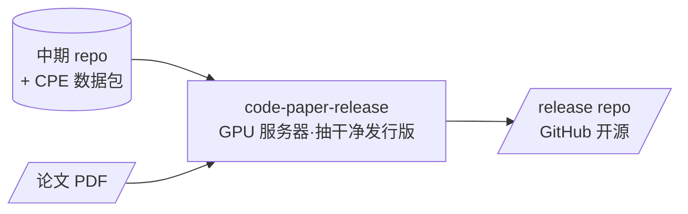
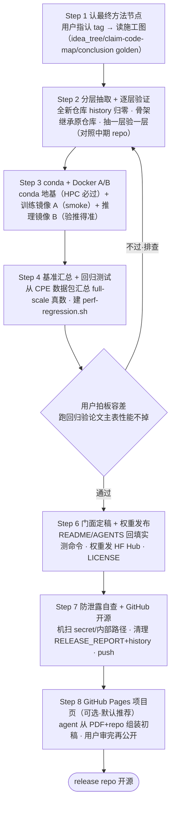

# Code Paper Release

## 这个 skill 干啥

研究仓库是**做研究**用的：baseline 可能是屎山，上面长了一棵 idea 树（`code-idea-execution` 的 git 分支树），堆满实验脚本、死代码、被否的分支、`runs/` 残留。这种仓库**不能直接开源**：① **idea 泄露**（git history、分支名、commit message、被否 idea 暴露未发表方向）；② **没法 follow**（研究者面对屎山读不进、跑不起）。

本 skill 在**论文写完/接收后**（CPE 跑完实验、writing-paper 写完论文），从**完整中期 repo**（GPU 服务器，CPE 跑过实验的）抽取重写成一份发行版：只保留最终方法 + 必要 baseline，干净重写到全新仓库（history 归零），让 follower 拿到就能读懂、复现论文主表、接着做。**核心约束：性能不掉**（发行版必须能复现主表）。

**单阶段**（开源关口，一次性做）：认最终方法节点 → 从中期 repo 抽干净 repo → conda + Docker A/B → 基准从 CPE 数据包汇总 → 跑回归验论文主表性能不掉 → 门面定稿 + 权重发布 → 防泄露自查 → GitHub 开源。

> **角色**：release 在 **CPE 之后**。CPE 在中期 repo 跑实验（不需 release 先抽 repo 给它），基准直接用 CPE 的 full-scale 真数（从数据包 results.json 汇总）。跑在 **GPU 服务器**（中期 repo 在那 + 回归要 GPU）。

## 视角分两层（本 skill 核心，先理解再动手）

这是 release 区别于 `writing-paper-review` 的本质。两层视角**不矛盾**，分别管"对外"和"对内"：

- **对外（发行版本身）= 严格 follower 视角**：README、AGENTS.md、代码组织、文档、镜像，全部假设读者**只有论文 PDF**、想 follow 用户的工作。发行版里**零探索痕迹、零未发表 idea、history 归零**——挡住一切泄露。
- **对内（抽取过程）= 读作者施工图**：agent 抽取重写时，**读研究仓库自己的产物当施工图**——`idea_tree.json` 认发布节点、`03-claim-code-map.md` 当**抽取地图**、`04-conclusion.md` 的 golden_metrics 钉基准、CPS/CPR 产物拿环境与 baseline 可信度。

> **为什么能读作者产物？** 因为这是**用户自己的仓库**，发布工具读自己的施工图不是泄露。视角锁的是**交付物**（发行版里不留图纸痕迹），不是**施工过程**（施工时当然看图纸）。
>
> 对比 `writing-paper-review`：review 的 agent **本身就是模拟 follower**（连 claim tree 都不能看）；release 的 agent 是**作者的施工队**（看图纸施工、交付物不留图纸）。

## 在系统里的位置



**图例**：圆柱体 = skill 间内部流转（中期 repo，不对外暴露）；平行四边形 = 外部成品（论文 PDF / release repo，用户拿走开源）。完整全局图见 `dl-assistant`。

## 边界

**做**：认最终方法节点（用户指认）+ 从中期 repo 抽取重写全新干净仓库 + conda + Docker A/B + 基准从 CPE 数据包汇总 + 建性能回归测试 + 验论文主表性能不掉 + README/AGENTS.md 双门面 + 权重发布 + 防泄露自查 + GitHub 开源。

**不做**（交给相邻 skill）：

| 场景 | 用 |
|---|---|
| 搭环境 / 装依赖 / 准备数据 checkpoint | `code-project-setup` |
| 复现**别人**论文的 baseline | `code-paper-reproduction` |
| 实现 idea / 跑实验 | `code-idea-execution` |
| 跑论文级实验（坐实主表、产论文数据）| `code-paper-experiment` |
| 写 / 改论文 | `writing-*` |

> 与 `code-paper-reproduction` 是**镜像关系**：reproduction 是"拿别人论文+代码跑起来当 baseline"；release 是"把我代码打包成别人能一键复现的 baseline"。release 正好产出 reproduction 每次都希望对方提供的东西。

## 输入

- **完整中期 repo**（GPU 服务器）：iterate 收口、CPE 跑过实验的 repo。release 从它抽。
- **最终方法节点指认**（用户，必需）：哪个分支/tag 是锁定的最终方法。agent 读施工图推荐，**用户拍板**（发错节点全错）。
- **CPE 实验数据包**（基准来源）：`results.json` + `experiments-actual.json` + `pkg-meta.json`（主表 mean±std + 权重指针 + GPU-hours 台账），release 汇总成基准记录。
- **论文 PDF**（验收标准）：follower 视角公开依据 + 主表 = 对外验收标准。

> 解耦：跨机器交接（中期 repo → GitHub）由用户做，不绑 scp/ssh。

## 产出与保存

release repo = 全新 git 仓库（GPU 服务器，位置用户定），第一个 commit 就是干净发行版。

**骨架继承原仓库**（只删不搬）：删掉中期/后期产物目录（`ideas/`、`experiments/`、`docs/` 施工文件、`runs/` 残留）后，**剩下的原仓库目录结构就是发行版骨架**——不为了好看把代码搬进 `src/` 之类的统一目录（搬目录 = 改 import = 引入回归风险，和「性能不掉」直接冲突）。局部重组（如某模块改名对论文概念）允许，但属「agent 提议、用户拍板」的可选项，不是默认动作。

在此骨架上**新增**的部分写死：

```
<release-repo>/                # 骨架 = 原仓库删减后的样子（配置/模型/数据/训练代码各安其位）
├── README.md                # 新增·follower 门面（readme-template）：主表 + quickstart 命令链
├── AGENTS.md                # 新增·agent 操作手册（agents-template）：命令 + 产物落点 + 成功判据 + 已知坑
├── LICENSE                  # 新增·用户拍板
├── environment.yml          # 新增·conda 环境（必过关用的环境源）
├── requirements.txt         # 新增
├── scripts/                 # 新增·入口脚本
│   ├── train.sh / eval.sh
│   └── perf-regression.sh   # 性能回归测试（一键复现主表 + 比对基准 → pass/fail）
├── docker/
│   ├── Dockerfile.train     # 新增·镜像 A（验训得动）
│   └── Dockerfile.infer     # 新增·镜像 B（挂权重验推得准）
├── docs/
│   ├── data_preparation.md  # 新增·大数据集详细准备说明（挂载用）
│   ├── perf-baseline.json   # 新增·机读基准（CPE full-scale 真数），perf-regression.sh 读它
│   └── index.html + 媒体     # （可选）GitHub Pages 项目页（Step 8）
└── RELEASE_REPORT.md        # 新增·验证留底报告（含内部信息，开源前删，Step 7）
```

> 干净感不靠目录位置，靠三点：死代码删净、模块命名对应论文概念、README/AGENTS.md 的「仓库地图」节把 `目录/模块 ↔ 论文组件` 的映射讲清楚。follower 是对照论文读代码的，有地图就够。

- **权重不进 repo**——发布到 Hugging Face Hub（或用户指定存储），README/AGENTS.md/`perf-baseline.json` 记下载链接。
- **`RELEASE_REPORT.md` 开源前必删**（含节点名/排除记录/自查结果），留底复制到 repo 外。

## references

| reference | 讲什么 | 何时读 |
|---|---|---|
| `references/release-flow.md` | 单阶段八步全流程（认节点 / 抽 repo / conda+Docker / 基准+回归 / 验主表 / 门面+权重 / 防泄露+开源 / 项目页）+ 验证原则 | 做 release 时 |
| `references/readme-template.md` | `README.md` 模板（follower 门面）| Step 2 起骨架 / Step 6 定稿 |
| `references/agents-template.md` | `AGENTS.md` 模板（agent 操作手册）| Step 2 起骨架 / Step 6 定稿 |
| `references/perf-baseline-template.json` | `docs/perf-baseline.json` 模板（机读基准）| Step 4 生成基准时 |
| `references/release-report-template.md` | `RELEASE_REPORT.md` 模板（验证留底，含内部信息开源前删）| Step 7 建报告时 |

## 核心纪律

- **不要把施工图写进发行版**——claims.json / spec / plan / conclusion / 探索历史，对内可读、对外零泄露。
- **不要原地清理当发行版**——必须全新仓库重写（`git init`），否则 git history 照样泄露未发表 idea。
- **骨架继承原仓库，只删不搬**——别为了好看把代码统一搬进 `src/`：搬目录 = 改 import = 引入回归风险，和「性能不掉」直接冲突。干净感靠删净死代码 + 仓库地图讲清模块↔论文映射，不靠目录位置。
- **抽一层验一层**——按环境→数据→模型→推理→训练分层，每层抽完当场和中期 repo 对照（核心是模型层权重等价 + 前向一致），不过不进下一层；别抽完了才靠最后的全量回归一把验。
- **conda 是地基、Docker 是封装**——HPC 多无 Docker 权限，发行版必须 conda 独立跑通主表。conda 过不了 Docker 无意义。
- **A/B 镜像验证不对称**——A 验"训得动"（smoke），B（挂发布权重）验"推得准"。不要求 A 重训精确复现主表。
- **权重路径挂载不写死**——支持作者发布的 / follower 自训的两种来源。
- **大数据/大权重不进镜像、不进 repo**——数据留准备说明 + 挂载；权重发 HF Hub 给链接。
- **不要抽错最终方法节点**——发哪个 idea/tag 由用户拍板，agent 只推荐。
- **repo 必须自带回归测试**——`scripts/perf-regression.sh` + `docs/perf-baseline.json` 是 repo 的一部分，交付即闭环（已验过性能不掉），不是跑完就丢的临时动作。
- **基准用 CPE full-scale 真数**——从 CPE 数据包 results.json 汇总，不做占位。
- **README 每条命令必须真跑过**——双门面（README/AGENTS.md）的命令链就是 Step 5 回归实测的命令，一条都不许凭记忆写。
- **开源前清理 RELEASE_REPORT + history**——`RELEASE_REPORT.md` 含内部信息（节点名/排除记录/防泄露自查），开源前必删 + 删 `.git` 重新 init。别直接 push 带 RELEASE_REPORT 的 repo。
- **不要在会话里用 `$...$` LaTeX**——会话符号用 Unicode（横切规范见 `dl-assistant` SKILL.md「横切规范」）。

## 工作流

**TaskList 跟踪流程**：建任务（认节点 / 抽取重写 / conda+Docker / 基准+回归 / 验主表 / 门面+权重 / 防泄露+开源 / 项目页（可选）），每步完成即勾。



八步（细节见 `references/release-flow.md`）：

1. **认最终方法节点**：读 `idea_tree.json` + git log 摆树 → **用户指认**最终方法 tag → 读施工图（版本目录 01~04 + claims.json + `04-conclusion.md` 可复现信息 + CPS/CPR 产物）。
2. **分层抽取 + 逐层验证**：GPU 服务器全新仓库 `git init`（history 归零），屎山只读参照，按 `03-claim-code-map.md` 抽 + follower 视角重写；骨架继承原仓库（只删不搬）；按环境→数据→模型→推理→训练分五层，**抽一层当场和中期 repo 对照验一层**（核心是模型层的权重等价 + 前向一致），不过不进下一层；起 README/AGENTS.md 骨架。
3. **conda + Docker A/B**：conda 地基（`environment.yml`，HPC 第一必过关）+ 训练镜像 A（smoke 验训得动）+ 推理镜像 B（挂权重验推得准）。
4. **基准汇总 + 回归测试**：从 CPE 数据包三件套汇总 full-scale 真数成 `docs/perf-baseline.json` + 建 `scripts/perf-regression.sh`。
5. **跑回归验论文主表性能**（用户拍板容差）：conda 复现主表（必过）+ Docker B 复现 + Docker A smoke + 对外比对 PDF 主表。
6. **门面定稿 + 权重发布**：README/AGENTS.md 回填实测命令与主表数字；发布权重到 HF Hub；用户拍板 LICENSE。
7. **防泄露自查 + GitHub 开源**：history/施工文件/runs/双盲人工核对 + secret/内部路径机扫 → 用户确认后清理 `RELEASE_REPORT` + history → 推 GitHub。
8. **GitHub Pages 项目页**（可选，默认推荐）：同仓库 `docs/` 做一页高级美观的科研展示页（只定原则不手把手，媒体策略：小文件进 docs/、大视频 YouTube 嵌 iframe）——agent 从 PDF + perf-baseline + CPE figures 组装初稿（teaser/demo 素材用户给）→ 用户审完再公开。
