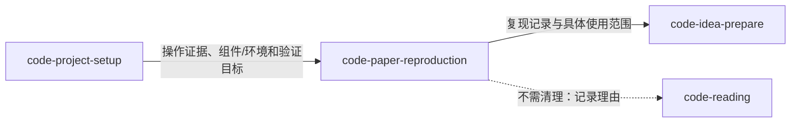

# 按明确目标核查复现结果

核查具体实现和结果，提供可追溯、用途明确的参考条件与证据。**数值接近不证明整体实现正确；训练/评测失败不等于研究假设错误；局部检查不认证未验证配置或规模。** 每项结论绑定代码、环境、数据、模型、协议与实际检查范围。

本skill执行已明确的复现/验证设计，按证据调查差距，不替用户维护原假设或设计新研究方法。需要改研究问题、对照、方法或增加科学实验时，交idea-find/iterate设计、execution实施。关键大规模验证仍按目的分工，不因卡数/时长自动推给论文阶段。

## 用 W&B 保存可追查的基准运行

接收 setup 的 tracking_ref 和实际验证范围，按 [W&B 共同记录](../wandb/references/experiment-records.md) 使用同一内网实例。缺少接入验证先交 setup 处理相关事项或如实限定本地记录，不默认连云端。每个训练/评测/诊断尝试记录独立 run，绑定复现 target/protocol、实际代码+diff、配置、数据/模型和选择规则；复现没有 idea 轮次也可登记，不虚建 ideas 节点。全部 seed、失败、恢复、取消和未同步记录保留，W&B run 不等于独立重复。

执行前自查核实例/身份/上传范围和本地数据保留；交接前自查核 SDK 实际写入及 API/MCP 读回范围、sync_status 与执行状态、所有尝试和关键结果快照。reproduction.json 顶层保存 tracking_ref，runs 中保存 attempt/replicate 身份及 wandb 关联，见共同记录映射；后续方法实验引用这些精确 run 和条件，不只引用 UI 的最佳数。上传失败不重跑训练，页面 finished 不认证复现可信。

## 低成本配置先核关键条件

定义协议、执行前自查及提供低成本配置时，按 [研究条件与低成本实验](../dl-assistant/references/research-conditions.md) 对应目标、本轮配置和必须保留项。关键条件被缩掉的配置不能用于检验原假设；影响未知可作有范围的检查，不认证方向可靠。交接 low_cost_configs 包含条件记录引用、实际证据/未知、推断范围与目标验证触发点；未明确下游假设时仅声明当前复现用途，不替未来方法认证。

## 系统关系与前置

全局关系见dl-assistant。code-reading仍是主线必经，清理按实际需要；本skill的源码核查不替代用户阅读。论文读取用实际可用工具和对应skill，arXiv/DOI/URL、公式及跨机器文件遵循全局规范。

需要的是当前目标所需的实际环境/资产/入口，而不是一份格式齐全的setup文件。优先读取指定setup.json；无该文件但已有运行环境时先核实最小前置、记录来源，缺准备条件则交setup，不因缺固定目录直接拒绝。与当前目标无关的blocked项不阻塞全部工作。

## 工作流程

### 1. 接收目标和实际状态

读取新版setup的components、environments、operations/checks、supported_operations、validation_targets、survey_task_responses与未决项。ready_commands/conda_env只帮助定位，不继承整体可信，也不把所有组件压成一个环境/仓库。旧记录缺字段视为未知，实际使用时核对，不批量迁移。

核实际commit+diff、配置、资产身份/完整性、已运行任务及相关日志。条件不变且证据足够时复用已做检查；只对影响目标的变化补核，不无条件重装或重跑。保护用户改动，不自动重置/stash，不重复启动仍在运行的任务。

### 2. 建立逐目标验证清单与版本化协议

按 [规格模板](references/reproduction-spec-template.md) 写每项目标：
- 原论文/发布结果在原条件下的评测或训练复现；或明确改变条件后的参考结果/行为验证。
- 具体组件、来源与版本、目标表格行/行为、数据/划分/样本/单位/指标与实现、预处理/采样/增强/聚合、权重与选择规则、训练条件及相关设备/精度。
- 当前实际条件与原条件的相同、不同和未知；引用实际位置。改条件的结果不冒充原条件复现。
- 所需观察、数值/行为比较办法、依据、重复/不确定性计划、预算和停止条件，及本轮结果的适用范围。

允许没有官方权重、论文表格行或数值指标的目标，用与任务相关且有出处的参考行为/已知答案；无参照则说明当前只能检查什么、还有什么未决，不借无关model zoo分数代替。缺失关键目标定义先讨论，不让运行替用户补研究设计。

评测、训练、数据/测量组件可并列，不强制所有任务先official checkpoint eval。需要训练证据时不能用评测代替；已有权重评测与目标相关时可作为一项验证，不是所有训练研究的通用前置。详细选择见 [验证策略](references/reproduction-strategy.md)。

协议保存ID、版本、来源和实际批准范围。旧协议/结果保留不覆盖；确需改指标、划分或方法时说明影响并确认，新版本重新核可比性，不把协议称为永远正确的事实。没有“loss/架构/增强属于可修改列表所以公平”的通用授权。

**执行前自查**写在spec：目标/条件能否对应；参考与可比性是否核实；比较/不确定性规则有无依据；预算、修复范围与授权是否清楚。逐项写clear/limited/needs_revision、来源、未知和行动影响。可做有限验证就说明范围；影响当前比较的缺陷先修正，不为了填通过编容差。自查不新增独立JSON/脚本或逐项审批；已有授权直接沿用，实质变化再确认。

### 3. 按批准目标执行并保存全部相关证据

优先使用已检查真实入口，核对环境/代码/config/数据/权重及运行条件。训练和评测分别保留实际设置、逐次读数、样本/seed、选择与恢复过程、命令/工作目录、时间、日志、退出状态和产物。单次实测与论文声明/社区报告分开；不得只保留最接近论文数或最好的seed。

重复次数按目标和已有依据规划，不默认必须2—3个，也不只在差距接近时追加到“对齐”。训练随机性、固定权重评测随机性、数据抽样/分组、数值误差和协议差异分别处理。原文未报方差、只报最佳值或来源不充分时保留限制，不以任意默认容差填补；统计解释见策略参考。

修复按setup的影响规则：已批准且含义不变的修复继续并记录；加载映射、转换或依赖适配核实际对应；影响数据/计算/比较或影响未知时返回确认，科学设计改变交研究讨论。不能自动切官方/自训权重或调超参追论文数；权重和初始化选择按目标、来源与公平比较条件决定。

长任务按实际调度环境和 [共享运行说明](../dl-assistant/references/long-run-ops.md) 管理，结合进程、日志、退出状态与产物核实。估计费用/耗时说明依据和不确定性；短运行不可直接认证全程成本。不默认固定开发卡、固定分支、merge或tag，不以结果是否成功决定是否保存/提交记录；提交/推送遵循项目与用户授权。

### 4. 解释一致、差距与未决，不强求原因

分别判断执行、数据/实现有效范围、可比性与参考比较。数字接近仍核协议/身份；数字不同不直接归为训练bug、随机噪声或整个实现不可信。即使official eval接近，也不能将新模型差距“干净归因”于训练部分。

使用 [差距核查参考](references/trust-traps.md) 记录：实际观察、候选解释、支持/反对证据、已排除事项、剩余未知，以及下一项有信息且成本合理的检查。最强反对证据要保留；可说明原因未知，不为交付强写根因。

可比性未定/有协议差异，先说明差异影响，不能用一个容差吞并。参考比较允许consistent_with_reference/discrepant/insufficient_evidence/not_comparable/not_assessed/not_applicable，理由和范围必填。consistent不证明全部算法正确；discrepant不自动推导方法错误或研究无价值。

### 5. 低成本配置仅按需要提供

**不采用自动scaling law拟合、强制扫描与外推认证。** 不再产“拟合通过所以新方法趋势可推广”的结论，不规定只缩数据或默认小时上限。

确有后续需求时，按 [低成本配置规则](references/reduced-setting.md) 讨论它回答什么、改变什么、成本与证据边界。缩数据、模型、输入或训练长度都按问题评估和批准，不能冒充原条件。可选配置不是复现交付的强制项，不自动从训练可信度继承研究外推能力。

基线在多个规模上的曲线即使可拟合，也不说明新方法收益/排序能推广。若规模间关系本身值得研究，交iterate形成明确假设与比较设计，再由execution实施；本skill不默认做扫描、已知消融或idea试探。没有迁移证据就写未验证，不称“只用来排方向”也一定可靠。

### 6. 交接前自查并给出逐项使用范围

按 [报告与JSON模板](references/reproduction-report-template.md) 交付逐目标观察、协议、证据、差距调查和后续用途，不再用一个trustworthy_for_delta布尔值认证整个仓库。

**交接前自查**：
- 每项结论能否追到实际命令/环境/代码/config/资产/读数和协议？进程完成是否被当成结果符合？
- 是否把近似数值、组件检查、短曲线或缩规模结果推广到未验证条件？
- 容差/不确定性、数据有效范围与可比性是否分开？是否遗漏反证、失败和选择过程？
- 每个目标/survey待办是否回应，后续用途、限制、缺口、责任与预算是否明确？

逐项写判断、实际来源、未知和影响；needs_revision不能交宽泛可用结论，仍可报告真实部分结果/待解决问题。复现未完成或未接近原数也可交付，不无限修到“成功”；是否继续研究由具体设计与用户决定，不能在偏弱或条件不明的基线上直接宣称提升。

## 保存与下游交接

默认 `docs/code-paper-reproduction/<实际日期>-<slug>/`，尊重指定路径，冲突加唯一标识，继续任务核版本/实际进程与完整性，不覆盖历史。保存spec.md、reproduction.json、report.md、alignment.md和各次runs；大型资产留实际位置并记录版本/校验和获取条件。实际没有的字段不填示例值/假通过，不批量重写旧项目。

清理按实际必要性决定，结构清楚/局部工作可记理由跳过code-idea-prepare；需要清理时交实际协议、入口与已有结果，prepare按保留用途与对应行为检查，不从单一指标或旧标签推导整体等价。用户code-reading仍必经。execution按当前批准问题/设计读取相应证据，不把本报告当新方法有效、创新或可发表的证明。

新版schema_version=2；prepare与code-reading已按实际用途、变更与证据范围接收；后期旧消费者仍需在各自审查时同步，交接明确新字段与语义。旧标签仅定位历史实现，不代表评测/训练或规模推广能力；旧缩规模外推/噪声底线字段不自动映射为新结论。科学协议修改保留新旧版本和可比性判断，不能在旧记录上改成从来如此。
