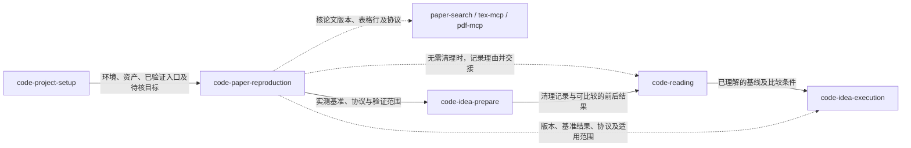
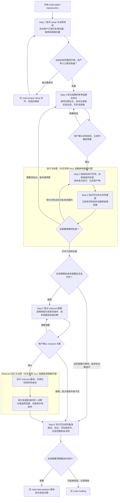

# 复现参考结果与建立比较基准

在「提出假设 → 设计实验 → 收集数据 → 分析并修订假设 → 提出下一步假设」的科研循环中，本 skill 负责标定后续实验的比较基准。先确认参考结果对应的代码、环境、模型、数据和协议，再实测当前实现。交付可复跑的命令、实际读数和适用范围，让后续实验知道从哪一版基线开始、哪些条件需要保持、一个差值应怎样解释。

按实际目标选择验证。需要使用已有权重时，核推理与评测。后续需要重训时，验证相关训练条件和结果。资源只够核部分链路时，交付实际验证到的范围。整体科研流程见 [dl-assistant](../dl-assistant/SKILL.md#共同研究流程)。

## SKILL 交接关系



优先使用用户指定的 setup 记录。当前项目已有环境和资产时，按目标核实可复用证据。需要补环境、数据、权重或入口准备时，交 `code-project-setup`。复现中发现需调整研究问题、对照或方法时，带证据回 `idea-find` 或 `code-idea-iterate` 讨论。

## 产出与保存

默认保存到 `docs/code-paper-reproduction/<repo>-<日期>/`。用户指定位置时按指定位置保存。续做时核原目录对应的版本和实际任务，新任务使用独立目录。

| 产物 | 记录内容 |
| --- | --- |
| [复现规格](references/reproduction-spec-template.md) `spec.md` | 逐项目标、参考来源、协议、实际条件、比较判据、预算和用户确认范围 |
| [复现条件与差距核对](references/alignment-template.md) `alignment.md` | 参考条件、当前配置和代码位置的对应关系，以及差距假设、支持与反对证据、实际排查结果 |
| [复现报告与机读交接](references/reproduction-report-template.md) `report.md`、`reproduction.json` | 参考结果和实测结果、运行入口、可比性、随机波动、已验证条件及后续用途。每次运行后回填，两份记录保持一致 |
| `runs/<run-slug>/` | 各次评测、训练、组件检查和 reduced 对照的命令、配置、日志、退出码、指标与产物。独立保存重试和恢复记录 |
| 按需保存的配置和资产指针 | 基线曲线、checkpoint 实际位置与来源、可复跑的 reduced 配置、子集清单和升档条件 |

每次执行单独建一个 `runs/<run-slug>/`，按以下结构记录。续训或复跑另建目录，并在 `meta.json` 引用原尝试和所用 checkpoint。

```text
runs/<run-slug>/
├── meta.json          # 目标、协议版本、seed、代码与环境、资产、会话和运行状态
├── command.sh         # 可复跑的实际命令、工作目录和环境入口
├── config/            # 按需保存实际配置、覆盖项及试跑样本清单
├── run.log            # 进程 stdout/stderr；tmux 使用 <会话名>.log
├── EXIT_CODE          # 已落盘的退出码；tmux 使用 <会话名>.EXIT_CODE
├── metrics.json       # 有数值产出时保存实际指标、单位及聚合范围
└── outputs/           # 按需保存轨迹、样本 ID、预测、曲线或 checkpoint 指针
```

启动前保存 `meta.json` 和 `command.sh`。配置已随代码版本固定时，可在记录中引用具体路径、版本和覆盖项。运行后登记实际日志、退出码、指标和产物路径。未生成的文件标明原因或待核状态。日志与退出码路径以实际执行工具生成的文件为准。

当前下游通过 `target`、`ready_commands`、`checkpoint`、`reproduced_baseline_checkpoint`、`determinism`、`noise_floor` 和 `reduced_setting` 等字段定位基准。字段按已取得的真实证据填写，同时在报告标注适用范围和未决项。跨机器交接按 [dl-assistant 共用规则](../dl-assistant/SKILL.md#所有技能共用的规则)处理，大文件记录原位置、版本和获取方式。

## 运行流程图



## 参考资料列表

| 参考资料 | 什么时候读 |
| --- | --- |
| [运行手册](references/workflow.md) | 开始或续做时先读，按六步核对参考、执行复现、记录差距与交接 |
| [复现规格分析指引](references/reproduction-spec-guide.md) | 从后续用途确定复现目标，分析可比条件、取证方案和预算时 |
| [复现规格模板](references/reproduction-spec-template.md) | 写逐项目标、参考协议、成本和比较判据时 |
| [复现条件与差距核对模板](references/alignment-template.md) | 记录开工情况、逐项核条件及更新排查结论时 |
| [复现验证策略](references/reproduction-strategy.md) | 根据目标选择评测、训练和组件检查，规划比较与重复运行时 |
| [差距排查](references/trust-traps.md) | 查指标、数据划分、权重来源、训练链和具体差距时 |
| [Reduced 配置](references/reduced-setting.md) | 根据实测成本备选规模、保留关键研究条件并核跨规模对照时 |
| [复现报告与机读模板](references/reproduction-report-template.md) | 执行中记录观察、归档结果和交接时 |
| [论文检索](../paper-search/SKILL.md)、[论文源码](../tex-mcp/SKILL.md)、[论文 PDF](../pdf-mcp/SKILL.md) | 核参考身份、固定版本、表格行及协议时，按可取得的材料选工具 |
| [长任务托管与恢复](../dl-assistant/references/long-run-ops.md) | 启动或恢复较长的评测、训练和 reduced 检查时 |

流程、确认点和验收原则按本页执行。专项参考中的检查命令与案例按当前目标、实际条件和批准范围选用。

## 原则与确认点

### 1. 先核当前现场，再定比较目标

读取 setup 的 `components`、`environments`、`operations`、`checks`、`supported_operations` 和 `validation_targets`。对旧记录按实际入口、环境、配置、数据和权重回查。核当前分支、commit、未提交 diff 和运行中任务。结束初查后先向用户汇报可复用的证据、缺项和续做位置。小样本入口证据支持该次试跑，完整评测需要核正式条件与实际入口。

参考结果可以来自论文的具体表格行、维护者发布的匹配结果，或有出处的组件行为。将参考和当前的模型、权重来源、划分、指标实现与单位、预处理、聚合、有效 batch、训练计划及设备精度逐项对应，标明已核、差异和未知。

### 2. 确认目标、协议、比较判据和预算后执行

按目标选择评测、训练或组件检查，并分别说明什么条件和证据达到本轮要求。已有权重用于其适用的推理与评测目标，训练结果通过实际训练观察。可使用论文对照、已有同条件运行和合适的重复实验确定比较规则。明确每次比较的单位、波动来源、重复安排和预算。

执行前交用户审阅复现规格。需变更指标、划分、权重选择、关键训练条件或投入时，说明影响、建议、验证办法，再确认变更。按已确认方案自主推进必要的工程修复，保留实际改动与复跑证据。默认在本地 `code/paper-reproduction` 分支工作，保护用户改动。合并由用户决定，交接的提交或 tag 绑定实际验证范围。

### 3. 给每项结果写可比性、差距和使用范围

分别记录执行状态、实际行为、与参考条件的可比性和结果差距。数字接近时仍需核口径和权重。如有差距，先查版本、配置、样本统计和指标，再查影响训练或推理的路径以及随机波动。记录候选解释、支持与反对证据、待核项和下一次检查。多次尝试各自保存，交接时说明证据能支持哪些后续使用。

### 4. Reduced 用于降低迭代成本，写清升档条件

后续需要反复比较且目标配置超出迭代预算时，提出 reduced 方案。说明实测成本、拟缩减条件、必须保留的样本和训练阶段，以及拟用的可比对照。用户确认后运行基线和获准的对照。跨规模比较以同一个改动相对同一个基线的实测差值为依据。缺少可比对照时把跨规模收益记为未知，并明确哪些决定需要升档确认。正式收益按研究方案在目标条件验证。

### 5. 在目标机器托管长任务

预计超过 5 分钟、耗时不确定或重跑代价高的任务，在实际执行机器使用 tmux 分离会话，集群任务使用调度器。评测、训练、差距排查和 reduced 对照均适用。命令显式指定运行环境，每次尝试单独命名并保存日志和退出码。续做先查原任务、代码和配置版本、资产及输出，再继续未完成部分。需要使用项目实验记录时，按 [W&B 共同记录约定](../wandb/references/experiment-records.md)保存对应运行及实际同步状态。
