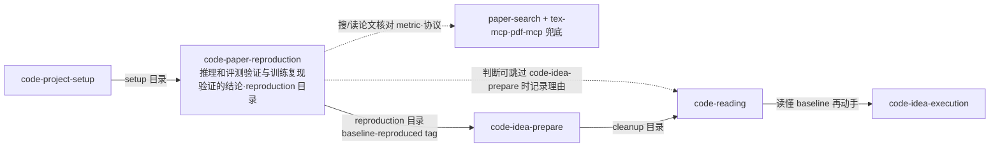
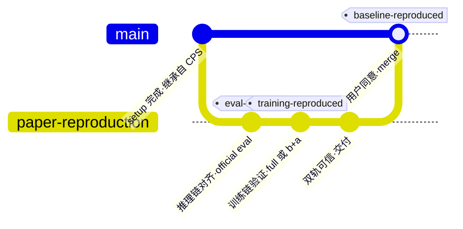
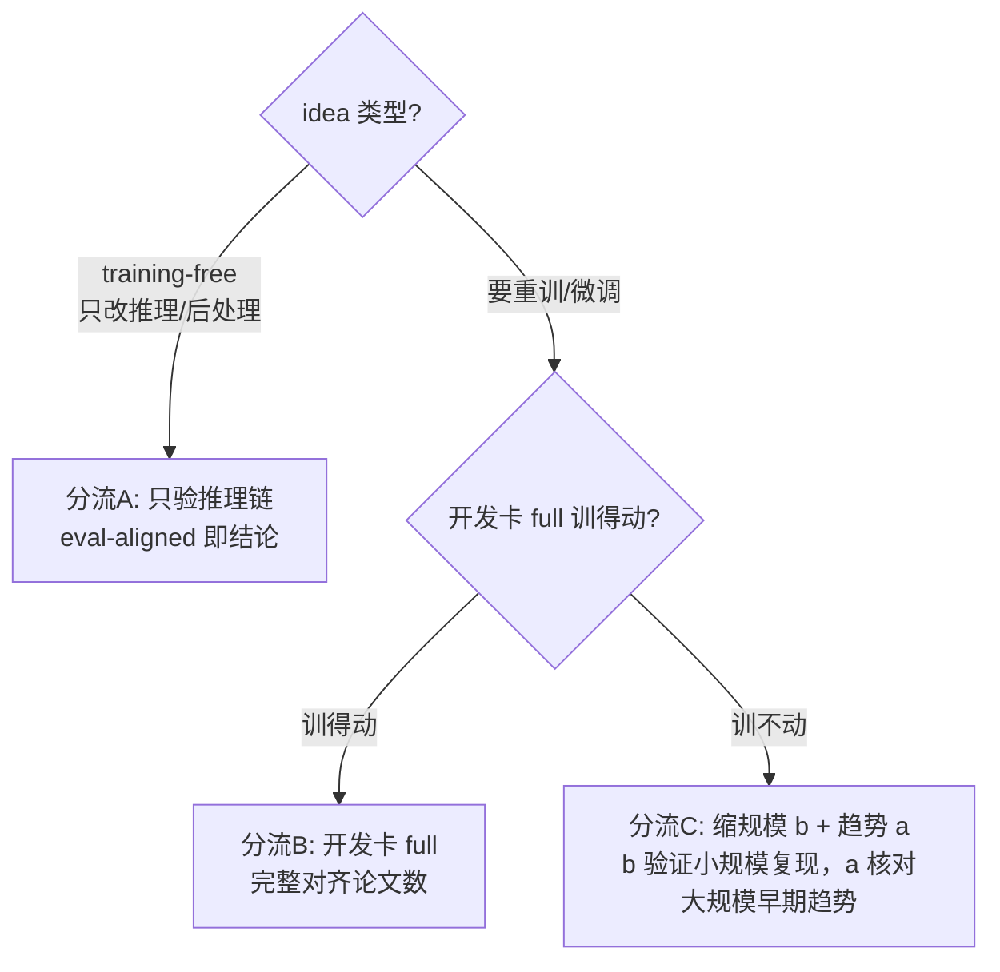
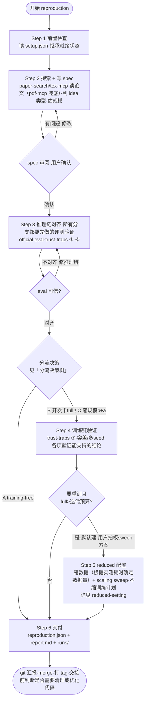

# Code Paper Reproduction

## 这个 skill 解决什么问题

完成 `code-project-setup` 后，先核对选定仓库能否复现参考结果，再在此基础上修改方法和比较实验结果。

命令执行成功后，仍需核对指标的实现、val/test 划分、checkpoint 的训练来源和版本、评测协议及论文表格行。还要判断数值差异是否超出随机种子带来的波动。具体排查顺序见 `trust-traps.md`。

先验证推理和评测。需要重训或微调时，再验证训练能否复现参考结果。

- **推理和评测验证（eval）**。所有分支先用官方 checkpoint 跑评测，核对权重、推理实现和评测协议。数据增强、损失实现、优化器和分布式 BN 等训练设置在重训时验证。
- **训练复现验证（training）**。通过重训复现参考结果，或按后文的小规模复现和大规模短训方案验证。若基线重训本身低于参考结果，方法改动后的提升可能只是恢复了基线原有表现。

training-free 的 idea 到 eval 可信即可；要重训的（绝大多数）必须到 training 可信。本 skill 据此**分流验证**（见「分流决策树」）。

**复现目标由仓库用途决定。** `baseline-survey` 在 clone 卡上记录仓库用途，经 `setup.json` 传递。用于比较的基线代码以目标论文的指定表格行为复现目标。用于分析实验的代码仓库以维护者报告的参考结果为目标，从 model zoo、README 或技术报告核对模型、benchmark 和数值，确认后续分析可用同一评测设置比较。两种用途沿用相同的验证分支、容差、`noise_floor` 和 reduced 配置规则。

## 边界：本 skill 做什么、不做什么

**做**：读取 `setup.json`，查阅论文和代码，明确复现目标，按是否需要重训和训练规模选择验证方案。用容差和不同随机种子下的结果判断差异，分别记录推理评测和训练复现结论。固定后续比较所用的指标与评测协议，记录随机波动和允许改动的组件。按原有触发条件准备 reduced 配置，交付 reproduction 目录。

**不做**（交给相邻 skill）：

| 场景 | 用 |
| ---- | -- |
| repo 还跑不起来（环境/依赖/数据/checkpoint 未就绪） | `code-project-setup`（中期·早） |
| 逐段精读源码、讲调用链给人听 | `code-reading`（中期） |
| 理解论文方法本身、不操作代码 | `paper-reading`（前期） |
| 实现 idea、设计实验矩阵、跑消融 | `code-idea-execution`（中期核心） |
| full 规模铺开（多 seed/多数据集/多卡大消融，投稿级） | `code-paper-experiment`（运行服务器，论文实验阶段；`code-paper-release` 只做发行版，不铺实验） |

> 本 skill 在 GPU 服务器的开发卡上执行。开发卡能完成全量训练时，直接完整复现。开发卡无法完成时，做小规模复现和大规模短训的趋势验证，并把完整的大规模数值验证交给运行服务器。

## 指标契约与评测设置

中期实验比较沿用固定的指标定义、评估协议和数据划分。各阶段职责如下。

| 环节 | 对指标契约的职责 |
| --- | --- |
| `baseline-survey` | **提出**：从论文摘 `paper_metrics`（论文报的主指标 + 目标表格行；仓库用于分析实验时则摘仓库维护者报告的参考结果：哪个模型 @ 哪个 benchmark = 多少） |
| `code-project-setup` | **传递 + 保证能跑**：`paper_metrics` 原样继承进 `setup.json`，不打开论文、不核对 metric 语义；保证 eval 命令能从头跑到尾 |
| `code-paper-reproduction`（本 skill） | 阅读源码，确定指标定义、评测协议、官方报告值、复现值、容差范围和随机种子造成的数值波动，并写入 `reproduction.json` 的 `target` 块。后续比较沿用这套定义。 |
| `code-idea-execution` | 用已确定的定义和协议判断结果应保留还是放弃。需要修改评估协议时暂停，请用户确认。 |

**评测设置的修改需要确认。** `target` 固定后，后续保留或放弃的判定以它为准。要改指标计算方式、评测协议或数据划分时，先暂停并请用户确认。

**记录可改动的范围。** 在 `reproduction.json` 中列出 `frozen_components`（评测协议、指标实现、数据划分、官方 checkpoint 的训练来源和版本）和 `mutable_components`（损失、架构、数据增强、优化器）。常规方法迭代只修改后者，以保留与基线的可比性。

> **smoke run** 是 `code-project-setup` 用官方命令做的分钟级试运行。**reduced setting** 是本 skill 为日常迭代准备的数据量较小、通常按小时运行的训练配置。

## 在系统里的位置（局部）

本 skill 以 `code-project-setup` 产出的 setup 目录为前置条件。核对论文时用 `paper-search` 查找，arXiv 内容优先用 `tex-mcp` 阅读，PDF 文件操作用 `pdf-mcp`。完成后将 reproduction 目录和对应 Git tag 交给 `code-idea-prepare`，符合跳过条件时记录理由，再交给 `code-reading`。之后由 `code-idea-execution` 读取复现结果。



> 整体架构、全局怎么连，看 `dl-assistant` 的「全局 skill 流向图」；本 skill 只画与自己相关的 skill。

## 产出与保存：reproduction 目录

reproduction 的核心产物是一个**目录**，**固定落 `docs/code-paper-reproduction/<repo>-<日期>/`**，不问用户、不接受另行指定：

```
docs/code-paper-reproduction/<repo>-<日期>/
├── spec.md                # 复现规格（确认点 1，用户审过）
├── reproduction.json      # 供下游技能读取的记录（下游直接消费，单一真相源）
├── report.md              # 人读正文（验证台账·执行中动态更新 + 推理和评测验证、训练复现验证结论）
├── runs/<run-slug>/       # 各 run 的 run.log / EXIT_CODE / metrics / 训练曲线
│                          # run-slug: eval / dev-full / scaled-b / trend-a / reduced
└── alignment.md           # 论文 vs repo vs setup 对齐核对 + trust-traps 排查底稿
```

- **机读区单一真相源**：`reproduction.json` 是下游入口（inherits / idea_kind / repro_strategy / 双轨判定 / evidence_strength / full_scale_alignment / target（冻结）/ frozen_components / mutable_components / noise_floor / ready_commands / artifacts / baseline_curves / checkpoint / reproduced_baseline_checkpoint / training_chain / determinism / dev_card_footprint / known_pitfalls / blocked / reduced_setting）。人读材料分散在目录其他文件，两者描述同一事实，别打架。
- **大 checkpoint 留服务器原地**、json 记路径，不搬进交付目录。
- **跨机器交接**：产出是跨机器交接物——共用规则见 `dl-assistant` SKILL.md「所有技能共用的规则」。

模板：`reproduction-spec-template.md` / `reproduction-report-template.md`（含 reproduction.json 字段）。

## 核心纪律

### 两个确认点（spec 审 + reduced 配置拍板，必停）

复现里真正需要人参与的是**确认复现目标与方案**（spec）和**影响实验语义的判断**（语义判断即停）。其余（跑 eval、修推理链工程 bug、多 seed、resume 续跑）是 agent 该自主连跑的工程活。

- **Spec 审阅**：探索完论文 + repo 后，产出 `spec.md` 给用户审——复现目标（表格行 + metric 精确定义 + 期望数 + 容差范围）、idea 类型、分流建议、命令/checkpoint/config、预估时间、已知问题和待验证风险。**先探索再开口**，不在信息不足时问用户。spec 落盘是"当初决定复现什么、为什么这么分流"的证据。模板见 `reproduction-spec-template.md`。
- **确认 reduced 配置方案**：要重训且 full 训练超迭代预算（默认 2-3h、上限 4h）时，**默认建 reduced 配置**（没有它 execution 就没有用于迭代的训练配置）；agent 提议缩减策略（**只减少训练数据量**、用实测耗时选择数据规模 + 选择不同数据规模做 scaling sweep，训练计划保持原文），用户确认 scaling sweep 的方案才跑（见 Step 5）。

### 按步骤更新报告

产物即真相。Spec 确认后建立 `report.md`。每项验证完成时立即记录目的、实际操作、预期结果、实测值和是否通过，便于中断后核对进度。交付时定稿「推理和评测验证、训练复现验证结论」。模板见 `reproduction-report-template.md`。

### 停顿规则（触发式，全程统一）

- **语义判断即停**（遇到时暂停）：checkpoint `strict` 报 key 不匹配 / 评测协议开不开 / val-test 该用哪个 / 同步 BN-loss 归约-lr 缩放改不改 / 要动已冻结的指标的具体计算方式 → **停下、汇报为什么 + 建议怎么改、等用户确认**。
- **多次尝试仍无法解决时报告用户**：多次处理后仍无法解决的工程 bug、大资源消耗显著超 spec 估算 → 停下报告用户，暂停进一步尝试。
- **agent 自处理**（不停）：checkpoint key 机械修正、metric 参数核对、论文数值提取、表格行定位、能从源码直接看出来的问题、训练跑挂的工程 bug（路径/兼容/config override）、断了用框架 resume 续跑。

### 复现不是调参

不为追论文数做大规模超参搜索。gap 超出容差范围 时按 `trust-traps.md` 排语义问题，不是靠搜超参把数字"碰"对齐——搜出来的对齐不可复现、也不可信。

### 面向 method 迭代的交付纪律

reproduction 的下游是 method 迭代（execution），交付必须回答 execution 的四个问题：

- **多小的 delta 是噪声？**——分流 B/C 训练侧默认 ≥2-3 个 seed（full 太贵时至少 2 个并写明），把 `noise_floor`（同配置跨 seed std）写成契约字段：execution 的 delta < 2×std 时不可判 keep/discard。reduced 配置同理，用论文已知消融在 reduced 上标定噪声区间。
- **哪里能改、哪里不能动？**——`frozen_components` / `mutable_components` 机读清单（见「指标契约」）。
- **正常训练长什么样？**——baseline 训练曲线（loss / metric / 固定批预测演变）登记进 `baseline_curves`，execution 每版改动对照曲线形状，判"训崩了还是方法不行"。
- **从哪版权重切？**——自己重训出的 baseline ckpt 登记 `reproduced_baseline_checkpoint`（路径 / seed / config），execution 微调从这切，不从 official ckpt 切。

此外，排 trust-traps 时命中的坑（这个 repo 的 metric 有坑、ckpt 是 EMA 之类）写进机读的 `known_pitfalls`，execution 必读。

### 长任务托管 + 恢复续跑

预计超过 5 分钟、耗时不确定，或会话断开后重跑代价高的命令，一律在 tmux 的分离会话中执行。首选 `dl-assistant/scripts/run-long.sh`，禁止用 `run_in_background` 或在前台等待。大测试集评测、开发卡全量训练、小规模完整训练和大规模短训都可能需要托管。会话名前缀为 `repro-<repo>-<run>`，并行运行各用独立会话，通过会话状态、日志和退出码查看进度。具体做法见 `dl-assistant/references/long-run-ops.md`。

重连后用 `tmux ls | grep repro-` 查看会话，核对各次运行的 `run.log`、`EXIT_CODE` 和指标，再对照 `reproduction.json` 继续。不额外建立状态文件。

### git 工作流：paper-reproduction 分支 + 里程碑 tag

所有复现改动在 `code/paper-reproduction` 分支，不动 main。可信度是递进的，每个里程碑打 tag，让 execution 能从对应可信度级别切：



- `eval-aligned`：推理链对齐（official eval 对齐论文数）—— training-free 的 idea 到这就够
- `training-reproduced`：训练链验证通过（full 或缩规模 b+趋势 a）—— 要重训的 idea 需要这层（training-free 跳过）
- `baseline-reproduced`：双轨可信，merge 回 main 后打 —— execution v1 从这切（`git checkout -b idea/v1-<slug> baseline-reproduced`）

> 复现不可信（not_trustworthy）则不打 tag、不 merge —— 回去修。图里分支名简称 `paper-reproduction`（实际 `code/paper-reproduction`）。

## 读取已有的环境和运行信息：setup.json 字段用法

启动先读 setup 目录的 `setup.json`——没有就退出建议先 `code-project-setup`；目标资源 `blocked-by-*` 则向用户说明 blocker、建议回 setup。继承不重查：

| setup.json 里的 | reproduction 怎么用 |
| --- | --- |
| env / ready_commands / data / checkpoint | 直接继承就绪状态（eval 命令从这拿），不重新搭 |
| `repo_role`（baseline / substrate，经 setup 原样传递） | 为 substrate 时，Step 2 以仓库维护者报告的参考结果为目标。 |
| `dev_card_footprint` | 估训练规模（单步耗时 × 论文 iter），据此分流 B/C |
| `reproducibility` 块（seed 位置 / cudnn / worker seed） | 判差异是否超出随机波动的基线：determinism 没固定时，band 内 gap 大概率噪声 |
| `paper_metrics`（若有） | Step 2 复现目标的初稿——仍要回论文核对表格行和 setting（防跟错行，trust-traps ⑤ 纪律不变） |

## 分流决策树（核心）

先用官方 checkpoint 验证推理、权重加载和评测。随后根据构想是否需要重训，以及开发卡能否完成全量训练，选择训练验证方案。



| 分流 | 验什么 | training_判定 | 打 tag |
| --- | --- | --- | --- |
| **A training-free** | 完成评测验证即可 | NA | `eval-aligned` → `baseline-reproduced` |
| **B 开发卡 full** | 先用官方权重验证评测 + 开发卡 full 完整对齐 | full_reproduced | 叠加 `training-reproduced` |
| **C 缩规模 b+a** | 先用官方权重验证评测 + 小 setting 对齐(b) + 大规模趋势(a) | b_plus_a_confirmed | 叠加 `training-reproduced` |

> 各分流怎么执行、容差范围 / 多 seed 怎么判差异是否超出随机波动，见 **`reproduction-strategy.md`**。可信度陷阱排查见 **`trust-traps.md`**（①-⑥ eval 侧 + ⑦ 训练链特有 + 组件级验证手册）。

## 各项验证能支持的结论：没法全量跑时

开发卡无法全量训练时，按下列顺序收集证据，分别说明已验证的训练行为和待验证的论文规模结果。每降低一级，在 `reproduction.json` 中记录证据强度（`evidence_strength`）和下游使用限制。

1. **开发卡 full 对齐**（分流 B）——可直接核对完整训练结果：数值 + 训练链双对齐。
2. **论文自报小 setting + 趋势外推**（分流 C 的 b+a）——b 用完整的小规模训练结果验证（作者自己验过的缩减，最可信的小 setting），a 用大规模短训结果补充证据。
3. **组件级证据**（无法完成 b 和 a 时）——不跑完整训练，验训练链语义：overfit 单批 / loss 初值 / input-independent baseline / 进网络前可视化 / 梯度依赖检查，全套见 `trust-traps.md`「组件级验证手册」。组件级全过 = 训练链语义正确，只是数值没验到。
4. **外部旁证**——社区复现报告（repo issue / paperswithcode / 第三方复现）交叉验证；官方若放出多个 checkpoint，其间 variance 可用来定噪声 band。
5. **记录已验证项、未验证项和使用限制**——落到哪级写哪级：`reproduction.json` 记 `full_scale_alignment: deferred_to_running_server`（数值对齐显式推迟给运行服务器的 `code-paper-experiment`），写清哪些组件验过、哪些没验过；execution 在上面的 delta 带着这个风险认知，重大结论回 full 验证。

开发卡执行第 1–4 项可完成的验证。需要多卡才能完成的论文规模数值验证交给运行服务器。

## 运行流程总览

6 个 Step，每步"目标 + 关键动作 + 何时停"。Step 间不是死板的瀑布——推理链没对齐回去修、训练断了用 resume 续都正常。

**TaskList 跟踪流程**：Step 1 通过后建任务（探索+spec / 推理链对齐 / 训练链验证（按分流）/ reduced 配置（条件触发）/ 交付），每步完成即勾——多步骤 + 长任务托管，防恢复后跳步。



各 Step 的详细执行要点见文末「运行流程详情」。

## references 文件列表

| reference | 讲什么 | 什么时候读 |
| --- | --- | --- |
| `reproduction-spec-template.md` | spec.md 模板（复现规格，确认点 1） | Step 2 写 spec 时 |
| `reproduction-strategy.md` | 三分流执行详述 + 容差/多 seed 判据 | Step 3/4 执行时 |
| `trust-traps.md` | 可信度陷阱 ①-⑦ + 容差范围 表 + 组件级验证手册 | 数字对不上 / 好得可疑 / 训练链排障时 |
| `reduced-setting.md` | reduced 配置设计（缩减策略 + 有效性验证 + 噪声标定） | Step 5 |
| `reproduction-report-template.md` | `reproduction.json` + `report.md` 模板 | Step 6 写交付时（report 建立于 Step 2 后） |
| *（跨 skill 共享）* `dl-assistant/references/long-run-ops.md` | 长任务托管通用机制 | 跑长任务 / 恢复续跑时 |

## 常见错误

- 不要没有 `setup.json` 就开始复现 —— 退出并建议先 `code-project-setup`。
- **不要只做 eval 对齐就宣称 baseline 可信** —— 绝大多数 idea 要重训，eval 只证推理链。
- 不要不分 idea 类型一刀切 —— training-free 走 eval，要重训按规模分流（「分流决策树」）。
- **所有分支都先用官方 checkpoint 跑评测。**
- 不要把大规模 full 一律推给运行卡 —— 开发卡训得动的规模，full 是本 skill 正常一环；只有训不动才退 b+a。
- 不要规模大时只做 a 或只做 b —— b 用完整的小规模训练结果验证、a 用大规模短训结果补充证据，两个一起才敢说训练链可信。
- 不要把单 seed 小 gap 当真差 —— 按容差/多 seed 判据（`reproduction-strategy.md`），band 内倾向噪声。
- 不要训练侧只跑单 seed 就交付 —— `noise_floor` 是契约字段，分流 B/C 默认 ≥2-3 seed（full 太贵时至少 2 个并写明）。
- 不要把开发卡训不动当成"算了" —— 沿「各项验证能支持的结论」降级并显式标注证据强度，数值对齐显式 deferred 给运行服务器，不模糊带过。
- 不要为追论文数做大规模超参搜索 —— 复现不是调参。
- **不要在 reproduction 阶段做 idea 实验** —— reduced 只验有效性（跑 baseline），不试 idea。
- 不要为压迭代预算压缩训练计划 —— 停在未收敛点会系统性错误放弃"学得慢但终点高"的改动；预算靠缩数据凑（`reduced-setting.md`）。
- 不要拿模型容量当缩减手段 —— 换小模型会让对标的 baseline 直接不成立（官方 config / 权重 / 论文数字全对不上，强跑 = 改 baseline 语义）；reduced 只减少训练数据量，用实测耗时选择数据规模。
- 交付 reduced 配置前，用不同数据量跑 scaling sweep。最大规模应能在 ≤4h 完成，少数情况经用户确认可到 12h。用较小规模的结果拟合，再实际运行一个留出的更大规模核验预测。
- 仓库用于分析实验（`repo_role: substrate`）时，复现目标取仓库维护者报告的参考结果。
- 不要动已冻结的指标的具体计算方式 / 评测协议 —— `target` 冻结后改协议 = 语义改动即停。
- smoke run 用分钟级试运行检查命令和基本数值。reduced setting 用小时级的少量数据训练支持迭代。
- 每项验证完成时更新 report.md，记录实测值和是否通过。
- 不要用 `run_in_background` 跑长 eval/训练 —— 会话退即被杀，走 tmux detach（见 `dl-assistant/references/long-run-ops.md`）。
- 不要在会话里用 `$...$` LaTeX——会话符号用 Unicode（共用规则见 `dl-assistant` SKILL.md「所有技能共用的规则」）。

## 运行流程详情（Step 1 - Step 6）

### Step 1 前置检查

- **目标**：确认能开始复现。
- **关键动作**：按「读取已有的环境和运行信息」读 `setup.json` 机读区（继承 env/数据/ckpt/命令就绪状态 + `dev_card_footprint` + `reproducibility` 块 + `paper_metrics` 初稿）；保护工作区（git status / 分支，建 `code/paper-reproduction` 分支，不在 main 改代码）；测网络（和 setup 不一致告知用户，策略见 `dl-assistant/references/network-mirror.md`）。
- **何时停**：没 `setup.json` → 退出建议先 `code-project-setup`；目标资源 `blocked-by-*` → 说明 blocker 建议回 setup。

### Step 2 探索 + 写 spec（用户确认）

- **目标**：搞清复现什么、走哪条分流，落 spec 给用户审。
- **关键动作**：用 `paper-search` + `tex-mcp` 读论文（`tex_open` 打开固定版本，源码不可用或已有本地 PDF 时降级 `pdf-mcp`；任务/数据集/metric **精确定义**/目标表格行/训练细节/有无小 setting）——`setup.json` 若带 `paper_metrics` 则以它为复现目标初稿（仍要回论文核对表格行和 setting，防跟错行，trust-traps ⑤ 纪律不变；**仓库用于分析实验时**（`repo_role: substrate`）没有目标论文可核对，改核仓库维护者报告的参考结果的出处与口径——README / model zoo / 技术报告里哪个模型 @ 哪个 benchmark = 多少）；探索 repo（metric 实现、ckpt loading、训练链）；判 idea 类型（training-free / 要重训，拿不准问一句）；估训练规模（`dev_card_footprint` 单步耗时 × 论文 iter）；写 `spec.md`（模板见 `reproduction-spec-template.md`）。
- **何时停**：写完 spec → 停下给用户审，确认才进 Step 3。**先探索再开口**，不在信息不足时问用户。spec 确认后建立 `report.md`，之后随验证结果逐节更新。

### Step 3 推理链对齐（所有分支先做）

- **目标**：用 official checkpoint eval 验证推理、权重加载和评测流程。
- **关键动作**：跑 official eval（命令从 `setup.json` 的 ready_commands 拿）；对齐论文数；不对齐按 `trust-traps.md` ①-⑥ 排（**metric 定义是优先检查项，必须读源码**，README/config 名不可信）；追到源码把问题查实，修复后重跑；落 `eval_判定`，回填 report.md 推理链一节。详见 `reproduction-strategy.md`「所有分支先用官方 checkpoint 跑评测」。
- 官方权重的评测结果在容差内且各项设置核对通过后，再按相应分支验证训练。若评测未通过，先找出并修正推理或评测问题，再继续验证训练。
- 何时停见「核心纪律 · 停顿规则」。

### Step 4 训练链验证（按分流，training-free 跳过）

- **目标**：验训练链能否复现（分流 B/C），并测出随机种子造成的数值波动。
- **关键动作**：按分流执行（B 开发卡 full 完整对齐 / C 缩规模 b 验证小规模复现，a 核对大规模早期趋势），查 `trust-traps.md` ⑦ 列出的训练设置和实现（BN / loss 归约 / 等效 batch / lr 缩放 / 增强 / warmup-EMA），用容差范围 + 多 seed 判差异是否超出随机波动（详见 `reproduction-strategy.md`）；训练侧默认 ≥2-3 seed 落 `noise_floor`；full 训不动时沿「各项验证能支持的结论」降级，组件级验证用 `trust-traps.md`「组件级验证手册」，每降一级写明证据强度。落 `training_判定` + `trustworthy_for_delta`，回填 report.md 训练链一节。
- 推理链已校准，训练 gap 优先查训练链 ⑦；**不为追论文数做大规模超参搜索——复现不是调参**。
- 何时停见「核心纪律 · 停顿规则」。

### Step 5 reduced 配置（默认必做：要重训且 full 超迭代预算；由用户确认 scaling sweep 的方案）

- **目标**。为 execution 提供达到单轮时间预算（默认 2-3h、上限 4h）的缩小数据量配置，并用实验验证从该配置推算更大规模结果的可靠性。
- **关键动作**。
  1. 短训至吞吐稳定后测量吞吐，估算不同数据量的单轮用时。只减少训练数据量，保持模型容量、输入分辨率、batch 和原训练计划不变。按迭代次数设置的项目换算为等效的 epoch 位置。最大规模预计 ≤4h，少数情况经用户确认可到 12h。用户确认 scaling sweep 方案后再运行。
  2. 在各档数据规模上跑基线。用较小规模的结果拟合幂律，预测一个尚未训练的更大规模的结果，再实际运行该规模核验。预测在预设容差内才确认可按拟合结果推算，未通过时标记 `degraded`。
  3. 从基线自身对照、已知消融对照、简单基线变体对照中选一种，核对缩减后性能变化的趋势。没有可用对照时做低置信度检查。测量缩减配置下的随机波动，选择迭代预算内最大的已验证规模。结果写入 `reproduction.json` 的 `reduced_setting`（含 `scale_sweep`）。详见 `reduced-setting.md`。压缩 epoch 可能使训练在尚未收敛时停止，导致过早放弃收敛较慢、最终结果更好的方案。
- **复用分流 C 的小规模结果**：复现走了分流 C 时，(b) 的小 setting 若只缩了数据（模型与 full 一致），它就是 sweep 的现成已验证点——往往只需补齐中间规模、用于检验预测的较大规模及随机波动测量；若 (b) 用了论文自报的小模型 setting（容量变了），不能进 sweep，只当 scaling 旁证写进报告。
- **豁免**：training-free / full 本就在预算内 / RL、对抗训练等缩减后趋势失真的任务——豁免时显式告知用户迭代节奏后果，由用户决定迭代方式，不静默降级。
- reduced 是加速层非替代，只验有效性（跑 baseline）不试 idea；有希望的方向最终回 full。

### Step 6 产出交付

- **目标**：整理交付目录，定稿并交接。
- **关键动作**：report.md 已随执行动态成型，本步收尾定稿——「推理和评测验证、训练复现验证结论」节定稿、`reproduction.json` 全字段填齐（值要真：验证过才填，查不到标 unknown，不编数字；`target` 块标 `frozen: true`）、按「产出与保存」目录树核对产物齐、打 tag + merge（见 git 工作流）、向用户总结（走了哪分流、推理和评测验证与训练复现验证的结论、证据强度、能否放心重训）。
- 大 checkpoint 留服务器原地、json 记路径，不搬进交付目录。
- 交接前判断是否需要清理或优化代码与交接内容见下。

### 下游交接（Step 6 的一部分）

#### 交接前判断是否需要 code-idea-prepare

默认先用 `code-idea-prepare` 清理和优化代码，再进入后续实现。清理后需要做严格相等验证，因此交接前按以下条件判断是否值得先做。

- **建议过 CIP**：repo 大（上万行 / 多入口）或 ablation、调试残留多；idea 要动的范围涉及多个模块；预期 execution⇄iterate 迭代版本多（未清理的代码会持续增加后续迭代成本）。
- **可跳过**：repo 小而干净、入口链清晰；本次 idea 是局部改动（动的模块少且明确）。跳过时在交接说明里**记录理由**，下游从 `baseline-reproduced` 直接切。

#### 交接内容

- **主线（过 CIP）**：明确提醒把 **reproduction 目录路径**给 `code-idea-prepare`——它用 `reproduction.json` 的 ready_commands 跑 coverage、拿推理评测与训练复现的数值当严格相等的基准。
- **跳过 CIP**：明确提醒把 **reproduction 目录路径**给 `code-reading`（中期主线必经，读懂 baseline 再动手）——之后 `code-idea-execution` 读 `reproduction.json` 机读区就继承推理和评测验证与训练复现验证的结论、可信 baseline、命令/数字/容差/随机种子造成的数值波动/frozen|mutable 边界/曲线参照/checkpoint 的训练来源与版本/训练链设置，v1 从 `baseline-reproduced` tag 切分支。
