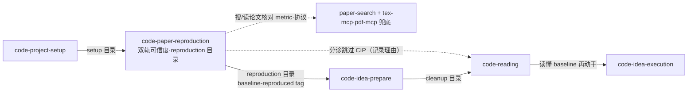
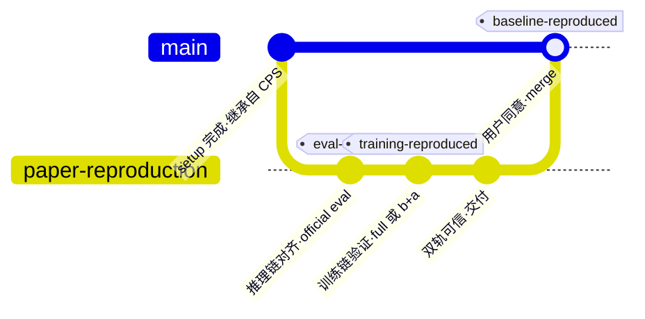
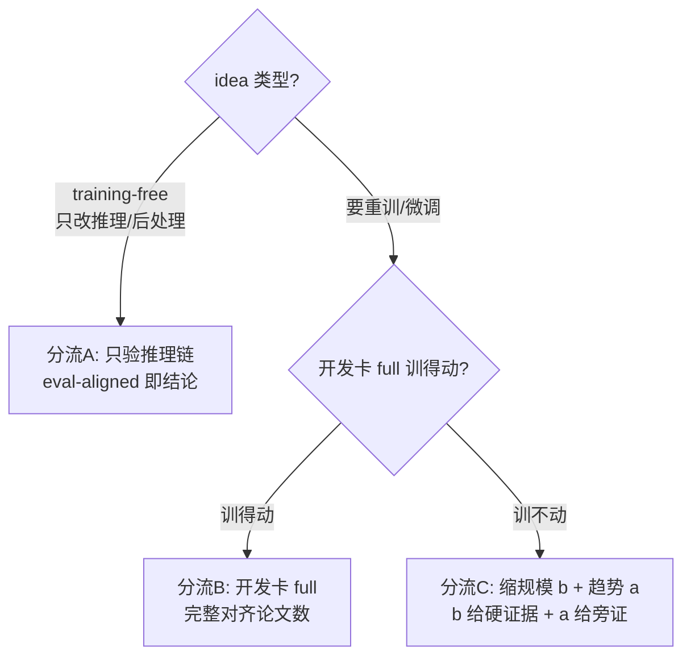
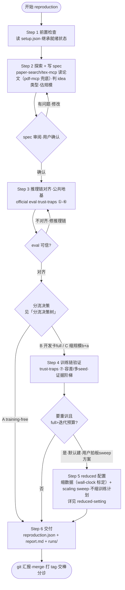

# Code Paper Reproduction

## 这个 skill 解决什么问题

环境中期的第二道坎：环境搭好了（`code-project-setup` 已就绪），但**这个 baseline 的数字可信吗**？不可信的 baseline 是论文炸弹——你在它上面做的所有 delta 都建在流沙上。动自己的 idea 代码之前，要先验证它能不能复现论文报的性能。

两个核心认知，贯穿整个 skill：

**「跑出数」≠「数可信」。** 命令跑通、有 metric 出来只是底线；真正的坑是**那些不像 bug 的错**——同名 metric 不同算法、val/test 混淆、checkpoint 血缘对不上、评测协议差异、跟错论文表格行、或只是 seed 噪声被当真差距。这些不 crash、不报 error，靠盯 traceback 抓不到。排查手册见 `trust-traps.md`。

**可信度是两层，不是一层。** "baseline 可信"的真实用途 = "我能在它上面训出可信的 delta"，而绝大多数 idea 要重训。于是分两层：

- **eval 可信度（推理链）**：official checkpoint eval 对齐论文数。只证**推理链 + 权重 + eval 协议**对——**碰不到训练链**（dataloader 增强、loss 实现、optimizer、分布式 BN 只在训练时跑到）。它是**所有分流的公共地基**，不是 training-free 专属。
- **training 可信度（训练链）**：重训能复现论文数（或合理外推）。**只有这层过了，重训出来的 delta 才有意义**——否则 baseline 都训不到论文的数，你 +1.5 个点是真提升还是把失败 baseline 拉回正常，说不清。

training-free 的 idea 到 eval 可信即可；要重训的（绝大多数）必须到 training 可信。本 skill 据此**分流验证**（见「分流决策树」）。

**repo 角色：对打 baseline vs 实验基座。** baseline-survey 的 clone 卡会标角色（经 setup.json 透传）。前驱改进型 idea 的 repo 是"对打 baseline"——复现目标 = 目标论文的表格行；组合 insight / 分析先行型 idea 的 repo 是"**实验基座**"（没有直接前驱，v1 是在基座上跑假设裁决的分析实验）——此时没有"目标论文"可复现，复现目标改为**基座自报的参考数字**（官方 model zoo / README / 技术报告：哪个模型在哪个 benchmark 上是多少），验的是"**测量仪器可信**"：仪器读数准了，长在它上面的分析实验 delta 才可信。基座模式下分流、容差、noise_floor、reduced 全部照走（"论文数"读作"基座参考数"）。

## 边界：本 skill 做什么、不做什么

**做**：吃 `setup.json`；读论文 + 探索 repo 对齐目标；判 idea 类型 + 训练规模据此分流；用容差 band + 多 seed 判噪声 vs 真差，落双轨可信度；冻结指标契约、测噪声底线、划定 frozen/mutable 组件边界；可选建 reduced 配置；产出 reproduction 目录交下游。

**不做**（交给相邻 skill）：

| 场景 | 用 |
| ---- | -- |
| repo 还跑不起来（环境/依赖/数据/checkpoint 未就绪） | `code-project-setup`（中期·早） |
| 逐段精读源码、讲调用链给人听 | `code-reading`（中期） |
| 理解论文方法本身、不操作代码 | `paper-reading`（前期） |
| 实现 idea、设计实验矩阵、跑消融 | `code-idea-execution`（中期核心） |
| full 规模铺开（多 seed/多数据集/多卡大消融，投稿级） | `code-paper-experiment`（运行服务器，论文实验阶段；`code-paper-release` 只做发行版，不铺实验） |

> **运行位置 + 两台机器分工**：本 skill 在 **GPU 服务器**（开发卡）上跑。**开发卡能 full 训完的规模，full 就是复现的正常一环，不推走**；只有"开发卡 full 训不动"才退「缩规模等价复现 + 大规模趋势外推」，**完整大规模对齐论文数**才是运行服务器（多卡）的事。dev 卡负责"把训练链验到可信"，run 卡负责"把规模铺到论文级"——前者本 skill 做，后者不做。

## 指标契约：本 skill 是冻结点

中期一切实验对比都建在一个**冻结的指标 + 评估协议**上（指标不定死，keep/discard 就是空话）。指标契约按链传递，各环节职责钉死：

| 环节 | 对指标契约的职责 |
| --- | --- |
| `baseline-survey` | **提出**：从论文摘 `paper_metrics`（论文报的主指标 + 目标表格行；基座模式则摘基座自报参考数字：哪个模型 @ 哪个 benchmark = 多少） |
| `code-project-setup` | **传递 + 保证能跑**：`paper_metrics` 原样继承进 `setup.json`，不打开论文、不核对 metric 语义；保证 eval 命令能从头跑到尾 |
| `code-paper-reproduction`（本 skill） | **冻结**：读源码钉死 metric 精确定义 + 评测协议 + official 数 + 复现数 + 容差 band + 噪声底线，落 `reproduction.json` 的 `target` 块——自此这是 ground truth，下游不许改口径 |
| `code-idea-execution` | **消费**：keep/discard 判据；评估协议只读，改协议 = 语义改动即停 |

**冻结即 harness 只读**：`target` 块冻结后，execution 的一切 keep/discard 以它为判据；任何人想动 metric 口径、评测协议、数据 split，都是语义改动即停。

**冻结的同时划定迭代边界**：本 skill 探索 repo 时已摸过 metric 实现、ckpt loading、训练链，顺带在 `reproduction.json` 机读登记两份清单——`frozen_components`（eval 协议 / metric 实现 / 数据 split / official ckpt 血缘：动了就破坏与论文基线的可比性，execution 不可动）和 `mutable_components`（loss / 架构 / 数据增强 / 优化器：method 迭代空间）。execution 的改动落在 mutable 里，可比性才有保障。

> **命名约定**：分钟级的链路冒烟叫 **smoke run**，归 `code-project-setup`；小时级的迭代代理配置叫 **reduced setting**，归本 skill——两个词不混用。

## 在系统里的位置（局部）

本 skill 是 `dl-assistant` 配套 skill 之一，角色是中期的 **baseline 可信度验证关卡**。上游吃 `code-project-setup` 的 setup 目录（硬前置）；核对论文时自己调 `paper-search` + `tex-mcp`/`pdf-mcp` 搜读论文（横切工具；arXiv 论文内容首选 `tex-mcp`，PDF 文件操作仍走 `pdf-mcp`）；下游把 reproduction 目录 + 可信 tag 交给 `code-idea-prepare`（主线默认；交棒前先做分诊，可记录理由跳过，见「下游交接」），经 `code-reading` 最终交给 `code-idea-execution`。



> 整体架构、全局怎么连，看 `dl-assistant` 的「全局 skill 流向图」；本 skill 只画与自己相关的 skill。

## 产出与保存：reproduction 目录

reproduction 的核心产物是一个**目录**，**固定落 `docs/code-paper-reproduction/<repo>-<日期>/`**，不问用户、不接受另行指定：

```
docs/code-paper-reproduction/<repo>-<日期>/
├── spec.md                # 复现规格（确认点 1，用户审过）
├── reproduction.json      # 机读交接区（下游直接消费，单一真相源）
├── report.md              # 人读正文（验证台账·执行中动态更新 + 双轨结论）
├── runs/<run-slug>/       # 各 run 的 run.log / EXIT_CODE / metrics / 训练曲线
│                          # run-slug: eval / dev-full / scaled-b / trend-a / reduced
└── alignment.md           # 论文 vs repo vs setup 对齐核对 + trust-traps 排查底稿
```

- **机读区单一真相源**：`reproduction.json` 是下游入口（inherits / idea_kind / repro_strategy / 双轨判定 / evidence_strength / full_scale_alignment / target（冻结）/ frozen_components / mutable_components / noise_floor / ready_commands / artifacts / baseline_curves / checkpoint / reproduced_baseline_checkpoint / training_chain / determinism / dev_card_footprint / known_pitfalls / blocked / reduced_setting）。人读材料分散在目录其他文件，两者描述同一事实，别打架。
- **大 checkpoint 留服务器原地**、json 记路径，不搬进交付目录。
- **跨机器交接**：产出是跨机器交接物——横切规范见 `dl-assistant` SKILL.md「横切规范」。

模板：`reproduction-spec-template.md` / `reproduction-report-template.md`（含 reproduction.json 字段）。

## 核心纪律

### 两个确认点（spec 审 + reduced 配置拍板，必停）

复现里真正需要人参与的是**动手前对齐**（spec）和**影响实验语义的判断**（语义判断即停）。其余（跑 eval、修推理链工程 bug、多 seed、resume 续跑）是 agent 该自主连跑的工程活。

- **Spec 审阅**：探索完论文 + repo 后，产出 `spec.md` 给用户审——复现目标（表格行 + metric 精确定义 + 期望数 + 容差 band）、idea 类型、分流建议、命令/checkpoint/config、预估时间、风险地雷。**先探索再开口**，不在信息不足时问用户。spec 落盘是"当初决定复现什么、为什么这么分流"的证据。模板见 `reproduction-spec-template.md`。
- **Reduced 配置拍板**：要重训且 full 训练超迭代预算（默认 2-3h、上限 4h）时，**默认建 reduced 配置**（没有它 execution 就没有迭代载体）；agent 提议缩减策略（**只缩数据轴**、档位按 wall-clock 标定 + scaling sweep 布点，训练计划保持原文），用户拍板 sweep 方案才跑（见 Step 5）。

### 报告动态更新（活文档）

`report.md` 在 spec 确认后即建立，**随验证逐节回填**——每个验证节当场写「目的 / 做了什么 / 预期结果 / 实际结果（实测值，不是"通过了"）/ 是否成功」，不留到最后一次性补写。「双轨结论」节在交付时定稿。产物即真相：回忆录式的报告会丢细节、美化失败，恢复续跑时也没法靠它定位断点。模板见 `reproduction-report-template.md`。

### 停顿规则（触发式，全程统一）

- **语义判断即停**（命中即停）：checkpoint `strict` 报 key 不匹配 / 评测协议开不开 / val-test 该用哪个 / 同步 BN-loss 归约-lr 缩放改不改 / 要动已冻结的指标口径 → **停下、汇报为什么 + 建议怎么改、等用户拍板**。
- **死结上报**：反复修不动的工程 bug、大资源消耗显著超 spec 估算 → 停下报告用户，不盲耗。
- **agent 自处理**（不停）：checkpoint key 机械修正、metric 参数核对、论文数值提取、表格行定位、能从源码直接看出来的问题、训练跑挂的工程 bug（路径/兼容/config override）、断了用框架 resume 续跑。

### 复现不是调参

不为追论文数做大规模超参搜索。gap 超 band 时按 `trust-traps.md` 排语义问题，不是靠搜超参把数字"碰"对齐——搜出来的对齐不可复现、也不可信。

### 面向 method 迭代的交付纪律

reproduction 的下游是 method 迭代（execution），交付必须回答 execution 的四个问题：

- **多小的 delta 是噪声？**——分流 B/C 训练侧默认 ≥2-3 个 seed（full 太贵时至少 2 个并写明），把 `noise_floor`（同配置跨 seed std）写成契约字段：execution 的 delta < 2×std 时不可判 keep/discard。reduced 配置同理，用论文已知消融在 reduced 上标定噪声区间。
- **哪里能改、哪里不能动？**——`frozen_components` / `mutable_components` 机读清单（见「指标契约」）。
- **正常训练长什么样？**——baseline 训练曲线（loss / metric / 固定批预测演变）登记进 `baseline_curves`，execution 每版改动对照曲线形状，判"训崩了还是方法不行"。
- **从哪版权重切？**——自己重训出的 baseline ckpt 登记 `reproduced_baseline_checkpoint`（路径 / seed / config），execution 微调从这切，不从 official ckpt 切。

此外，排 trust-traps 时命中的坑（这个 repo 的 metric 有坑、ckpt 是 EMA 之类）写进机读的 `known_pitfalls`，execution 必读。

### 长任务托管 + 恢复续跑

**亮线规则**：预计 >5 分钟 / 会话断开重跑代价高的命令 → 一律 tmux detach（拿不准时长就当长任务），首选封装脚本 `dl-assistant/scripts/run-long.sh`；禁止 `run_in_background`、禁止前台干等。reproduction 的长任务是**大 test set eval / 训练复现（开发卡 full / 缩规模 full / short-schedule）**，常多并行 run。机制见 **`dl-assistant/references/long-run-ops.md`**（tmux detach + sentinel + 只读三连 + 扫产物恢复）。本 skill 的 session 前缀 `repro-<repo>-<run>`、多并行 run 各自独立 session、恢复时扫各 run 的 `run.log`/`EXIT_CODE`/metric + 读 `reproduction.json`。

核心：**恢复靠扫真实产物，不靠状态文件**——重连后扫 `tmux ls | grep repro-`、读各 run 状态、对照 reproduction.json，零额外状态文件。

### git 工作流：paper-reproduction 分支 + 里程碑 tag

所有复现改动在 `code/paper-reproduction` 分支，不动 main。可信度是递进的，每个里程碑打 tag，让 execution 能从对应可信度级别切：



- `eval-aligned`：推理链对齐（official eval 对齐论文数）—— training-free 的 idea 到这就够
- `training-reproduced`：训练链验证通过（full 或缩规模 b+趋势 a）—— 要重训的 idea 需要这层（training-free 跳过）
- `baseline-reproduced`：双轨可信，merge 回 main 后打 —— execution v1 从这切（`git checkout -b idea/v1-<slug> baseline-reproduced`）

> 复现不可信（not_trustworthy）则不打 tag、不 merge —— 回去修。图里分支名简称 `paper-reproduction`（实际 `code/paper-reproduction`）。

## 上游接缝：setup.json 字段用法

启动先读 setup 目录的 `setup.json`——没有就退出建议先 `code-project-setup`；目标资源 `blocked-by-*` 则向用户说明 blocker、建议回 setup。继承不重查：

| setup.json 里的 | reproduction 怎么用 |
| --- | --- |
| env / ready_commands / data / checkpoint | 直接继承就绪状态（eval 命令从这拿），不重新搭 |
| `repo_role`（baseline / substrate，survey 经 setup 透传） | substrate = 基座模式：Step 2 复现目标改为基座自报参考数字，不硬找"目标论文表格行" |
| `dev_card_footprint` | 估训练规模（单步耗时 × 论文 iter），据此分流 B/C |
| `reproducibility` 块（seed 位置 / cudnn / worker seed） | 判噪声 vs 真差的基线：determinism 没固定时，band 内 gap 大概率噪声 |
| `paper_metrics`（若有） | Step 2 复现目标的初稿——仍要回论文核对表格行和 setting（防跟错行，trust-traps ⑤ 纪律不变） |

## 分流决策树（核心）

复现策略由 idea 类型 + 训练规模决定。**先做 official checkpoint eval（公共地基）校准推理链标尺**，再按分流验训练链：



| 分流 | 验什么 | training_判定 | 打 tag |
| --- | --- | --- | --- |
| **A training-free** | 公共 eval 即止 | NA | `eval-aligned` → `baseline-reproduced` |
| **B 开发卡 full** | eval 地基 + 开发卡 full 完整对齐 | full_reproduced | 叠加 `training-reproduced` |
| **C 缩规模 b+a** | eval 地基 + 小 setting 对齐(b) + 大规模趋势(a) | b_plus_a_confirmed | 叠加 `training-reproduced` |

> 各分流怎么执行、容差 band / 多 seed 怎么判噪声 vs 真差，见 **`reproduction-strategy.md`**。可信度陷阱排查见 **`trust-traps.md`**（①-⑥ eval 侧 + ⑦ 训练链特有 + 组件级验证手册）。

## 证据阶梯：没法全量跑时

**没法全量跑时，本 skill 交付的不是"论文数对齐"，而是"训练链可信"——这两个要拆开。** 可信度不是二元的，是证据链：沿阶梯逐级降级，**每降一级，在 `reproduction.json` 显式标注证据强度（`evidence_strength`）和下游使用约束**——绝不把"跑不动"模糊成"应该没问题"：

1. **开发卡 full 对齐**（分流 B）——最硬：数值 + 训练链双对齐。
2. **论文自报小 setting + 趋势外推**（分流 C 的 b+a）——b 给硬证据（作者自己验过的缩减，最可信的小 setting），a 给旁证。
3. **组件级证据**（b+a 也够呛时）——不跑完整训练，验训练链语义：overfit 单批 / loss 初值 / input-independent baseline / 进网络前可视化 / 梯度依赖检查，全套见 `trust-traps.md`「组件级验证手册」。组件级全过 = 训练链语义正确，只是数值没验到。
4. **外部旁证**——社区复现报告（repo issue / paperswithcode / 第三方复现）交叉验证；官方若放出多个 checkpoint，其间 variance 可用来定噪声 band。
5. **降级结论 + 风险移交**——落到哪级写哪级：`reproduction.json` 记 `full_scale_alignment: deferred_to_running_server`（数值对齐显式推迟给运行服务器的 `code-paper-experiment`），写清哪些组件验过、哪些没验过；execution 在上面的 delta 带着这个风险认知，重大结论回 full 验证。

**边界不变**：开发卡负责"把训练链验到可信"（阶梯 1-4 都是手段），运行服务器负责"把数值对齐铺到论文级"。

## 运行流程总览

6 个 Step，每步"目标 + 关键动作 + 何时停"。Step 间不是死板的瀑布——推理链没对齐回去修、训练断了用 resume 续都正常。

**TaskList 跟踪流程**：Step 1 通过后建任务（探索+spec / 推理链对齐 / 训练链验证（按分流）/ reduced 配置（条件触发）/ 交付），每步完成即勾——多步骤 + 长任务托管，防恢复后跳步。



各 Step 的详细执行要点见文末「运行流程详情」。

## references 文件列表

| reference | 讲什么 | 什么时候读 |
| --- | --- | --- |
| `reproduction-spec-template.md` | spec.md 模板（复现规格，确认点 1） | Step 2 写 spec 时 |
| `reproduction-strategy.md` | 三分流执行详述 + 容差/多 seed 判据 | Step 3/4 执行时 |
| `trust-traps.md` | 可信度陷阱 ①-⑦ + 容差 band 表 + 组件级验证手册 | 数字对不上 / 好得可疑 / 训练链排障时 |
| `reduced-setting.md` | reduced 配置设计（缩减策略 + 有效性验证 + 噪声标定） | Step 5 |
| `reproduction-report-template.md` | `reproduction.json` + `report.md` 模板 | Step 6 写交付时（report 建立于 Step 2 后） |
| *（跨 skill 共享）* `dl-assistant/references/long-run-ops.md` | 长任务托管通用机制 | 跑长任务 / 恢复续跑时 |

## 常见错误

- 不要没有 `setup.json` 就开始复现 —— 退出并建议先 `code-project-setup`。
- **不要只做 eval 对齐就宣称 baseline 可信** —— 绝大多数 idea 要重训，eval 只证推理链。
- 不要不分 idea 类型一刀切 —— training-free 走 eval，要重训按规模分流（「分流决策树」）。
- **不要把 official checkpoint eval 当 training-free 专属** —— 它是所有分流的公共地基。
- 不要把大规模 full 一律推给运行卡 —— 开发卡训得动的规模，full 是本 skill 正常一环；只有训不动才退 b+a。
- 不要规模大时只做 a 或只做 b —— b 给硬证据、a 给旁证，两个一起才敢说训练链可信。
- 不要把单 seed 小 gap 当真差 —— 按容差/多 seed 判据（`reproduction-strategy.md`），band 内倾向噪声。
- 不要训练侧只跑单 seed 就交付 —— `noise_floor` 是契约字段，分流 B/C 默认 ≥2-3 seed（full 太贵时至少 2 个并写明）。
- 不要把开发卡训不动当成"算了" —— 沿「证据阶梯」降级并显式标注证据强度，数值对齐显式 deferred 给运行服务器，不模糊带过。
- 不要为追论文数做大规模超参搜索 —— 复现不是调参。
- **不要在 reproduction 阶段做 idea 实验** —— reduced 只验有效性（跑 baseline），不试 idea。
- 不要为压迭代预算压缩训练计划 —— 停在未收敛点会系统性误杀"学得慢但终点高"的改动；预算靠缩数据凑（`reduced-setting.md`）。
- 不要拿模型容量当缩减手段 —— 换小模型会让对标的 baseline 直接不成立（官方 config / 权重 / 论文数字全对不上，强跑 = 改 baseline 语义）；reduced 只缩数据轴，档位按 wall-clock 标定。
- 不要 reduced 只跑单点就交付 —— 沿数据轴做 scaling sweep（从最小到 ≤4h 的可接受规模，少数拍板到 12h），小点拟合、外推预测留验点、实跑命中才算 scaling 成立；单点的 reduced 外推性是信仰不是证据。
- 不要在基座模式下硬找"目标论文表格行" —— 基座（`repo_role: substrate`）的对齐目标是它自报的参考数字（仪器标定），分析先行的 idea 不需要复现别人的 SOTA 行当标尺。
- 不要动已冻结的指标口径 / 评测协议 —— `target` 冻结后改协议 = 语义改动即停。
- 不要把 smoke run 和 reduced setting 混为一谈 —— 前者是 setup 的分钟级链路冒烟，后者是本 skill 的小时级迭代代理。
- 不要最后一次性补写 report.md —— 验证台账随执行逐节回填（实际结果写实测值 + 成败），回忆录式报告丢真相。
- 不要用 `run_in_background` 跑长 eval/训练 —— 会话退即被杀，走 tmux detach（见 `dl-assistant/references/long-run-ops.md`）。
- 不要在会话里用 `$...$` LaTeX——会话符号用 Unicode（横切规范见 `dl-assistant` SKILL.md「横切规范」）。

## 运行流程详情（Step 1 - Step 6）

### Step 1 前置检查

- **目标**：确认能开始复现。
- **关键动作**：按「上游接缝」读 `setup.json` 机读区（继承 env/数据/ckpt/命令就绪状态 + `dev_card_footprint` + `reproducibility` 块 + `paper_metrics` 初稿）；保护工作区（git status / 分支，建 `code/paper-reproduction` 分支，不在 main 改代码）；测网络（和 setup 不一致告知用户，策略见 `dl-assistant/references/network-mirror.md`）。
- **何时停**：没 `setup.json` → 退出建议先 `code-project-setup`；目标资源 `blocked-by-*` → 说明 blocker 建议回 setup。

### Step 2 探索 + 写 spec（用户确认）

- **目标**：搞清复现什么、走哪条分流，落 spec 给用户审。
- **关键动作**：用 `paper-search` + `tex-mcp` 读论文（`tex_open` 打开固定版本，源码不可用或已有本地 PDF 时降级 `pdf-mcp`；任务/数据集/metric **精确定义**/目标表格行/训练细节/有无小 setting）——`setup.json` 若带 `paper_metrics` 则以它为复现目标初稿（仍要回论文核对表格行和 setting，防跟错行，trust-traps ⑤ 纪律不变；**基座模式**（`repo_role: substrate`）没有目标论文可核对，改核基座自报参考数字的出处与口径——README / model zoo / 技术报告里哪个模型 @ 哪个 benchmark = 多少）；探索 repo（metric 实现、ckpt loading、训练链）；判 idea 类型（training-free / 要重训，拿不准问一句）；估训练规模（`dev_card_footprint` 单步耗时 × 论文 iter）；写 `spec.md`（模板见 `reproduction-spec-template.md`）。
- **何时停**：写完 spec → 停下给用户审，确认才进 Step 3。**先探索再开口**，不在信息不足时问用户。spec 确认后建立 `report.md` 骨架（活文档，此后逐节回填）。

### Step 3 推理链对齐（公共地基，所有分流都做）

- **目标**：用 official checkpoint eval 校准推理链标尺。
- **关键动作**：跑 official eval（命令从 `setup.json` 的 ready_commands 拿）；对齐论文数；不对齐按 `trust-traps.md` ①-⑥ 排（**metric 定义是头号坑，必须读源码**，README/config 名不可信）；追到源码把问题查实，修复后重跑；落 `eval_判定`，回填 report.md 推理链一节。详见 `reproduction-strategy.md`「公共地基」。
- 对齐了 → 推理链对，要重训时 gap 干净归因训练链；不对齐 → 推理链本身坏了，先修再往下（否则训练数字没有可信标尺）。
- 何时停见「核心纪律 · 停顿规则」。

### Step 4 训练链验证（按分流，training-free 跳过）

- **目标**：验训练链能否复现（分流 B/C），并测出噪声底线。
- **关键动作**：按分流执行（B 开发卡 full 完整对齐 / C 缩规模 b 硬证据 + 趋势 a 旁证），查 `trust-traps.md` ⑦ 训练链特有伪对齐（BN / loss 归约 / 等效 batch / lr 缩放 / 增强 / warmup-EMA），用容差 band + 多 seed 判噪声 vs 真差（详见 `reproduction-strategy.md`）；训练侧默认 ≥2-3 seed 落 `noise_floor`；full 训不动时沿「证据阶梯」降级，组件级验证用 `trust-traps.md`「组件级验证手册」，每降一级写明证据强度。落 `training_判定` + `trustworthy_for_delta`，回填 report.md 训练链一节。
- 推理链已校准，训练 gap 优先查训练链 ⑦；**不为追论文数做大规模超参搜索——复现不是调参**。
- 何时停见「核心纪律 · 停顿规则」。

### Step 5 reduced 配置（默认必做：要重训且 full 超迭代预算；sweep 方案用户拍板）

- **目标**：给 execution 交付"一个工作点 + 一条 scaling 验证链"——单轮 ≤ 迭代预算（默认 2-3h、上限 4h）的快速迭代代理，且 reduced→full 的外推性经过实测验证。没有它，execution 就没有迭代载体。
- **关键动作**：实测吞吐（跑一小段训练、等吞吐稳定后测，换算各数据比例的单轮用时）→ 按 wall-clock 提议 scaling sweep 布点（**只缩数据轴**——模型容量不许动，动容量 = 改 baseline 语义；**训练计划保持原文**——压缩 epoch 会停在未收敛点，系统性误杀"学得慢但终点高"的改动；不降分辨率、不减 batch；iteration 锚定项换算 epoch 等效位置；最大点 ≤4h，少数情况拍板到 12h；详见 `reduced-setting.md`）→ 用户拍板 sweep 方案 → 跑各点 baseline → 小点拟合幂律、**外推预测一个没训过的更大规模留验点、实跑验证**（命中 = scaling 成立；不命中显式降级 `degraded`）→ 趋势保真对照（三选一 + 兜底：baseline 自身对照 / 已知消融对照 / 简单 idea 试探 / 弱证据兜底）+ 标定 reduced 噪声区间 → 工作点 = ≤ 迭代预算的最大已验证点 → 写入 `reproduction.json` 的 `reduced_setting`（含 `scale_sweep`）。
- **分流 C 的接力**：复现走了分流 C 时，(b) 的小 setting 若只缩了数据（模型与 full 一致），它就是 sweep 的现成已验证点——往往只需补齐中间点 + 留验点 + 噪声标定；若 (b) 用了论文自报的小模型 setting（容量变了），不能进 sweep，只当 scaling 旁证写进报告。
- **豁免**：training-free / full 本就在预算内 / RL、对抗训练等缩减后趋势失真的任务——豁免时显式告知用户迭代节奏后果，由用户决定迭代方式，不静默降级。
- reduced 是加速层非替代，只验有效性（跑 baseline）不试 idea；有希望的方向最终回 full。

### Step 6 产出交付

- **目标**：整理交付目录，定稿交棒。
- **关键动作**：report.md 已随执行动态成型，本步收尾定稿——「双轨结论」节定稿、`reproduction.json` 全字段填齐（值要真：验证过才填，查不到标 unknown，不编数字；`target` 块标 `frozen: true`）、按「产出与保存」目录树核对产物齐、打 tag + merge（见 git 工作流）、向用户总结（走了哪分流、双轨可信度、证据强度、能否放心重训）。
- 大 checkpoint 留服务器原地、json 记路径，不搬进交付目录。
- 交棒分诊与交接内容见下。

### 下游交接（Step 6 的一部分）

#### 交棒前分诊：要不要过 code-idea-prepare

**主线默认是先过 `code-idea-prepare`（清理 + 质量优化）再进 execution**——但 CIP 有固定成本（全量清理 + 严格相等验证），不是每个 baseline 都值回票价。交棒时花几分钟分诊：

- **建议过 CIP**：repo 大（上万行 / 多入口）或 ablation、调试残留多；idea 要动的范围横穿多个模块；预期 execution⇄iterate 迭代版本多（脏乱会逐版复利）。
- **可跳过**：repo 小而干净、入口链清晰；本次 idea 是局部改动（动的模块少且明确）。跳过时在交接说明里**记录理由**，下游从 `baseline-reproduced` 直接切。

#### 交棒内容

- **主线（过 CIP）**：明确提醒把 **reproduction 目录路径**给 `code-idea-prepare`——它用 `reproduction.json` 的 ready_commands 跑 coverage、拿双轨数字当严格相等的基准。
- **跳过 CIP**：明确提醒把 **reproduction 目录路径**给 `code-reading`（中期主线必经，读懂 baseline 再动手）——之后 `code-idea-execution` 读 `reproduction.json` 机读区就继承双轨可信度、可信 baseline、命令/数字/容差/噪声底线/frozen|mutable 边界/曲线参照/ckpt 血缘/训练链设置，v1 从 `baseline-reproduced` tag 切分支。
