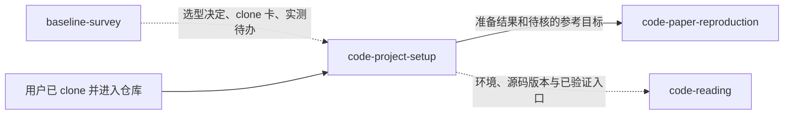
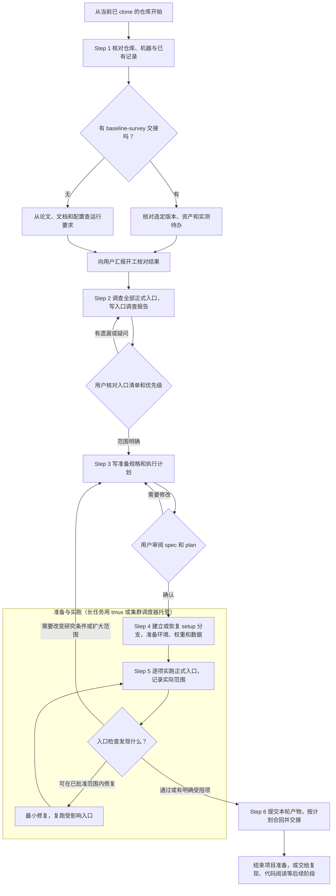

# 研究代码仓库准备与入口验证

按本轮研究或复现需要，在目标机器上准备已选定的代码、模型与数据，并逐项验证所需操作。交付时说明每项操作在什么条件下实际验证到了哪里、还有哪些问题，以及下游可以从哪一步接着做。

从用户已 clone 并进入的仓库开始。已有选型交接时核对选定版本、组件、资产和首批实测待办。直接试跑论文代码时，根据仓库、论文和发布资料确定运行要求，两种入口共用后续流程。

## SKILL 交接关系



用户只想试跑论文代码时，准备和验证完成后可直接交付。需要核对参考性能或建立研究基线时，把准备结果交给 `code-paper-reproduction`。整体关系见 [dl-assistant](../dl-assistant/SKILL.md)。

## 产出与保存

默认保存到当前项目的 `docs/code-project-setup/<repo>-<日期>/`。用户指定位置时用该位置。续做时复用已核实的原目录，新任务遇到同名目录时另取路径。

| 产物 | 记录内容 |
| --- | --- |
| [入口调查报告](references/entrypoint-report-template.md) `entrypoint-report.md` | 开工前给用户看。记录查过的范围、全部正式入口、候选命令、所需资产、最小检查和建议优先级 |
| [准备规格](references/setup-spec-template.md) `setup-spec.md` | 准备目标、必须保持的条件、环境与资产决策、各项验证的通过标准 |
| [执行计划](references/setup-plan-template.md) `setup-plan.md` | 分项任务、依赖、执行和验证方法、资源与长任务启动方式 |
| [准备报告与机读交接](references/setup-report-template.md) `setup-report.md`、`setup.json` | 实际运行范围、工作目录、版本、环境、日志、修复与待办。逐项回填，按入口编号关联调查报告 |
| 补充材料 | 可复跑的检查脚本与环境导出。按需保存[数据集速览](references/dataset-report-template.md)、样本和日志 |

保留当前下游读取的 `ready_commands`、环境、数据、权重和参考指标等交接字段。`ready_commands` 只登记实际跑过的命令及其已证实范围。组合选型和无法用现有字段完整表达的验证条件，在报告里逐项交代。

## 运行流程图



## 参考资料列表

| 参考资料 | 什么时候读 |
| --- | --- |
| [运行手册](references/workflow.md) | 开始或续做时先读。六步的具体命令、检查、异常处理与落盘位置在这里 |
| [正式入口调查指引](references/entrypoint-discovery.md) | 查找正式入口、追踪实际调用路径、判断清单能否交审时 |
| [入口调查报告模板](references/entrypoint-report-template.md) | 整理入口清单、调查缺口和建议顺序时 |
| [准备规格与执行计划编写指引](references/setup-spec-and-plan.md) | 从已审阅的入口清单确定四项交付、逐入口验收和任务依赖时 |
| [准备规格模板](references/setup-spec-template.md)、[执行计划模板](references/setup-plan-template.md) | 准备动手前写两份审阅材料时 |
| [编译型依赖](references/compile-deps.md)、[数据与权重准备](references/dataset-prep.md) | 选择环境、排查编译问题、下载或校验资产时 |
| [数值与行为检查](references/numeric-sanity.md) | 选择环境、组件与真实入口检查时。每项判据根据实际操作和依据确定 |
| [准备报告与机读交接](references/setup-report-template.md)、[数据集速览](references/dataset-report-template.md) | 执行中记录结果和准备交接时 |
| [网络与镜像](../dl-assistant/references/network-mirror.md)、[长任务托管与恢复](../dl-assistant/references/long-run-ops.md) | 核对下载方式、启动或恢复长任务时 |

阶段顺序和确认点以本页与运行手册为准。现有参考文件中的任务编号用于定位原有内容，按当前入口清单确定实际任务。

## 执行原则

### 1. 先确认入口清单，再审准备方案

盘点训练、推理、评测、预处理和正式实验入口。同一脚本内路径不同的模式分别记录。先和用户核对清单与优先级，再提交 spec 和 plan，两份文件可一次确认。按获准的版本与范围开始执行。选型报告保留全部已选组件、条件和首批实测分工。正式研究对照按研究计划交给相应阶段。

### 2. 环境、权重和数据准备后，按操作选检查

准备各入口需要使用的环境和资产，核对完整性与真实读取。按需验证环境与配置、实际组件行为、真实输入与入口。每项检查说明预期行为和依据，记录实际观察与适用范围。评测结果可以为复现提供线索，参考结果和容差由 `code-paper-reproduction` 按相应协议核验。资产、权限或资源缺失时记录已尝试的方法、受影响的入口与续做条件。

### 3. 在 setup 分支提交，按已确认的计划合回

默认用本地 `code/project-setup` 分支。先核对用户现有改动和续做记录。按批准方案做最小工程修复，记录触发条件与 diff，复跑受影响入口。可能改变数据、权重加载、训练、测量或评测含义时，先解释变化和验证方法，再请用户确认。影响后续维护的其他问题留证，交给复现、代码准备或实验执行阶段处理。

收尾时在 setup 分支提交本轮修复和可交接的文本产物，包括调查、计划、报告、配置、脚本和复跑所需的轻量证据。即使源码无需修改，也要提交这些产物。计划获准合回时，执行并核验本地合并。具体检查见[运行手册 Step 6](references/workflow.md#step-6-提交本轮产物按计划合回并交接)。

### 4. 长任务在目标机器上托管

预计超过 5 分钟、耗时不确定或中断后重跑代价高的命令，在实际执行机器上用 tmux 分离会话托管，集群任务使用调度器。计划中写明工作目录、环境、会话名、日志目录和实际命令。启动后立即核对会话与日志，恢复时先查已有任务。

```bash
bash "$run_long" "$session" "$log_dir" "$run_command"
```

`run_long` 指向 [run-long.sh](../dl-assistant/scripts/run-long.sh)。完整启停与核查命令见[运行手册](references/workflow.md#长任务启动与恢复)。本轮需要准备实验记录时，按 [W&B 使用说明](../wandb/SKILL.md)复用项目集成。
