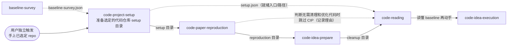
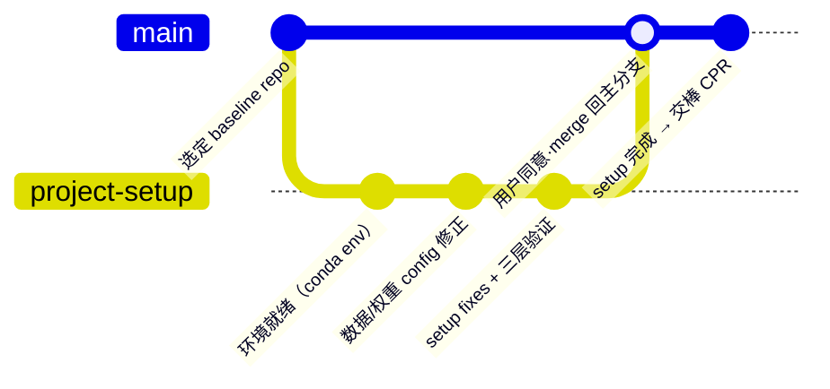
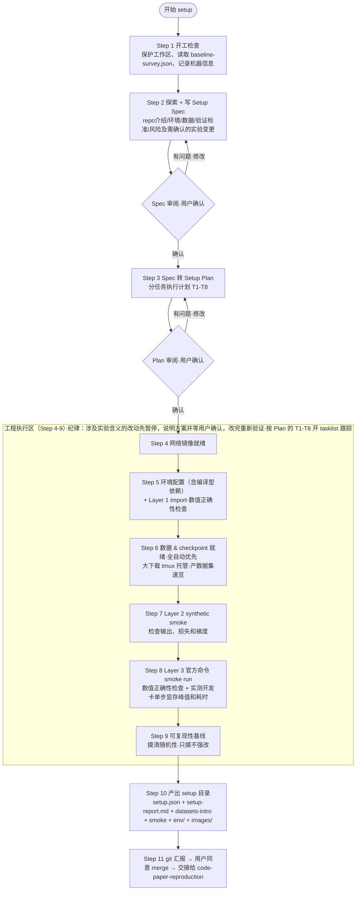

# Code Project Setup

## 这个 skill 解决什么问题

开始修改研究代码前，先确认选定仓库可以正常运行。准备时要处理依赖无法安装、缺少数据或权重、官方命令执行失败，以及命令执行后输出仍含 NaN 等问题。

本 skill 负责准备仓库，并在 `setup.json` 中记录可供 `code-paper-reproduction`、`code-reading` 和 `code-idea-execution` 使用的配置、路径和已验证命令。源码讲解和论文性能复现由对应技能负责。任何可能影响实验含义的变更都须先暂停，请用户确认。

> **命令执行成功后，还要检查输出和权重。** 检查输出是否含 NaN 或全零、损失量级是否合理，以及预期的权重是否实际加载。即使命令未报错，`strict=False` 仍可能允许预期的权重键缺失，设备映射或预处理也可能不正确。

## 边界：本 skill 做什么、不做什么

**做**：
- 从上游 `baseline-survey` 报告（`baseline-survey.json`）读取主要调用关系、依赖信息和关键风险，使用已有核查结果。
- spec → plan 两阶段动手前对齐，用户审过才执行
- 环境配置（含编译型依赖处置，conda 或官方 docker）、网络镜像策略、数据 & checkpoint 就绪
- 三层验证依次进行。先检查 import，再用合成输入调用实际组件（synthetic smoke），最后用官方命令做分钟级试运行（smoke run）。每层都检查数值正确性
- 记录仓库中的随机性来源（可复现性基线）、实测开发卡单步显存峰值和耗时
- 产出 setup 目录（spec + plan + 机读交接 + 人读报告 + 数据集速览 + smoke 脚本 + 环境导出），交给下游

**不做**（交给相邻 skill）：

| 场景 | 用 |
| ---- | -- |
| 选哪个 baseline repo / 权重 / 数据集 | `baseline-survey`（前期，本地跑） |
| 逐段精读源码、讲调用链给人听 | `code-reading`（中期） |
| 验证这个 baseline 能否复现论文报的性能 | `code-paper-reproduction`（中期） |
| 实现 idea、设计实验矩阵、跑消融 | `code-idea-execution`（中期核心） |
| 多机 / 多卡跑消融种子（full 规模铺开实验） | `code-paper-experiment`（运行服务器，论文实验阶段；`code-paper-release` 只做开源发行版，不铺实验） |

> **运行位置**：本 skill 在 **GPU 服务器**（开发卡，通常单卡）上跑。资源实测的基准是"这张开发卡够不够支撑 execution 迭代开发"，**不是**"复现得起原文的多卡规模"——后者（多卡跑 full 规模消融 / 种子）是运行服务器上的事，归 `code-paper-experiment`（论文实验阶段）。

## 指标契约与评测分工

中期实验按同一项指标定义和评估协议比较。各阶段按下表记录、核对和使用这些信息。

| 环节 | 对指标契约的职责 |
| --- | --- |
| `baseline-survey` | **提出**：从论文摘 `paper_metrics`（论文报的主指标 + 目标表格行） |
| `code-project-setup`（本 skill） | 将 `paper_metrics` 原样写入 `setup.json`。验证 eval 命令能执行完毕，且输出通过基本数值检查。本阶段不打开论文核对指标含义。 |
| `code-paper-reproduction` | 阅读源码，确定指标的精确定义、评测协议、官方报告值、复现结果和容差范围，并将其固定为下游比较的依据。 |
| `code-idea-execution` | 按固定的评估协议判断结果应保留还是放弃。需要改协议时暂停，请用户确认。 |

Setup 阶段用短时试运行确认评测命令可以跑完，权重实际加载，指标非零且已排除异常满分。到 `code-paper-reproduction` 阶段才打开论文核对指标含义，并与相应的参考结果比较。

> **命名约定**。**synthetic smoke** 用合成输入调用仓库的实际组件做最小测试。**smoke run** 用官方命令做分钟级试运行。**reduced setting** 由 `code-paper-reproduction` 定义，用小时级的较小实验为后续迭代提供参考。

## 在系统里的位置（局部）

本 skill 在 GPU 服务器上准备选定的仓库。可以接着 `baseline-survey` 的选型报告运行，也可独立启动。setup 目录交给 `code-paper-reproduction` 做复现验证，`code-reading` 可直接从 `setup.json` 读取已验证的运行命令。



> 整体架构、全局怎么连，看 `dl-assistant` 的「全局 skill 流向图」；本 skill 的局部图画全与自己相关的交接。

## 产出与保存：setup 目录

setup 的核心产物是一个**目录**（和前期 skill 的目录产出一致），**固定落 `docs/code-project-setup/<repo>-<日期>/`**，不问用户、不接受另行指定：

```
docs/code-project-setup/<repo>-<日期>/
├── setup-spec.md              # 准备规格（确认点 1）
├── setup-plan.md              # 分任务执行计划（确认点 2）
├── setup.json                 # 下游技能统一读取的配置、路径与命令
├── setup-report.md            # 人读正文（任务执行记录·执行中动态更新 + 就绪结论）
├── <repo>-datasets-intro.md   # 数据集速览（是什么 + 真实样本）
├── smoke.py                   # Layer 2 smoke script（多个脚本用 smoke/ 目录）
├── env/                       # 环境导出五件套
│   ├── environment.yml / requirements.txt / uv.lock / poetry.lock / pyproject.toml
└── images/                    # 数据集样本图（datasets-intro 相对路径引用）
```

- **下游统一从 setup.json 读取配置**：`setup.json` 是下游 agent 的入口（conda_env / ready_commands / data / checkpoint / blocked / dev_card_footprint / reproducibility / paper_metrics / repo_role / dataset_report / env_export / smoke），人读材料分散在目录其他文件。`setup.json` 与 `setup-report.md` 中的信息应保持一致。
- **跨机器交接**：产出是跨机器交接物（本地读 setup-report.md / datasets-intro、服务器上跑）——共用规则见 `dl-assistant` SKILL.md「所有技能共用的规则」。

模板：`setup-spec-template.md` / `setup-plan-template.md` / `setup-report-template.md`（含 setup.json 字段）/ `dataset-report-template.md`。

## 核心纪律

### 两个确认点（spec 审 + plan 审，必停）

setup 里真正需要人参与的是**动手前对齐**（spec / plan）和**影响实验语义的改动**（语义改动即停）。其余（装环境、跑 smoke、数据就绪、修路径）是 agent 该自主连跑的工程活。

- **Spec 审阅**：读完 baseline-survey + 扫完 repo 后，产出 `setup-spec.md` 给人 review——repo 介绍、环境决策（含资源判断）、数据 & 权重清单、验证标准、已知问题、待验证风险和需确认的实验变更。这是"动手前对齐方案"，有问题改到确认。
- **Plan 审阅**：spec 确认后，转成 `setup-plan.md`（分任务执行计划 T1-T8）给人 review。有问题改到确认，才进工程执行区。

> spec 定 what / why（做什么、为什么、风险、标准），plan 定 how（分任务执行）。两阶段都过用户，比单 plan 把"对齐"和"分解"混在一起清晰。模板见 `setup-spec-template.md` / `setup-plan-template.md`。

**全程用户在场**：agent 连跑工程活，只在两个确认点 + 语义改动时停；长任务（大下载 / 偏长 smoke run）托管期间用户可离开，那本质是"等命令跑完"，不需要 agent 替你做决策。

### 任务完成后更新报告

产物即真相。工程任务每完成一项，立即更新 `setup-report.md`，记录实际测得的值和任务是否成功，便于中断后从已有结果继续。「就绪结论」在 T7 定稿。模板见 `setup-report-template.md`。

### 语义改动即停（触发式，贯穿工程执行区）

不在流程固定位置。一旦要做下面这些"可能影响实验语义"的改动，**立刻停下、汇报为什么要改 + 建议怎么改、等用户确认**：
- checkpoint `strict=False` 或 key remapping
- dataset annotation 转换、label map 修正
- metric 调用参数变化
- 修改默认 config 中与实验结果相关的值

用户有疑问时继续解释。用户同意后，按确认的方案修改，再重新运行受影响的验证层。

### 长任务托管 + 恢复续跑

预计超过 5 分钟、耗时不确定，或会话断开后重跑代价高的命令，一律在 tmux 的分离会话中执行。首选 `dl-assistant/scripts/run-long.sh`，禁止用 `run_in_background` 或在前台等待。常见情况是大量数据和权重下载或耗时较长的 smoke run，session 前缀为 `setup-dl-<slug>`。通过会话状态、日志和退出码查看进度。具体做法见 `dl-assistant/references/long-run-ops.md`。

重连后检查 conda 环境、数据目录和 checkpoint 是否已经准备好，再读 `setup.json` 确认上次记录到哪一步，据此继续。不额外建立状态文件。

### git 工作流：code/project-setup 分支

所有 setup fix 在 **`code/project-setup` 分支**上进行，不动主分支。完成后**向用户汇报做了哪些修复**，用户同意才 merge 回主分支；有疑问就停在分支继续修 / 解释，不 merge。这样下游 `code-paper-reproduction` / `code-idea-execution` 拿到的是干净可回溯的 setup 完成态。



> 图里分支名简称 `project-setup`（gitGraph 分支名带 `/` 易渲染出问题，实际分支名 `code/project-setup`）。条件循环不在图里画（gitgraph 是确定拓扑）：汇报后用户有疑问 → 停在分支继续 commit 修订、不 merge，直到同意才 merge。

## 从选型报告读取已有信息：baseline-survey.json 字段用法

启动时在固定目录 `docs/baseline-survey/` 查找 `baseline-survey.json`。有多个候选报告且无法确定用哪一份，或找不到报告时，向用户确认。跨机器交接规则见 `dl-assistant` SKILL.md「所有技能共用的规则」。通过用户指认或 `decision.repo` 确定仓库，再从对应的 `candidate` 读取下表所列字段。已有字段直接沿用，后续用服务器实测核对。

| survey 里的 | setup 怎么用 |
| --- | --- |
| 主要调用关系（训练链 / eval 链 / 数据链，`文件:函数`级） | 用来确定 Layer 2/3 验证应调用的入口 |
| 环境依赖分析（含不常见库 / 可能遇到的编译问题） | 写入 Spec「环境决策」，优先检查已知的环境问题 |
| 关键风险（权重链接失效、数据与论文不一致、多条社区复现失败记录） | 进 Spec「已知问题和待验证风险」，在 setup 阶段重点核验 |
| 候选是现成实现还是论文所基于的仓库，以及预计改造成本 | 了解接手需要多少改动、是否要从论文所基于的仓库开始修改 |
| 论文报告主指标（`paper_metrics`） | 原样写入 `setup.json`，供后续复现阶段核对验收基准。 |
| 仓库用途（`decision.repo_role`，用于比较的基线代码或用于分析实验的代码仓库） | 原样写入 `setup.json`。由 `code-paper-reproduction` 据此选择复现目标，即论文表格中的对应结果或仓库维护者报告的参考结果。 |

> survey 是**远程读文件的预判**，setup 是**真实机器的实测**——继承不等于照单全收。survey 说"权重直链可下"，setup 要真下下来验加载；survey 预判"mmcv 可能编译难"，setup 真去编译验证。**冲突时以 setup 实测为准**，并在 report 记一笔"survey 预判 X，实测为 Y"。

**没有 survey 报告也能独立跑**：退回从零探索（README → docs → scripts → configs → 依赖文件 → source imports → paper / 项目页），整理运行入口、已知问题和待验证风险。软依赖，不强制。

## 运行流程总览



进工程执行区后，agent 按 Plan 的 T1-T8 **开 tasklist 逐项跟踪**。普通工程活（pip / conda 装包、import 报错、config 路径、symlink、device map、batch / num_workers 调参、wrapper 命令修正）agent 自己 debug，**只有多次处理后仍无法解决的问题才上报**。

各 Step 的详细执行要点见文末「运行流程详情」。

## references 文件列表

| reference | 讲什么 | 什么时候读 |
| --- | --- | --- |
| `setup-spec-template.md` | setup-spec.md 模板（动手前对齐方案） | 写 spec 时 |
| `setup-plan-template.md` | setup-plan.md 模板（分任务执行计划） | spec 转 plan 时 |
| `dataset-prep.md` | 数据集就绪 8 类常见问题 + 自动化处置 + 样本挑取 | 数据就绪时 |
| `dataset-report-template.md` | 数据集速览模板（`<repo>-datasets-intro.md`） | 写数据集速览时 |
| `compile-deps.md` | 编译型依赖版本对齐 + 替代方案及处理顺序 | 遇编译型依赖时 |
| `numeric-sanity.md` | 三层验证的数值正确性检查判据 | 做 Layer 1/2/3 时 |
| `setup-report-template.md` | setup-report.md + setup.json 模板 | 写报告时 |
| *（跨 skill 共享）* `dl-assistant/references/long-run-ops.md` / `network-mirror.md` | 长任务托管 / 网络镜像通用机制 | 跑长任务 / 配网络时 |

## 常见错误

- 不要只装包 / 跑 import 就宣称 done —— 三层验证 + 数值正确性检查才算就绪。
- 命令执行完毕后检查输出是否含 NaN 或全零，并核对预期的权重键是否都已加载。使用 `strict=False` 须按实验变更确认规则处理。
- smoke run 的评测结果用于检查命令执行和基本数值。与论文数字的比较由 `code-paper-reproduction` 完成。
- 区分分钟级的 smoke run 和 `code-paper-reproduction` 为迭代定义的小时级 reduced setting。
- 有 `baseline-survey.json` 时，先读取已有的仓库信息。
- 不要对编译型依赖反复盲试 —— 走 `compile-deps.md` 的版本对齐 + 替代方案及处理顺序。
- 不要在编译型依赖重的 repo 上反复尝试用 conda 安装 —— spec 环境决策先看 repo 有没有官方维护的 docker 镜像。
- 不要擅自 `strict=False` / 改 label map / 改 metric 参数 —— 那是语义改动即停点，停下问用户。
- 不要强制改 deterministic / seed —— 可复现性基线只记录现有设置，不强制修改（强改是实验语义，归 execution）。
- 不要用 `run_in_background` 跑长下载 / 长 run —— 会话退即被杀，走 tmux detach（见 `dl-assistant/references/long-run-ops.md`）。
- 不要在主分支上直接改 setup fix —— 进 `code/project-setup` 分支，汇报同意再 merge。
- 不要在开发卡上去对标 repo 声称的多卡规模 —— setup 实测的是"开发卡够不够迭代"，full 规模是运行服务器的事。
- 中断后核对已有产物和 setup.json，从已确认的进度继续。
- 不要写完 smoke script 就跑完丢弃 —— 落进产出目录，下游复验 / 回归要重用。
- 每完成一项任务就更新 setup-report.md，记录实测值和任务结果，便于中断后继续。
- 不要在会话里用 `$...$` LaTeX——会话符号用 Unicode（共用规则见 `dl-assistant` SKILL.md「所有技能共用的规则」）。

## 运行流程详情（Step 1 - Step 11）

### Step 1 开工检查

- **工作区保护**：`git status --short` / `git branch --show-current`——不在 `main` 上改代码，建 / 切到 `code/project-setup` 分支（见「核心纪律 · git 工作流」）；有用户未提交改动先说明来源、问怎么处理。
- **读取选型报告**。按「从选型报告读取已有信息」在 `docs/baseline-survey/` 查找并读取 `baseline-survey.json`。没有报告时独立调查仓库。
- **机器信息采集**：`conda info --envs` / `python --version` / `nvidia-smi` / `nvcc --version` / `gcc --version`——环境决策和编译型依赖对齐都靠这几个真值。

### Step 2 探索 + 写 Setup Spec（用户确认）

扫 repo（README / docs / scripts / configs / 依赖文件），结合 survey 继承的已知问题和待验证风险清单，产出 `setup-spec.md`：repo 介绍、环境决策（含资源判断、conda vs docker 选择）、数据 & 权重清单、验证标准（"setup 完成"的定义）、已知问题、待验证风险和需确认的实验变更。写完**停下给用户审**，确认才转 Plan。模板见 `setup-spec-template.md`。

### Step 3 Spec 转 Plan（用户确认）

把确认的 spec 分解成 `setup-plan.md`（T1-T8，每个任务一个可验证产出、可追溯到 spec 某一节）。写完**停下给用户审**，确认才进工程执行区。进工程执行区后按 Plan **开 tasklist 逐项跟踪**。模板见 `setup-plan-template.md`。

### Step 4 网络镜像就绪

进环境配置前先明确下载策略，避免后续反复失败。**通用网络策略（探网络 / 配代理 / 镜像 / 直连失败交接）见 `dl-assistant/references/network-mirror.md`**；本 skill 在 setup-report.md 记录本次采用的策略值。

### Step 5 环境配置（含编译型依赖处置）+ Layer 1

基于项目文件 + Step 1 采集的机器信息落实 spec 的环境决策：conda env 名、Python 版本、PyTorch/TF/JAX × CUDA 组合、安装顺序、是否 editable install；或按 spec 决定走 repo 官方 docker。

> **编译型依赖常会阻塞安装**，例如 mmcv-full、detectron2、flash-attn、apex、deformable attention 和自定义 CUDA 算子。安装时需要核对 `torch × CUDA × gcc × nvcc` 的兼容性。版本表、安装方法、诊断顺序和改用预编译 wheel、较旧版本或官方 docker 的条件见 `compile-deps.md`。

装完做 **Layer 1 import 验证**：framework + 项目 package + config 系统加载；**数值正确性检查（轻）**——确认没有 CUDA 版本不匹配的情况（`torch.cuda.is_available()` 为真、算子编译版本和运行 CUDA 对得上）。判据见 `numeric-sanity.md`。

### Step 6 数据 & checkpoint 就绪（全自动优先）+ 产数据集速览

**基调：自动化优先**——agent 自己查版本对齐、配代理、下、转格式、改硬编码路径、构建测试子集、验证 loader，**只在必须人工时停**（Kaggle / 网盘账号、license 需点击同意条款、内网、链接失效）。详细常见问题及自动处理方法见 **`dataset-prep.md`**（8 类常见问题：格式转换 / repo 预处理脚本 / split / 路径硬编码 / 下载校验 / loader 隐式假设 / 版本一致性 / 测试子集构建方法）。

就绪后**产数据集速览**（`<repo>-datasets-intro.md` + `images/`）：给每个数据集挑 3-5 个真实样本 + 介绍（是什么 / 规模 / 格式 / 版本对齐），解决"不知道这些数据集都是啥"的痛。模板见 `dataset-report-template.md`。

大下载走 tmux detach 托管（**见 `dl-assistant/references/long-run-ops.md`**），不用 `run_in_background`。完成后验证：目录结构存在、loader 能读真实 sample、checkpoint 能 load（这一步触发数值正确性检查：严格加载并核对权重键是否齐全——`strict=False` 是语义改动即停点）。

### Step 7 Layer 2 synthetic smoke

用 agent 写的极小 smoke script 调 repo **真实** model / loss / transform / collate / trainer 组件（允许 fake tensor / dummy batch，但只调真实组件，不伪造数据集、不改算法逻辑）。**数值正确性检查（关键）**：forward 输出不含 NaN 且非全零、形状对、loss 为有限正数且量级合理、backward 梯度非全零。判据见 `numeric-sanity.md`。

**smoke script 落盘**：写好的 smoke script 存进产出目录（`smoke.py`，多个脚本用 `smoke/`），在 setup-report.md 记一笔——下游 reproduction 复验、execution 改代码后回归都能直接重用。

### Step 8 Layer 3 官方命令 smoke run

枚举官方 train / eval / inference / demo / preprocess 命令，逐个判断 ready / blocked / 超出范围。能轻量跑的做 smoke 验证（`--help` / dry-run → tiny subset eval → 1-5 iter train），不能跑的记 blocker。**不自动启动 full training / 多 GPU 长任务**。

- **数值正确性检查（强）**：损失呈下降趋势、eval 指标大于 0 且量级合理。如经确认使用 `strict=False`，记录缺失的权重键。判据见 `numeric-sanity.md`。
- **指标契约职责**。确认 eval 命令能执行完毕，且输出通过基本数值检查。对照论文数字由 reproduction 阶段完成。
- **资源实测**：记录开发卡单步显存峰值和耗时，判断够不够支撑 execution 迭代。

### Step 9 可复现性基线

数据 / 权重就绪后，**记录仓库中的随机性来源**（seed 设了几处、`cudnn.deterministic` / `benchmark`、dataloader shuffle / worker seed），供 code-idea-execution 后续核对实验是否可比。**只记录现有设置，不强制修改**（强制 deterministic 可能改实验语义，归 execution）。结果进 `setup.json` 的 `reproducibility` 块（机读）+ setup-report.md 记一节（人读叙事）。

### Step 10 产出 setup 目录

report 的任务执行记录已随执行动态成型，本步做**收尾定稿**：写「就绪结论」节、`setup.json` 全字段填齐（值要真：验证过才填 ✓，没验证标状态，查不到标 unknown）、按「产出与保存」节的目录树核对产物齐（setup-spec.md / setup-plan.md / setup.json / setup-report.md / `<repo>-datasets-intro.md` / smoke.py / env/ / images/）。机读区和人读正文描述同一事实，改动路径时同步更新两份文件。

### Step 11 git 汇报 → merge → 交接

按「核心纪律 · git 工作流」汇报修复、用户同意后 merge 回主分支。merge 后向用户总结：
- 哪些入口 ready / 哪些资源仍 blocked
- setup 目录保存路径
- 建议下一步：主线是 `code-paper-reproduction`（验证能否复现论文性能）→ 之后 `code-idea-prepare`（根据结果判断是否需要清理或优化代码）→ `code-reading`（读懂源码）→ `code-idea-execution`（实现 idea）

用户接着使用下游技能时，请提供 **setup 目录路径**。下游从 `setup.json` 读取本次配置。Layer 3 已记录短时训练的损失趋势和评测指标量级，随后由 `code-paper-reproduction` 核对参考结果。
