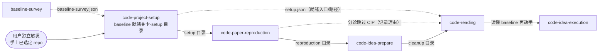
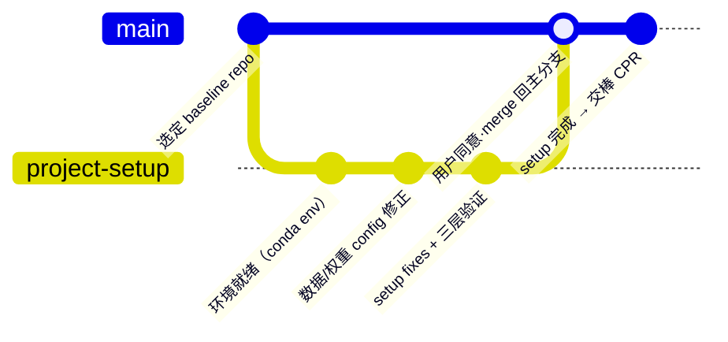
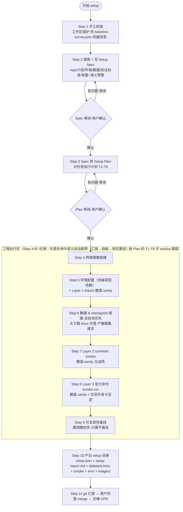

# Code Project Setup

## 这个 skill 解决什么问题

科研项目中期的第一道坎：手上有一个选定的 baseline repo，但它**还跑不了 / 跑不对**。环境装不上（尤其编译型算子）、数据权重没就绪、官方命令跑不通、或者跑通了但输出是 NaN——这些都得在动自己的 idea 代码之前清掉。

本 skill 是 DL 代码工作流的第一层**就绪关卡**：把 repo 准备到下游 `code-paper-reproduction` / `code-reading` / `code-idea-execution` 可直接消费的状态。它**不**逐段讲源码、**不**验证论文性能、**不**碰实验语义——只负责"让这个 baseline 可读、可调、可信地跑起来"。

> **「跑通」≠「跑对」。** 这是本 skill 区别于"装完包就完事"的核心。环境装好、命令不报错只是底线；还要一道**数值 sanity**（输出不是 NaN / 全零、loss 量级合理、权重真加载进去了）才算"可信"。静默错误（`strict=False` 加载了一半 key、device map 错、预处理用错）比报错更危险——它拖到 reproduction 才暴露就晚了。

## 边界：本 skill 做什么、不做什么

**做**：
- 吃上游 `baseline-survey` 报告（`baseline-survey.json`），继承执行链 / 依赖 / 风险，不从零重查
- spec → plan 两阶段动手前对齐，用户审过才执行
- 环境配置（含编译型依赖处置，conda 或官方 docker）、网络镜像策略、数据 & checkpoint 就绪
- 三层验证（import → synthetic smoke → 官方命令 smoke run），每层加数值 sanity
- 摸清 repo 随机性来源（可复现性基线）、实测开发卡资源足迹
- 产出 setup 目录（spec + plan + 机读交接 + 人读报告 + 数据集速览 + smoke 脚本 + 环境导出），交给下游

**不做**（交给相邻 skill）：

| 场景 | 用 |
| ---- | -- |
| 选哪个 baseline repo / 权重 / 数据集 | `baseline-survey`（前期，本地跑） |
| 逐段精读源码、讲调用链给人听 | `code-reading`（中期） |
| 验证这个 baseline 能否复现论文报的性能 | `code-paper-reproduction`（中期） |
| 实现 idea、设计实验矩阵、跑消融 | `code-idea-execution`（中期核心） |
| 多机 / 多卡跑消融种子（full 规模铺开实验） | `code-paper-experiment`（运行服务器，论文实验阶段；`code-paper-release` 只做开源发行版，不铺实验） |

> **运行位置**：本 skill 在 **GPU 服务器**（开发卡，通常单卡）上跑。资源实测的基准是"这张开发卡够不够支撑 execution 迭代开发"，**不是**"复现得起原文的多卡规模"——后者（多卡跑 full 规模消融 / 种子）是运行服务器上的事，归 `code-paper-experiment`（论文实验阶段）。

## 指标契约：本 skill 在指标链上的位置

中期一切实验对比都建在一个**冻结的指标 + 评估协议**上（指标不定死，keep/discard 就是空话）。指标契约按链传递，各环节职责钉死：

| 环节 | 对指标契约的职责 |
| --- | --- |
| `baseline-survey` | **提出**：从论文摘 `paper_metrics`（论文报的主指标 + 目标表格行） |
| `code-project-setup`（本 skill） | **传递 + 保证能跑**：`paper_metrics` 原样继承进 `setup.json`，**不打开论文、不核对 metric 语义**；同时保证 eval 命令能从头跑到尾、出的数机械上合理——中期一切比较都建在这条命令能跑上 |
| `code-paper-reproduction` | **冻结**：读源码钉死 metric 精确定义 + 评测协议 + official 数 + 复现数 + 容差 band——自此这是 ground truth，下游不许改口径 |
| `code-idea-execution` | **消费**：keep/discard 判据；评估协议只读，改协议 = 语义改动即停 |

**与 code-paper-reproduction 的一句话边界**：CPS 回答"每条链能不能产出机械上合理的结果"，CPR 回答"这些结果能不能当科学结论的标尺"。CPS 的 eval 是 smoke 性质——评估链能跑完、metric 非 0 非假满分、权重真加载，**不对照论文数字、不查 metric 语义**；对照论文是 CPR 第一次打开论文做的事。

> **命名约定**：分钟级的链路冒烟在本 skill 叫 **smoke run**；小时级的迭代代理配置叫 **reduced setting**，归 `code-paper-reproduction`——两个词不混用。

## 在系统里的位置（局部）

本 skill 是 `dl-assistant` 配套 skill 之一，角色是中期的 **baseline 就绪关卡**——把选定的 baseline repo 在 GPU 服务器上准备到可信可跑，产出 setup 目录。上游吃 `baseline-survey` 的选型报告（`baseline-survey.json`）或用户独立触发；下游主线是 `code-paper-reproduction`（验证能否复现），`code-reading` 也会直接读 `setup.json` 拿就绪入口。



> 整体架构、全局怎么连，看 `dl-assistant` 的「全局 skill 流向图」；本 skill 的局部图画全与自己相关的交接。

## 产出与保存：setup 目录

setup 的核心产物是一个**目录**（和前期 skill 的目录产出一致），**固定落 `docs/code-project-setup/<repo>-<日期>/`**，不问用户、不接受另行指定：

```
docs/code-project-setup/<repo>-<日期>/
├── setup-spec.md              # 准备规格（确认点 1）
├── setup-plan.md              # 分任务执行计划（确认点 2）
├── setup.json                 # 机读交接区（下游 agent 直接消费，单一真相源）
├── setup-report.md            # 人读正文（任务台账·执行中动态更新 + 就绪结论）
├── <repo>-datasets-intro.md   # 数据集速览（是什么 + 真实样本）
├── smoke.py                   # Layer 2 smoke script（多个脚本用 smoke/ 目录）
├── env/                       # 环境导出五件套
│   ├── environment.yml / requirements.txt / uv.lock / poetry.lock / pyproject.toml
└── images/                    # 数据集样本图（datasets-intro 相对路径引用）
```

- **机读区单一真相源**：`setup.json` 是下游 agent 的入口（conda_env / ready_commands / data / checkpoint / blocked / dev_card_footprint / reproducibility / paper_metrics / repo_role / dataset_report / env_export / smoke），人读材料分散在目录其他文件。两者描述同一事实，别打架。
- **跨机器交接**：产出是跨机器交接物（本地读 setup-report.md / datasets-intro、服务器上跑）——横切规范见 `dl-assistant` SKILL.md「横切规范」。

模板：`setup-spec-template.md` / `setup-plan-template.md` / `setup-report-template.md`（含 setup.json 字段）/ `dataset-report-template.md`。

## 核心纪律

### 两个确认点（spec 审 + plan 审，必停）

setup 里真正需要人参与的是**动手前对齐**（spec / plan）和**影响实验语义的改动**（语义改动即停）。其余（装环境、跑 smoke、数据就绪、修路径）是 agent 该自主连跑的工程活。

- **Spec 审阅**：读完 baseline-survey + 扫完 repo 后，产出 `setup-spec.md` 给人 review——repo 介绍、环境决策（含资源判断）、数据 & 权重清单、验证标准、预判地雷 + 语义改动预警。这是"动手前对齐方案"，有问题改到确认。
- **Plan 审阅**：spec 确认后，转成 `setup-plan.md`（分任务执行计划 T1-T8）给人 review。有问题改到确认，才进工程执行区。

> spec 定 what / why（做什么、为什么、风险、标准），plan 定 how（分任务执行）。两阶段都过用户，比单 plan 把"对齐"和"分解"混在一起清晰。模板见 `setup-spec-template.md` / `setup-plan-template.md`。

**全程用户在场**：agent 连跑工程活，只在两个确认点 + 语义改动时停；长任务（大下载 / 偏长 smoke run）托管期间用户可离开，那本质是"等命令跑完"，不需要 agent 替你做决策。

### 报告动态更新（活文档）

`setup-report.md` 的任务台账**随执行逐节回填**——工程执行区每完成一个任务，当场写下「实际结果（实测值，不是"通过了"）+ 是否成功」，不留到最后一次性补写。产物即真相：回忆录式的报告会丢细节、美化失败，恢复续跑时也没法靠它定位断点。「就绪结论」节在 T7 收尾时定稿。模板见 `setup-report-template.md`。

### 语义改动即停（触发式，贯穿工程执行区）

不在流程固定位置。一旦要做下面这些"可能影响实验语义"的改动，**立刻停下、汇报为什么要改 + 建议怎么改、等用户拍板**：
- checkpoint `strict=False` 或 key remapping
- dataset annotation 转换、label map 修正
- metric 调用参数变化
- 修改默认 config 中与实验结果相关的值

用户有疑问 → 继续解释；同意 → 按方案改、回命中层重验。

### 长任务托管 + 恢复续跑

**亮线规则**：预计 >5 分钟 / 会话断开重跑代价高的命令 → 一律 tmux detach（拿不准时长就当长任务），首选封装脚本 `dl-assistant/scripts/run-long.sh`；禁止 `run_in_background`、禁止前台干等。setup 会遇到长任务（几十 GB 数据 / 权重下载、偏长 smoke run）和中断（网络断、去手动下数据、换机器）。**机制见 `dl-assistant/references/long-run-ops.md`**（tmux detach + sentinel + 只读三连 + 扫产物恢复）。本 skill 的 session 前缀 `setup-dl-<slug>`、长任务以下载为主、恢复时扫 conda env / 数据 / checkpoint 落地 + 读 setup.json。

核心：**恢复靠扫真实产物，不靠状态文件**——重连后扫 conda env 在不在、数据目录到位没、checkpoint 在不在、上次 setup.json 写到哪，零额外状态文件。

### git 工作流：code/project-setup 分支

所有 setup fix 在 **`code/project-setup` 分支**上进行，不动主分支。完成后**向用户汇报做了哪些修复**，用户同意才 merge 回主分支；有疑问就停在分支继续修 / 解释，不 merge。这样下游 `code-paper-reproduction` / `code-idea-execution` 拿到的是干净可回溯的 setup 完成态。



> 图里分支名简称 `project-setup`（gitGraph 分支名带 `/` 易渲染出问题，实际分支名 `code/project-setup`）。条件循环不在图里画（gitgraph 是确定拓扑）：汇报后用户有疑问 → 停在分支继续 commit 修订、不 merge，直到同意才 merge。

## 上游接缝：baseline-survey.json 字段用法

启动先扫固定目录 `docs/baseline-survey/` 找 `baseline-survey.json`（多个夹子歧义问用户；扫不到问用户要——跨机器交接横切规范见 `dl-assistant` SKILL.md「横切规范」）。用户指认选定的 repo（或读 `decision.repo`），读对应 `candidate` 的下列字段，不解析散文。有就继承，不重查：

| survey 里的 | setup 怎么用 |
| --- | --- |
| 执行链骨架（训练链 / eval 链 / 数据链，`文件:函数`级） | Layer 2/3 验证时知道该调哪条链，不从零摸入口 |
| 环境依赖分析（含不常见库 / 编译地雷预判） | 直接进 Spec「环境决策」的已知地雷，重点处置 |
| 关键风险与坑（权重失效 / 数据对不上 / 复现失败潮） | 进 Spec「预判地雷」，setup 重点提防 + 实测核验 |
| 改造成本 / 血缘（现成 repo 还是近亲改造） | 知道接手疼不疼、要不要从祖先 repo 改起 |
| 论文报告主指标（`paper_metrics`） | 原样带进 `setup.json`——指标契约的传递带，reproduction 的验收基准初稿随链传递，不用回头翻 survey |
| repo 角色（`decision.repo_role`：对打 baseline / 实验基座） | 原样透传进 `setup.json`——CPR 据此定复现目标（论文表格行 vs 基座自报参考数字） |

> survey 是**远程读文件的预判**，setup 是**真实机器的实测**——继承不等于照单全收。survey 说"权重直链可下"，setup 要真下下来验加载；survey 预判"mmcv 可能编译难"，setup 真去编译验证。**冲突时以 setup 实测为准**，并在 report 记一笔"survey 预判 X，实测为 Y"。

**没有 survey 报告也能独立跑**：退回从零探索（README → docs → scripts → configs → 依赖文件 → source imports → paper / 项目页），自己建立入口表和地雷清单。软依赖，不强制。

## 运行流程总览



进工程执行区后，agent 按 Plan 的 T1-T8 **开 tasklist 逐项跟踪**。普通工程活（pip / conda 装包、import 报错、config 路径、symlink、device map、batch / num_workers 调参、wrapper 命令修正）agent 自己 debug，**只有反复修不动的死结才上报**。

各 Step 的详细执行要点见文末「运行流程详情」。

## references 文件列表

| reference | 讲什么 | 什么时候读 |
| --- | --- | --- |
| `setup-spec-template.md` | setup-spec.md 模板（动手前对齐方案） | 写 spec 时 |
| `setup-plan-template.md` | setup-plan.md 模板（分任务执行计划） | spec 转 plan 时 |
| `dataset-prep.md` | 数据集就绪 8 类坑 + 自动化处置 + 样本挑取 | 数据就绪时 |
| `dataset-report-template.md` | 数据集速览模板（`<repo>-datasets-intro.md`） | 写数据集速览时 |
| `compile-deps.md` | 编译型依赖版本对齐 + fallback 链 | 遇编译型依赖时 |
| `numeric-sanity.md` | 三层验证的数值 sanity 判据 | 做 Layer 1/2/3 时 |
| `setup-report-template.md` | setup-report.md + setup.json 模板 | 写报告时 |
| *（跨 skill 共享）* `dl-assistant/references/long-run-ops.md` / `network-mirror.md` | 长任务托管 / 网络镜像通用机制 | 跑长任务 / 配网络时 |

## 常见错误

- 不要只装包 / 跑 import 就宣称 done —— 三层验证 + 数值 sanity 才算就绪。
- 不要把"命令不报错"当"跑对了" —— NaN / 全零输出、`strict=False` 丢 key 是静默炸弹。
- 不要把 smoke run 跑出的 metric 拿去对照论文数字 —— CPS 只保证评估链能跑、数机械上合理；对照论文是 code-paper-reproduction 的事。
- 不要把 smoke run（分钟级链路冒烟）和 reproduction 的 reduced setting（小时级迭代代理）混为一谈。
- 不要从零重查 README —— 有 `baseline-survey.json` 先吃进来继承。
- 不要对编译型依赖反复盲试 —— 走 `compile-deps.md` 的版本对齐 + fallback 链。
- 不要在编译型依赖重的 repo 上死磕 conda —— spec 环境决策先看 repo 有没有官方维护的 docker 镜像。
- 不要擅自 `strict=False` / 改 label map / 改 metric 参数 —— 那是语义改动即停点，停下问用户。
- 不要强制改 deterministic / seed —— 可复现性基线只摸清不强改（强改是实验语义，归 execution）。
- 不要用 `run_in_background` 跑长下载 / 长 run —— 会话退即被杀，走 tmux detach（见 `dl-assistant/references/long-run-ops.md`）。
- 不要在主分支上直接改 setup fix —— 进 `code/project-setup` 分支，汇报同意再 merge。
- 不要在开发卡上去对标 repo 声称的多卡规模 —— setup 实测的是"开发卡够不够迭代"，full 规模是运行服务器的事。
- 不要为 agent 单设状态文件 —— setup.json 兼恢复入口，扫产物自恢复。
- 不要写完 smoke script 就跑完丢弃 —— 落进产出目录，下游复验 / 回归要重用。
- 不要最后一次性补写 setup-report.md —— 任务台账随执行逐节回填（实际结果写实测值 + 成败），回忆录式报告丢真相、也没法当恢复断点的依据。
- 不要在会话里用 `$...$` LaTeX——会话符号用 Unicode（横切规范见 `dl-assistant` SKILL.md「横切规范」）。

## 运行流程详情（Step 1 - Step 11）

### Step 1 开工检查

- **工作区保护**：`git status --short` / `git branch --show-current`——不在 `main` 上改代码，建 / 切到 `code/project-setup` 分支（见「核心纪律 · git 工作流」）；有用户未提交改动先说明来源、问怎么处理。
- **吃上游报告**：按「上游接缝」扫 `docs/baseline-survey/` 吃 `baseline-survey.json`；没有 survey 就退回从零探索。
- **机器信息采集**：`conda info --envs` / `python --version` / `nvidia-smi` / `nvcc --version` / `gcc --version`——环境决策和编译型依赖对齐都靠这几个真值。

### Step 2 探索 + 写 Setup Spec（用户确认）

扫 repo（README / docs / scripts / configs / 依赖文件），结合 survey 继承的地雷清单，产出 `setup-spec.md`：repo 介绍、环境决策（含资源判断、conda vs docker 选择）、数据 & 权重清单、验证标准（"setup 完成"的定义）、预判地雷 + 语义改动预警。写完**停下给用户审**，确认才转 Plan。模板见 `setup-spec-template.md`。

### Step 3 Spec 转 Plan（用户确认）

把确认的 spec 分解成 `setup-plan.md`（T1-T8，每个任务一个可验证产出、可追溯到 spec 某一节）。写完**停下给用户审**，确认才进工程执行区。进工程执行区后按 Plan **开 tasklist 逐项跟踪**。模板见 `setup-plan-template.md`。

### Step 4 网络镜像就绪

进环境配置前先明确下载策略，避免后续反复失败。**通用网络策略（探网络 / 配代理 / 镜像 / 直连失败交接）见 `dl-assistant/references/network-mirror.md`**；本 skill 在 setup-report.md 记录本次采用的策略值。

### Step 5 环境配置（含编译型依赖处置）+ Layer 1

基于项目文件 + Step 1 采集的机器信息落实 spec 的环境决策：conda env 名、Python 版本、PyTorch/TF/JAX × CUDA 组合、安装顺序、是否 editable install；或按 spec 决定走 repo 官方 docker。

> **编译型依赖是 DL setup 最高频的阻塞点**（mmcv-full / detectron2 / flash-attn / apex / deformable attention / 自定义 CUDA 算子），对 `torch × CUDA × gcc × nvcc` 四方绑死。遇到走 **`compile-deps.md`**——版本对齐表、常见算子已知装法、编译失败诊断顺序、何时 fallback 到预编译 wheel / 降版本 / 官方 docker。

装完做 **Layer 1 import 验证**：framework + 项目 package + config 系统加载；**数值 sanity（轻）**——没有 silent 的 CUDA 版本不匹配警告（`torch.cuda.is_available()` 为真、算子编译版本和运行 CUDA 对得上）。判据见 `numeric-sanity.md`。

### Step 6 数据 & checkpoint 就绪（全自动优先）+ 产数据集速览

**基调：自动化优先**——agent 自己查版本对齐、配代理、下、转格式、改硬编码路径、造 subset、验证 loader，**只在必须人工时停**（Kaggle / 网盘账号、license 需点击同意条款、内网、链接失效）。详细坑 + 自动化处置见 **`dataset-prep.md`**（8 类坑：格式转换 / repo 预处理脚本 / split / 路径硬编码 / 下载校验 / loader 隐式假设 / 版本一致性 / subset 造法）。

就绪后**产数据集速览**（`<repo>-datasets-intro.md` + `images/`）：给每个数据集挑 3-5 个真实样本 + 介绍（是什么 / 规模 / 格式 / 版本对齐），解决"不知道这些数据集都是啥"的痛。模板见 `dataset-report-template.md`。

大下载走 tmux detach 托管（**见 `dl-assistant/references/long-run-ops.md`**），不用 `run_in_background`。完成后验证：目录结构存在、loader 能读真实 sample、checkpoint 能 load（这一步触发数值 sanity：strict 加载、key 是否全中——`strict=False` 是语义改动即停点）。

### Step 7 Layer 2 synthetic smoke

用 agent 写的极小 smoke script 调 repo **真实** model / loss / transform / collate / trainer 组件（允许 fake tensor / dummy batch，但只调真实组件，不伪造数据集、不改算法逻辑）。**数值 sanity（关键）**：forward 输出不是 NaN / 全零、形状对、loss 是有限正数量级合理、backward 梯度非全零。判据见 `numeric-sanity.md`。

**smoke script 落盘**：写好的 smoke script 存进产出目录（`smoke.py`，多个脚本用 `smoke/`），在 setup-report.md 记一笔——下游 reproduction 复验、execution 改代码后回归都能直接重用。

### Step 8 Layer 3 官方命令 smoke run

枚举官方 train / eval / inference / demo / preprocess 命令，逐个判断 ready / blocked / 超出范围。能轻量跑的做 smoke 验证（`--help` / dry-run → tiny subset eval → 1-5 iter train），不能跑的记 blocker。**不自动启动 full training / 多 GPU 长任务**。

- **数值 sanity（强）**：loss 趋势对、eval metric > 0 且不离谱、`strict=False` 报告丢了哪些 key。判据见 `numeric-sanity.md`。
- **指标契约职责**：这一步保证 eval 命令能从头跑到尾、出的数机械上合理——**不对照论文数字**（那是 reproduction 的事）。
- **资源实测**：记录开发卡单 step 显存 / 耗时，判断够不够支撑 execution 迭代。

### Step 9 可复现性基线

数据 / 权重就绪后，**摸清 repo 随机性从哪来**（seed 设了几处、`cudnn.deterministic` / `benchmark`、dataloader shuffle / worker seed），给下游 execution 的可比性审计打底。**只摸清不强改**（强制 deterministic 可能改实验语义，归 execution）。结果进 `setup.json` 的 `reproducibility` 块（机读）+ setup-report.md 记一节（人读叙事）。

### Step 10 产出 setup 目录

report 的任务台账已随执行动态成型，本步做**收尾定稿**：写「就绪结论」节、`setup.json` 全字段填齐（值要真：验证过才填 ✓，没验证标状态，查不到标 unknown）、按「产出与保存」节的目录树核对产物齐（setup-spec.md / setup-plan.md / setup.json / setup-report.md / `<repo>-datasets-intro.md` / smoke.py / env/ / images/）。机读区和人读正文描述同一事实，别打架——改了路径两边都改。

### Step 11 git 汇报 → merge → 交棒

按「核心纪律 · git 工作流」汇报修复、用户同意后 merge 回主分支。merge 后向用户总结：
- 哪些入口 ready / 哪些资源仍 blocked
- setup 目录保存路径
- 建议下一步：主线是 `code-paper-reproduction`（验证能否复现论文性能）→ 之后 `code-idea-prepare`（分诊）→ `code-reading`（读懂源码）→ `code-idea-execution`（实现 idea）

如果用户接着进下游 skill，明确提醒把 **setup 目录路径**给下游——它读 `setup.json` 机读交接区就能继承本次配置。Layer 3 smoke run 的 loss 趋势 / metric 量级已打底，`code-paper-reproduction` 在此基础上往上靠论文数字。
