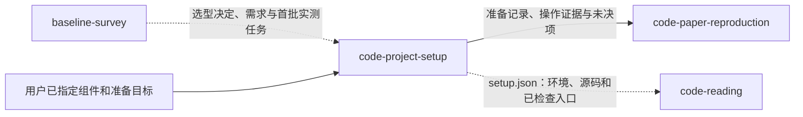

# 按本轮需求准备环境与验证入口

根据选定组件和本轮操作，准备实际环境、模型与数据，提供可追溯的运行证据。**命令执行结束、组件符合预期、整体实现正确和研究假设成立分别判断**；不把“能运行”概括为“可信基准”。部分完成也可交接，但必须明确支持哪些操作、哪些仍未知或受阻。

通常在实际实验机器工作，按任务选择CPU、GPU或其他设备，不默认单卡训练。可以独立接收用户指定目标，不强制先补survey文件或新研究假设。需要重新选型返回baseline-survey；研究设计变动返回idea-find/iterate；批准的科学实验由execution实施。大规模是否属于中期研究或论文补充实验按目的判断，不由卡数/时长决定。

## W&B 内网记录准备

新增代码实验默认按 [wandb skill](../wandb/SKILL.md) 接入用户自托管实例，详细规则见 [部署与内网验证](../wandb/references/deployment.md)。先检查已有服务和仓库集成，复用实际 logger，不重复初始化；新部署先核固定镜像/架构/授权与持久存储，Kubernetes 不是前置条件。项目非敏感配置写 `docs/wandb/tracking.json`，setup.json 保存 tracking_ref；密钥仅通过私有配置注入，不写报告或命令参数。

把最小 SDK 写入、独立 API/MCP 读回、产物校验、重启保留和禁外网检查列入现有 operations/checks；分别记录实际证据，不因某一侧成功就标集成通过。检查指标定义/step、解析后配置、分布式主进程记录、必要上传范围，以及断连后的本地保留/补同步。logger 改动纳入代码/行为检查，不能改训练或评估语义。受阻时明确本地记录方案和下一步，不静默用云端；状态、同步与科学有效性分别记录，交接前自查核对应范围。

## 准备和改配置时保护研究条件

按 [研究条件记录](../dl-assistant/references/research-conditions.md) 接收目标与本轮条件，将必须保留项对应到实际配置、数据和入口。准备/执行前自查核对实际差异；小输入、短步数的链路检查单独标为调试，不能替代保留关键条件的研究实验。OOM 等问题需要改输入、batch、精度或调度时先评估科学影响，影响关键条件则返回研究讨论。交接记录实际保留证据和未知，不用“能跑”证明配置适合筛选方法。

## 在系统中的位置

全局关系见dl-assistant。setup不替用户完成code-reading，不因短检查通过就跳过相应复现可信度核查或代码阅读。这里的检查不替代完整评测/训练复现，也不设计新研究方法。

## 输入、上游接收与实际目标

优先读用户指定的survey/准备记录和研究说明；已知目标与授权直接使用。未指定时在当前项目约定目录定位，不按日期自动选择最新文件；有歧义才澄清。没有survey时从实际代码/配置/原文建立当前准备需求。

新版 `baseline-survey.json` 接收规则：
- 检查schema、decision.status及实际用户决定，不把recommendation当已选定；未决定可以只读调查，不擅自下载、安装候选或悄悄选择替代。
- 读取decision.components的全部候选/版本/角色、requirements、research_fit、validation_targets、verification_tasks、来源和组合条件，不能只读decision.repo或repo_role。
- 把setup负责的实测任务映射到具体操作和检查；reproduction/execution或research_discussion任务保留并交对应责任，不替下游宣称完成。
- 执行前核对真实代码commit/diff、配置、模型与数据身份；源码预判不等于本机结果。版本变化先确认影响，不直接复用旧调查的适配结论。
- 旧报告仅作线索，缺字段保留未知，按实际需求补齐；不批量迁移历史项目。多组件不可静默压缩成单仓库。

先列本轮需要的操作，如评测、训练入口检查、中间量读取、数据转换或组合接口验证，并关联R需求。缺少核心科学比较或需要重建方法时先讨论；允许只准备已明确部分，不称研究已就绪。

## 准备时必须理解的含义

setup要检查自己正在操作的数据、配置和接口：对象/标签/单位/划分、预处理/转换、模型与权重对应、入口输入输出、指标定义/参数及实际必要依赖。需要时读论文、源码、配置和原测试，不能以“不负责复现”为由忽略协议差异。

| 阶段 | 责任 |
| --- | --- |
| survey | 静态核查选型依据、条件与剩余实测任务 |
| setup | 检查准备操作是否符合约定，指定操作在什么条件下实际执行到哪里 |
| reproduction | 在明确协议下评估对应评测或训练结果的复现可信范围 |
| iterate | 根据证据更新研究认识、价值和下一步 |

可以用有出处的已知答案或参考结果做检查，但不为追论文数自动调参；小样例正确不能推出完整性能正确。参考指标保留身份、条件和核查范围，不按baseline/substrate旧角色自动挑一个数字当基准。

## 工作流程

### 1. 保护现场并核对已有状态

读取项目约定，核对工作区、分支、未提交改动、当前代码和已有环境/资产/进程。保护用户改动；只有确实影响后续操作时才澄清，不自动stash、重置或覆盖。按项目规则使用当前授权分支或隔离分支，不强制固定名字、不假设主分支叫main、不要求最终merge才算完成。

恢复时结合版本/配置、环境实际状态、文件完整性、检查日志、退出状态及进程核实。文件/目录/环境存在不等于已完成；旧结果只可复用到相同且相关的条件。先定位运行中任务，不重复启动下载/训练；状态未知就保留未知。

### 2. 写好 spec 和 plan，提交用户审阅

按 [规格模板](references/setup-spec-template.md) 写 `setup-spec.md`，说明操作、组件、环境/资产需求、检查依据、允许调整与预算。按 [计划模板](references/setup-plan-template.md) 写 `setup-plan.md`，列实际任务和依赖。简单任务也保留两份文件，可以简写并相互引用。

**执行前自查**直接写在spec/plan：
- 目标：每项操作对应什么需求和组件？必要入口/观察是否遗漏？
- 依据：输入条件、预期行为及来源是否明确？是否又用了“输出必须非零、几步loss必降”等无依据标准？
- 改动与授权：将改变数据、加载、计算或比较的哪些部分？如何验证、是否在已批准范围？
- 任务范围：哪些检查需要真实数据/设备，哪些不适用？成本和运行条件哪些仍未知？

逐项记录判断、证据/版本、未知和行动影响。clear 表示自查已通过；limited 说明限制为何不妨碍当前准备；needs_revision 先修正或讨论。自查结果用于审阅，不新增单独自查 JSON 或脚本。

**执行门槛**：写完并自查后，向用户同时提供两份文件的路径，提示审阅范围、改动、成本和待决事项，明确请用户确认 spec 和 plan。一次回复可以确认两份。只有用户明确批准当前两份内容后，才能进入第 3 步。只批准其中一份时，继续等待另一份。确认前可以只读核对现场、查资料和完善文档；安装依赖、下载资产、修改项目代码或配置、运行验证任务都等两份获批后再开始。既有选型决定、资源授权和自查通过可作为审阅依据，仍需核实用户已明确确认当前两份文件。

记录确认所对应的文件版本及授权范围。恢复任务时先查该记录；两份文件已有明确批准且内容仍在批准范围内时继续执行。范围、成本或研究条件有实质变化时，更新受影响的文件并提交用户重新审阅，获批后再执行变更。

### 3. 准备环境与资产，按实际影响处理改动

**长任务启动规则**。预计超过 5 分钟或中断后重跑代价高的命令，单机或 SSH 直连机器上用 `dl-assistant/scripts/run-long.sh` 在实际执行机器上通过 tmux detach 启动。通过集群调度器提交的任务走调度器。启动和恢复细节见 [共享长任务说明](../dl-assistant/references/long-run-ops.md)。

确认当前 spec 和 plan 均已获用户批准后，按方案选择项目适用的隔离环境/容器，不把容器标识塞进conda_env。依赖版本与安装办法按实际项目和官方说明核对，记录来源、环境导出和日志；编译扩展处理见 [依赖规则](references/compile-deps.md)。网络/镜像设置尽量限于任务进程或项目环境，不擅改系统设置，见 [网络参考](../dl-assistant/references/network-mirror.md)。

数据/权重下载、完整性、转换和读取见 [资产准备](references/dataset-prep.md)。不覆盖原始数据，不为让loader运行擅自删除样本、改标签或换split。格式适配需有规则和对应检查；检查发现与选型条件不符时按相同版本/条件核对，保留新证据和原调查。

**每次修复按影响判断，而不是参数名**：
1. 已授权且可确认不改变计算/数据含义的路径等修复：自主执行并记录。
2. 旨在保持含义但需验证的转换/名称映射：先明确规则、授权与对应检查；在批准范围内执行，不能只说“格式变化”等价。
3. 改变含义或影响不明：如忽略关键权重、换核心算子/精度策略、改标签定义、batch或训练/评测条件，说明具体影响与建议，返回确认；科学设计变动交idea-find/iterate，批准后才实施。

`strict=False`/key映射并非自动正确或自动错误；检查实际使用、遗漏、额外参数及有意初始化部分。batch、worker、device和依赖替换也不自动归为普通工程调整。既有批准不重复询问，新的未决影响不能凭“只是工程”跳过。

### 4. 按操作组合验证，保留可重复的最小检查

按 [行为与数值检查](references/numeric-sanity.md) 在适用处检查三层：环境/配置、必要组件行为、真实输入与实际入口。不是每个任务都必须GPU、合成输入、训练或官方命令全部执行。

每检查先明确：**对象 → 输入/条件 → 预期行为及依据 → 实际结果 → 能说明/不能说明什么**。预期无依据就记观察和待调查，不补任意阈值；没有异常也不认证整体实现。

| 本轮操作 | 验证重点 |
| --- | --- |
| 纯评测/推理 | 权重/配置、真实输入、预测与指标/保存；不强制backward |
| 需要训练 | 相关数据/目标计算、预期参数依赖与更新，及本轮需要的保存/恢复行为；不要求几步loss单调下降 |
| 中间量读取/测量接口 | 指定状态量实际可取、样本对应、形状/单位与保存；新科学测量实验另交execution |
| 数据处理 | 转换、数量/身份/标签/划分和输出可读；不强制模型/GPU |
| 多组件组合 | 各自必要检查及接口、单位、样本身份、预处理与版本一致性 |

合成输入只有满足实际输入要求时才使用；否则选可追溯的真实小样本。小样本用于检查读取与执行，不代表全量分布、泛化或训练性能。只改小样本/步数等检查条件时另存配置，检查结论限于该条件，不覆盖正式配置。

最小脚本/命令保存在 `checks/`（已有smoke.py可沿用），调用真实组件并绑定来源代码/配置、输入样本与预期依据。保留日志/退出状态、观察、未覆盖部分和再运行方式，供后续重复使用；只写脚本未运行不能标已检查。

按观测需要记录资源：机器/设备、模型、输入尺寸/长度、batch、精度、训练或推理、预热/测量范围和方式。区分实际测量与估计；短检查不推算为完整训练成本，异步设备计时需说明同步等测量条件，不把一次峰值概括为全规模能力。

### 5. 持续记录、排错与恢复

任务执行即更新setup-report和setup.json，记录具体结果、失败/阻塞、全部相关尝试和修改，不到最后凭回忆补写。结合日志、进程与退出码核实任务状态。不把缺退出码视为仍运行，或把退出0视为检查符合预期。

需要调查的异常先读输入、配置和实际证据，按预算排查。重复无新信息、将超预算、资产/权限缺失或需改科学设计时报告已试方案、证据、限制和建议，不要求尝遍所有安装方式才上报，不无限调参追求通过。

访问失败先区分认证/限流/网络/源不可用，按已有授权查找合法替代；用户介入确有必要时一次说明缺什么及影响，不要求在对话里粘贴秘密。修改随机性、确定性、划分和训练条件按上述影响规则处理，不擅自增强“可复现性”。

### 6. 交接前自查与逐项结论

按 [报告和JSON模板](references/setup-report-template.md) 保存每项操作和检查的真实状态。部分完成可交待解决问题，不能伪造成功；无关操作可not_applicable并说明，不为凑三层检查启动不需要的训练。

**交接前自查**写在现有报告：
- 证据：每项“已检查”是否有实际命令/工作目录/环境、代码commit+diff、配置/资产版本、输入范围、日志/退出状态与结果？
- 范围：是否把组件检查、极小样本结果或一次加载夸大为整体正确/可复现/研究支持？
- 改动：转换/加载/依赖适配是否按批准规则验证，原数据与未解决影响是否保留？
- 需求与责任：survey实测任务逐项回应了吗？多组件是否遗漏？未解决事项是否明确归setup、reproduction、研究讨论或execution？

needs_revision不交“已就绪”结论；仍可如实交部分结果和受阻事项。操作通过仅支持声明范围；未受影响操作可继续，不因单个问题判整个项目失败。没有实际运行或用户授权依据不能标已验证/已批准。自查不替用户关键代码审阅或独立科学核查。

## 保存、版本与下游

默认 `docs/code-project-setup/<实际日期>-<slug>/`，尊重指定路径；继续旧任务先核对记录，新任务目录冲突加唯一标识，不覆盖历史。保留setup-spec.md、setup-plan.md、setup-report.md、setup.json、必要检查与环境记录；按实际需要生成 [数据速览](references/dataset-report-template.md) 和样本文件，不要求每次有images/或全部仓库数据。

按项目约定提交本次授权内容，不默认merge/push、不覆盖用户分支。就绪入口绑定实际代码/config/环境/数据；git改动后哪些检查需要重跑按影响判断。报告与JSON保持一致，敏感值不写进命令/环境导出。

交reproduction的是验证目标、已检查操作和剩余可信度问题；给code-reading提供环境、源码与入口。研究执行仍需相应前置核查和用户代码阅读。schema_version=2的多组件与检查语义须明确；reproduction、prepare与code-reading已按实际操作/目标/行为证据接收；后期skills按实际来源与验证范围接收；历史项目记录仍须核对，不能以旧“✓”或repo_role推算可信度。
