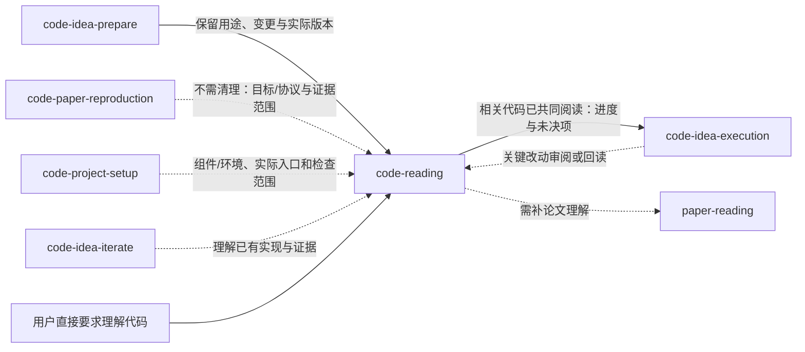

# 按实际任务带用户读代码

帮助用户亲自理解相关代码，说明解释依据、理解进度与尚未验证部分。**不以完整笔记、运行成功或“继续”认证用户已掌握；不以静态无引用、覆盖记录或接口简单认证代码无用或修改安全。**

主线中code-reading仍必经：用户需参与实际相关代码阅读和后续关键改动审阅，agent摘要不能替代。不要求精读整个仓库，也不默认目的是加模块；测量、数据处理、评测和训练都可成为阅读目标。用户只问一个函数时先答当前问题，再按需要补上下文，不强迫走完整流程。

## 读懂目标与当前运行的条件差异

项目已接入 W&B 时，相关阅读包括实际 logger 初始化、指标定义/step、分布式记录、checkpoint 选择与恢复，按 [共同记录](../wandb/references/experiment-records.md) 对应本地实验/attempt/run 身份。以相关实际源码解释，不用网页曲线代替理解，也不为教学自动部署服务或上传新数据。

选定阅读场景、追踪数据/训练/评测链路和交接自查时，结合 [研究条件记录](../dl-assistant/references/research-conditions.md)，向用户说明关键条件由哪些代码/配置实现、reduced 改变了什么、哪些目标路径还未读或未验证。教学中的小输入/短运行不能代表完整研究行为；不把用户理解代码或调试成功写成跨规模有效。

## 系统关系与边界

全局关系见dl-assistant。缺环境/数据/权重需要准备时交setup；复现结果验证交reproduction；清理交prepare；新方法/实验设计交idea-find/iterate，获批实现交execution。读到错误可核实、解释并建议责任方，不借阅读自动修代码或开展新科学实验。

## 1. 明确本次阅读范围，先给最小运行场景

使用当前会话已知目标、背景和顺序，不重复询问。先核用户指定项目/模块、代码commit与实际未提交diff；范围不清时只补影响阅读的条件。

先用普通话说明：这段程序接收什么、产生什么、本次想理解哪项操作、它为什么与当前任务相关。然后给项目/路径概览，标相关入口、主要数据变化和待查位置；不要在用户不清楚程序用途时先讲一整套框架。

**建立阅读范围与完成条件**：要理解的操作/路径、关键输入输出与接口、必要依赖/框架机制、相关论文部分和明确不在范围的内容。逐项列已读/待读、需要实际验证还是可以静态说明；完成指本次约定范围，不等于整个仓库或全部理解已验证。可以是逐段精读、先概览再展开或连续讲解，按用户意愿调整。

## 2. 核实际环境与已有记录，选择观察方式

有setup报告不保证当前能运行，无报告也不说明环境不存在。按具体入口、资产、环境、预算与用户意愿选择静态阅读、agent局部验证或用户交互调试，可在同一路径混合使用。静态也可精读，不要求运行才能讲所有内容。

按需读取新版记录：
- setup：components/environments、operations/checks及supported_operations、config/资产与限制，不只看conda_env或命令字符串。
- reproduction：targets/protocol/runs/use_scope，区分原条件与改条件、评测/训练/局部证据；不默认使用低成本训练配置。
- prepare：retained_uses/changes/verification_records/selected_state_refs、操作路径观察和未覆盖项；旧hot-path不是热点或未来必经证明。

核实际版本与记录是否对应，只对本次相关项补核；缺文件可按实际代码继续，不伪装已取得来源。用户停在某行/断点时先解释当前段，再补位置。工具/环境不足就明确限制，允许继续静态阅读，不为教学擅装依赖、下载权重或启动长训练，也不例行测试无关网络通道。

## 3. 补当前必要基础，逐段读实际源码

默认顺序：**最小运行场景 → 项目与路径概览 → 当前必要基础 → 实际源码 → 相应运行观察**。基础用独立例子说明定义/用途，再连接当前问题，不拿尚未讲过的本文方法或框架调用反向解释基础。用户指定先讲方法/某行时尊重选择，必要前提短补后返回，不重上整套课程。

每个连贯主题说明：当前路径位置与具体源码、这段解决什么、输入/输出及单位/形状/类型/状态变化、关键依赖和下一跳。展示必要实际代码片段及真实文件位置，不只列目录或函数名；大段拆成能连续理解的部分，不强制固定行数或跳转数量。

解释中的事实分开标：
1. **源码明确内容**：绑定实际文件/版本/条件；静态定义不等于实际分支已执行。
2. **条件性推断**：说明前提和未知，形状不能确定就用条件表达，不编实际值。
3. **独立教学/局部验证**：说明抽取/导入了什么、输入与状态，不能冒充项目入口已运行。
4. **项目实际观察**：给真实入口、环境/config/资产/输入/模式等条件及结果来源，不能推广全部配置。

agent预测、用户口述、截图可见内容和agent实际运行分别注明；没有收到结果就不写成实测。不确定的第三方API/机制按当前版本查官方文档/源码，再核项目实际使用，不凭示例框架名称补结论。

论文映射按需要进行，先核论文身份/版本与已读范围，再对应概念、条件与实际实现；可能一对多、有工程变形或不一致，不能强贴“这一行就是公式”。没有相关论文则不凑映射。

讨论后续修改时，只按明确研究需求说明接口、依赖、资产兼容、影响和必要验证，不默认每篇笔记都找接入点。纯函数/接口清楚也不等于修改安全，当前未调用也不等于死代码；不在阅读中顺手删改。

**每个新主题讲解前短自查**：场景已清楚吗？基础解释是否依赖未讲后续内容？依据类别和条件是否标清？有没有把未知用途或简单接口当作删除/修改保证？需要修正先换例子、补前提或改结论，不只写“已自查”。不每段展示表格、考试或重复请求确认。

## 4. 必要时观察运行行为，授权按实际影响

先明确要消除哪个解释上的未知，选择有信息、成本合理的观察，不强制“能跑的都跑”。可用已授权的局部脚本或调试器，但应先核实际作用、状态影响和输出范围，具体见 [观察规则](references/diagnostics.md)；交互调试见 [调试说明](references/vscode-debugging.md)。

不改源码也可能有状态/文件/网络/设备影响；import、forward、模式切换、读取迭代器、梯度计算和hook都不能一概承诺只读。相同进程的重复调用也可能改变下一次观察。优先适当隔离、保存/恢复明确状态，改变条件时标明哪些项目行为未覆盖。

已有具体授权内的观察继续；新增源码改动、运行/资源或状态影响超出范围时说明目的、实际改动和恢复方式再确认，不按“是否侵入源码”机械区分。临时改动记录准确diff，只恢复本次内容；不能在结束时笼统删除用户改动、已有调试配置或证据。

脚本/调试入口只在实际可用条件下运行，不为讲解扩大成环境准备或科学实验。保留支持解释所需的脚本/配置/必要结果和条件，不要求讲完即弃，也不大量存无关激活/原始数据。未运行脚本只是方案，不是实测。

## 5. 区分推进、讲过与理解检查

按约定节奏停顿或连续讲，用户追问则留当前主题。用户明确“继续”授权下一步，不自动表示掌握；沉默不表示授权。用户想先看全貌或直接看答案时允许调整，不无限换说法直到对方说懂。

记录已讲解、用户自述理解、做过理解检查及其范围、仍有疑问/跳过；可用复述数据流、解释调用、预测小例子或定位源码检查具体理解，不每段考试，不凭一次回答评价整体能力。主线仍需用户实际参与相关代码阅读和审阅，不能因生成笔记就视为已完成。

## 6. 保存进度，交接前自查

主线默认保存中文人读笔记；独立阅读已有实质讲解时保存必要进度，用户要求不落文件则尊重。默认docs/code-reading/<实际日期>-<topic>/，尊重指定路径；旧notes目录可继续用，新任务冲突加标识，不覆盖旧版本。结构见 [笔记模板](references/notes-template.md)，无需新增机读契约或完整模板填空。

**交接前短自查**：范围/实际进度和用户反馈真实吗？源码—解释—观察能否对应版本与条件？教学例子或预测有没有被写成项目事实？推断、未读/未验证、修改影响和待办是否保留？临时状态/改动及实际恢复情况是否说明？有缺陷先纠正或明确阶段性，不把笔记完整当理解完成。

暂停时保存实际位置、已讲/跳过、用户疑问、所需前提、尚缺来源/运行结果及下一步。继续先核代码/config/环境和原笔记版本，不能只用旧行号，也不因缺新字段从头重讲；修订保留原因与受影响解释。

给execution/iterate的是人读上下文，不是实现方案批准、科研证据认证或理解合格证；后续关键代码改动仍需用户审阅。公式与论文标识遵循dl-assistant全局规范。旧A/B、hot-path、reduced优先或“改起来安全”标签不自动转换为当前理解/证据状态，历史笔记不批量迁移。
