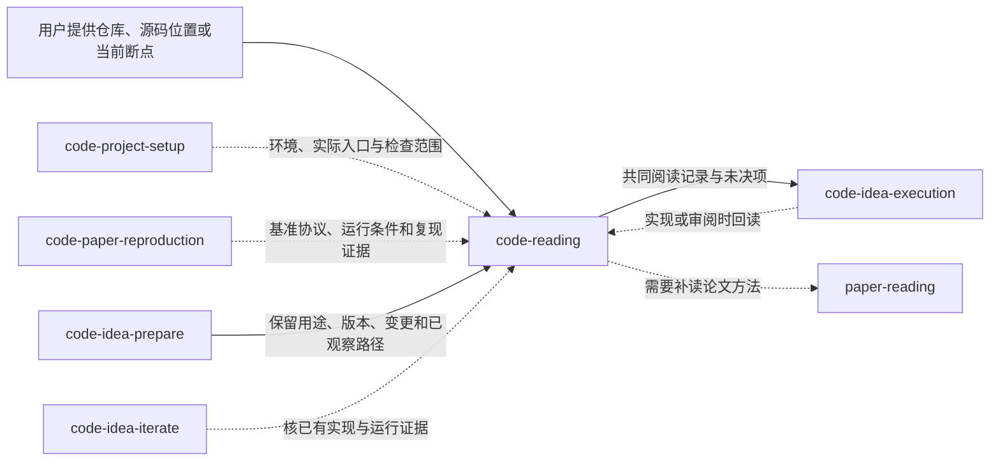
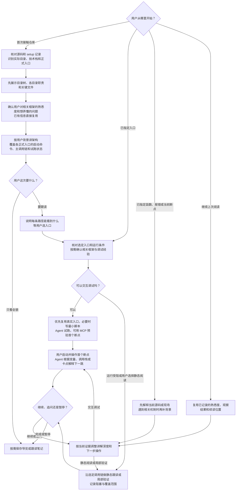

# 围绕实际任务读源码

首次读陌生仓库时，先给带职责说明的目录树，再确认用户对相关框架的熟悉度和想弄懂的问题。据此讲架构及各正式顶层入口的主调用链。跟读时请用户选入口，等选定后再按需确认调试经验、准备调试。默认由用户亲手启动、查看断点现场和单步，agent 根据观察讲解下一跳。

用户已经指定入口时直接准备该路径。用户指定函数、错误位置或当前断点时先解释现场，续读时从笔记记录的位置接上。用户明确只要概览或静态阅读时，按其要求推进。

复用对话和笔记里已知的背景。用户跳过背景问题时，按首次接触该机制的深度继续，并根据后续观察调整讲解。

中期主线在实现方案前先和用户共同读懂当前相关的基线代码。阅读范围由研究任务决定，可聚焦训练、评测、数据、测量、分析或恢复入口。

## SKILL 交接关系



全局关系见 [dl-assistant](../dl-assistant/SKILL.md)。需要配置环境、数据或权重时交 setup。需要实测基线性能时交 reproduction。需要整理代码或实现新方法时分别交 prepare 和 execution。

## 产出与保存

主线默认保存中文阅读笔记。独立阅读有需要回看的讲解时，可保存用户需要的范围。暂停时写明已讲内容、未决疑问和下一次从哪里接上。沿用用户指定或已核实的笔记路径。

```text
docs/code-reading/<日期>-<主题>/
├── notes.md                 # 版本、选定路径、讲解、证据与续读位置
└── diagnostics/             # 按需保存支持讲解的脚本、条件和关键输出
    ├── <诊断脚本>
    └── <运行记录或输出>

<仓库>/.vscode/launch.json   # 采用 VS Code 交互调试时，按需添加对应入口
```

笔记给用户和后续执行会话阅读。只有明确有改动需求时才记录候选接入点、受影响接口和待做验证。

## 运行流程图



## 参考资料列表

| 资料 | 何时读 |
| --- | --- |
| [阅读流程](references/workflow.md) | 梳理目录、确认用户背景、讲解架构和顶层入口、逐站跟读和续读 |
| [局部诊断](references/diagnostics.md) | 需要直接观察张量、对象、配置或单段运行行为 |
| [交互调试](references/vscode-debugging.md) | 准备 VS Code 入口、首个断点，或用可选的 mcp-debugger 做课前预验 |
| [中文笔记模板](references/notes-template.md) | 准备保存笔记或交接进度 |

## 阅读原则

1. 先让用户知道自己在哪，再讲当前操作。逐段使用真实源码，说明位置、输入输出、状态变化和调用下一跳。
2. 静态阅读、局部验证和交互调试可在同一条路径混用。分别说明哪些来自源码、条件推断、独立小验证和项目实际运行。
3. 按用户选择的节奏推进。用户追问时留在当前段。「继续」表示可以推进。需要核理解时，用复述、定位或预测输出等方式确认具体问题。
4. 把未观察到的调用范围写明。讨论改动时记录调用方、约束、可能影响和验证办法。运行或临时调试前先核是否会影响数据、文件、设备、网络或训练状态，超出已有授权时再与用户确认。
