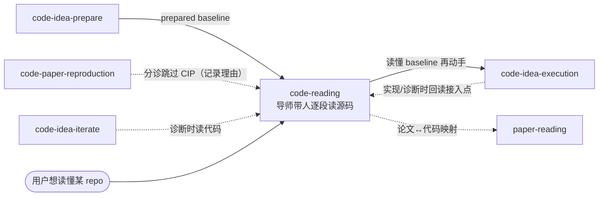
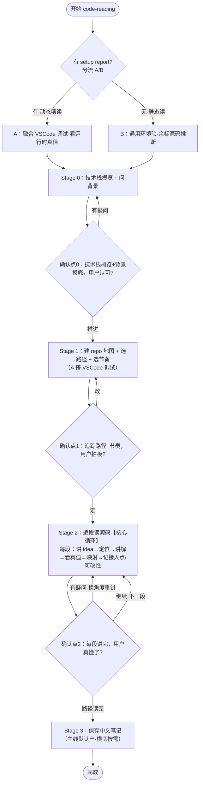

# Code Reading

让 agent 以**导师**身份，带**人**逐段读懂一个**完整大型 repo**的源码。它服务的是人的理解，不产给下游机器消费的契约——机器要读代码随时自己读。

主线场景下（code-idea-execution 之前），读懂不是终点——**读懂是为了改**：阅读笔记里的「接入点地图」直接回答「idea 往哪插、改它的影响面是什么」，给 method 快速迭代打底。

## 成功标准

**Done** = 用户理解了 repo 宏观结构、选定真实运行路径的分段调用链、关键类/函数职责、tensor/data flow、相关框架机制；主线模式下保存了含「接入点地图」的中文阅读笔记（横切按需调用时按需保存）。两种模式都算 Done：

- **A · 精读**（有 `code-project-setup` 报告，环境配好）：默认和用户的 **VSCode 调试工作流融合**——在真实运行里看运行时真值（shape / 数据结构 / registry 实际对象 / config 覆盖后真值 / BN 统计）。
- **B · 静态读**（没报告 / 现在不打算把 repo 跑起来）：repo 专属环境没配，但**通用 torch 环境能验的照样验**，验不了的标「源码推断」。不是降级，是正常选择。

## 在系统里的位置（局部）

本 skill 是 `dl-assistant` 配套 skill 之一，角色有二：

- **中期主线必经**——`CPS → CPR → CIP → CR → EX`：动 idea 之前先带人把 baseline 代码读懂（理解是人的活，agent 不能替代，设计哲学见 `dl-assistant` SKILL.md）。
- **横切的源码导师**——execution 实现/诊断时、iterate 诊断时按需回读，或用户直接想读懂某 repo。



> 整体架构、全局怎么连，看 `dl-assistant` 的「全局 skill 流向图」。

## 与相邻 skills 的边界

| 场景 | 应使用 |
| ---- | ------ |
| 要把 repo 跑起来（装依赖/解 CUDA/备数据/备 checkpoint） | `code-project-setup` |
| repo 跑不起来，但只想**静态读懂**代码、不打算现在跑 | `code-reading`（B 静态读，不退出） |
| 没有 Project Setup Report 但想读代码 | `code-reading`（B 静态读，不退出） |
| 要验证论文/baseline 性能是否可信、训练链对不对 | `code-paper-reproduction` |
| 要理解论文方法本身（不碰代码） | `paper-reading` |
| 看不懂源码/调用链/框架机制（不论 repo 跑没跑起来） | `code-reading` |
| 孤立代码片段/gist，无 repo 语境 | 直接回答，不必走本 skill |
| 已决定实现新方法并要改代码 | `code-idea-execution` |
| 已有明确报错或 bug | `code-idea-execution`（训练动态 debug 见 `code-idea-execution/references/training-dynamics-debug.md`） |

## 产出与保存

| 产物 | 路径 | 什么时候产 |
| ---- | ---- | ---------- |
| 诊断脚本 | `docs/code-reading/diagnostics/`（不假设 `docs/` 存在，先确认/建/问用户） | A/B 都可能：一次性只读探针，讲完即弃 |
| `launch.json` | repo 的 `.vscode/`（惯例位置） | A 且用户在 VSCode 里调 |
| 中文阅读笔记 | `docs/code-reading/notes/YYYY-MM-DD-<topic>.md` | **主线模式（EX 之前）默认产**；横切按需调用时用户要求才产 |

笔记是**人读 md**，结构与深度标尺见 `references/notes-template.md`。主线场景下它是 execution 起手时用户可甩给 `code-idea-execution` 的上下文——「接入点地图」一节直接服务 EX 定位接入点；这是人读备忘，不是机器契约，下游不解析字段，无需对齐 schema。

## 核心纪律

分三组：**读的节奏**（怎么推进）、**探查运行时真值**（怎么安全地看「真跑是什么」）、**讲解手法**（怎么讲懂）。

### A. 读的节奏

1. **不一次性读完整 repo。** 先建地图，再围绕选定路径按段推进。（用户选「骨架快过」时先串主干跳转再回精读，见 Stage 1。）
2. **每次只讲一小块。** 一个函数片段、一次调用跳转、一个数据结构转换——以用户几分钟内能理解为单位。
3. **没收到推进信号不进入下一段。** 每段讲完停下等反馈。

### B. 探查运行时真值

4. **能验的运行时事实，别凭脑子猜——判据是「验这事要什么环境」：**
   - 需 repo 专属环境（import repo、用它的 build/数据/权重）→ 只有 A 能验（VSCode debug console 或集成诊断脚本）。
   - 只需通用 torch 环境（自包含 shape/单个标准模块/算子）→ 独立诊断脚本，**A、B 都该验**。
   - 什么都不用跑（讲结构/职责/意图）→ 静态读，不必起脚本。
   - B 真验不了某事 → 标「源码推断，待确认」，**绝不把推断当实测**。
5. **改源码必须先批准、不改语义、结束删除。** 要在源码里加临时 debug print/hook，先说明意图、获批准再改，只加**不改变运行语义**的探针，会话结束删除。**优先用非侵入手段**（VSCode 断点 + debug console、外挂 forward hook）——它们根本不碰源码，不触发审批。
6. **agent 看不到用户的 debug console。** A 融合 VSCode 时分工是「agent 备脚手架 + 预测你会看到什么 + 讲解；用户 F5、敲命令、亲眼看」。但 agent 自己能用脚本验的（要先验才能讲的）就**自己跑自己看**，别全推给用户。

### C. 讲解手法

7. **先讲 idea，再讲细节。** 每个大段开始先用 1-2 段讲清「这段要解决什么、核心直觉」，再逐行读。类似论文 Abstract → Details。理解了「为什么」才不会在「怎么做」里迷失。
8. **不假装知道第三方框架机制。** 不确定的机制，先查证再解释（展开判据见「框架机制讲解」节）。
9. **主动标注死代码与可改性。** 研究代码常有大量死代码（定义未调用、参数未消费、整块注释）。明确标「这是死代码，不影响运行」，省用户时间。主线模式下再记一笔可改性：自包含纯函数标「改起来安全」；隐藏耦合（hook 改 forward / registry 间接 / 全局状态 / 隐式 shape 假设）标「改起来危险」并说清危险点——这是 execution 改动时的风险清单。
10. **论文 ↔ 代码映射。** repo 对应论文时，为每个核心模块做「论文公式/概念 ↔ 代码行」映射：先讲论文（直觉+公式），再讲实现（行号+变量）。没本地 PDF 用 `paper-search` 搜到 arXiv ID，首选 `tex-mcp` 读（`tex_open` 打开固定版本 → `tex_read`，公式保留 LaTeX 原文，对论文↔代码映射更友好）；源码不可用时降级 `pdf-mcp`。
11. **符号展示。** 会话公式用 Unicode——横切规范见 `dl-assistant` SKILL.md「横切规范」；shape 记法沿用本 skill 的 `[B,256,H/32,W/32]` 写法。

## 上游接缝：先分流 A / B（都是完整 repo，都走全流程）

启动第一步分流——**有没有 Project Setup Report，决定能不能动态调试，不决定能不能用本 skill**：

```text
我可以两种方式带你读这个 repo：

A. 你有 code-project-setup 的 Project Setup Report
   → 精读：我把读代码和你的 VSCode 调试融合起来——为你选的路径写好 launch.json、
     给一份和讲解分段对齐的断点计划，你 F5 步进真实代码，停在断点时我告诉你
     在 debug console 里敲什么、会看到什么真值（shape / registry 真实类 / BN 统计），
     你亲眼看、我在旁边讲为什么。需要隔离验证时我也会跑诊断脚本。
B. 你没有报告，或现在不打算把它跑起来
   → 静态读：repo 专属环境没配，"真跑 repo 才能得到的信息"我给不了，会标"源码推断"。
     但自包含逻辑（一段 reshape 的 shape、单个标准模块、算子行为）通用 torch 环境就能验，
     这类我照样写小脚本验，不瞎猜。

你走 A 还是 B？（有报告把路径发我；没有但想读，直接说，我们走 B。）
```

两条都是**一等公民**，**走同一套 Stage 0 → 1 → 2**，唯一差别是 repo 专属环境配没配。

**A（精读）额外规则**：

- 先读报告**同目录的 `setup.json`**（机读交接区已独立成单文件，conda_env / ready_commands / data / checkpoint 等结构化字段比抠正文稳），提取 conda env、commit、ready/blocked commands、dataset/checkpoint 状态、推荐入口。
- 报告标关键入口 `blocked-by-env` / `-data` / `-checkpoint` → 说明 blocker。**仍可继续**：就这些 blocked 入口走 B 静态读，或建议回 `code-project-setup` 解 blocker 后再精读。用户选。
- **VSCode 调试是 A 的 offered 默认交互 track**（机制见 `references/vscode-debugging.md`），不强制；用户不在 VSCode 里调时退回 agent 跑 standalone 脚本。

**主线模式（EX 之前）额外输入**：除 setup report 外，顺带读 `docs/code-paper-reproduction/` 目录（存在时）提取 **reduced 入口/配置**——读懂训练主循环优先在 reduced run 上做（见 Stage 1）；`docs/code-idea-prepare/` 目录存在时读 `coverage/hot-path.md`（CIP 产的训练链热路径地图）——建训练链地图直接站在它上面，不从零摸。

**两条都不做**：下载数据、备 checkpoint、装依赖、修运行环境——那是 `code-project-setup`。本 skill 只读、只讲。

**不接的场景**：孤立代码片段 / gist（无 repo 语境）——agent 直接答即可，不必走本 skill。本 skill 预设对象是**完整大型 repo**。

## 流程总览



| 确认点 | 时机 | 用户在确认什么 |
| ------ | ---- | -------------- |
| 0 | Stage 0 技术栈概览给出后 | 概览没理解偏差、自己的框架背景被正确摸底 |
| 1 | Stage 1 地图+路径+节奏给出后 | 追踪哪条路径、精读还是骨架快过 |
| 2 | Stage 2 每段讲完 | 这段真懂了才推进；有疑问换角度重讲，轮数无上限 |

> 确认点学 paper-reading 问答制：用户没明确推进（懂了/继续/下一段）就留当前段继续讲——绝不闷头往下冲。
>
> **TaskList 跟踪流程**：Stage 1 定路径后建任务（Stage 0 概览 / Stage 1 地图+路径 / Stage 2 逐段读——路径各段作动态子任务 / Stage 3 笔记）——逐段推进进度可见。

## references

| 文件 | 内容 | 什么时候读 |
| ---- | ---- | ---------- |
| `references/vscode-debugging.md` | launch.json 两类用途、断点计划、debug console REPL、单进程调试分布式 | A 模式搭调试脚手架时 |
| `references/diagnostics.md` | 诊断脚本决策树（验这事要什么环境）、两类诊断×手法、模板 | 要写 standalone 诊断脚本时 |
| `references/notes-template.md` | 阅读笔记结构（含接入点地图）+ 深度标尺 + 浅/深示例 | Stage 3 保存笔记前 |

## 常见错误

- **不要凭脑子猜运行时事实**——凡是脚本/调试器能验的都去验；B 验不了的标「源码推断，待确认」，绝不把推断当实测。
- **不要一次性输出完整调用链**——带用户逐段读，每段等推进信号；只列文件树不算读。
- **不要未经批准改源码**——探针先批准、不改语义、结束删除；优先非侵入手段（断点 / 外挂 hook）。
- **不要把能自己验的全推给用户跑**——agent 要先验才能讲的事，自己跑脚本自己看。
- **不要重新配环境/数据/checkpoint**——那是 code-project-setup；blocked 入口降级走 B 或建议回 setup。
- **不要把给人讲懂的产物硬塞成下游机器契约**——笔记是人读备忘。
- **主线模式不要跳过「接入点地图」**——读懂为了改，笔记没这节等于没交棒。

## Stage 0: 建技术栈概览 + 问一次背景

**仅 A：先吃报告 + 测网络。** 从 Project Setup Report 同目录的 `setup.json`（机读交接区，优先读）提取：conda env 与运行方式、ready/blocked commands、推荐入口/config/dataset/checkpoint、已做的 setup fixes 和语义风险、网络/镜像策略。

**主线模式（EX 之前）**：顺带读 `docs/code-paper-reproduction/` 目录（存在时），提取 reduced 入口/配置，Stage 1 推荐路径用。

提取后用报告记录的代理/镜像配置实测当前网络可达性（网络环境可能与 setup 时不同）：

```bash
curl -s --max-time 5 https://huggingface.co > /dev/null && echo "HF direct OK" || echo "HF direct FAIL"
curl -s --max-time 5 https://pypi.org > /dev/null && echo "PyPI direct OK" || echo "PyPI direct FAIL"
# 若报告记录了镜像，也测镜像可达性
```

与报告不一致时（如当时有代理现在没有、镜像失效），继续前告知用户当前真实网络状态、哪些后续操作（诊断脚本依赖的 pip 安装等）受影响。不改任何网络配置。

**A、B 都做：扫少量文件建技术栈概览**——依赖文件（`requirements.txt` / `environment.yml` / `pyproject.toml` / `setup.py`）、README/docs 首页、入口对应的 scripts/configs/source（A 用报告推荐入口，B 用 README/scripts 里的官方入口）。

输出：

```markdown
<!-- A 开头：我读取了 Project Setup Report，当前可用入口是：...，我们边读边在 VSCode 里调。 -->
<!-- B 开头：没有 setup report，走静态读——repo 专属环境没配，
     "真跑才能得到"的信息我会标"源码推断"，通用环境能验的我会写小脚本验。 -->

我先扫了下项目，主要技术栈：

| 库/框架 | 在项目中的用途 | 读代码时为什么重要 |
| ------- | -------------- | ------------------ |
| `...`   | ...            | ...                |

想确认几点：
1. 上面这些你哪些熟、哪些完全不了解？**特别是关键框架**（HF Trainer / peft / DeepSpeed / flash_attn / 分布式）——读代码会大量遇到，我需要知道哪些要展开讲。
2. 你想理解训练流程、推理流程，还是某个特定模块？
3. 这个 repo 对应的论文方法你大概熟吗？
<!-- 仅 A 问 4、5；B 不动态调试 -->
4. （A）你在 VSCode 里读吗？是的话我直接给你写 launch.json + 断点计划，边调边讲。
5. （A）诊断脚本（要隔离验证时）放哪？默认 `docs/code-reading/diagnostics/`。
```

用户回复后进入 Stage 1。

## Stage 1: 建 repo 地图，选路径 + 选节奏（+ A 搭调试）

基于 ready commands（A）或官方入口（B）和用户目标，收集 README/docs、`.vscode/launch.json`/scripts、configs、顶层源码目录（model/dataset/loss/trainer/registry/utils），输出：

**Repo 宏观地图**：入口层 / Config 层 / 数据层 / 模型层 / 训练评估层 / 工具层。

**关键文件表**：

| 模块 | 关键文件/目录 | 作用 | 阅读优先级 |
| ---- | ------------- | ---- | ---------- |

**建议追踪的真实运行路径**：

```text
路径 A：python train.py ...
  来自：ready command（A）/ README 官方命令（B）
  适合理解：训练主流程
  会经过：entry → config → dataset → model → loss → optimizer
```

**主线模式（读懂为了改）下，优先推荐 reduced 入口那条路径**：用 CPR 产出的 reduced 配置跑训练主循环——小时级能跑完整个 loop，断点、诊断脚本、debug console 全在快的 run 上做，和后续 2-3h 一轮的 method 迭代节奏一致。全量入口作为对照路径提及即可，不推荐在精读阶段追。

然后问路径 + 节奏：

```text
你想先跟哪条路径？如果你已经在 VS Code 里停在某个文件/函数/行号，直接发我，从那接上。

读的节奏挑一个：
- 精读（默认）：一段一段讲，每段讲完停下等你，适合你真要改/吃透的那条路径。
- 骨架快过：我先把这条路径的 5-8 个关键跳转一次性串一遍（每跳一两句：在哪、干嘛、
  下一跳去哪、关键 shape 变化），你拿到全貌后点哪段，我们再切精读展开那一段。
  适合先要全局、或赶时间。
```

**骨架快过怎么给**（用户选它时，Stage 2 先出这个再回到逐段循环）：沿选定路径列关键跳转，每跳一两句——位置（file:line）、职责、下一跳、主干 shape 变化；不展开源码、不停顿。串完一句话点出「哪几跳是这条路径的肉（最该精读）」，再问从哪跳展开。展开即回到 Stage 2 逐段循环。**骨架只给主干、不钻支线**，钻哪条由用户点。

### A 模式：为选定路径搭好 VSCode 调试（offered，不强制）

用户在 VSCode 里读时，选定路径后直接搭脚手架（机制/模板见 `references/vscode-debugging.md`）：

1. **为这条路径的真实入口写 launch.json**（不只是为诊断脚本）——`justMyCode:false` + setup 的 env python + 入口 args；分布式入口用单进程 trick。用户当场能 F5 步进真实代码。
2. **给一份断点计划**：沿这条路径标 5-8 个值得断的位置，**和 Stage 2 要逐段走的段对齐**——「先在这几处下断点，我们一段段来，停在每处我告诉你 debug console 敲什么、会看到什么」。

不在 VSCode 里调（或不想调）时跳过这步，Stage 2 走 agent 跑 standalone 脚本的老路。

## Stage 2: 逐段读源码【核心循环】

按选定路径一段一段推进，不一次性总结。每段通常是：入口参数解析片段 / config 加载与对象构建 / dataset 构造或 `__getitem__` 关键片段 / model 构建 / `forward` 的一个逻辑块 / loss·metric 计算块 / 框架 hook 或 registry 调用节点。

每轮：

1. **先讲 idea（大段开头）**：1-2 段讲清「这段解决什么、核心直觉」。
2. **定位下一段**：基于运行路径选下一段；用户停在某断点/debugger 当前行时优先围绕那里讲。
3. **讲解当前段**：位置、作用、输入、输出、关键变量、下一跳。**带实际源码片段**（不只行号），让用户对照读。
4. **看当前段 tensor/data flow 的运行时真值**（按纪律 #4「能验别猜」，选验证路径）：
   - **A 且开了 VSCode track** → 给「停在断点 X → debug console 敲 Y → 你会看到 Z」+ 解释为什么。用户亲眼看、回报关键结果（机制见 `references/vscode-debugging.md`）。
   - **否则**（A 没开调试器，或 B 的通用环境独立诊断）→ agent 跑诊断脚本看输出再讲（手法见 `references/diagnostics.md`）。
   - 验不了（B 缺 repo 专属环境）→ shape/值标「源码推断」。
5. **必要时跳出局部看整体**：当前段在全链路的位置。
6. **识别死代码 + 标可改性**：发现定义未调用/参数未消费/整块注释 → 明确标「死代码，不影响运行」。主线模式下再标可改性：这段是「改起来安全」（自包含、接口清晰）还是「改起来危险」（隐藏耦合：hook 改 forward / registry 间接 / 全局状态 / 隐式 shape 假设），危险的说清危险点。
7. **论文 ↔ 代码映射**（repo 对应论文时）：标当前段对应的论文公式/概念（如「line 42 = Eq 3: attention weight」）。没本地 PDF 用 `paper-search` 搜，首选 `tex-mcp`（公式保留 LaTeX 原文），源码不可用时降级 `pdf-mcp`。
8. **主线模式多记一笔：当前段是不是潜在接入点**——idea 类方法可能插在这段？是的话当场记录三样：**接口契约**（输入输出的 shape/类型/语义）、**影响面**（谁调用它、config/registry 怎么挂一个新实现进去、要不要动 trainer）、**风险**（接上一条的可改性）。Stage 3 汇总成笔记的「接入点地图」节。
9. **主动抛可能疑问**：结合 Stage 0 确认的框架熟悉度指出卡点。
10. **等用户反馈**：收到「继续/下一段/没问题」才推进。

数据流解释格式：

```text
数据流（当前段）：
  输入：batch["image"]  shape: [B, C, H, W]
  经过：backbone → neck
  输出：features        shape: [B, 256, H/32, W/32]   ← debug console 实测 / 脚本实测 / 源码推断（标清）
```

## 框架机制讲解

**判据（不是清单）**：凡是**调用链不显式、或行为反直觉**的框架机制，**且 Stage 0 显示用户对它不熟** → 就展开讲。遇到任何符合判据的都讲，**下面的示例不是边界、不是「讲完这些就齐活」**。

遇到 registry/config/hook 等隐藏调用链的机制，先点破它为什么不直观：

```text
这里没显式调用 ModelClass()，因为 repo 用 registry：
1. Config 写 type: ...
2. Registry 按字符串找到对应类
3. build 函数实例化它
4. 所以真正执行的是 ...
```

不确定的第三方库行为、版本差异、框架 API，主动查证，不凭记忆。registry 真 build 出哪个类这类，A 下可在 debug console 敲 `type(obj)` 当场印证。

**示例（符合判据时怎么讲，非穷举）**：

- **HF Trainer**：「模板方法模式」（循环在父类、子类只覆盖钩子）+ Trainer 替你做什么（分布式/混精度/checkpoint/eval）+ `compute_loss` 是什么。
- **peft (LoRA)**：「换零件」模型（init 时 Linear → LoRA-Linear，forward 时 PeftModel 是薄代理）+ 为什么这么设 `requires_grad`。
- **DeepSpeed / 分布式**：dist init 机制 + ZeRO stage 含义 + 单进程 debug 技巧（见 `references/vscode-debugging.md`）。
- **attention mask**：从 softmax + mask 数学讲起，不假设用户知道「-inf → 权重 0」。

碰到示例之外、但同样「隐藏控制流 / 反直觉」的机制（自定义 autograd.Function、metaclass 注册、`__getattr__` 代理、hook 改 forward、dispatch/分发表……），一样按判据展开。

## 诊断与调试：授权

> **怎么验全在两个 reference，本节只管授权：**
> - 在 VSCode 断点里交互看（A 默认）→ `references/vscode-debugging.md`（launch.json、断点计划、debug console REPL、单进程调试分布式）。
> - 写 standalone 诊断脚本（agent 自验 / 隔离复现 / B 的通用环境独立诊断）→ `references/diagnostics.md`（决策树、两类×手法、模板）。
> 「该不该验、用哪条路」已在核心纪律 #4-6，不在此重复；产物落哪见「产出与保存」。

**首次授权**：本次会话首次要**跑诊断脚本**、或要**在源码里加探针**（非侵入手段之外）时，先说意图请用户批准，之后本会话内不重复确认。用户自己在 VSCode 下断点、敲 debug console 是他自己的操作，不需要 agent 授权。

```text
我想写个小脚本验 dataset.__getitem__ 的实际输出结构，只 import 代码打印一个样本的 keys/shape，不改任何文件。可以吗？
```

## Stage 3: 保存中文笔记

**主线模式（EX 之前）默认执行；横切按需调用时用户要求才执行。** 保存路径写死 `docs/code-reading/notes/YYYY-MM-DD-<topic>.md`，动笔时告知用户。

笔记结构、每节写到什么程度、深度标尺见 `references/notes-template.md`——主线模式按完整版写（**含「接入点地图」节**），横切按需可裁剪。笔记用中文写；代码路径、类名、函数名、变量名、命令保留原文。

## 常见情况处理

**用户给了 debugger 当前行 / 断点截图** → 优先解释当前段，再补它在宏观路径里的位置；接着给下一个该看的 debug console 命令。

**用户只说「这个 repo 我看不懂」** → 先按上游接缝节分流：有 report 走 A 精读（问要不要 VSCode 融合），没有走 B 静态读（不要求他先去跑 setup），再走 Stage 0、Stage 1。

**用户问「这个函数是干嘛的」** → 回答必须含：被谁调用、返回什么、为什么运行路径需要它。

**用户问「这里能不能改来实现我的 idea」** → 解释当前位置职责和修改风险（用可改性标注的判断），但不进入实现方案（那是 `code-idea-execution`）。

**用户要临时加 print/hook 看 shape** → 优先非侵入手段（VSCode 断点 + debug console、外挂 forward hook，都不碰源码）；必须改源码则按纪律 #5：先批准、不改语义、结束删除。

**用户想保存但没走完路径** → 可保存阶段性笔记，标「阶段性」并列尚未追踪的部分。
