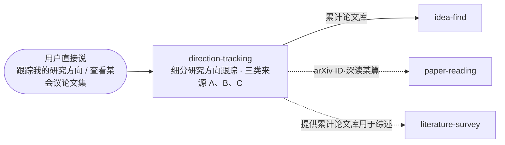
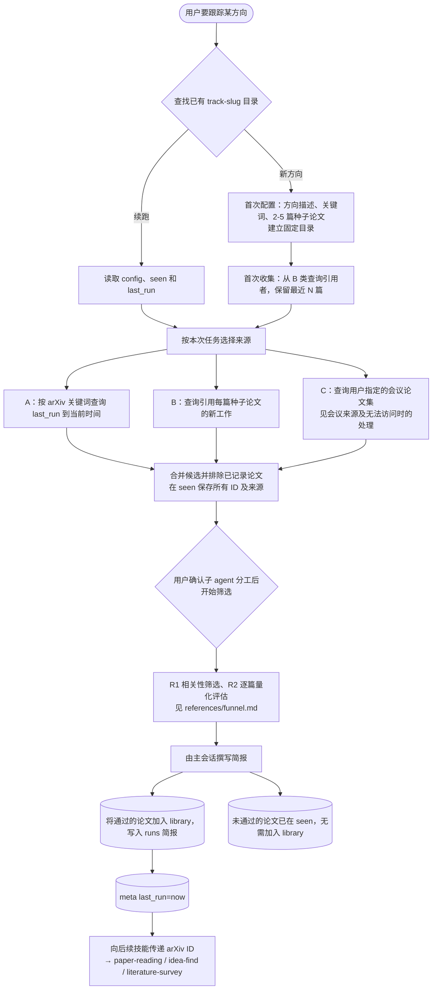
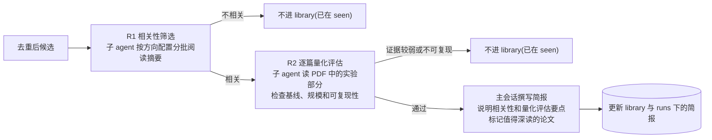

# 细分研究方向的论文跟踪

每次运行读取已有论文记录，只筛选本次新发现的论文，并将通过筛选的论文加入同一份论文库。

本技能以研究方向的相关性作为第一轮筛选条件。`arxiv-daily-paper` 用于查看所选分类的全部当日投稿，研究方向只影响展示顺序。

> 本技能在科研前期使用，只在本地机器上运行。

## 与其他技能的关系

本技能与 `arxiv-daily-paper`、`hf-trending-papers`、`paper-reading` 和 `literature-survey` 同属科研前期，负责持续更新细分方向的论文库。



> 完整流程见 `dl-assistant` 的全局图。此图只显示本技能直接涉及的交接。

## 边界

从相应来源获取论文，合并去重后先筛选相关性，再做量化评估。将通过筛选的论文加入论文库，写本次简报，按需交接论文的 arXiv ID。

其他任务按下表交接。

| 任务 | 交给 |
| --- | --- |
| 逐篇精读与讲解 | `paper-reading`(本技能只标记「值得深读」) |
| 判断研究缺口、选题或创新性 | `idea-find`（可参考累计论文库） |
| 整理领域综述 | `literature-survey` |
| 查看指定分类的全部当日投稿 | `arxiv-daily-paper` |
| 跟踪作者 | 此技能未提供 |
| 复现 / 跑代码 | 中期 `code-*` |

## 与用户协作

**分工**。主会话负责与用户沟通、判断、安排和委派任务。子 agent 执行批量任务，接收任务要求、读写文件路径和起始信息，因为它们无法读取主会话上下文。用户确定方向、配置如何调整以及关键研究判断。

**委派前确认**。说明计划派几个子 agent、各自承担什么任务、读写哪些文件、为什么这样分批，等用户确认或调整后再委派。常规更新在筛选前集中确认一次。首次收集或会议查询的候选较多时，第一轮结束后再汇报有多少篇相关，并确认是否进入第二轮。

**边查边讲**。随着结果出来向用户介绍新发现。简报完成后，用直白的话概括本批论文的主题和推荐理由，由用户决定进一步了解哪些论文。

具体任务分工如下。

- **主会话负责判断**。确定方向配置、组织简报、标记值得精读的论文，并决定交给哪个技能。
- **子 agent 负责批量处理并保存结果**。分批做 R1 相关性筛选、R2 量化评估，以及获取 C 类会议论文集。任务可并行，一律使用能读 PDF 和写文件的 `general-purpose`，禁用 `Explore`。

## 参考文件

| 文件 | 内容 | 何时阅读 |
| --- | --- | --- |
| `references/output-contract.md` | 目录结构、配置、去重记录、论文库、进度文件和简报的格式与保存顺序 | 创建目录或写文件时 |
| `references/lifecycle.md` | 四种运行方式和三类论文来源的获取步骤 | 选择运行方式或查询论文来源时 |
| `references/funnel.md` | 两轮筛选与简报的标准、数量限制和子 agent 任务模板 | 筛选论文时 |
| `references/conference-sources.md` | C 类会议来源、论文集查询方式及无法访问时的处理 | 查询 C 类会议论文集时 |

## 每个方向使用固定目录

在固定根目录 `<项目>/docs/direction-tracking/` 下为每个方向建立 `track-<方向slug>/`。后续运行继续更新同一个目录。

```
docs/direction-tracking/track-<方向slug>/
├── config.yaml       方向描述、关键词、同义词、2-5 篇种子论文的 arXiv ID 和创建时间，用户可编辑。提名的新种子经用户确认后加入
├── seen.jsonl        所有已获取论文（包括未通过的），记录 {id,source,date} 供下次去重
├── library.md        累计论文库，只收录通过两轮筛选的论文，沿用简报条目格式
├── runs/<日期>-<HHmm>.md   本次更新的简报，文件名带时间，同日多次更新互不覆盖
└── meta.json         上次更新时间 last_run 与进度索引，供下次继续运行
```

各文件的格式、保存顺序及来源字段见 `references/output-contract.md`。

> `seen.jsonl` 记录所有获取过的论文 ID，包括未通过筛选的论文，供下次去重，避免再次获取或筛选。`library.md` 只收录通过筛选的论文，供用户和后续技能查阅。参见 `dl-assistant` 的「没有状态文件这回事」和「产物即真相」。

> 结果保存在本地。后续技能在其他机器运行时，请用户提供所需文件。见 `dl-assistant` 的「所有技能共用的规则」。

## 工作流



### 按已有记录选择运行方式

检查固定目录 `docs/direction-tracking/` 下是否已有 `track-<方向slug>/`。

- **首次配置**。询问方向描述、关键词与同义词，以及 2–5 篇种子论文的 arXiv ID。建立方向目录，保存配置、空的已见记录、空论文库和初始进度文件，再做首次收集。
- **后续更新**。读取 config、seen 和 last_run，再检索新增论文。存在多个目录或无法确定对应方向时，请用户指定。
- 无法确定时向用户确认。

首次配置、首次收集、后续更新和按会议与年份查询的流程，以及三类来源的获取方式，见 `references/lifecycle.md`。

## 两轮筛选与简报

第一轮根据方向相关性排除不相关的论文。例如，关键词匹配但研究主题不同的论文不通过这一轮。



- **R1 相关性筛选**。子 agent 分批阅读摘要，依据方向描述、关键词和种子论文主题，给出相关或不相关的判断，并附一句理由。既检查关键词匹配的论文，也检查引用种子论文的工作。此轮不打分。
- **R2 逐篇量化评估**。沿用 arxiv-daily 第 2 轮的标准，检查对比基线年份与数量、是否包含 SOTA、实验规模、算力和可复现性。会议论文已同行评审，C 类只读摘要和元数据，做简要评估。
- **主会话撰写简报**。汇总论文与方向的关联和量化评估要点，标记值得精读的论文。需要精读时交给 `paper-reading`。从本次通过筛选的论文中提名 1–2 篇质量较高的新论文作为种子，用户确认后才更新 config，使引用检索继续贴合当前的研究方向。

各轮的标准、候选较多时如何限制数量，以及子 agent 任务模板，见 `references/funnel.md`。

## 通用约定

- **TaskList 跟踪流程**。选定运行方式后，按本次任务跟踪获取论文（按需使用 A、B、C）、去重、R1、R2、写简报、更新论文库和 meta，以及按需交接。每完成一步就标记完成。
- **符号展示**。会话公式用 Unicode，见 `dl-assistant` 的「所有技能共用的规则」。
- **语言**。使用中文。论文标题、方法名、数据集和指标保留英文。
- **工具**。A 类用 arXiv API 做关键词查询。B 类用 paper-search 的 `get_paper_citations`，传稳定的种子论文 arXiv 标识，见 `references/lifecycle.md`。C 类按 `references/conference-sources.md` 查询会议论文集。只使用查到的论文信息，标识约定见 `dl-assistant` 的「所有技能共用的规则」。
- **来源失败或没有结果**。告知用户哪个来源失败，继续处理其他来源。本次没有新论文时直接说明。
- **委派与记录**。按「与用户协作」确认分工并保存各批结果。

## 向其他技能交接（附 arXiv ID）

| 用户意图 | 交给 |
| --- | --- |
| 精读选定论文 | `paper-reading`(传 arXiv ID) |
| 从累计论文库寻找研究缺口 | `idea-find` |
| 根据累计论文库整理综述 | `literature-survey` |

## 核心原则

- **只处理新增论文**。`seen.jsonl` 包含全部已获取的论文 ID，包括未通过筛选的。已有记录的获取和筛选工作无需重做。
- **以方向相关性作为第一轮筛选条件**。
- **标记值得精读的论文**。全文精读交给 `paper-reading`，研究缺口的判断交给 `idea-find`。
- **按需使用三类来源**。A 类及时检索新投稿，B 类补充引用种子论文的相关工作，C 类补充经过同行评审的会议论文。`seen.jsonl` 用于跨来源去重。
- **委派前由用户确认**。按已确认的分工安排子 agent。
