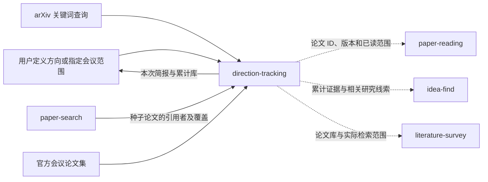
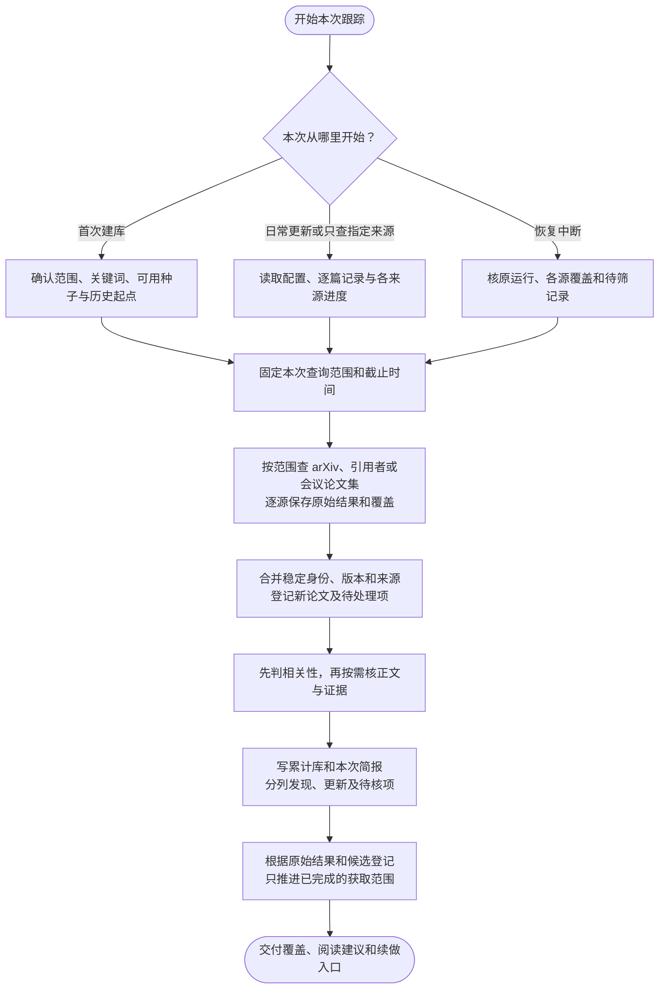

# 持续跟踪一个研究方向

按已确认的方向范围查论文，记录本库首次发现的论文、已收录论文的重要更新及待核查项。可以首次建库、日常更新、恢复中断，或只查一个指定会议。

## SKILL 交接关系



全局关系见 [dl-assistant](../dl-assistant/SKILL.md)。查看整类 arXiv 新投稿用 arxiv-daily-paper，查看 HF 社区热门用 hf-trending-papers。后续精读、选题或综述由用户选择。

## 产出与保存

默认保存在 `docs/direction-tracking/track-<方向slug>/`。每个方向共用累计记录，每次筛选有独立运行目录。续做先核原配置、未完成运行和待处理论文。

```text
track-<方向slug>/
├── config.yaml                # 方向范围、关键词、种子、回溯起点及配置版本
├── seen.jsonl                 # 逐篇追加处理记录、版本、理由与待办
├── library.md                 # 当前方向的累计论文库，按稳定身份合并
├── meta.json                  # 按配置和来源保存获取进度
└── runs/<UTC时间>/
    ├── config.yaml            # 本次实际使用的配置快照
    ├── raw/
    │   ├── source-coverage.json # 各源请求、已取范围、原始文件及待补任务
    │   └── <实际查询返回或论文集快照>
    ├── pdfs/<安全版本ID>.pdf    # 按需保存已核版本和可读性的 PDF
    ├── round1/part-<编号>.md   # 相关性分片及逐篇理由
    ├── round2/<安全版本ID>.md  # 按需保存正文和证据检查
    └── digest.md              # 首次发现、重要更新、待核与优先阅读
```

## 运行流程图



## 参考资料列表

| 资料 | 何时读 |
| --- | --- |
| [执行流程](references/workflow.md) | 首次建库、更新、恢复及部分来源失败时 |
| [来源与续做](references/lifecycle.md) · [会议论文集](references/conference-sources.md) | 计算增量范围、核种子引用者或实际会议范围 |
| [两轮筛选](references/funnel.md) | 判相关性、核正文证据、分片和推荐 |
| [记录格式与恢复](references/output-contract.md) | 写配置、逐篇记录、来源进度、累计库与简报 |

## 跟踪原则

1. 获取进度按来源独立计算。已获取未筛的论文保留待办。失败、截断、空结果和完整获取后的零新增分别记录。
2. 同一论文合并可核实的身份和来源。版本、配置或待核状态变化时，按实际影响重新检查。记录首次发现时间和论文公开时间。
3. 累计库按方向相关性收录。正文或证据暂缺时注明实际已读范围和下一步。推荐说明为什么值得读以及读时核什么。
4. 用户确认方向、配置实质变化与新增种子。需要委派时先给分片任务、输入和落点，由用户确认分工后执行；当前环境不支持并行时可顺序处理。
