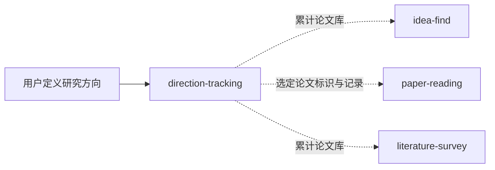

# 研究方向持续跟踪

针对用户定义的研究范围获取论文、检查相关性并累计保存。避免重复推荐同一版本，保留未完成工作；发现修订版、配置变化或之前处理失败时允许重新核查。这里的“新”指本库首次发现或本次新增记录，不一定是刚发表。

## 在系统中的位置

全局流程见 `dl-assistant`。通常在本地项目目录运行，文件跨机器交接遵循其“横切规范”。不自动执行下游任务。

## 范围与用户确认

- 方向配置写明包含的问题、排除的问题、边界案例、关键词与同义词、参考论文、首次回溯范围。相关性是本 skill 的主要筛选依据，证据不足不自动等于不相关。
- 用户确认方向和配置变更。新增参考论文可由 agent 提名，确认后再写配置。
- **派子 agent 前先确认**：说明候选数量、任务分片、各自读写文件及理由，等用户同意后执行。常规增量可一次确认两轮分工；首次建库或会议候选很多时，在相关性检查后汇报再确认正文检查范围。
- 子 agent 接收方向配置、任务与输入输出路径，每个分片写独立文件；主 agent 核对覆盖与重复后汇总。按当前环境选择具备所需读写能力的 agent，不绑定固定类型名。
- 运行不是自动定时服务；用户调用时执行，不承诺持续后台监控。

## 资料与保存

默认 `<项目>/docs/direction-tracking/track-<slug>/`，尊重用户已指定的位置。先查已有方向，明确匹配时续跑；存在多个无法区分的候选才询问用户。

| 参考文件 | 使用时机 |
| --- | --- |
| [references/output-contract.md](references/output-contract.md) | 建库、记录状态、合并身份、恢复与写报告 |
| [references/lifecycle.md](references/lifecycle.md) | 首次建库、增量获取、配置调整、各来源进度 |
| [references/funnel.md](references/funnel.md) | 相关性及正文检查、阅读建议 |
| [references/conference-sources.md](references/conference-sources.md) | 获取会议论文集与核对跨来源身份 |

## 工作流程

1. 读取方向配置、逐篇处理记录及各来源进度，优先确认上次未完成事项。配置或记录格式变化时按参考文件处理，不因出现于 `seen.jsonl` 就跳过。
2. 首次建立方向时，请用户确认包含/排除/边界定义、回溯时间及参考论文。关键词检索与引用者检索结合使用；会议来源按用户需要加入。没有参考论文时可先用关键词检索，不强迫提供不存在的信息。
3. 记录本次配置版本、固定查询截止时间与各来源范围。获取原始结果、合并身份，保存新候选为待筛选；抓取失败、分页未完成或截断均保留未完成范围。
4. 经用户确认分工后，逐篇检查相关性及必要的正文信息。不相关项写理由，边界项或资料不足项待核查，相关项记录证据评价与阅读层次。正文不可用不能直接称论文不可复现。
5. 主 agent 汇总累计库与本次报告，分别列首次发现论文、旧论文的重要更新、待核查项。每篇重点推荐附具体阅读问题；不确认创新性，也不替用户判定研究课题价值。
6. 核对原始结果已保存、候选均有记录、来源进度与实际完整性一致后写入进度。交付报告路径、覆盖情况及后续选项，完成当前任务。

## 来源与完整性

- **A：arXiv 关键词**。脚本 `scripts/fetch_arxiv_keywords.py` 按 UTC 提交日期查询。将配置中的同义词展开为短语列表。日期包含两端；展示解析后的具体日期，不自动换日期。重叠查询有助于发现延迟收录，但不能保证完全覆盖。
- **B：参考论文的引用者**。用 `paper-search` v2 的稳定 paper_ref 获取引用者；get_query_results 浏览快照，extend_query 才继续上游获取或补查失败。长期记录保存稳定论文标识及版本，不依赖本地查询 ID。引用数据库可能不完整或滞后，不能声称囊括所有引用者。
- **C：会议论文集**。核实会议、年份、主会/研讨会等范围与官方列表。录用信息不能替代内容检查。

每个来源独立记录成功范围和未完成任务。返回空结果、源不可用、只取部分结果及完整获取后的零新增分别说明；任何一源失败不阻止处理其他已获得数据，也不推进失败来源的进度。数量上限控制本次评估成本，剩余候选保留待处理，不以截断结果代表全部。

## 本次覆盖情况与报告

报告首先列每个来源：请求范围、实际获取范围、数量、是否截断/失败、完成到哪里、剩余任务。分别汇报获取数、相关数、已收录数、待核查数。源数据未完整时写“在已检查范围内未发现新增”，不能写成该方向没有进展。

推荐不是固定配额，通常列 3–5 篇重点，其余相关论文仍进入累计库。研究内容和证据判断分开；每篇解释为何相关及建议阅读时核查的问题。全文讲解用 `paper-reading`，课题与创新性判断用 `idea-find`，系统综述用 `literature-survey`。

标题、方法名、数据集和指标保留原文，其余中文。数字、论文身份与结论有真实来源，未知则明确说明；公式与稳定论文标识遵循 `dl-assistant` 的“横切规范”。
