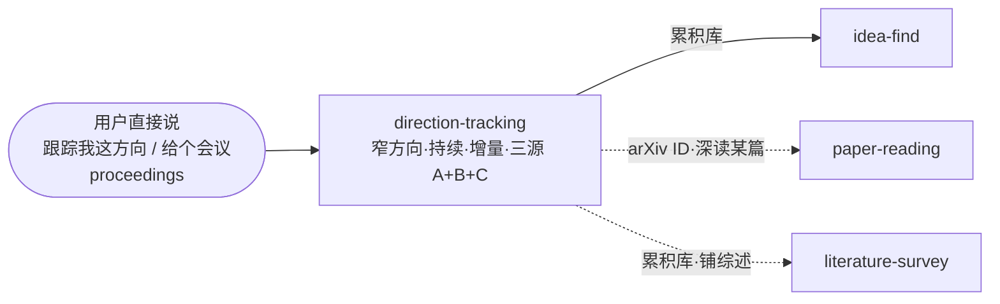
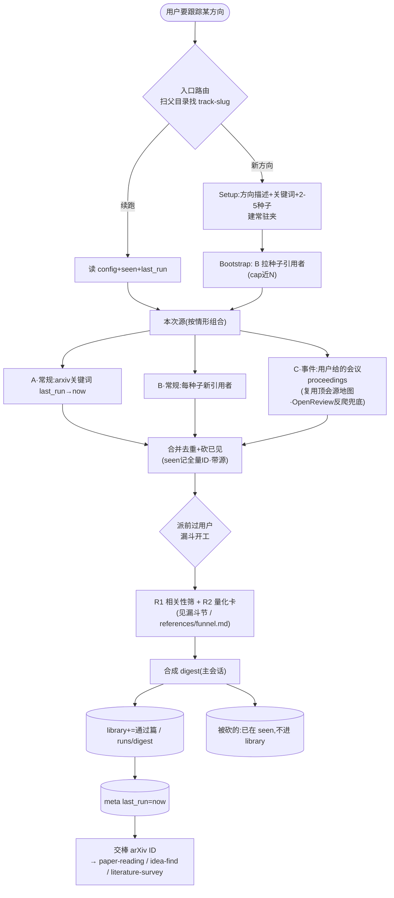
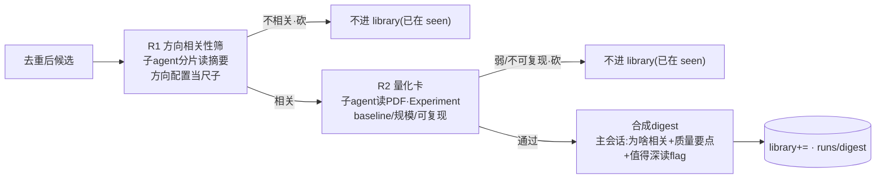

# 窄方向论文跟踪器

给一个细分研究方向,长期盯着它的最新进展——**有记忆地增量跟踪**:只推新论文、绝不重复推老的,跑得越多、方向论文库越攒越大。

跟 `arxiv-daily-paper` 互补:arxiv-daily 是**全域类目漏斗**(按 `cs.CV` 整类拉全量、方向只置顶、服务跨领域暴露);本 skill 是**窄方向持续跟踪**(严过滤、方向相关性是主滤、累积)。要广撒看前沿 → arxiv-daily;要长期盯一个细分方向 → 本 skill。

> 本 skill 只在**本地机器**跑(前期·输入阶段)。

## 在系统里的位置（局部）

前期·本地机器,跟 `arxiv-daily-paper` / `hf-trending-papers` / `paper-reading` / `literature-survey` 并列的输入节点。区别:它是**唯一"窄方向 + 持续 + 增量"**的,其他都广撒或一次性。



> 整体架构看 `dl-assistant` 全局图;本 skill 只画相邻 skill。

## 边界

**做**:三源抓取 → 去重 → 相关性+量化漏斗 → 累积库 + digest → 交棒 arXiv ID。

**不做**（交给相邻 skill）:

| 不是本 skill 的活 | 交给 |
| --- | --- |
| 深读单篇、讲懂 | `paper-reading`(本 skill 只标"值得深读"flag) |
| 判 gap / 找 idea / 创新性够不够 | `idea-find`(累积库是它的富矿) |
| 铺领域综述 | `literature-survey` |
| 整个类目全域质量漏斗(广撒) | `arxiv-daily-paper` |
| 跟踪作者 | (不做,盲区已弃) |
| 复现 / 跑代码 | 中期 `code-*` |

## 怎么跟用户协作（核心原则）

**三个角色**:**主会话**(掌舵——对话 / 判断 / 调度 / 派子 agent)/ **子 agent**(体力活——读不到主会话上下文,派时把任务 + 读写文件 + 起点信息全塞进 prompt)/ **用户**(真人研究者——方向定义、配置演化、关键判断归用户)。

**派子 agent 前过用户**(贯穿全程):每次要派子 agent(漏斗的 R1 / R2 分片),先说清"准备派几个、每个干啥、读写哪、为啥这么切",等用户点头(或调整)再发。常规增量 run **轻过**(漏斗开工前一次性过);bootstrap / C 量大时,R1 完加一个中途汇报("X/Y 篇相关,进 R2?")。

**边查边讲**:子 agent 抓回来 / 漏斗筛出来的论文,用户大概率没读过——全是新信息。不攒到最后倒,digest 出来顺手用白话讲"这批新论文长啥样、哪几篇值得看",再让用户决定深入哪个。

**判断 vs 体力活**:

- **判断(主会话亲自)**:方向配置怎么定、digest 怎么组织、哪篇值得深读 flag、交棒给谁。
- **体力活(派子 agent,必须落盘)**:R1 相关性筛分片、R2 量化卡分片、C 抓 proceedings。可并行、吃 token,交出去;每个子 agent 产出落盘。子 agent 一律 `general-purpose`,禁 `Explore`(要读 PDF / 落盘,Explore 干不了)。

## references 文件列表

| reference | 讲什么 | 什么时候读 |
| --- | --- | --- |
| `references/output-contract.md` | 目录树 / config.yaml / seen.jsonl / library.md / meta.json / digest 各 schema + 落盘次序 | 建夹子、写各文件、理清全局时 |
| `references/lifecycle.md` | 四种入口(setup / bootstrap / 增量 / C)流程 + 三源(A / B / C)抓取机制 | 跑某个入口、实现某源时 |
| `references/funnel.md` | R1 相关性筛 + R2 量化卡 + 合成 digest 的具体判据 + 控量 + 派子 agent 模板 | 跑漏斗时 |
| `references/conference-sources.md` | C 顶会源地图 + 各 venue 抓取 + OpenReview 反爬兜底 | 跑 C(会议 proceedings)时 |

## 落盘：一个方向一个常驻夹

**保存目录写死 `<项目>/docs/direction-tracking/`**,在其下建 `track-<方向slug>/` 常驻夹,**每次 run 更新同一个夹子**(累积,不是按日期摊):

```
docs/direction-tracking/track-<方向slug>/
├── config.yaml       方向配置(用户可手改):方向描述、关键词+同义词、2-5 种子 arxiv ID、创建时间(种子可演化:run 时 skill 提名、用户确认才加)
├── seen.jsonl        已拉过的论文全清单(带源 {id,source,date},去重真相源,含被漏斗砍掉的)
├── library.md        累积库:只收通过漏斗的论文(digest 条目格式,随时间长大)
├── runs/<日期>-<HHmm>.md   每次 run 的 digest("自上次以来这方向的新论文";带时间,同日多次 run 不互相覆盖)
└── meta.json         last_run 水位 + 进度索引(续跑恢复用)
```

各文件 schema、落盘次序、seen 带源格式见 `references/output-contract.md`。

> **seen 是去重真相源**:记所有拉过的 ID(含被漏斗砍掉的),下次不再重复拉 / 过滤——增量不重跑的关键。library 只收通过的,是给人和下游看的价值产物。呼应 dl-assistant「没有状态文件、产物即真相源」。

> 产出在本地;若下游(`idea-find` 等)在别的机器,找用户弄过去——横切规范见 `dl-assistant` SKILL.md「横切规范」。

## 工作流



### 进来先路由(不默认从头)

扫固定目录 `docs/direction-tracking/` 下有没有 `track-<方向slug>/`:

- **没有 → setup**:问方向描述 + 关键词(同义词)+ 2-5 篇种子 arxiv ID,建夹子(config + 空 seen + 空 library + meta 骨架)→ 进 bootstrap。
- **有 → 续跑**:读 config + seen + last_run → 进增量。多个夹子 / 歧义就问用户跟哪个。
- **拿不准 → 追问**,别猜。

四种入口(setup / bootstrap / 增量 / C)的详细流程 + 三源抓取机制见 `references/lifecycle.md`。

## 漏斗（两轮过滤 + 合成）

核心区别:**R1 方向相关性筛是命门**——arxiv-daily 是"方向只置顶绝不丢",本 skill relevance 是主滤,A 的假阳全靠 R1 砍。



- **R1 方向相关性筛**:子 agent 分片读摘要,拿方向配置(描述 + 关键词 + 种子主题)当尺子,判相关 / 不相关 + 一句理由,**不打分**。砍 A / B 的假阳。
- **R2 量化卡**:复用 arxiv-daily round2 判据(baseline 年份 / 数量、SOTA、规模、算力、可复现)。**C 调轻**(顶会已 peer-review,读摘要 + 元数据做轻量卡即可)。
- **合成 digest(主会话)**:揉"为啥相关 + 质量要点",标值得深读 flag。**不做 full 精读**(那是 `paper-reading` 的活,交棒)。**种子演化**:从本次通过篇里提名 1-2 篇高质新论文进 config 种子列表(用户确认才写)——B 源语义锚跟着方向长,防老种子引用网络漂移。

每轮判据、控量(bootstrap / C volume 爆时的分片采样)、派子 agent 模板见 `references/funnel.md`。

## 横切规范

- **TaskList 跟踪流程**:路由后按入口建流程任务(抓取 A/B/C 按组合 / 去重 / R1 / R2 / 合成 digest / 累积+meta / 交棒),每步完成即勾——多入口多阶段,防跳步。
- **符号展示**:会话公式用 Unicode——横切规范见 `dl-assistant` SKILL.md「横切规范」。
- **语言**:中文;论文标题、方法名、数据集、指标保留英文。
- **工具**:A 用 arxiv API 关键词查询;B 用 paper-search `get_paper_citations`(传入种子的稳定 arXiv 标识,机制见 `references/lifecycle.md`);C 按顶会源地图抓(见 `references/conference-sources.md`)。**不编造**;论文标识规范见 `dl-assistant` SKILL.md「横切规范」。
- **诚实克制**:源失败如实说(哪个挂了,继续跑别的);无新论文就说"本期无新",不凑数。
- **派子 agent 过用户 + 落盘零信息损失**:见「怎么跟用户协作」+ 各 reference。

## 衔接下游（交棒 arXiv ID）

| 用户意图 | 交给 |
| --- | --- |
| 深读某篇 / "帮我读第 X 篇" | `paper-reading`(传 arXiv ID) |
| 从累积库找 gap | `idea-find` |
| 把累积库铺成综述 | `literature-survey` |

## 核心原则

- **增量不重跑**:seen 记全量 ID(含砍掉的),已落盘的抓取 / 筛选绝不重做,只做增量。
- **方向相关性是主滤**:R1 是命门,区别于 arxiv-daily 的"方向只置顶"。
- **不做精读、不判 novelty**:只标值得深读 flag,深读交 `paper-reading`、gap 判断交 `idea-find`。
- **三源互补**:A 及时、B 语义、C 高质量;跨源去重靠 seen 兜底。
- **派子 agent 前过用户**:不自作主张一次全发。
