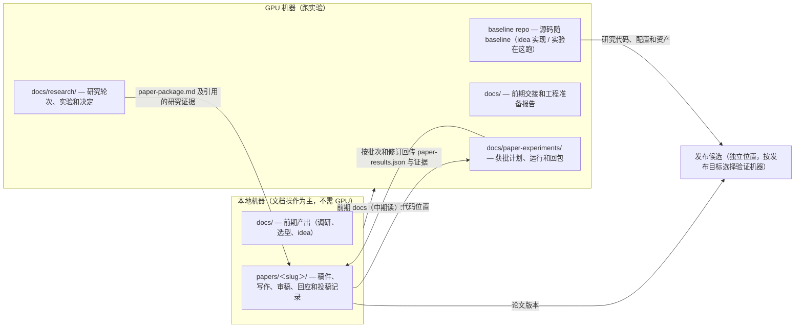

# DL Assistant 系统总览

## 核心定位

这是 dl-assistant 科研 skill 系统的**总览与全局地图**——一份参考文档，不做路由、不执行具体工作。它讲三件事：

1. **全局 skill 流向图**：系统有哪些 skill、如何衔接、之间交接什么文件（见下节）。
2. **三阶段划分**：前期输入 / 中期 coding / 后期产出。
3. **跨机器模型**：产物落哪、怎么协作（见「全局目录布局与跨机器同步」）。

**什么时候读它**：想搞清楚系统怎么连、某个 skill 的前后交接是什么、或想找该用哪个 skill 时。**其他 skill 在自己的局部依赖图里只画相邻 skill，要看全局就按名引用本文档。**

## 共同研究流程

**提出假设 → 设计实验 → 收集数据 → 分析并修订假设 → 提出下一步假设。**

每轮明确「原来相信什么、实际观察到什么、因此改变了什么判断」。`idea-find` 形成首轮研究问题、假设和取证计划，`code-idea-execution` 按计划取得证据并记录实际条件与偏差，`code-idea-iterate` 根据证据修订判断，决定下一轮要减少哪个未知。

### 从实验到论文

- **实验前**，在研究说明中回答「即使做成功，结果会回答什么科学问题，论文能据此提出什么新结论？」在本轮取证方案中写清对照和测量怎样区分可能的解释。
- **实验执行后**，`code-idea-execution` 报告实际执行、测量质量和观察到的结果。论点的证据判断（`evidence_assessment`）说明本轮证据在实际条件下怎样支持或削弱具体命题，并标出仍无法区分的解释。
- **研究判断时**，`code-idea-iterate` 用实际数据重新回答实验前的问题。说明得到的发现改变了什么认识、哪条替代解释仍成立、结论适用于哪里，以及相对最接近的已有工作新增了什么。研究贡献和是否开始写作分别判断。`supported` 的数量、运行成功与代码标签均只提供各自对应的信息。
- **交接论文时**，围绕科学问题、发现、证据、替代解释、适用边界和相对已有工作的新增组织材料。按每项证据在论证中的作用选择实验和图表，说明核心论证还有哪些缺口。`code-idea-iterate` 据此给出写作建议，由用户决定是否启动写作。截稿时间可影响写作安排和主张范围，证据缺口如实保留。

## 核心设计哲学

**人在回路。** Agent 主动搜集证据、分析、筛选并给出有理由的推荐，**放大人的信息处理带宽**，把问题**推进到人可以下判断的临界点**。研究方向、投入和最终主张由人决定。各 skill 在需要用户决定的地方设确认点，并保留供用户核对的报告和可供下游读取的记录。

**产物即真相。** 判断「进行到哪一步」的唯一依据是磁盘上的真实产物——它们不会过期、不会和实现脱节。一切关键结论必须落盘：**可审计**（数字来自真实 run，能追回命令与配置）、**可回溯**（轮次索引、实际 run 的 commit 和收尾 tag 能定位代码）、**可追踪**（产物交接靠显式契约，不靠记忆）。会话可以断、机器可以换，只要产物在，上下文就能重建。

## 所有技能共用的规则

各技能的正文只需用一行引用本节。有专用约定时，例如某个技能需要额外的符号记法，可在对应技能中补充。其他技能中引用的「横切规范」也指本节。

- **符号约定**：会话里给用户看的公式/符号用 Unicode（σ、λ、≥、×10⁻³），写进落盘 markdown 才用 LaTeX。
- **论文标识**：落盘文件和给用户的内容里，论文用 arXiv ID / DOI / URL 标识，并注明已核版本。paper-search v2 调用也使用稳定外部标识，跨机器交接用导出的来源和结果。
- **跨机器交接**：skill 只声明「需要哪个文件」，不规定怎么传——文件不在找用户要，不绑传输工具（详见「全局目录布局与跨机器同步」）。

## 科研三阶段全景

DL Assistant 把一个科研项目划分为三阶段，每阶段对应一组 skill：

| 阶段               | 干什么                                          | skills                                                                                                                           |
| ------------------ | ----------------------------------------------- | -------------------------------------------------------------------------------------------------------------------------------- |
| **前期（输入）**   | 找方向 / 读论文 / 调研 / 想 idea                | arxiv-daily-paper、hf-trending-papers、direction-tracking、paper-reading、literature-survey、idea-find、baseline-survey          |
| **中期（coding）** | 搭环境 / 复现 / idea迭代                        | code-project-setup、code-paper-reproduction、code-idea-prepare、code-reading、code-idea-execution、code-idea-iterate             |
| **后期（产出）**   | 写论文 / 做实验 / 审稿 / 回应 / 投稿 / 代码发布 | writing-paper、writing-paper-review、writing-paper-response、writing-paper-submission、code-paper-experiment、code-paper-release |

通常前期在本地机器、中期在 GPU 机器、后期写作线在本地 + 实验线在 GPU 机器；各 skill 产各自的产物，靠下方「全局目录布局与跨机器同步」做跨机器协作。

## 配套 skill

下列 MCP 配套技能在各阶段均可按需使用。

| skill                                    | MCP server       | 干什么                                                                                                                                   |
| ---------------------------------------- | ---------------- | ---------------------------------------------------------------------------------------------------------------------------------------- |
| [paper-search](../paper-search/SKILL.md) | paper-search-mcp | 论文检索（搜索 / 详情 / 引用追踪 / 作者·机构）                                                                                           |
| [tex-mcp](../tex-mcp/SKILL.md)           | tex-mcp          | 读 arXiv 论文源码（章节正文 / 图 / 表 / 参考文献）——**arXiv 论文内容读取的首选通道**，用 `tex_open` 打开固定版本，源码不可用时用 pdf-mcp |
| [pdf-mcp](../pdf-mcp/SKILL.md)           | pdf-mcp          | PDF 文件操作（提取文字·图片 / 搜索 / 渲染页面）——本地/成品 PDF 专用 + tex-mcp 的兜底                                                     |
| [overleaf-mcp](../overleaf-mcp/SKILL.md) | overleaf-mcp     | 绑定本地 Git 仓库、远端编译、查日志与 PDF。正文编辑和同步走 Git CLI。                                                                    |

- [W&B](../wandb/SKILL.md) 提供可选的实验记录和查询支持。
- [research-presentation](../research-presentation/SKILL.md) 用于制作汇报幻灯片。

上表的操作按各 MCP v2 说明执行。TeX 和 PDF 打开后以返回的 `document_id` 继续读，Overleaf 用同一轮的 `compile_id` 查日志和产物。

## 全局 skill 流向图

箭头标明技能之间交接的材料。项目可以从已有成果或用户指定的任务进入。具体的运行步骤和检查项见各技能的流程图。

```mermaid
flowchart LR
    subgraph PRE["前期 · 输入（本地）"]
        direction TB
        AD[arxiv-daily-paper]
        HF[hf-trending-papers]
        DT[direction-tracking]
        PR[paper-reading]
        LS[literature-survey]
        IF["idea-find"]
        BS[baseline-survey]
    end
    subgraph MID["中期 · coding（GPU 服务器）"]
        direction TB
        CPS[code-project-setup]
        CPR[code-paper-reproduction]
        CIP[code-idea-prepare]
        EX["code-idea-execution"]
        IT[code-idea-iterate]
        CR[code-reading]
    end
    subgraph POSTW["后期 · 写作线（本地）"]
        direction TB
        WP["writing-paper"]
        WPR[writing-paper-review]
        WRESP[writing-paper-response]
        WPS[writing-paper-submission]
    end
    subgraph POSTE["后期 · 实验线（GPU 服务器）"]
        direction TB
        CPE[code-paper-experiment]
    end
    REL[code-paper-release]

    DOCS[("文献调研·baseline 选型")]
    PKG[("论文材料（paper-package.md）与代码仓库")]
    EPLAN[("获批计划<br/>plan-vN.md + plan-vN.json")]
    EDATA[("分批结果<br/>paper-results.json 与可复查证据")]
    PDF[/核查后的稿件或论文 PDF/]
    GUIDE[/投稿指南及人工提交待办/]
    REPO[/release repo/]

    AD -.->|关注的论文| IF
    HF -.->|关注的论文| IF
    PR -.->|精读笔记| IF
    LS -.->|领域地图| IF
    DT -.->|累积库| IF
    IF -->|研究说明草稿（候选代码仓库线索及研究设想类型）| BS
    IF -.->|研究说明、首轮取证方案与初始论点记录| EX
    BS --> DOCS
    DOCS --> CPS
    CPS -->|setup report| CPR
    CPS -.->|setup.json| CR
    CPR -->|reproduction report| CIP
    CIP -->|prepared baseline repo| CR
    CR -->|读懂 baseline 再动手| EX
    CPR -.->|评估后跳过代码清理（记录理由）| CR
    EX -->|实际观察、证据判断与适用边界| IT
    IT -->|继续迭代，交接研究说明、本轮取证方案和论点记录| EX
    IT -->|进入论文写作与补充实验阶段| PKG

    PKG --> WP

    WP -->|"固定版本的稿件与指定材料"| WPR
    WPR -->|"problem-list.json 与稿件校验值"| WRESP
    WRESP -->|"获批 revision-brief.json"| WP
    WP -->|"revision-result.json、稿件与核查证据"| WRESP
    WP -.->|"稿件版本、投稿要求与待办"| WPS
    WPR -.->|"合规疑问及检查范围"| WPS
    WRESP -.->|"回复定稿、稿件版本及未决项"| WPS
    WPS -.->|"适用要求与材料问题"| WP
    WPS -.->|"回复要求与待核项"| WRESP
    WP --> PDF
    WPS --> GUIDE

    WP --> EPLAN
    EPLAN --> CPE
    CPE --> EDATA
    EDATA --> WP
    WP -.->|"核心主张未决或新证据动摇贡献"| IT
    CPE -.->|"实测证据触及核心研究判断"| IT
    WRESP -.->|"核心研究未决、依据与影响"| IT

    WP -.->|"论文版本与数据口径"| REL
    EDATA -.->|"相关结果、配置与资产出处"| REL
    REL -.->|"稿件数字、链接或说明需更正"| WP
    REL -->|"可审阅候选，按授权公开"| REPO
```



- 方框为技能，圆柱为跨阶段的交接材料，平行四边形为用户可取得的产物。箭头上的文字说明交接内容。
- **实线**表示采用该流程时的主要交接。**虚线**表示按任务发生的补充输入、分支或返回。
- **改交接必同步三张图**：增删/改任何一条交接，本图 + 两端 skill 各自的局部图一起改，别只改一处。
- 中期由 `code-idea-execution` 执行实验，`code-idea-iterate` 分析证据后与用户决定是否继续迭代。进入论文阶段后，`code-idea-iterate` 生成 `paper-package.md`，记录科学问题、主要发现、支撑证据、替代解释、结论边界、相对已有工作的新增和剩余论证缺口。写作端从中定位研究证据、待解决的问题和对应代码版本。
- 中期主线依次包括环境准备、复现、代码清理、代码阅读和方案实现。**代码阅读（`code-reading`）是必经步骤**。实现研究方案之前，先带用户读懂基线代码（见「核心设计哲学」）。
- `baseline-survey` 按用途选择代码仓库。**用于比较的基线代码**适用于改进直接前驱方法的研究。**用于分析实验的代码仓库**适用于组合已有研究发现或先做分析的研究，这类研究没有直接前驱仓库，第一版用分析实验检验假设。后一种情况下，`code-paper-reproduction` 以仓库自己报告的参考结果为复现目标，核查这套代码能否用于后续测量。
- 复现后通常先做代码清理，再进入代码阅读。复现交接时，根据仓库规模、未使用代码和消融实验残留的多少、方案涉及的改动范围，以及预计的迭代次数，判断是否需要清理。仓库较小、代码整洁且只涉及局部改动时，**记录理由后可跳过清理，直接进入代码阅读**。交接内容见[论文复现流程](../code-paper-reproduction/references/workflow.md)。
- 需要论文补充实验时，`writing-paper` 将获批的 `plan-vN.md`、`plan-vN.json` 和实际代码位置交 `code-paper-experiment`。执行端记录 `run-spec.json`，同一批可按不同修订交回 `paper-results.json`、引用快照和实际证据。写作端按批次和修订核结果。核心研究仍未决时回 iterate。
- 预审把指定的 `problem-list.json` 和稿件校验值交回应端。回应端向写作端发获批 `revision-brief.json`，写作端用 `revision-result.json` 回传实际改动、稿件及证据。正式回复按实际核查结果定稿，投稿指南记录适用要求及用户需完成的平台操作。
- **前期文献库不直接交给论文写作技能**。前期调研报告和精读笔记供用户了解领域、判断研究价值。论文写作时，围绕具体论点选取参考文献，包括研究方案所基于的核心论文，以及需要比较的相关工作。因此，图中前期调研与论文写作之间没有交接箭头。

## 全局目录布局与跨机器同步

这套 skill 把机器分成**两类**（各自数量不限、不关心具体几台、什么拓扑）：

- **本地机器**：干**文档类**的活——文献调研、读论文、想 idea、写论文、审稿回应，不需要 GPU。目录通常为 `docs/` 和 `papers/`。论文可用本地 LaTeX 或已绑定的 Overleaf 工程。
- **GPU 机器**：**跑实验**——搭环境、复现、idea 实现 / 迭代、跑论文实验。在 baseline 仓库中保存 `docs/` 下的前期交接、工程准备报告和 `docs/research/` 下的中期研究轮次。发布候选在独立位置整理，验证机器按发布目标确定。

> **运行位置假设**：这套 skill 假设 agent 在**项目根目录**下被启动——本地机器站在本地项目根（= 方向工作目录根）、GPU 机器站在 GPU 项目根（即下面树里的 `<项目>/`），所有 `docs/`、`papers/` 都相对这个根。**如果 agent 发现当前目录不像项目根（没有 `docs/` 之类），别猜，先问用户项目根在哪。**

两类机器上的标准目录布局：

```
本地机器：
<项目>/
└── docs/                      # 人会回看的交接文档（前期产出 + 后期 skill 独立使用产物）
    ├── arxiv-daily/           # arxiv-daily-paper：每日简报（按日期）
    ├── hf-radar/              # hf-trending-papers：雷达快照（按时间窗）
    ├── direction-tracking/    # direction-tracking：track-<slug>/ 累积库（常驻，增量更新）
    ├── paper-reading/         # paper-reading：精读笔记（一篇论文一个文件夹）
    ├── literature-survey/     # report.md、survey.json、reading-list.md、coverage-review.md 等
    ├── idea-find/             # idea-find：idea 文件夹（研究说明草稿 + 实验计划 + 初始论点记录）
    ├── baseline-survey/       # baseline-survey：选型报告（baseline-survey.json + report.md + facts/）
    ├── writing-paper-review/<slug>/round-N/  # 独立预审或复查，布局见下
    └── submission-guide/<日期>-<标识>/  # 独立查规则或核材料，主入口 submission-guide.md

<项目>/papers/<slug>/  # 论文根，可使用本地 LaTeX 或已绑定的 Overleaf 工程
├── <主文件>.tex、sections/、tables/、figures/、refs.bib
├── _draft/
│   ├── config.json、paper-state.json、venue-contract.md、venue-contract.json
│   ├── blueprint.md、content/、references.json、canonical-values.json
│   ├── visuals/、scripts/、build/、writing.log
│   ├── experiments/
│   │   ├── plan-vN.md、plan-vN.json                 # 写作端获批计划
│   │   └── <batch-id>/handoffs/rev-<N>/
│   │       ├── paper-results.json、plan-vN.json、run-spec.json
│   │       └── <随包证据>
│   └── revisions/<response-id>/<return-id>/
│       └── revision-result.json                     # 实际改稿回传与证据引用
├── review/round-N/
│   ├── review-run.json、workflow-result.json、tasks/  # 当轮输入和原始任务
│   ├── materials/、sources/                          # 按需保存本轮材料和检索来源
│   └── handoffs/rev-<N>/
│       ├── problem-list.json、problem-清单.md
│       └── 审稿总报告.md、validation.json、records/
├── response/<response-id>/
│   ├── response-state.json                           # 当前记录
│   ├── receipts/<return-id>/                         # 收到的改稿回传及证据
│   └── handoffs/<stage>-<N>/
│       ├── response-state.json、response-map.md      # 该阶段记录快照
│       └── revision-brief.json、rebuttal-letter.md、validation.json
└── submission/<阶段>-<轮次>/
    ├── submission-guide.md                           # 官方要求、实际核查和人工提交待办
    ├── checks/                                      # 可含 material-checks.json、build-record.json
    └── renders/                                     # 按需保存页图
```

> 注意：`papers/` 里是嵌套 git repo——方向目录本身也是 git repo 时，把 `papers/` 加进方向目录的 `.gitignore`，避免父 repo 把嵌套 clone 当 submodule 噪音。

```
GPU 机器：
<项目>/           # = baseline repo（baseline 自己的源码结构，不动）
├── docs/        # 新建：前期 docs（拿过来）+ 中期报告
│   ├── idea-find/                 # 从前期项目整体复制过来的研究资料
│   ├── code-project-setup/        # setup 报告（setup.json + setup-report.md）
│   ├── code-paper-reproduction/   # reproduction 报告（reproduction.json + report.md）
│   ├── code-idea-prepare/         # cleanup 报告（cleanup.json + cleanup-report.md + coverage/）
│   ├── code-reading/             # 诊断脚本 + 阅读笔记
│   ├── paper-experiments/<batch-id>/  # 论文实验批次
│   │   ├── plan-vN.md、plan-vN.json、run-spec.json
│   │   ├── experiments/<exp-id>/
│   │   │   ├── report.md、configs/、scripts/
│   │   │   └── runs/<attempt-id>/                   # command.sh、meta.json、metrics.json、日志与产物
│   │   └── handoffs/rev-<N>/
│   │       ├── paper-results.json、plan-vN.json、run-spec.json
│   │       └── <随包证据>
│   └── research/                     # 中期研究记录
│       ├── PROJECT_CONTEXT.md    # 项目背景及资料指针
│       ├── research-rounds.json  # 按顺序登记已建立的轮次
│       ├── v<N>-<slug>/          # research-spec.md、research-plan.md、claims.json
│       │   ├── claim-code-map.md
│       │   ├── experiments/     # index.json、单实验报告和运行
│       │   ├── executions/      # 各执行批次的独立核查
│       │   ├── decisions/       # 基于本轮证据作出的决定
│       │   ├── execution-conclusion.md
│       │   └── execution-conclusion.json
│       └── paper-package.md     # 用户决定进入写作时生成
└── [baseline 自己的源码 …]

<发布候选目录>/           # 可发布的代码、README、许可证和适用的复现材料
<内部记录目录>/<release-id>/  # RELEASE_REPORT.md、checks/ 和按需保存的基准
```



在 baseline 仓库的 `docs/research/` 中，execution 和 iterate 共用轮次目录。一轮可有多批执行和多个决定。首轮由 execution 登记，后续由 iterate 在确认建轮时追加。研究代码默认沿 `main` 推进，实际起点和收尾代码按[研究轮次登记与 Git 交接](references/research-rounds.md)记录。

**跨机器文件交接**。前期资料可按完整目录复制到研究仓库，例如把 `docs/idea-find/` 带到实际运行仓库的 `docs/`。写作端接收 `paper-package.md` 及其引用的证据，实验端接收获批计划和实际代码位置；回包按整个修订目录转交，保留相对路径及外部证据的位置和可访问方式。用实际文件、版本和摘要对账。传输工具按项目约定选择。

> **没有状态文件这回事。** 判断"进行到哪一步"靠的是**按需扫描真实的产物文件**（轮次索引、实验记录、各种报告、论文 manifest）——产物即真相（见「核心设计哲学」），不维护任何 `PROJECT_STATE` 之类的中枢。跨机器也无需带状态文件：每个 skill 都读自己的产物自恢复上下文，靠本节定义的协作机制把产物送到该在的机器上。

> **归位判据（产物放哪个目录）**：前期交接和工程准备材料按 skill 保存在 `docs/` 下。中期取证、判断及轮次索引统一在 `docs/research/`。论文与发布成果分别在 `papers/<slug>/` 和独立发布仓库。
