# DL Assistant 系统总览

## 目标条件、低成本实验与解释范围

涉及低成本配置、跨规模比较或资源不足时，使用共享 [研究条件与低成本实验](references/research-conditions.md)。前期明确假设依赖的条件，中期核实际落实和结果范围，后期不把目标规模的核心未知当常规补实验；所有阶段都不能用旧 reduced 标签保证新方法的方向。

## 核心定位

这是 dl-assistant 科研 skill 系统的**系统总览与流程说明**——一份参考文档，不做路由、不执行具体工作。它讲三件事：

1. **全局 skill 流向图**：系统有哪些 skill、按什么顺序使用、之间交接什么文件（见下节）。
2. **三阶段划分**：前期调研 / 中期代码与实验 / 后期论文与发布。
3. **跨机器协作方式**：文件保存在哪里、怎么协作（见「全局目录布局与跨机器同步」）。

**什么时候读它**：想搞清楚系统怎么连、某个 skill 的前后交接是什么、或想找该用哪个 skill 时。**其他 skill 在自己的局部依赖图里只画相邻 skill，要看全局就按名引用本文档。**

## 设计原则

**关键研究决策由用户确认。** agent 负责检索、分析、实现和实验，并提供证据与建议；研究方向、核心结论和进入论文写作阶段的决定由用户确认。具体确认点见各 skill，用户已授权的日常工作继续执行。报告供用户阅读，JSON / YAML 文件供下游工具读取。

**用文件记录进展，用证据核实结论。** 保存关键结论、实验命令、配置、代码 commit、数据版本和结果路径。恢复会话时检查文件是否完整、是否对应当前代码与数据；过期报告和未完成实验不能直接作为结论依据。git tag 和版本索引帮助定位历史实现，但不能替代结果验证。

## 横切规范（所有 skill 共用）

“横切规范”指所有阶段共同遵守的规则；保留此标题供其他 skill 引用。

各 skill 正文**不复述**以下规则，只留一行指针（"横切规范见 `dl-assistant` SKILL.md「横切规范」"）；局部有特殊扩充（如某 skill 额外的记法）可在本地保留增量。

- **符号约定**：会话里给用户看的公式/符号用 Unicode（σ、λ、≥、×10⁻³），写进保存到文件的 markdown 才用 LaTeX。
- **论文标识**：论文调用和交接均用稳定标识，如 arxiv:…、doi:…、s2:…、openalex:… 或论文 URL，并附已核版本。paper-search MCP v2 不使用旧整数 paper_id；query_id、snapshot_id 和游标仅用于当前缓存，跨机器交接需导出结果及来源/覆盖限制。
- **跨机器交接**：skill 只声明「需要哪个文件」，不规定怎么传——文件不在找用户要，不绑传输工具（详见「全局目录布局与跨机器同步」）。

## 术语说明

- `baseline`：用于比较的基准方法或代码实现；`repo`：代码仓库。
- `spec`：研究问题与假设说明；`plan`：方法实现与实验计划。
- `claim`：需要证据支持的论点；`claims.json`：总论点与子论点的状态及证据记录。
- `run`：一次具体实验运行；`seed`：随机种子；`checkpoint`：保存的模型参数与训练状态。
- `slug`：用于目录或版本名称的简短标识；`venue`：目标会议或期刊；`authorkit`：其提供的论文模板与投稿材料要求。

## 科研三阶段全景

DL Assistant 把一个科研项目划分为三阶段，每阶段对应一组 skill：

| 阶段               | 干什么                                          | skills                                                                                                                          |
| ------------------ | ----------------------------------------------- | ------------------------------------------------------------------------------------------------------------------------------- |
| **前期（输入）**   | 找方向 / 读论文 / 调研 / 想 idea                | arxiv-daily-paper、hf-trending-papers、direction-tracking、paper-reading、literature-survey、idea-find、baseline-survey                             |
| **中期（coding）** | 搭环境 / 复现 / idea迭代                        | code-project-setup、code-paper-reproduction、code-idea-prepare、code-reading、code-idea-execution、code-idea-iterate            |
| **后期（产出）**   | 写论文 / 做实验 / 审稿 / 回应 / 投稿准备 / 代码发布 | writing-paper、writing-paper-review、writing-paper-response、writing-paper-submission、code-paper-experiment、code-paper-release |

通常前期在本地机器、中期在 GPU 机器、后期写作线在本地 + 实验线在 GPU 机器；各 skill 产各自的产物，靠下方「全局目录布局与跨机器同步」做跨机器协作。

## 配套 skill

dl-assistant 提供了几个 MCP 配套的 skill，可以在任意阶段**使用**——任何阶段按需调用、不在顺序链上：

| skill              | MCP server       | 干什么                                            |
| ------------------ | ---------------- | ------------------------------------------------- |
| `paper-search`     | paper-search-mcp | v2 身份核对、多来源检索、引用/相关论文、实体消歧、校验下载与记录导出    |
| `tex-mcp`          | tex-mcp          | v2 固定版本源码、正文与直接引用的图表/公式/文献；tex_open 后用 document_id 读取，源码不可用或需核排版时用 pdf-mcp |
| `pdf-mcp`          | pdf-mcp          | v2 固定快照读取 PDF/论文 HTML/JATS；结构化原文优先，PDF 原页核查，按需 Docling 识别 |
| `overleaf-mcp`     | overleaf-mcp     | v2 绑定本地仓库、编译与源码依据、日志/PDF 核查、评论/历史快照；正文同步走 Git CLI |
| `wandb` | 官方 W&B MCP＋SDK | 自托管实验记录、运行身份/同步核对、曲线与产物查询；研究与代码版本仍按原约定 |

## 汇报材料

[research-presentation](../research-presentation/SKILL.md) 用于组会进展、论文分享、学术报告和技术项目汇报，可在任意阶段使用。接收实际笔记、论文、研究判断、实验/项目材料，先组织内容并逐页落实视觉表达，再制作离线 HTML、PDF 和讲者备注。它不替代研究设计/判断，也不是进入写作或实验的必经步骤；原 revealjs-pro 已改名，不再作为独立入口。

## 全局 skill 流向图（skill 间顺序依赖）

下图展示典型工作顺序和文件依赖，不表示每项任务都必须从头执行。已有所需输入时可独立使用对应 skill；具体前置要求见该 skill。箭头不表示自动调用或文件自动同步。**每个 skill 自己的局部依赖图只画相邻 skill；要看全局怎么连，回这张图（本文档）。**

```mermaid
flowchart LR
    subgraph PRE["前期 · 输入（本地）"]
        direction TB
        AD[arxiv-daily-paper]
        HF[hf-trending-papers]
        DT[direction-tracking]
        PR[paper-reading]
        LS[literature-survey]
        IF["idea-find"]
        BS[baseline-survey]
    end
    subgraph MID["中期 · coding（GPU 服务器）"]
        direction TB
        CPS[code-project-setup]
        CPR[code-paper-reproduction]
        CIP[code-idea-prepare]
        EX["code-idea-execution"]
        IT[code-idea-iterate]
        CR[code-reading]
    end
    subgraph POSTW["后期 · 写作线（本地）"]
        direction TB
        WP["writing-paper"]
        WPR[writing-paper-review]
        WRESP[writing-paper-response]
        WPS[writing-paper-submission]
    end
    subgraph POSTE["后期 · 实验线（GPU 服务器）"]
        direction TB
        CPE[code-paper-experiment]
        REL[code-paper-release]
    end

    DOCS[("文献调研·baseline 选型")]
    PKG[("论文准备材料+代码仓库")]
    EPLAN[("实验计划包")]
    EDATA[("实验数据包")]
    PDF[/论文 PDF/]
    GUIDE[(官方要求、检查清单与人工待办)]
    HUMAN([用户在投稿平台提交])
    REPO[/release repo/]

    AD -.->|关注的论文| IF
    HF -.->|关注的论文| IF
    PR -.->|精读笔记| IF
    LS -.->|领域分类与研究关系| IF
    DT -.->|累积库| IF
    IF -->|研究说明草稿（候选线索+本轮取证需求）| BS
    IF -.->|研究说明+实施与实验计划+初始论点记录| EX
    BS --> DOCS
    DOCS --> CPS
    CPS -->|环境准备报告| CPR
    CPS -.->|setup.json| CR
    CPR -->|复现报告| CIP
    CIP -->|清理后的基准代码仓库| CR
    CR -->|读懂 baseline 再动手| EX
    CPR -.->|评估后跳过代码清理（记录理由）| CR
    EX -->|实际证据+执行状态+解释限制| IT
    IT -->|批准下一轮: 问题+假设+取证计划| EX
    IT -->|具备写作依据: 研究判断+证据来源| PKG

    PKG --> WP
    WP -->|核心证据或贡献未决：返回研究记录| IT
    PKG --> CPE

    WP -->|论文成品 PDF| WPR
    WPR -->|版本绑定的意见、分歧与未决| WRESP
    WPR -->|建议返回：核心研究未决| IT
    WPR -.->|合规疑问与适用来源| WPS
    WRESP -->|版本绑定的已批准修改批次| WP
    WP -->|实际修改、当前稿与核查| WRESP
    WRESP -->|核心研究未决、依据与影响| IT
    IT -->|研究判断变化、依据与限制| WRESP
    WRESP -->|回复/论文版本、规则与未决| WPS
    WP -->|定稿论文+投稿要求| WPS
    WP --> PDF
    WPS --> GUIDE
    GUIDE --> HUMAN
    PDF -.->|用户准备的上传材料| HUMAN
    WPS -.->|已有材料显示核心研究未决：建议判断| IT
    WPS -->|适用要求与材料问题| WP
    WPS -->|回复要求与材料问题| WRESP

    WP --> EPLAN
    EPLAN --> CPE
    CPE --> EDATA
    EDATA --> WP

    CPE -->|核心研究未决或证据动摇贡献| IT
    CPE --> REL
    REL --> REPO
```



- **方框** = skill；**圆柱体** = 跨阶段/子图交接的内容（DOCS / PKG / 实验计划包 / 实验数据包）；**平行四边形** = 最终外部成品（PDF 投稿 / REPO 发行，用户拿走）；**边标签** = 子图内部交接（论文成品 PDF，写作线内）。
- **实线** = 默认流程或主要文件交接；**虚线** = 可选输入或可跳过的步骤。强制前置条件以下方说明及各 skill 正文为准。
- **改交接必同步三张图**：增删/改任何一条交接，本图 + 两端 skill 各自的局部图一起改，别只改一处。
- 中期 `execution ⇄ iterate` 根据证据更新问题与假设，也可暂停或停止。iterate按 [五项研究判断](references/research-transition.md) 决定准备写作，产PKG（研究判断、证据来源及代码版本）；论文实验另需写作实验计划。**execution不直接将supported视为论文贡献交后期**。writing-paper已按五项判断接收研究材料，核心证据或贡献受动摇时返回iterate，并保留原判断、新证据、条件、受影响内容与用户决定；writing-paper-review已完成独立预审/修改复查与证据分级改造，核心研究未决可建议返回iterate；writing-paper-response已完成意见覆盖、行动/回复状态和跨意见影响改造；writing-paper-submission已改为官方要求提取、按需材料检查及人工提交待办，平台填写/上传/提交由用户完成；code-paper-experiment已按共享实验记录、批次来源、精确重复、有限复算和部分交接完成改造；code-paper-release已按论文与实现对应、分项复现能力、资产范围、版本重验和实际公开状态完成改造。停止迭代不表示具备写作条件。
- 中期主线 `CPS → CPR → CIP → CR → EX`：**code-reading 是主线必经**——动 idea 之前先带人把 baseline 代码读懂（用户需实际参与相关代码阅读和后续关键改动审阅，agent摘要或完整笔记不能代替理解，见「设计原则」）。
- BS按本轮研究或复现需求选择代码、模型与数据，可分别承担比较方法、研究实现、测量分析或数据处理，允许多组件组合；不按两种idea类型决定角色。静态调查与实际验证分开，先核查研究适配性；后续准备和复现目标按具体组件、协议与来源确定，不由baseline/substrate旧字段自动推算。新版选型交接见 [报告格式](../baseline-survey/references/report-template.md)，setup按本轮操作提供检查证据，reproduction按目标记录可比性、实际结果和适用范围；不以缩规模拟合或统一噪声阈值认证后续研究。
- 中期 `CPR → CIP → CR` 是典型顺序，但 **CIP非必经**：按实际阅读/开发负担、保留用途/接口、改动范围与验证成本决定是否清理。无需清理可记录理由直接进入CR，code-reading仍必经。CIP按逐项变更验证约定行为，不把未覆盖当作可删、不以指标接近证明整体等价；无改动也可交调查结果。
- 后期 `writing-paper → review → response → writing-paper`（改论文）来回箭头。
- 后期两条并行线：**写作线（本地）** + **实验线（GPU 服务器）**，靠 实验计划包（WP→CPE）/ 实验数据包（CPE→WP）两个圆柱体双向同步。
- **前期文献可供写作参考**：调研报告与阅读笔记不是写作的强制交接文件，因此图中未逐一连线。写作时可复用其中的候选文献，但必须根据具体论点重新核对原文、相关性与引用信息。

## W&B 实验记录

新增代码实验按 [wandb](../wandb/SKILL.md) 使用用户内网实例：setup验证接入，reproduction保存基准，prepare保留记录行为，execution/论文实验用SDK记录，iterate/写作通过实际MCP或有来源的本地快照查证。采用固定版本、实测可用的部署，Kubernetes不是前置；部署、授权、架构或网络未验证要如实说明，不能自动转云端。研究spec/plan/claims、Git commit+diff与实验台账保留，各attempt双向关联run；细则见 [共同记录](../wandb/references/experiment-records.md)。不另建统一研究状态或让W&B标签覆盖研究判断。

## 常用交接文件与共享资料

文件的具体格式以负责生成它的 skill 为准：

| 交接 | 文件或目录 |
| --- | --- |
| 选型 → 环境准备 | `docs/baseline-survey/` 中的选型报告与仓库信息 |
| 环境准备 → 复现 | `docs/code-project-setup/` 中的 `setup.json` 与 `setup-report.md` |
| 复现 → 清理或代码阅读 | `docs/code-paper-reproduction/` 中的 `reproduction.json` 与 `report.md` |
| 实验执行 → 研究判断 | 当前版本的 `conclusion.json`、`04-conclusion.md`、`claims.json` 与实验记录 |
| 迭代判断 → 写作与论文实验 | `ideas/paper-package.md` 与其中指向的代码版本、证据；论文实验还必须取得写作 skill 生成的实验计划 |
| 写作 → 论文实验 | `_draft/experiments/plan-vN.json`（供程序读取）与 `.md`（供用户阅读） |
| 论文实验 → 写作 | schema2包的计划/run-spec快照、batch_id、actual/results/pkg-meta与artifact_manifest；含部分/失败记录、精确重复及复算来源，不以success或seed数认证 |
| 投稿准备 → 用户/写作/回复 | 官方要求来源、适用条件、检查结果与人工待办；材料检查按需，平台填写/上传/提交由用户完成 |
| 意见回应 ⇄ 改稿 | `revision-brief.json` 引用具体 `response-state.json`、批准及版本；writing-paper回传实际修改/核查，response再核回复与完成陈述 |

本目录还保存供其他 skill 按需读取的共享资料：

- 版本目录与 git 约定：[references/version-tree.md](references/version-tree.md)。
- 会话恢复与项目背景：[references/session-recovery.md](references/session-recovery.md)、[references/project-context-template.md](references/project-context-template.md)。
- 研究说明与计划：[references/spec-template.md](references/spec-template.md)、[references/plan-template.md](references/plan-template.md)、[references/plan-writing-principles.md](references/plan-writing-principles.md)。
- 论点与版本索引模板：[references/claims-template.json](references/claims-template.json)、[references/idea-tree-template.json](references/idea-tree-template.json)。
- 研究与写作判断及后期返回：[references/research-transition.md](references/research-transition.md)。
- 关键行动自查与结构检查：[references/research-self-check.md](references/research-self-check.md)、[scripts/check_research_self_check.py](scripts/check_research_self_check.py)。
- 维护验证：[references/system-validation.md](references/system-validation.md)，区分连续交接测试、实际agent行为与部署核查。
- 长任务启动与恢复：[references/long-run-ops.md](references/long-run-ops.md)、[scripts/run-long.sh](scripts/run-long.sh)。
- 下载网络与镜像设置：[references/network-mirror.md](references/network-mirror.md)。

## 全局目录布局与跨机器同步

这套 skill 把机器分成**两类**（各自数量不限、不关心具体几台、什么拓扑）：

- **本地机器**：干**文档类**的活——文献调研、读论文、想 idea、写论文、审稿回应，不需要 GPU。目录放 `docs/`（前期产出）+ `papers/`（后期产出：每篇论文一个 Overleaf git clone，见下）。
- **GPU 机器**：**跑实验**——搭环境、复现、idea 实现 / 迭代、跑论文实验、整理公开发布的代码仓库。装 baseline repo（源码结构随 baseline），我们在里面**新建** `docs/`（前期 docs + 中期报告）和 `ideas/`（版本记录、runs/、conclusion），再加 release 新仓库。

> **运行位置假设**：这套 skill 假设 agent 在**项目根目录**下被启动——本地机器站在本地项目根（= 方向工作目录根）、GPU 机器站在 GPU 项目根（即下面树里的 `<项目>/`），所有 `docs/`、`ideas/`、`papers/` 都相对这个根。优先使用用户指定的项目根；否则结合当前目录、git 根与已有项目文件判断。新项目尚无 `docs/` 属正常情况，只有存在多个候选且无法确定时才询问用户。

两类机器上的标准目录布局：

```
本地机器：
<项目>/
└── docs/                      # 人会回看的交接文档（前期产出 + 后期 skill 独立使用产物）
    ├── arxiv-daily/           # arxiv-daily-paper：每日简报（按日期）
    ├── hf-radar/              # hf-trending-papers：热门论文记录（按时间窗）
    ├── direction-tracking/    # direction-tracking：track-<slug>/ 累积库（常驻，增量更新）
    ├── paper-reading/         # paper-reading：精读笔记（一篇论文一个文件夹）
    ├── literature-survey/     # literature-survey：调研报告（report + survey.json + reading-list + 研究方法发展关系）
    ├── idea-find/             # idea-find：idea 文件夹（spec 草稿 + plan + 初始论点记录（claims.json））
    ├── baseline-survey/       # baseline-survey：选型报告（baseline-survey.json + report.md + facts/）
    └── writing-paper-review/  # writing-paper-review 独立使用（审外部 PDF）：<slug>/round-N/ 审稿产物

<项目>/papers/    # 后期产出统一入口：各篇论文独立目录；可用已有本地项目或已授权的 Overleaf clone，避免跨论文混写
└── <slug>/       # = 论文根（后期 skill 发现它：用户指定 > CWD 本身是 > papers/ 唯一候选 > 问用户）
    ├── <主 tex>.tex / sections/ / tables/ / figures/ / refs.bib   # LaTeX 该有的（Overleaf 看到的；主 tex 只做 \input，名字随 authorkit）
    └── _draft/     # writing-paper 工作记录：进度/研究来源、投稿要求、结构说明、证据表、图表源和日志；必要记录按约定版本控制或备份，不一律忽略；仅缓存可丢弃
```

> 注意：`papers/` 里是嵌套 git repo——方向目录本身也是 git repo 时，把 `papers/` 加进方向目录的 `.gitignore`，避免父 repo 把嵌套 clone 当 submodule 噪音。

```
GPU 机器：
<项目>/           # = baseline repo（baseline 自己的源码结构，不动）
├── docs/        # 新建：前期 docs（拿过来）+ 中期报告
│   ├── code-project-setup/        # setup 报告（setup.json + setup-report.md）
│   ├── code-paper-reproduction/   # reproduction 报告（reproduction.json + report.md）
│   ├── code-idea-prepare/         # cleanup 报告（cleanup.json + cleanup-report.md；coverage/按需）
│   └── code-reading/              # 按任务保存的阅读进度、必要观察材料与人读笔记
├── ideas/       # 新建：execution 版本记录 —— idea_tree.json、各版本目录（spec/plan/conclusion）、runs/
└── [baseline 自己的源码 …]

<独立位置>/       # code-paper-release 产出：独立发布目录，历史保留方式按公开范围决定
```


GPU 机器上的 `docs/` 和 `ideas/` 是在 **baseline repo 里新建**的目录——baseline 自己的源码结构（叫 `src/` 还是别的）不动，我们只在它上面加这俩目录装自己的产物。

**跨机器文件交接**：两类机器之间要来回交接文件（前期 docs → GPU、中期报告 / 实验数据 / 结论 → 本地、补充实验计划 → GPU）。原则是——**skill 只声明「需要哪个文件」，不规定怎么传**：到了需要跨机器文件的节点，skill 先检查用户指定的位置和现有文件；确实缺少时再向用户说明所需路径与版本。用户已授权传输时按授权执行，否则请用户提供（"给我 环境准备报告"、"把补充实验计划 弄到 GPU 机器上"），用户爱用 scp、FileZilla、手动拷都行，skill 只认文件到位。所以图里的箭头只标「什么文件、谁要用」，不标传输工具。

> **不维护跨 skill 的统一项目状态文件。** 各 skill 可以维护自己的状态与索引，如 `paper-state.json`、`idea_tree.json` 和任务退出码。恢复时结合这些记录检查对应的代码、日志和结果；跨机器交接时一并提供下游需要的索引与证据文件。

> **目录选择规则（产物放哪个目录）**：人会回看的交接文档 → `docs/`；只给下游 skill 按需取的高频实验记录（版本记录、runs/）→ `ideas/`；后期成品（论文 / 发行版）→ 各自独立目录（`papers/<slug>/` Overleaf clone、release 新仓库）。`ideas/` 是中期 execution / iterate 负责维护的版本记录——前期产物、setup/reproduction/cleanup 报告、论文产物都**不进 `ideas/`**（各进 `docs/`、`papers/` 等对应目录）。
