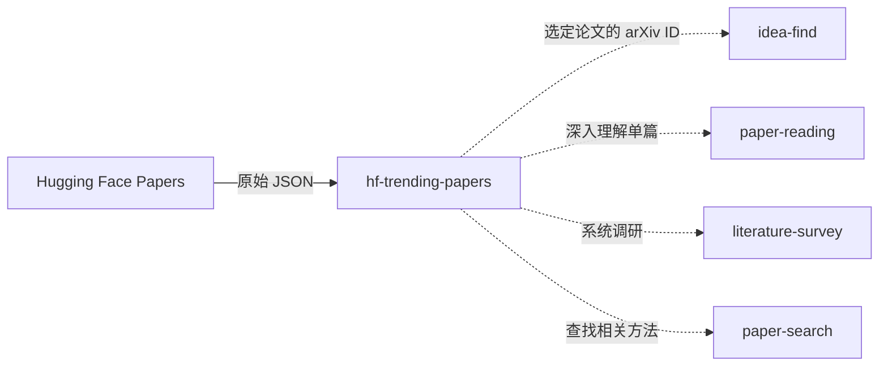

# Hugging Face 热门论文分析

使用官方 `hf papers` CLI 获取论文列表，说明本次 HF 样本中哪些研究内容受到关注，以及哪些论文值得进一步阅读。投票、star、关联资源数量不证明研究质量、创新性、实际使用量或工程成熟度。

## 在系统中的位置



全局流程见 `dl-assistant`。后续工作由用户选择，不自动启动；交接 arXiv ID、已有报告位置与已核查范围。

## 参数与数据获取

使用用户已确定的日期、时间窗、方向与模式，只补问影响执行的缺失信息。两种模式：

- **快速浏览**：获取列表，按研究问题分类，给出少量重点推荐。
- **完整分析**：在列表基础上对重点篇获取详情，并在存在可比历史时分析话题变化。

CLI 参数、版本核对、错误处理见 [references/hf-cli.md](references/hf-cli.md)。先检查 `hf version` 和相关命令帮助，再按用户意图选择日报、周/月列表、近期热门或主题搜索。显式获取 JSON，保留命令与原始返回，不将解析失败当成空列表。

### 日期与关注度的时间

- 将“今天”“昨天”解析为用户时区下的具体日期并告知，分别传入对应的 `YYYY-MM-DD`，不把昨天映射成今天。周使用明确的 ISO 周，月使用明确年月。
- HF 日报日期、论文发表时间、HF 收录时间和指标观测时间分开记录。源站日期边界或排序定义未核实时注明未知，不假设等于用户当地自然日或 arXiv 提交日。
- 用户指定日期无数据或源站报日期不可用时，如实说明，给出错误中提示的最新日期作为可选项；不自动改日期或换成近期热门。没有明确依据时不将空结果归因于周末、假期或发布时间。
- 查询历史日报取得的投票和 star，按本次获取时观测的数值记录；除非有历史快照证据，不能称为该日报日期当时的关注度。不同调用记录各自的获取时间。

### 覆盖范围

报告查询方式、排序、请求上限、返回数量与详情检查数量。HF 是平台样本，不是全部科研论文；达到上限或分页完整性未知时明确写为有限样本，搜索结果也不保证主题覆盖完整。

完整分析通常对 5–10 篇重点论文获取 `info`，按内容与推荐理由选择，不只按 star 或投票。未获取详情的论文仅做列表级介绍，不能将重点篇详情推及整个话题。少量失败保留为未核查，其余可用数据继续处理。

## 保存与重复运行

默认位置为 `<项目>/docs/hf-radar/<时间窗>/run-<UTC时间>/`，尊重用户指定位置。时间标识需足以区分运行；发生冲突时加编号，不覆盖既有报告。

```text
raw/                    每次 list、search、info 的原始 JSON，文件名含调用编号
request-log.json        命令参数、CLI 版本、各调用获取时间、状态、数量与限制
radar.md                用户报告
radar-snapshot.json     用于可比历史观测的快照
```

`request-log.json` 记录请求与实际结果的日期/窗口、时区解释、排序、limit、原始文件路径和错误摘要。命令记录不包含 token 等凭据。正文和快照引用原始文件；相同窗口重跑仍保留独立观测，不累加为多个时间窗。

## 分类、去重与解释

1. 依据原始标题和摘要，按具体研究问题或方法分类。可以参考 HF 的 `ai_keywords` / `ai_summary`，但标明它们是平台生成内容，需与原始摘要核对。缺失时从原始内容归纳，不补造字段。
2. 允许单篇独立话题，不强凑 3–5 组。多标签分类时说明论文可能跨组出现，全部论文总数按稳定 arXiv ID 去重。
3. 投票数与评论数分别记录；缺字段、null、明确的 0 分开表示。列表和详情不一致时保留来源与获取时间，不能无说明混用。
4. GitHub 仓库按规范地址去重，忽略同一仓库的链接形式差异；star 是仓库级指标，不按关联论文数重复相加。关联模型和数据集按各自 ID 去重；只有总数而无完整 ID 列表时不能算精确去重总和，改为逐篇列出并说明限制。跨组重复资源也注明，不重复计算全局总数。
5. 高 star、低投票只说明两类观测不同，不称为被低估；没有 HF 资源关联不等于没有代码或实际应用。较老仓库的累计 star 不能直接与新论文投票比较后判断价值。
6. 机构字段仅描述 HF 返回的归属，注明来源，不假设覆盖所有作者机构。缺失时写未知，不从姓名猜测。同机构出现多篇只报告本样本中的数量，不推断战略投入或发展方向。

## 推荐：关注度与研究内容分开展示

两种模式都将下列内容明确分开。默认重点推荐 3–5 篇，按结果和用户要求调整；其余获取结果仍保存在原始记录与分类清单中。

| 部分 | 写什么 |
| --- | --- |
| 关注度与资源 | 观测时间、投票、评论、仓库 star、HF 关联模型/数据集及缺失项；注明这是平台观测 |
| 研究内容与推荐理由 | 研究什么问题、作者声称的方法或发现、为何值得进一步阅读、信息来源与尚未核实之处 |
| 建议阅读时核查的问题 | 一个具体、可通过正文或实验检查的问题，并在可定位时建议阅读章节 |

推荐理由依据研究内容写，不以“很热门”代替，也不凭摘要确认“首次做到”“显著优于所有方法”等结论。这里只做初步内容介绍，不独立裁定质量或创新性；作者声明与已核实事实分开。

阅读问题应针对该论文，而非泛泛的“有没有创新”。例如：作者声称降低长序列信息损失时，可问“对照是否保持输入长度与计算预算一致，消融能否区分模块收益和额外计算收益？”只有摘要时说明这是待核实问题，不暗示已发现缺陷，也不编造章节位置。没有足够信息时标明需先补摘要或正文。

## 跨时间窗比较

仅在历史记录提供必要信息时执行：

- 比较相同查询类型、主题范围、时间窗长度、排序、limit 和相近获取时点的数据；记录实际覆盖范围与详情检查范围。日报、搜索与近期热门不混为一条趋势序列。
- 同窗口重跑选择一份明确的观测用于窗口统计，不作为多窗重复计数。当前未结束的周/月、截取范围变化或不可比的数据单列，不直接比较升降。
- 标注时间窗重叠。同一论文在重叠窗口持续出现，只是重复观测，不构成新的论文产出；话题中出现不同论文才可描述为新增论文，不能据此确认科研方向整体增长。
- 用话题定义、关键词和研究问题核对分类，不靠名称相同或论文 ID 重叠确认同一话题。跨期可追踪同一 ID 的关注度，但这与话题中新增论文数量分开。
- 每个话题报告样本内篇数、占本次去重论文数的比例、代表论文和缺失范围。多标签时比例和可能超过 100%。投票等累计指标不称为区间新增量，只有可比的逐篇历史观测才报告变化。
- 不在本次返回结果中只代表本次未观察到，不能直接称为降温。历史记录稀少时描述观察，不断言长期趋势或机构战略。
- 旧快照缺少请求范围、获取时间或逐篇指标时，仅作为历史报告参考，不补猜字段后纳入定量比较。

## 报告与快照

`radar.md` 包含：查询范围与限制、研究话题分类、重点推荐（按上述三部分）、完整分类清单或其文件位置、可比历史观察及未核查项。结论使用“本次 HF 样本中”，不将平台样本概括为整个科研社区。

`radar-snapshot.json` 保存以下信息，字段缺失写明，不能默认为零：

- 格式版本、运行标识、CLI 版本、获取时间、请求日期/窗口及其解释、查询类型与参数、实际数量、样本限制、详情检查 ID。
- 逐篇稳定 arXiv ID、研究话题、投票/评论的数值与观测时间、详情来源、机构来源、仓库规范地址及 star、关联资源 ID 或仅有的总数。
- 话题定义、关键词、去重论文 ID 与代表论文；统计口径和分母。保留逐篇数据支持去重，不只保存话题合计。

## 交付与边界

交付报告路径、重点推荐和未完成项，结束当前任务。用户选择后再交 `paper-reading`、`idea-find`、`literature-survey` 或 `paper-search`，不自动执行。

需要全部 arXiv 分类新投稿时使用 `arxiv-daily-paper`；主题检索使用 `paper-search` v2，并核逐来源覆盖限制；以稳定 paper_ref 和已核版本交接，不能将 HF 关注度或工具有限命中当作内容价值或完整领域覆盖。本 skill 不进行独立复现、系统综述或逐篇深入讲解。
