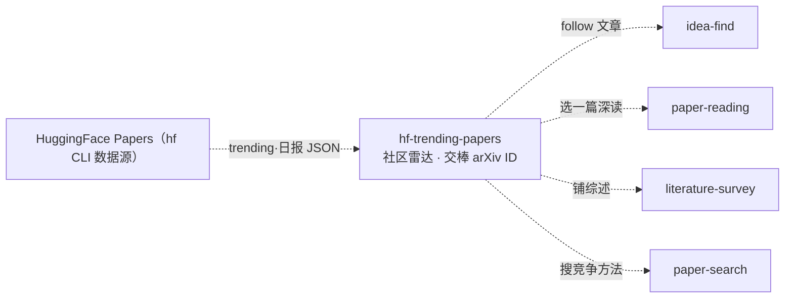
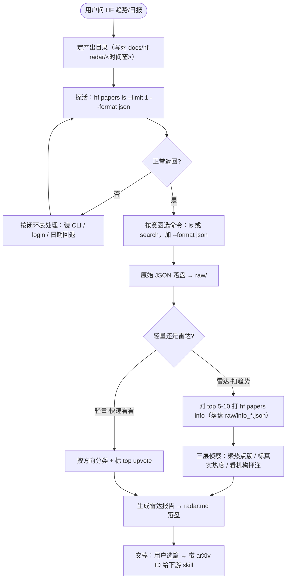

# HuggingFace 热门论文雷达

从 HuggingFace Papers 获取日报 / trending 论文，并把它当成**社区雷达**用——不是把列表丢给用户，而是侦察"社区这阵子在往哪涌"，再把感兴趣的论文衔接到深读 / 调研 / 找 idea。

底层全部走官方 **`hf papers` CLI**（`huggingface_hub` 自带），用 `--format json` 拿结构化数据。运行过程的原始 JSON 和最终雷达报告都落盘到产出目录（见「运行流程」），方便复查。

---

## 在系统里的位置（局部）

本 skill 是 `dl-assistant`（深度学习科研智能体）的配套 skill 之一，角色是**入口雷达**——上游是外部数据源（HF Papers），不接别的 skill；自己是个发散出口，衔接到 4 个可能的下游。图里全虚线 = 用户选了某篇才跳转，不是固定主线；交棒物是**选定篇的 arXiv ID**。



> 整体架构、全局怎么连，看 `dl-assistant` 的「全局 skill 流向图」；本 skill 只画与自己相关的 skill。

---

## 运行流程



**开工第一件事是定产出目录**——写死 `docs/hf-radar/<时间窗>/`（如 `docs/hf-radar/2026-W27/`），不问用户。整个运行过程的中间产物和最终报告都落这儿：

```
<产出目录>/
├── raw/                  # hf 命令原始 JSON，留痕可复查
│   ├── ls_<窗>.json
│   └── info_<arxiv_id>.json
├── radar.md              # 最终雷达报告
└── radar-snapshot.json   # 本次雷达快照（簇/top id/机构/upvotes）——下次跨窗口对比的数据源
```

- **原始 JSON 落 `raw/`**：每跑一次 `ls` / `search` / `info` 都把返回的 JSON 存下来（`ls_2026-W27.json`、`info_2506.12345.json`），数据有出处、事后能核。
- **最终报告落 `radar.md`**：雷达视角的成品（格式见下「趋势雷达」），是对话回复的留档版。
- **TaskList 跟踪流程**（雷达模式）：探活 / 拉取+落盘 / 逐篇 info / 三层侦察+跨窗对比 / radar 报告+快照 / 交棒。轻量场景（快速看看）两三步跑完，不建。
- **符号展示**：会话公式用 Unicode——横切规范见 `dl-assistant` SKILL.md「横切规范」。

下面的步骤是流程图各环节的展开。

### 依赖探活与闭环

本 skill 依赖 `hf` CLI（CLI 用法的权威参考是用户级 skill `hf-cli`，本 skill 只管雷达流程）。**第一次调用前先探活**，失败就按下表闭环处理，不要在数据缺失的情况下硬编结果：

```bash
hf papers ls --sort trending --limit 1 --format json
```

| 探活结果                                                         | 处理                                                                                                                                                                                |
| ---------------------------------------------------------------- | ----------------------------------------------------------------------------------------------------------------------------------------------------------------------------------- |
| 正常返回 JSON                                                    | 继续                                                                                                                                                                                |
| `command not found: hf`                                          | 告诉用户没装 `hf` CLI，给安装命令：`curl -LsSf https://hf.co/cli/install.sh \| bash`（或 `pip install -U huggingface_hub`），装完重试                                               |
| 报认证 / 401 / rate limit 错误                                   | 提示用户登录：`hf auth login`（大多数只读命令匿名可用，**仅在限流或报错时才要求登录**），登录后重试                                                                                 |
| `Bad request: "date" must be less than or equal to "<最新日期>"` | 不是错误——是当天日报还没发布（HF 常下午才更新、周末可能空），本机日期跑在 HF 最新数据之前。错误信息里的 `<最新日期>` 就是回退目标，改用 `--date <最新日期>`（见下方"今日为空"回退） |

> 安装的完整选项（含 Homebrew、uvx 免装）和认证细节见 `references/hf-cli.md`。

### 选命令：按用户意图分流

| 用户说                                | 用哪个                                                                               |
| ------------------------------------- | ------------------------------------------------------------------------------------ |
| "今天 / 昨天有什么新论文"             | `hf papers ls --date today`（报日期错则回退最新一天，见下）                          |
| "这周 / 这个月最火的"                 | `hf papers ls --week <ISO周> --sort trending` 或 `--month <YYYY-MM> --sort trending` |
| "帮我看看 X 月 X 日的"                | `hf papers ls --date YYYY-MM-DD`                                                     |
| "社区最近在关注什么 / 帮我扫一下趋势" | 趋势雷达（见下），默认 `--month` 或 `--week` + `--sort trending`                     |
| "社区有没有在搞 <某方向>"             | `hf papers search "<方向>"`                                                          |

**今日为空 / 日期报错的回退**：`--date today` 常因本机日期跑在 HF 最新数据之前而报 `Bad request: "date" must be less than or equal to "<最新日期>"`。这不是故障——取错误信息里的 `<最新日期>` 直接改用 `--date <最新日期>`，或退一步用 `ls --sort trending`（近期热门），并告诉用户"今天日报还没更新，先看最新一天/近期热门"。

### 趋势雷达：从"列表"到"侦察判断"

这是本 skill 的核心增值。**拿到 trending JSON 后不要只按方向分类罗列**，而是做三层侦察：

1. **聚热点簇**：用每篇的 `ai_keywords`（对 top 篇打 `hf papers info` 取）把论文聚成 3-5 个**有信息量的簇**。注意 `ai_keywords` 只有 HF 已处理过的（较老）论文有值，当天/新近 trending 论文常为 `null` 或缺键——新鲜论文占多数时退化为从 `title` / `summary` 提关键词聚簇，别拿空字段硬聚。
   - **簇名判据**：簇名要让人直接看出"社区在解决什么具体问题 / 走什么技术路线"——正例："Agent 自进化""文档解析 OCR-VLM""记忆系统"；反例："NLP""CV""大模型"（这是分类不是簇，等于没聚）。
   - **成簇判据**：一簇 ≥2 篇才成簇（单篇是孤立热点，单列"其他值得注意"）；3-5 簇覆盖 top 篇七成以上即可，不硬凑。
2. **标真实热度**：upvotes 只是话题热度。对重点篇打 `info` 看 `github_stars` / `num_total_models`——**高 star 低 upvote = 被低估的落地方向**；高 upvote 零生态（无 `github_repo` / `num_total_models` 为 0）= 还在论文期。两者都说出来。
3. **看谁在押注**：用 `organization` 看哪些机构在某簇密集出手（`organization` 只有 `ls --sort trending` 返回，且可为 `null`；日报 `ls` / `search` 没有该字段——拿不到时如实标"机构数据不可得"，不硬编）。
   - **判据**：同一机构在同一簇 ≥2 篇才算"押注"（战略信号），只出一篇不提；多家头部机构同时压一个簇 = 强信号，写进簇定性。
4. **跨窗口对比**（有历史快照时）：扫 `docs/hf-radar/` 下的历史 `radar-snapshot.json`（固定根目录，直接扫、不用问用户）——每个簇标**持续性**：「新冒头」（本窗才出）/「连续 N 窗」（真趋势）/「退潮」（历史有、本窗没）。没有历史标"首次运行，暂无对比"。**匹配规则：簇名不稳定，跨窗判同一簇用 `keywords`∩ + `top_ids`∩ 的重叠，不比簇名**（教训见 `arxiv-daily-paper/references/trend-snapshot.md`）。

> **簇定性词怎么下**（模板里的"话题最热/落地最实/闷声成簇"）：话题最热 = 簇内 upvotes 总量最高；落地最实 = 簇内 github_stars / num_total_models 总量高；闷声成簇 = upvotes 不突出但篇数多或机构密集。定性必须从数据推出，不是修辞。

**输出形态**（填进 `radar.md`，按真实数据填，别套死模板）：

```
## HF 趋势雷达 · <时间窗>

**一句话社区动向**：<这阵子重心压在哪几个簇、什么突然集中冒头>

### 热点簇（ai_keywords + organization 聚）
**簇 1 · <簇名>**（<一句定性：话题最热/落地最实/闷声成簇>）（新冒头 / 连续 N 窗 / 退潮——有历史快照时标）
- <title>（<upvotes>up, <org>, stars:<github_stars>, models:<n>）
- 信号：<谁在推 / 落地度 / 被高估还是低估>
**簇 2 · …**

### 交棒候选
- <arXiv ID> <标题> — <一句推荐理由：为什么值得深读 / 找 idea>
- …
```

交棒候选挑 3-5 篇：优先"高 star 低 upvote"的被低估篇和强信号簇的代表篇。推荐理由要具体（"和 <某工作> 直接竞争""把 <某路线> 第一次做到 <某规模>"），不写"很热门"这种废话。用户选定后把 arXiv ID 交给下游 skill（见「衔接下游」）。

> 跑完落 `radar-snapshot.json`：`{window, clusters: [{name, keywords, top_ids, orgs, upvotes_total}]}`——下次跨窗口对比的数据源。`keywords` 取该簇的 `ai_keywords` 核心项；`name` 仅给人读，跨窗匹配用 `keywords`∩ + `top_ids`∩，不信簇名。

> 打 `info` 有成本（一篇一次调用）——只对**要纳入雷达判断的 top 篇**（通常 top 5-10）打，不要对整个列表打。打的每篇 `info` 返回都落 `raw/info_<id>.json`。

**轻量场景**：用户只想"快速看看今天有啥"，不必做完整雷达——`ls --date today` 后按方向简单分类 + 标 top upvote 即可，雷达视角留给"扫趋势"类请求。

---

## 可用命令（`hf papers`）

全部加 `--format json` 取结构化结果；解析后**自己做雷达视角**，不要把 CLI 的人类表格原样转述。

| 命令                         | 干什么                       | 关键参数                                                                                                                                     |
| ---------------------------- | ---------------------------- | -------------------------------------------------------------------------------------------------------------------------------------------- |
| `hf papers ls`               | 列日报论文                   | `--date today\|YYYY-MM-DD`、`--week 2026-W26`、`--month 2026-06`、`--sort publishedAt\|trending`、`--submitter <user>`、`--limit`（默认 50，**硬上限 100，无分页**——`--month/--week` 只拿得到 top 100，看"最火的"够用，**不能当全量枚举/窄主题回填用**） |
| `hf papers info <arxiv_id>`  | 单篇详情（雷达金矿字段在这） | `--format json`                                                                                                                              |
| `hf papers search "<query>"` | HF 论文库搜索                | `--limit`                                                                                                                                    |

> `hf papers read <id>` 能出全文 markdown，但**深读不在本 skill 做**——交给 paper-reading。

**字段按命令分行**（HF 返回字段随端点/排序方式不稳定，以下为实测口径）：

- `ls` 默认（publishedAt 排序）：`id`(arXiv ID)、`title`、`authors`、`summary`(摘要)、`upvotes`、`comments`、`published_at`、`submitted_at`、`submitted_by_name`（无 `organization`）。
- `ls --sort trending`：同上 + `organization`（可为 `null`）。
- `search`：无 `organization`、无 `submitted_by_name`，其余同日报 `ls`。
- **`info <id>` 额外返回雷达金矿**：`ai_keywords`（聚类信号——仅 HF 已处理的较老论文有值，新鲜论文常为 `null` / 缺键）、`ai_summary`、`github_repo` + `github_stars`（代码热度）、`linked_models` / `linked_datasets` / `num_total_models`（生态落地度）。

> **upvotes 与 comments 是两个独立字段**——upvotes 才是社区投票，comments 是讨论数，别混。

> 各命令的完整参数与全局格式 flag（`--format json/agent/quiet`）见 `references/hf-cli.md`。

---

## 衔接下游（交棒时带 arXiv ID）

雷达给出候选后，用户选了某篇 → 把该篇 **arXiv ID**（`id` 字段）交给下游 skill（去向见上方局部图），别让下游重新搜：深读 → `paper-reading`、铺综述 → `literature-survey`、找 idea → `idea-find`、搜竞争方法 → `paper-search`。

---

## 边界

- **HF 日报 ≠ 全量 arXiv**：HF 是社区精选推荐，不是某分类的全部当日投稿。要"不漏掉某分类新论文"用 `arxiv-daily-paper`；要全面搜某主题用 `paper-search`。
- **upvote/star 不等于质量**：热门可能只因话题新颖。雷达给的是"社区在关注什么"的信号，不是质量背书——提醒用户结合摘要自己判断。
- **不深读、不做综述、不判 gap 值不值得做**——那些是下游 skill 的活，本 skill 只做"侦察 + 交棒"。

> 提示：想全面浏览 arXiv 某分类（如 cs.CV、cs.LG）当日所有新论文，说「看看今天 arxiv cs.CV 的文章」会切到 arxiv-daily-paper。
