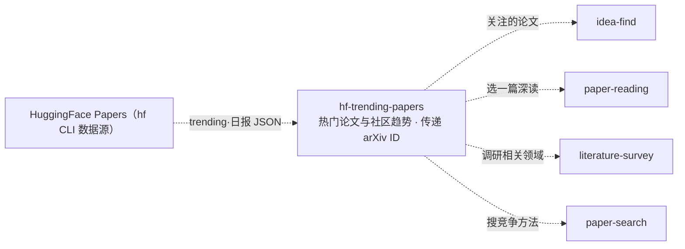
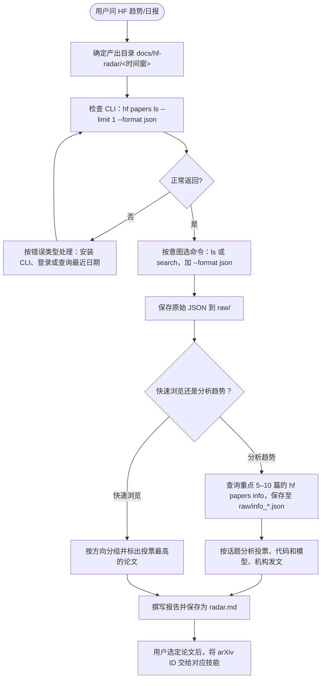

# Hugging Face 热门论文与社区趋势

从 Hugging Face Papers 获取每日论文和热门论文，按话题说明社区在关注什么、关联代码和模型的情况，以及哪些机构在同一话题发表多篇论文。选出值得进一步阅读、调研或用于研究选题的论文。

数据统一通过官方 `hf papers` CLI（由 `huggingface_hub` 提供）获取，使用 `--format json` 输出结构化结果。将原始 JSON 和最终报告保存到产出目录，供复查。

---

## 与其他技能的关系

本技能从 Hugging Face Papers 获取数据。用户选定论文后，可以根据后续任务向图中的四个技能传递该篇论文的 arXiv ID。虚线表示按需交接。



> 完整的技能关系见 `dl-assistant` 的「全局 skill 流向图」。此图只显示本技能直接涉及的交接。

---

## 运行流程



先使用固定产出目录 `docs/hf-radar/<时间窗>/`，例如 `docs/hf-radar/2026-W27/`。原始结果和最终报告都保存在这个目录下。

```
<产出目录>/
├── raw/                  # hf 命令返回的原始 JSON
│   ├── ls_<窗>.json
│   └── info_<arxiv_id>.json
├── radar.md              # 最终趋势报告
└── radar-snapshot.json   # 本次话题分组、代表论文 ID、机构和投票数，供后续比较
```

- **原始 JSON**。每次调用 `ls`、`search` 或 `info` 后，将返回结果保存到 `raw/`，例如 `ls_2026-W27.json` 或 `info_2506.12345.json`，供后续核对。
- **最终报告**。将对话中的趋势报告保存为 `radar.md`，格式见下方「分析社区趋势」。
- **TaskList 跟踪流程**。完整趋势分析按顺序跟踪六项任务：检查 CLI、获取并保存数据、查询重点论文详情、分析话题并比较时间窗、写报告与快照、按需交接。快速浏览只需两三步，跳过任务清单。
- **符号展示**。会话公式用 Unicode，见 `dl-assistant` SKILL.md「所有技能共用的规则」。

下面的步骤是流程图各环节的展开。

### 检查 CLI 并处理错误

本技能依赖 `hf` CLI，完整用法见用户级技能 `hf-cli`。第一次调用前运行以下命令检查 CLI 是否可用。失败时按表处理，缺少数据时如实说明。

```bash
hf papers ls --sort trending --limit 1 --format json
```

| 检查结果                                                         | 处理                                                                                                                                                                                |
| ---------------------------------------------------------------- | ----------------------------------------------------------------------------------------------------------------------------------------------------------------------------------- |
| 正常返回 JSON                                                    | 继续                                                                                                                                                                                |
| `command not found: hf`                                          | 告知用户缺少 `hf` CLI，提供安装命令`curl -LsSf https://hf.co/cli/install.sh \| bash`（或 `pip install -U huggingface_hub`），装完重试                                               |
| 报认证 / 401 / rate limit 错误                                   | 提示用户登录`hf auth login`（大多数只读命令匿名可用，**仅在限流或报错时才要求登录**），登录后重试                                                                                 |
| `Bad request: "date" must be less than or equal to "<最新日期>"` | 当天日报可能尚未发布，HF 常在下午更新，周末也可能没有日报。用错误信息中的 `<最新日期>` 重试，即 `--date <最新日期>`。 |

> 安装的完整选项（含 Homebrew、uvx 免装）和认证细节见 `references/hf-cli.md`。

### 按用户请求选择命令

| 用户说                                | 用哪个                                                                               |
| ------------------------------------- | ------------------------------------------------------------------------------------ |
| "今天 / 昨天有什么新论文"             | `hf papers ls --date today`（报日期错则回退最新一天，见下）                          |
| "这周 / 这个月的热门论文"                 | `hf papers ls --week <ISO周> --sort trending` 或 `--month <YYYY-MM> --sort trending` |
| "帮我看看 X 月 X 日的"                | `hf papers ls --date YYYY-MM-DD`                                                     |
| "社区最近在关注什么 / 看一下近期趋势" | 社区趋势分析（见下），默认 `--month` 或 `--week` + `--sort trending`                     |
| "社区有没有在搞 <某方向>"             | `hf papers search "<方向>"`                                                          |

**今日没有结果或日期超出范围**。`--date today` 可能早于 Hugging Face 更新日报的时间，返回 `Bad request: "date" must be less than or equal to "<最新日期>"`。用提示中的日期重试，即 `--date <最新日期>`，也可改查 `ls --sort trending` 获取近期热门论文。告知用户今天的日报尚未发布，以及实际查看的是哪个日期或范围。

### 分析社区趋势

取得热门论文的 JSON 后，按话题整理社区关注度、关联代码和模型、机构发文。有历史快照时再比较各时间窗。

1. **按具体问题或技术路线分组**。对排名靠前的论文用 `hf papers info` 取得 `ai_keywords`，将论文分成 3–5 组。Hugging Face 已处理的论文才有 `ai_keywords`，当天或近期论文的该字段可能为 `null` 或缺失。如果多数是新论文，就从 `title` 和 `summary` 提取关键词分组。
   - **话题名称**写清论文共同研究的具体问题或路线，例如「Agent 自进化」「文档解析 OCR-VLM」「记忆系统」。「NLP」「CV」「大模型」适合作为大类，话题组需要更具体的名称。
   - **篇数要求**。每组至少 2 篇，只有 1 篇的话题放入「其他值得注意」。3–5 组覆盖排名靠前论文的七成以上即可，按论文内容决定归属。
2. **分别报告社区投票及关联代码和模型的情况**。投票数 `upvotes` 反映话题关注度。用 `info` 查看重点论文的 `github_stars` 和 `num_total_models`。投票较少、GitHub stars 较多的论文，代码可能比投票显示的更受关注，可优先考虑推荐。投票较多却缺少 `github_repo` 或 `num_total_models` 为 0 时，标明投票较多，并注明缺少可见的代码仓库或关联模型。报告这两种情况及对应数据。
3. **查看哪些机构在同一话题发文较多**。使用 `organization` 字段。`ls --sort trending` 返回该字段，值可能为 `null`。按日报列出的 `ls` 结果和 `search` 结果没有该字段。缺少信息时标明「机构数据不可得」。
   - **标注条件**。同一机构在同一话题至少有 2 篇论文时才标注，单篇不单独提及。多家头部机构同时在同一话题发文时，在该话题说明中注明，这是机构发文集中的较强信号。
4. **比较各时间窗**。从固定目录 `docs/hf-radar/` 读取历史 `radar-snapshot.json`。按话题标注「本时间窗首次出现」「连续 N 个时间窗出现」或「本时间窗未出现」（历史中出现过）。没有历史时标明「首次运行，暂无对比」。比较 `keywords` 和 `top_ids` 的重叠情况来识别同一话题，话题名称本身不参与匹配。相关说明见 `arxiv-daily-paper/references/trend-snapshot.md`。

> **话题说明的依据**。「投票总数最高」依据组内 `upvotes` 之和。「代码和模型关注度较高」依据组内 `github_stars` 或 `num_total_models` 的总量。「投票不突出，但论文较多或机构发文集中」同时说明投票与发文情况。每项判断都写明对应数据。

按实际数据撰写 `radar.md`，以下为报告格式示例。

```
## Hugging Face 社区趋势 · <时间窗>

**社区关注概况**：<用一句话说明关注集中在哪些话题，哪些话题在本时间窗集中出现>

### 主要研究话题（根据 ai_keywords 和 organization 分组）
**话题 1 · <话题名称>**（<一句话说明，如投票总数最高、代码和模型关注度较高，或投票不突出但论文较多或机构发文集中>）（<本时间窗首次出现 / 连续 N 个时间窗出现 / 本时间窗未出现，仅有历史快照时标注>）
- <title>（<upvotes>up, <org>, stars:<github_stars>, models:<n>）
- 依据：<哪些机构集中发文、代码和模型的关联情况、投票与代码关注度是否一致>
**话题 2 · …**

### 推荐进一步阅读的论文
- <arXiv ID> <标题>。<一句话说明为什么值得精读，或对研究选题有何参考价值>
- …
```

推荐 3–5 篇论文，优先选择 GitHub stars 较多但投票较少的论文，以及投票、关联代码和模型或机构发文表现突出的话题中的代表论文。给出具体依据，例如与此前哪项工作直接比较，或将哪条路线推进到此前未达到的规模。用户选定后，将 arXiv ID 交给相应技能。

> 完成后保存 `radar-snapshot.json`，用于下次比较时间窗。格式为 `{window, clusters: [{name, keywords, top_ids, orgs, upvotes_total}]}`。`keywords` 记录该组的核心 `ai_keywords`，`name` 只用于展示。跨时间窗匹配依据是 `keywords` 和 `top_ids` 的重叠。

> 每篇论文的 `info` 需要单独调用。只查询用于趋势分析的重点论文，通常为排名前 5–10 篇，并将每篇结果保存到 `raw/info_<id>.json`。

**快速浏览**。用户只想看当天有哪些论文时，用 `ls --date today`，按方向简要分组并标出投票最高的论文。用户想看社区趋势时，按本节做完整分析。

---

## 可用命令（`hf papers`）

用 `--format json` 获取结构化结果。根据数据整理报告，向用户说明各话题的情况。

| 命令                         | 干什么                       | 关键参数                                                                                                                                     |
| ---------------------------- | ---------------------------- | -------------------------------------------------------------------------------------------------------------------------------------------- |
| `hf papers ls`               | 列日报论文                   | `--date today\|YYYY-MM-DD`、`--week 2026-W26`、`--month 2026-06`、`--sort publishedAt\|trending`、`--submitter <user>`、`--limit`（默认 50，最多 100，无分页。`--month/--week` 最多取得排名前 100 篇，适用于查看热门论文。完整列出投稿或按特定主题补查历史论文需要其他查询方式） |
| `hf papers info <arxiv_id>`  | 查询单篇详情及额外字段 | `--format json`                                                                                                                              |
| `hf papers search "<query>"` | HF 论文库搜索                | `--limit`                                                                                                                                    |

> `hf papers read <id>` 可输出全文 Markdown。需要精读时，交给 `paper-reading`。

**各命令返回的字段**。以下是此前核对的结果，字段可随命令和排序方式变化。

- `ls` 默认（publishedAt 排序）：`id`(arXiv ID)、`title`、`authors`、`summary`(摘要)、`upvotes`、`comments`、`published_at`、`submitted_at`、`submitted_by_name`（无 `organization`）。
- `ls --sort trending`：同上 + `organization`（可为 `null`）。
- `search`：无 `organization`、无 `submitted_by_name`，其余同日报 `ls`。
- **`info <id>` 额外返回的字段**包括 `ai_keywords`（用于按话题分组，只有 Hugging Face 已处理的论文有值，近期论文常为 `null` 或缺失）、`ai_summary`、`github_repo` 和 `github_stars`（代码仓库及其关注度），以及 `linked_models`、`linked_datasets` 和 `num_total_models`（关联模型、数据集及模型总数）。

> `upvotes` 是社区投票数，`comments` 是讨论数。

> 各命令的完整参数与全局格式 flag（`--format json/agent/quiet`）见 `references/hf-cli.md`。

---

## 向其他技能交接（附 arXiv ID）

用户选定论文后，直接传递该篇的 arXiv ID（`id` 字段）。精读交给 `paper-reading`，文献调研交给 `literature-survey`，研究选题交给 `idea-find`，查找竞争方法交给 `paper-search`。

---

## 边界

- **Hugging Face 日报**收录社区推荐的论文。需要查看 arXiv 某分类的全部当日投稿时用 `arxiv-daily-paper`，需要全面检索某主题时用 `paper-search`。
- **投票与 GitHub stars**反映关注度，话题新颖也可能带来较多关注。提醒用户结合摘要判断论文质量。
- **本技能的任务**是整理热门论文、分析社区趋势并按需交接。单篇精读、系统综述和研究缺口的价值判断由相应技能处理。

> 提示：想全面浏览 arXiv 某分类（如 cs.CV、cs.LG）当日所有新论文，说「看看今天 arxiv cs.CV 的文章」会切到 arxiv-daily-paper。
