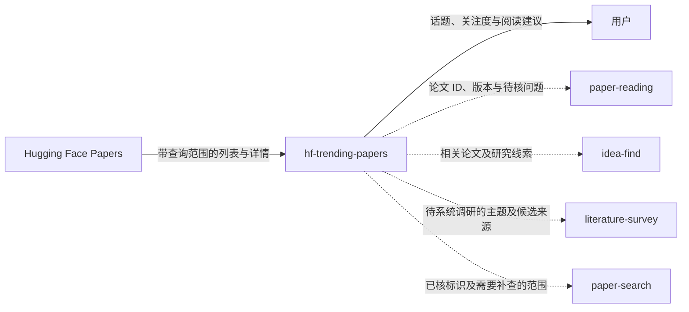
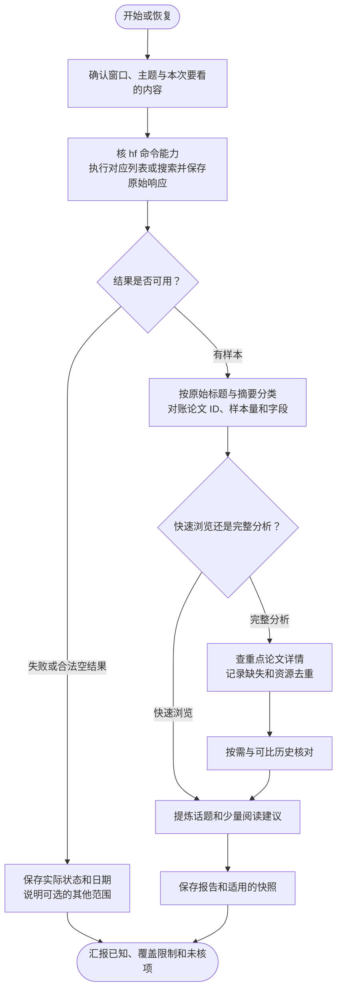

# 查看 Hugging Face 热门论文

帮助用户知道本次 HF 样本包含哪些研究、平台上观察到了什么、哪些论文值得先读。可快速浏览列表，也可对重点论文查详情并结合可比历史看话题变化。

## SKILL 交接关系



全局关系见 [dl-assistant](../dl-assistant/SKILL.md)。查看指定 arXiv 分类的新投稿使用 arxiv-daily-paper。后续是否精读、找研究问题或做调研由用户选择。

## 产出与保存

默认保存到 `docs/hf-radar/<时间窗>/run-<UTC时间>/`。时间窗按实际查询命名，例如 `daily-2025-01-23`、`week-2025-W04` 或 `trending`。主题搜索用可辨识的标识，完整查询保存在请求记录。续做同一运行可补既有文件，新查询另存运行目录。

```text
docs/hf-radar/<时间窗>/run-<UTC时间>/
├── raw/
│   ├── <请求ID>-<类型>.json        # list、search 或 info 的成功原始响应
│   └── <请求ID>-error.txt          # 按需保存已去凭据的错误或无法解析的响应
├── request-log.json               # 实际命令、窗口、观测时间、状态与覆盖
├── radar.md                        # 话题、平台观测、阅读建议和未核项
└── radar-snapshot.json             # 按需保存可复查的逐篇、资源和话题快照
```

可以用同一目录补查已选论文的详情，沿用本次研究范围并增加请求 ID。列表重新获取产生新的观测。

## 运行流程图



## 参考资料列表

| 资料 | 何时读 |
| --- | --- |
| [执行流程](references/workflow.md) | 选择命令、保存观测、分类、读详情及汇报 |
| [hf papers 命令与字段](references/hf-cli.md) | 核本机参数、处理失败和解释返回字段 |
| [请求记录模板](references/request-log-template.json) | 保存每次查询的输入、状态和覆盖 |
| [报告模板](references/report-template.md) · [快照模板](references/radar-snapshot-template.json) | 输出报告、记录样本和比较历史 |

## 分析原则

1. 日报日期、平台时间窗、论文发表时间、HF 收录时间和实际观测时间各自记录。用户指定日期无数据时保留原日期。
2. 话题按原始标题与摘要中的实际研究问题划分。平台生成的关键词和摘要可作为线索，按原文内容复核。
3. 分开记录投票、评论、仓库 star 和关联资源。说明推荐来自研究内容的哪一点，以及读论文时应核什么问题。
4. 跨窗比较先核查询类型、窗口、排序、上限、结束状态和观测条件。按样本解释话题变化和论文的重复出现。
