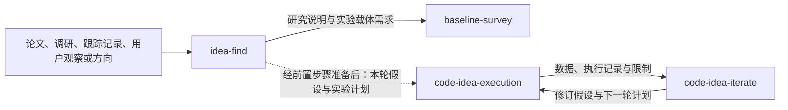

# 研究问题发现与假设形成

帮助用户从论文、方向、观察或初步想法中，形成**定义清楚、值得回答的研究问题**，提出有内容的假设，判断下一步需要什么证据。用户可以没有 idea、没有独家资源或尚未确定会议，agent 仍须主动发现问题、提出解释和方法构想，承担分析与推荐责任。

共同研究逻辑：**提出假设 → 设计实验 → 收集数据 → 分析并修订假设 → 提出下一步假设**。每轮明确“原来相信什么、实际观察到什么、因此改变了什么判断”。idea-find 建立首轮问题、假设及取证计划，不以走完模板或预设论文结论为完成目标。

## 设计实验时明确目标条件

交付实验前，按 [研究条件与低成本实验](../dl-assistant/references/research-conditions.md) 在 spec/plan 写明最终目标、假设依赖的关键条件、拟缩减项及依据、未知和解释范围。agent 要主动推理哪些条件必须保留；不能因为机器较弱默认缩模型、数据、输入或训练长度。handoff 自查的 design/interpretation/budget 必须核对条件表和目标验证触发点；没有合适低成本配置可讨论资源或改问题，不交无法检验原假设的方案。

## 在系统中的位置



这里的虚线不表示跳过选型、环境准备、复现和代码阅读。完整流程见 `dl-assistant`；中期 skill 尚需核对其前置要求。用户要学习领域或逐篇理解时可按需使用 literature-survey / paper-reading，不把先完整阅读某份清单当找问题的硬门槛。

## 核心原则

- **同时发现与推理**：阅读、比较和推理可以生成新问题，检索也可改变或替换候选；不能只否定最先提出的方案，或等用户提供核心创意。
- **主题、问题、假设、实验分开**：“研究压缩”是主题，“希望保留重要信息”是目标；继续明确对象、概念、范围、需要回答的问题与意义，再提出机制/解法假设和可区分的预测。
- **允许未知**：尚无证据与已有反证不同，没有先例不自动降级。检查推理缺口、证据适用条件与取证成本；有支持也不能当成本项目验证完成。
- **证据、创新性和价值分开**：现象成立不自动成为创新点，差异存在不自动重要。方法、理论、发现、评测和系统研究都可以有价值，不默认要求修复现有方法或赢某指标。
- **不预设收益**：区分真实基线结果、研究假设、值得继续的结果与意义有限的结果。没有依据不预测增益，不填任意阈值，不承诺阳性、录用或失败也必能发表。
- **问题改变就重评价值**：收窄、合并、更换解释后，用当前命题说明成功的意义，不能借用原来大问题的价值继续推进小问题。
- **用户参与且有依据**：agent 先讲清背景、已有认识和候选新增，给自己的建议、理由及不确定性；用户不熟悉时帮助理解，不将“你觉得呢”当作完成判断。
- **来源不决定待遇**：用户与 agent 的想法采用相同证据标准，都允许修改或放弃。记录来源只为追溯，不将 agent 的候选视为低一等。

## 两个不同决定

**值得继续讨论**：问题具体，假设有内容，推理可检查，能产生可区分的预测，回答后有意义，并有合理的取证途径。初期尚不完善时明确缺口并帮助改进，不把六项当要求一次填完的淘汰清单。

**值得投入下一轮实验**：上述内容已足以明确本轮要减少哪个未知，设计能区分什么、不能区分什么，结果如何影响后续决定，成本与研究价值相称。用户同意后才细化交接，不因先前投入很多就继续。

## 用户讨论与确认

| 决定 | 何时讨论 | agent 先准备什么 |
| --- | --- | --- |
| 是否愿意研究这个问题 | 开始了解兴趣，问题具体后再讨论 | 为什么重要、已有工作解决了什么、还不知道什么；用户暂时不能判断时先补背景 |
| 回答它是否值得 | 问题和假设初步明确后、详细实验设计前；问题显著变化后重评 | 假设成立的新增、与已有工作差异、重要性及意义有限的可能结果，附推荐与反对理由 |
| 下一步投入多少 | 开始了解总约束，每轮实验前确认具体投入 | 证据需求、成本依据/未知、较便宜选择、结果会影响的决定 |

“OK、继续”可表示授权所讨论的下一步，不得登记为假设成立、创新性已确认或用户已掌握所有技术。不能从沉默推断同意。无需强制一句话只能讨论一件事或五行内写完；按用户能理解的程度展开，保留必要技术内容。

子 agent 可检索、独立分析、比较解释或核查实验设计，不把创造能力限定给主 agent。主 agent 负责综合、去重、证据一致性和推荐。**派前仍先说明数量、任务、输入输出与理由，等用户确认**；按当前工具能力选择类型，每个子 agent 写独立文件，不并发修改累计记录。

## 工作流程

1. **了解起点与总体约束，启动文献检索**：使用本次会话已知目标、背景和资源。只要已有可检索的方向、现象、种子论文或想法，就在形成候选或评价已有构想前，按 [paper-search](../paper-search/SKILL.md) 调用 `get_capabilities`，随后用 `search_papers` 实际检索；有种子论文时可在核实身份后沿引用和相关论文扩展。用户给了论文或已有想法，同样主动补查会影响判断的工作。用户明确要求只基于给定材料时遵守该范围。

   用户无需单独提出查文献，也无需先批准实验或派遣子 agent。续做时可复用覆盖当前问题的可追溯检索记录，按证据缺口补查。paper-search 不可用或来源失败时，记录实际状态，用可用的学术检索途径补查；仍缺证据时把结论标为暂定。
2. **发现问题并形成假设**：结合真实文献、不同结果、失效条件和推理提出候选。解释其前提、替代解释与预测，边查边改，发现更有意义的问题时允许转向。详见 [references/direction.md](references/direction.md)。

   **进入深入讨论前自查（candidate）**：明确对象、概念、范围和问题（problem）；假设或探索目标及可区分预测（hypothesis）；推理、实际检索或复用记录、依据与未知（reasoning）；回答后的新增及重要性（value）；最强反证、替代解释和区分办法（alternatives）。尚无先例但推理和取证合理可以带限制继续，不自动否定。
3. **讨论当前问题的研究价值**：agent 给依据和推荐，帮助用户形成判断。结果可为继续推理/补文献、修改问题、取证或停止；认可价值不自动批准任何实验投入。
4. **设计本轮取证**：选择真正回答关键未知的观察、分析、训练实验或理论检查，不默认分析先行或只改一个模块。比较方案与成本，完成必要的独立核查后与用户确认。详见 [references/method.md](references/method.md)。

   **交实验前自查（handoff）**：重查上述五项，增加设计能否回答问题（design）、各种结果如何改变判断及解释边界（interpretation）、成本依据/未知与已批准投入（budget）。问题收窄后重评价值；影响本轮解释的缺陷先修正，不交下游临时补研究设计。
5. **写好草案并提交审阅**。下一步需要实验时，按 [交接草案说明](references/spec-draft.md) 写好 spec、plan 和 claims。把 spec 和 plan 的文件路径一起发给用户，说明研究问题、取证设计、预算和待决事项，请用户明确确认两份当前版本。一次回复可以确认两份。记录获批版本和范围，两份均获批后才作为可执行研究设计交接。其他情况保存问题、判断、未决项和下一步即可。

每步都可因新证据返回此前问题，不设固定候选数、固定审查轮数或“两次没找到就判方向没价值”。达到约定预算或连续工作无实质进展时，解释已知与未知，和用户决定暂停、换问题或继续，不无限重复生成。

## 自查必须影响下一步

在上述位置按 [共享自查规则](../dl-assistant/references/research-self-check.md) 保存 `self-checks/<阶段>-<唯一标识>.json`。每项写判断、实际依据、未知和行动影响，主动检查最强反证、其他解释和成功后的新增；不能只勾选或把流畅推理当证据。标为needs_revision的项必须先修正/讨论；limited需说明为什么仍可进行当前探索，未知不自动阻塞。自查不是独立核查，不增加逐项用户批准。

```bash
python3 <skills目录>/dl-assistant/scripts/check_research_self_check.py --record <自查.json> --root <项目根> --skill idea-find --stage candidate
# 实验交接前用 --stage handoff
```

输入变化后重新检查并保存新记录；非零时不把受阻行动标ready，保存缺失和下一步。退出0只表示记录结构、引用文件/版本与声明一致，不能证明选题价值或推理成立。独立核查仍按原流程；不能为了通过脚本改标签或编造依据。

## 记录与资料

默认 `<项目>/docs/idea-find/<日期>-<topic-slug>/`，尊重用户指定位置；继续旧工作先核对版本、阅读范围和新证据，不能因已有文件就免于重查。一次新运行目录冲突时加唯一标识，历史产物不覆盖。

- 统一研究原则与结果解读：[references/research-cycle.md](references/research-cycle.md)。
- 文件、进度与讨论决定：[references/output-contract.md](references/output-contract.md)。
- 问题与假设发现：[references/direction.md](references/direction.md)。
- 取证设计与审查：[references/method.md](references/method.md)。
- 三份实验交接草案：[references/spec-draft.md](references/spec-draft.md)。
- 只读取当前要使用的 [templates](references/templates/direction-seed-card.md)，各流程按用途链接具体模板；不为凑齐文件而启动全部模板。

本 skill 不运行 GPU 实验，不选定最终仓库，不代写最终论文。论文、代码与数据线索必须真实可核实；arXiv/DOI/URL、公式和跨机器交接遵循 `dl-assistant` 的“横切规范”。检索/正文工具按实际接口及对应 skill 使用；来源失败、合法空结果、部分数据与未执行分开记录，不保证查全或无人做过。
