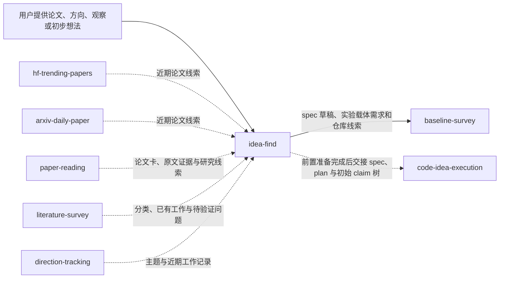
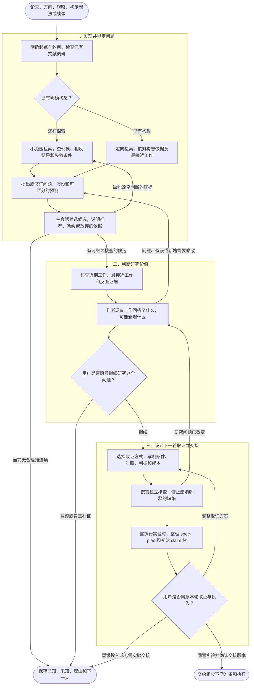

# 研究问题发现与假设形成

帮助用户从论文、方向、观察或初步想法中，形成定义清楚、值得回答的研究问题，提出有内容的假设，判断下一步需要什么证据。

**共同研究流程**

提出假设 → 设计实验 → 收集数据 → 分析并修订假设 → 提出下一步假设。

每轮明确「原来相信什么、实际观察到什么、因此改变了什么判断」。本 skill 负责形成首轮研究问题、假设和取证计划。用户可以尚无成型构想、独家资源或目标会议，主会话仍负责主动取证、提出候选、筛选和推荐。

实验前明确「即使做成功，结果会回答什么科学问题，论文能据此提出什么新结论？」同时说清哪些结果只足以确认实现可用或复现已知现象。实验后由 `code-idea-iterate` 用本项目实际证据重新回答。

## SKILL 交接关系

开始时先找可复用的文献调研。找不到时请用户提供已有结果的路径，或建议先做 `literature-survey`。覆盖过旧时建议重新调研，判断依据和继续方式见 [运行手册](references/research-workflow.md#开始或续做)。

实验执行前按项目实际情况完成选型、环境和数据准备、复现及代码核查，完整交接见 [dl-assistant 全局图](../dl-assistant/SKILL.md#全局-skill-流向图skill-间顺序依赖)。仓库及资源由 `baseline-survey` 核查，实验结果由 `code-idea-iterate` 主持分析并用于后续判断。

## 产出与保存

沿用项目内的 `docs/idea-find/<日期>-<topic-slug>/`。续做时先查看已有证据、决定和未决行动，再进入相应阶段。相同位置已有一轮独立工作时，使用可区分的新目录。

| 进展 | 主要保存内容 |
| --- | --- |
| 发现并界定问题 | `idea-seed.json` 记起点、观察和约束，`candidates/` 记候选、推理依据、筛选结论和待查证据 |
| 判断研究价值 | `literature/literature.json` 保存与当前问题和假设直接相关的证据，引用上游结果与本轮查询、论文笔记。在对应候选记录里更新比较、剩余未知和价值判断 |
| 设计下一轮取证 | `evidence-design/` 保存设计、必要的独立检查和修订。如只需继续读文献或澄清现象，在 `spec.json` 记具体下一步 |
| 实验交接 | `specs/` 保存 `<方向slug>-idea-spec-draft.md`、`<方向slug>-idea-plan-draft.md` 和 `<方向slug>-claim-tree-draft.json` |

`spec.json` 是决策日志，记录用户确认了哪项决定、依据、范围和对应的草案版本。初始 claim 树包含候选总论点及待检验的子论点，证据判断 `evidence_assessment` 为 `pending`，实验取证后更新。研究说明草案保留供仓库选型使用的任务、数据、模型、载体角色与可核实的仓库线索。本轮取证方案写到下游能按批准的条件取证，代码位置和实际运行设定待仓库准备后核实。保存细节见 [产出约定](references/research-records.md)。

## 运行流程图

## 参考资料列表

| 参考资料 | 什么时候读 |
| --- | --- |
| [运行手册](references/research-workflow.md) | 开始或续做时先读。包含检索、筛选、价值判断、取证、交接及完整示例 |
| [产出约定](references/research-records.md) | 核对目录、现有文件和决策记录的格式 |
| [问题发现与文献核查](references/question-discovery.md) | 记录起点，查近期、最接近和反面证据，形成方向判断 |
| [方法与取证设计](references/evidence-design.md) | 深读、设计对照、评估可行性和安排独立检查 |
| [实验交接草案](references/research-handoff.md) | 编写并核对 spec、plan 和初始 claim 树 |
| [研究起点模板](references/templates/research-seed.md) | Step 1 保存用户起点、约束、初查和下一步时使用 |
| [论文检索](../paper-search/SKILL.md)、[论文源码](../tex-mcp/SKILL.md)、[论文 PDF](../pdf-mcp/SKILL.md) | 检索、核对身份和追踪引用，读取固定版本的关键位置 |

按运行手册推进。其他参考用于查文件格式、工具操作和示例，其中的旧步骤编号供定位。候选筛选、取证方式和确认点按本页原则与运行手册执行。

## 核心原则

1. **同时发现与推理。** 阅读、比较和推理可以生成问题。主会话主动查证、提出解释和方法构想，并根据新证据修订或替换候选。用户尚无构想时同样开展这项工作。
2. **主题、问题、假设、实验分开。** 从主题或目标进一步写清对象、条件、具体现象和待回答的问题，再提出解释或解法及其可区分的预测。实验围绕这些预测取证。
3. **允许未知。** 区分尚无证据、已有反证与证据适用条件不同。尚无先例时，可以根据推理质量和取证成本继续核查。有文献支持时，仍要说明本项目是否已取得对应证据。
4. **证据、创新性和价值分别判断。** 分别写现象或机制有何支持、与最接近的工作有何实质差异、回答之后能改变什么认识或实践。方法、理论、发现、评测和系统研究都有可能贡献新结论。
5. **让收益预期服从证据。** 真实基线、假设预测、值得推进的结果和意义有限的结果分别说明。增益预测和实验判据要有出处或推导，尚无依据时保留未知。发表判断需要另外评估。
6. **问题改变就重评价值。** 收窄范围、合并问题或换了解释后，根据修改后的问题重新判断与已有工作的差异、成功的意义和取证是否值得。
7. **用户在理解依据后参与决定。** 主会话先解释背景、最接近工作的结论、候选新增和不确定性，再给筛选结果与推荐。用户决定研究取向和投入，必要时补背景、调整范围或质疑依据。
8. **构想来源使用同一证据标准。** 用户和 agent 的想法都可修改、暂缓或放弃。保留来源和变更依据，供续做和复查。

## 用户协作与确认

| 决定 | 主会话先准备什么 |
| --- | --- |
| 这个问题值得继续研究吗 | 问题和假设、支持及反面证据、最接近工作已解决的范围、回答后的具体新增及建议 |
| 值得投入本轮取证吗 | 本轮关键未知、可区分的结果、实际执行条件、证据解释边界、成本依据和较便宜的选项 |

用户回复「好」或「继续」时，按上下文记录获准的行动和范围。实验交接前请用户确认当前 spec 和 plan，可在一次回复中确认两份。需要委派时，先说明数量、任务、输入输出和理由，等用户确认后再派发。各批结果独立保存，主会话负责综合、去重和推荐。回退与续做按[运行手册](references/research-workflow.md)处理。
